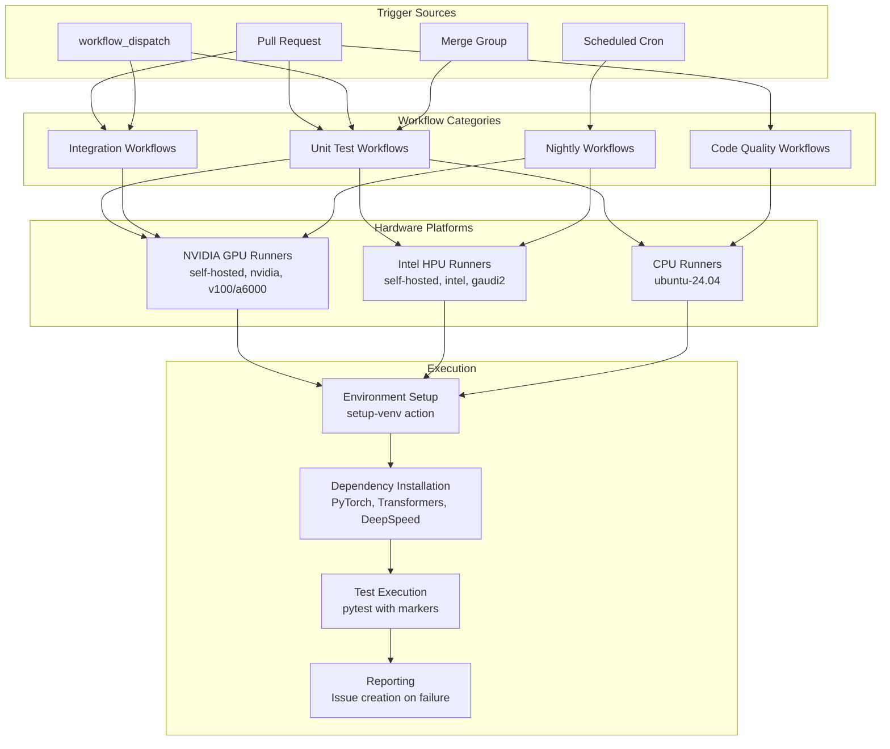

<!-- source: DeepWiki mcp.deepwiki.com · repo deepspeedai/DeepSpeed · page 16 CI/CD Pipeline · fetched 2026-10-21 -->

# CI/CD Pipeline

Relevant source files

The following files were used as context for generating this wiki page:

- [.github/workflows/amd-mi200.yml](.github/workflows/amd-mi200.yml)
- [.github/workflows/aws-accelerate.yml](.github/workflows/aws-accelerate.yml)
- [.github/workflows/aws-torch-latest.yml](.github/workflows/aws-torch-latest.yml)
- [.github/workflows/cpu-torch-latest.yml](.github/workflows/cpu-torch-latest.yml)
- [.github/workflows/formatting.yml](.github/workflows/formatting.yml)
- [.github/workflows/hpu-gaudi2-nightly.yml](.github/workflows/hpu-gaudi2-nightly.yml)
- [.github/workflows/hpu-gaudi2.yml](.github/workflows/hpu-gaudi2.yml)
- [.github/workflows/modal-accelerate.yml](.github/workflows/modal-accelerate.yml)
- [.github/workflows/modal-torch-latest.yml](.github/workflows/modal-torch-latest.yml)
- [.github/workflows/no-torch.yml](.github/workflows/no-torch.yml)
- [.github/workflows/nv-a6000.yml](.github/workflows/nv-a6000.yml)
- [.github/workflows/nv-accelerate-v100.yml](.github/workflows/nv-accelerate-v100.yml)
- [.github/workflows/nv-ds-chat.yml](.github/workflows/nv-ds-chat.yml)
- [.github/workflows/nv-flash-attn.yml](.github/workflows/nv-flash-attn.yml)
- [.github/workflows/nv-inference.yml](.github/workflows/nv-inference.yml)
- [.github/workflows/nv-lightning-v100.yml](.github/workflows/nv-lightning-v100.yml)
- [.github/workflows/nv-mii.yml](.github/workflows/nv-mii.yml)
- [.github/workflows/nv-nightly.yml](.github/workflows/nv-nightly.yml)
- [.github/workflows/nv-pre-compile-ops.yml](.github/workflows/nv-pre-compile-ops.yml)
- [.github/workflows/nv-sd.yml](.github/workflows/nv-sd.yml)
- [.github/workflows/nv-torch-latest-v100.yml](.github/workflows/nv-torch-latest-v100.yml)
- [.github/workflows/nv-torch-nightly-v100.yml](.github/workflows/nv-torch-nightly-v100.yml)
- [.github/workflows/nv-transformers-v100.yml](.github/workflows/nv-transformers-v100.yml)
- [.github/workflows/python.yml](.github/workflows/python.yml)
- [tests/unit/v1/compile/test_compile_autosp.py](tests/unit/v1/compile/test_compile_autosp.py)

## Purpose and Scope

The CI/CD Pipeline system validates DeepSpeed's functionality across multiple hardware platforms, frameworks, and configurations through automated testing workflows. This document covers the GitHub Actions-based continuous integration infrastructure, including workflow organization, trigger mechanisms, test execution patterns, and failure reporting.

For information about the testing framework and utilities used within these workflows, see [Testing Infrastructure](#15). For details on build and compilation system validation, see [Build System and Custom Operations](#9).

## Overview

DeepSpeed's CI/CD system is built on GitHub Actions and executes tests across three primary hardware platforms: NVIDIA GPUs, Intel Gaudi2 HPUs, and CPU-only environments. The system includes unit tests, integration tests with external frameworks, nightly validation runs, and code quality checks.

**Diagram: CI/CD System Architecture**

Sources: [.github/workflows/nv-torch-latest-v100.yml:1-48](), [.github/workflows/hpu-gaudi2.yml:1-140](), [.github/workflows/cpu-torch-latest.yml:1-64](), [.github/workflows/formatting.yml:1-41]()

## Detailed Pipeline Components

The CI/CD system is divided into several specialized areas covered in detail in the following child pages:

### GitHub Actions Workflow Architecture
DeepSpeed utilizes a modular workflow architecture to manage concurrency and failure handling. This includes specialized reusable actions like `setup-venv` and complex concurrency group definitions to optimize runner usage.
For details, see [GitHub Actions Workflow Architecture](#16.1).

### NVIDIA GPU Testing
NVIDIA testing covers a wide range of hardware (V100, A6000) and software stacks. This includes validation for the core engine, inference v1 and v2, and specialized features like FlashAttention and Stable Diffusion.
For details, see [NVIDIA GPU Testing](#16.2).

### Multi-Platform Testing
DeepSpeed maintains first-class support for diverse accelerators. This includes dedicated pipelines for Intel Gaudi2 HPUs, AMD ROCm (MI200), and CPU-only environments, as well as cloud-based testing on Modal.
For details, see [Multi-Platform Testing](#16.3).

### Test Categorization and Execution
Tests are organized via `pytest` markers (e.g., `sequential`, `inference`, `nightly`) to balance execution speed with coverage. The pipeline uses `pytest-xdist` for parallelization and manages platform-specific test exclusion lists.
For details, see [Test Categorization and Execution](#16.4).

## Workflow Organization

DeepSpeed's CI workflows are organized into distinct YAML files in `.github/workflows/`, each targeting specific platforms, test types, or integration scenarios.

### Workflow File Summary

| Workflow File | Purpose | Hardware | Trigger |
|--------------|---------|----------|---------|
| `nv-torch-latest-v100.yml` | Core unit tests with latest PyTorch | V100 GPU | PR, merge_group, schedule |
| `nv-inference.yml` | Inference v1 system tests | V100 GPU | PR, merge_group, schedule |
| `nv-a6000.yml` | Inference v2 and MII tests | A6000 GPU | PR, workflow_dispatch |
| `nv-accelerate-v100.yml` | HF Accelerate integration | V100 GPU | PR, merge_group, schedule |
| `nv-transformers-v100.yml` | HF Transformers integration | V100 GPU | PR, merge_group, schedule |
| `nv-mii.yml` | DeepSpeed-MII integration | V100 GPU | PR, merge_group, schedule |
| `nv-ds-chat.yml` | DeepSpeed-Chat integration | V100 GPU | PR, schedule |
| `hpu-gaudi2.yml` | Core tests on Intel Gaudi2 | Gaudi2 HPU | PR, schedule |
| `amd-mi200.yml` | Core tests on AMD ROCm | MI200 GPU | PR, schedule |
| `cpu-torch-latest.yml` | CPU-only tests | Ubuntu 24.04 | PR, merge_group, schedule |
| `formatting.yml` | Code style checks | Ubuntu 22.04 | PR, merge_group, schedule |

Sources: [.github/workflows/nv-torch-latest-v100.yml:1-14](), [.github/workflows/nv-inference.yml:1-17](), [.github/workflows/nv-a6000.yml:1-16](), [.github/workflows/hpu-gaudi2.yml:1-10](), [.github/workflows/amd-mi200.yml:1-10]()

## Trigger Mechanisms

Workflows are triggered by multiple mechanisms to provide comprehensive validation:

*   **Pull Request Triggers**: Uses path filters to optimize resource usage (e.g., `hpu-gaudi2.yml` triggers on `accelerator/hpu_accelerator.py`) [.github/workflows/hpu-gaudi2.yml:7-27]().
*   **Scheduled (Cron) Triggers**: Nightly tests run daily at midnight UTC [.github/workflows/nv-inference.yml:16-17]().
*   **Manual Dispatch**: Support for `workflow_dispatch` with custom inputs like `mii_branch` [.github/workflows/nv-a6000.yml:10-16]().
*   **Merge Group**: Validates the merge queue to ensure `master` branch stability [.github/workflows/cpu-torch-latest.yml:35-36]().

## Test Execution Pattern

All workflows follow a consistent execution pattern:

```mermaid
graph LR
    Checkout["actions/checkout@v4"] --> SetupVenv["setup-venv action<br/>or container image"]
    SetupVenv --> InstallPyTorch["Install PyTorch<br/>pip install torch"]
    InstallPyTorch --> InstallTransformers["Install Transformers<br/>git clone + pip install"]
    InstallTransformers --> InstallDS["Install DeepSpeed<br/>pip install .[dev,...]"]
    InstallDS --> DSReport["Run ds_report<br/>Verify environment"]
    DSReport --> RunTests["Execute pytest<br/>with test markers"]
    RunTests --> CreateIssue["Create GitHub Issue<br/>if nightly failure"]
```

**Diagram: Standard Test Execution Flow**

Sources: [.github/workflows/nv-torch-latest-v100.yml:24-48](), [.github/workflows/hpu-gaudi2.yml:102-139](), [.github/workflows/cpu-torch-latest.yml:86-190]()

### Failure Handling

Scheduled workflows automatically create GitHub issues on failure to alert maintainers. This is managed via the `JasonEtco/create-an-issue` action using the `.github/ISSUE_TEMPLATE/ci_failure_report.md` template [.github/workflows/nv-nightly.yml:55-63]().

Sources: [.github/workflows/nv-nightly.yml:55-63](), [.github/workflows/amd-mi200.yml:78-85](), [.github/workflows/nv-ds-chat.yml:73-81]()

---

