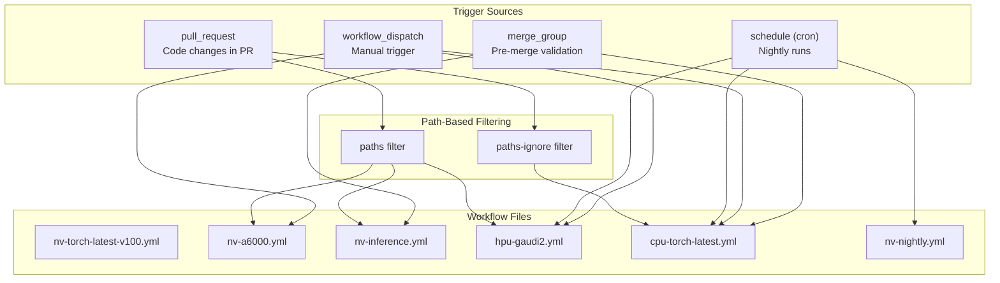
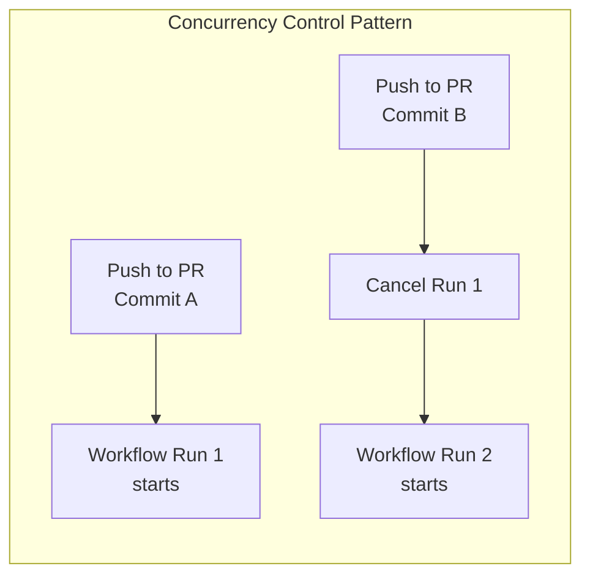
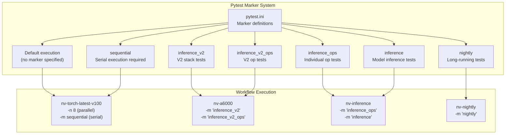
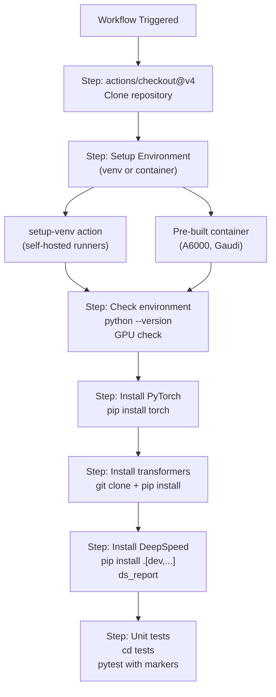

<!-- source: DeepWiki mcp.deepwiki.com · repo deepspeedai/DeepSpeed · page 16.1 GitHub Actions Workflow Architecture · fetched 2026-10-21 -->

# GitHub Actions Workflow Architecture

<details>
<summary>Relevant source files</summary>

The following files were used as context for generating this wiki page:

- [.github/workflows/amd-mi200.yml](.github/workflows/amd-mi200.yml)
- [.github/workflows/aws-accelerate.yml](.github/workflows/aws-accelerate.yml)
- [.github/workflows/aws-torch-latest.yml](.github/workflows/aws-torch-latest.yml)
- [.github/workflows/cpu-torch-latest.yml](.github/workflows/cpu-torch-latest.yml)
- [.github/workflows/formatting.yml](.github/workflows/formatting.yml)
- [.github/workflows/hpu-gaudi2-nightly.yml](.github/workflows/hpu-gaudi2-nightly.yml)
- [.github/workflows/hpu-gaudi2.yml](.github/workflows/hpu-gaudi2.yml)
- [.github/workflows/modal-accelerate.yml](.github/workflows/modal-accelerate.yml)
- [.github/workflows/modal-torch-latest.yml](.github/workflows/modal-torch-latest.yml)
- [.github/workflows/no-torch.yml](.github/workflows/no-torch.yml)
- [.github/workflows/nv-a6000.yml](.github/workflows/nv-a6000.yml)
- [.github/workflows/nv-accelerate-v100.yml](.github/workflows/nv-accelerate-v100.yml)
- [.github/workflows/nv-ds-chat.yml](.github/workflows/nv-ds-chat.yml)
- [.github/workflows/nv-flash-attn.yml](.github/workflows/nv-flash-attn.yml)
- [.github/workflows/nv-inference.yml](.github/workflows/nv-inference.yml)
- [.github/workflows/nv-lightning-v100.yml](.github/workflows/nv-lightning-v100.yml)
- [.github/workflows/nv-mii.yml](.github/workflows/nv-mii.yml)
- [.github/workflows/nv-nightly.yml](.github/workflows/nv-nightly.yml)
- [.github/workflows/nv-pre-compile-ops.yml](.github/workflows/nv-pre-compile-ops.yml)
- [.github/workflows/nv-sd.yml](.github/workflows/nv-sd.yml)
- [.github/workflows/nv-torch-latest-v100.yml](.github/workflows/nv-torch-latest-v100.yml)
- [.github/workflows/nv-torch-nightly-v100.yml](.github/workflows/nv-torch-nightly-v100.yml)
- [.github/workflows/nv-transformers-v100.yml](.github/workflows/nv-transformers-v100.yml)
- [.github/workflows/python.yml](.github/workflows/python.yml)
- [tests/unit/v1/compile/test_compile_autosp.py](tests/unit/v1/compile/test_compile_autosp.py)

</details>


## Purpose and Scope

This page documents the GitHub Actions workflow architecture that powers DeepSpeed's continuous integration system. It covers workflow triggers, concurrency control mechanisms, test selection via pytest markers, and the common structure shared across different hardware platforms including NVIDIA GPUs, Intel Gaudi HPUs, and CPU-only environments.

For details on specific platform testing (NVIDIA V100/A6000, Intel Gaudi2, CPU), see [NVIDIA GPU Testing](#16.2) and [Multi-Platform Testing](#16.3). For the distributed test framework itself, see [Testing Infrastructure](#15).

## Workflow Trigger System

DeepSpeed workflows use multiple trigger types to balance comprehensive testing with efficient resource usage. Each workflow can be activated through different mechanisms depending on development needs.

### Trigger Types



**Sources:** [.github/workflows/nv-a6000.yml:3-16](), [.github/workflows/hpu-gaudi2.yml:3-27](), [.github/workflows/cpu-torch-latest.yml:3-38](), [.github/workflows/nv-inference.yml:3-17]()

| Trigger Type | Purpose | Example Usage | Workflows |
|-------------|---------|---------------|-----------|
| `pull_request` | Validate changes in PRs | Code modifications trigger relevant tests | Most workflows |
| `schedule` | Nightly regression testing | `cron: "0 0 * * *"` runs daily at midnight | `nv-nightly.yml`, `hpu-gaudi2.yml`, `amd-mi200.yml` |
| `workflow_dispatch` | Manual execution | Developers trigger specific test suites with custom inputs | `nv-a6000.yml`, `hpu-gaudi2.yml`, `cpu-torch-latest.yml` |
| `merge_group` | Pre-merge validation | Final checks before merging to master branch | `cpu-torch-latest.yml`, `nv-inference.yml` |

**Sources:** [.github/workflows/nv-nightly.yml:1-6](), [.github/workflows/hpu-gaudi2.yml:3-6](), [.github/workflows/cpu-torch-latest.yml:35-36]()

### Path-Based Trigger Filtering

Workflows use path filters to run only when relevant code changes. This reduces unnecessary CI runs and saves resources.

**Inference v2 workflow** [.github/workflows/nv-a6000.yml:4-9]() triggers only for:
- CUDA accelerator changes (`accelerator/cuda_accelerator.py`)
- Inference v2 code modifications (`deepspeed/inference/v2/**`)
- Inference v2 test updates (`tests/unit/inference/v2/**`)
- Workflow file changes

**Intel Gaudi workflow** [.github/workflows/hpu-gaudi2.yml:7-27]() monitors specific runtime components:
- Core runtime files (`engine.py`, optimizers, ZeRO stages 1/2/3)
- HPU-specific accelerator and op builders (`accelerator/hpu_accelerator.py`, `op_builder/hpu/**`)
- Parameter offloading and coordination logic

**CPU workflow** uses a `paths-filter` action [.github/workflows/cpu-torch-latest.yml:61-72]() to determine if tests should run, excluding documentation and inference v2 code:
```yaml
filters: |
  run_tests:
    - '**'
    - '!docs/**'
    - '!blogs/**'
    - '!deepspeed/inference/v2/**'
    - '!tests/unit/inference/v2/**'
```

**Sources:** [.github/workflows/nv-a6000.yml:4-9](), [.github/workflows/hpu-gaudi2.yml:7-27](), [.github/workflows/cpu-torch-latest.yml:66-72]()

## Concurrency Control

All DeepSpeed workflows implement concurrency control to prevent resource conflicts and wasted compute when new commits are pushed during active runs.



**Sources:** [.github/workflows/nv-torch-latest-v100.yml:3-5]()

### Concurrency Configuration

Every workflow uses the same pattern:

```yaml
concurrency:
  group: ${{ github.workflow }}-${{ github.ref }}
  cancel-in-progress: true
```

**Configuration explained:**
- **`group`**: Creates a unique concurrency group per workflow and branch/PR.
  - `${{ github.workflow }}`: Workflow name (e.g., `nv-torch-latest-v100`).
  - `${{ github.ref }}`: Git reference (e.g., `refs/pull/123/merge`).
- **`cancel-in-progress: true`**: Automatically cancels older runs in the same group when new commits arrive.

**Sources:** [.github/workflows/nv-torch-latest-v100.yml:3-5](), [.github/workflows/nv-a6000.yml:18-20](), [.github/workflows/hpu-gaudi2.yml:29-31]()

## Test Selection via Pytest Markers

DeepSpeed uses pytest markers to categorize tests and enable selective execution across different workflows. This allows workflows to run specific test subsets appropriate for their hardware and time constraints.



**Sources:** [tests/pytest.ini:1-14]()

### Marker Definitions

The pytest configuration defines markers in [tests/pytest.ini:1-14]():

| Marker | Purpose | Workflows |
|--------|---------|-----------|
| `sequential` | Tests that must be run one at a time to avoid interference | `nv-torch-latest-v100`, `amd-mi200` |
| `inference` | Legacy inference model tests | `nv-inference` |
| `inference_ops` | Individual inference operator tests | `nv-inference` |
| `inference_v2` | Inference tests for the v2 (FastGen) stack | `nv-a6000` |
| `inference_v2_ops` | Op-level tests for the v2 stack | `nv-a6000` |
| `nightly` | Long-running or resource-intensive tests | `nv-nightly` |
| `stable_diffusion` | Tests specifically for Stable Diffusion integration | `nv-sd` |

**Sources:** [tests/pytest.ini:3-13](), [.github/workflows/nv-inference.yml:63-64](), [.github/workflows/nv-a6000.yml:62-63]()

### Workflow Test Selection Examples

**NVIDIA V100 - Parallel and Sequential** [.github/workflows/nv-torch-latest-v100.yml:42-47]():
```bash
# Parallel execution of non-marked tests (8 workers)
pytest -x $PYTEST_OPTS --instafail --timeout 600 --forked -n 8 unit/

# Sequential execution of sequential-marked tests
pytest $PYTEST_OPTS --instafail --timeout 600 --forked -m 'sequential' unit/
```

**NVIDIA A6000 - Inference V2** [.github/workflows/nv-a6000.yml:58-63]():
```bash
# Inference v2 stack tests
python -m pytest --color=yes --durations=0 --verbose -rF -m 'inference_v2' unit/
# Inference v2 operator tests
python -m pytest --color=yes --durations=0 --verbose -rF -m 'inference_v2_ops' unit/
```

**Sources:** [.github/workflows/nv-torch-latest-v100.yml:42-47](), [.github/workflows/nv-a6000.yml:58-63]()

## Common Workflow Structure

All DeepSpeed workflows follow a consistent pattern with standard steps for environment setup, dependency installation, and test execution.



**Sources:** [.github/workflows/nv-torch-latest-v100.yml:8-47](), [.github/workflows/nv-a6000.yml:23-62]()

### Environment Setup

DeepSpeed uses two primary environments:
1.  **Virtual Environments**: Managed by a local composite action `setup-venv` for self-hosted V100 and MI200 runners [.github/workflows/nv-torch-latest-v100.yml:14-15](), [.github/workflows/amd-mi200.yml:31-32]().
2.  **Containers**: Docker-based execution for A6000 and Gaudi2 platforms to ensure a consistent driver/SDK environment [.github/workflows/nv-a6000.yml:26-30](), [.github/workflows/hpu-gaudi2.yml:42-46]().

### Dependency Installation Logic

*   **PyTorch**: Usually installed with a specific index URL for the target accelerator (e.g., `https://download.pytorch.org/whl/cu124` for NVIDIA or `https://download.pytorch.org/whl/rocm6.0` for AMD) [.github/workflows/nv-inference.yml:36](), [.github/workflows/amd-mi200.yml:36]().
*   **Transformers**: Frequently cloned from the Hugging Face repository and installed from source to test against the latest changes or specific stable SHAs [.github/workflows/nv-torch-latest-v100.yml:23-30](), [.github/workflows/nv-mii.yml:29-36]().
*   **DeepSpeed**: Installed using `pip install .[dev,1bit,autotuning,inf]` to include all optional components required for CI [.github/workflows/nv-inference.yml:50]().

**Sources:** [.github/workflows/nv-inference.yml:36-50](), [.github/workflows/amd-mi200.yml:36](), [.github/workflows/nv-torch-latest-v100.yml:23-30]()

## Hardware-Specific Runner Configuration

DeepSpeed workflows target different hardware platforms using GitHub Actions self-hosted runners with specific labels.

| Runner Labels | Hardware | Workflows |
|---------------|----------|-----------|
| `[self-hosted, nvidia, cu124, v100]` | NVIDIA V100 | `nv-torch-latest-v100`, `nv-inference`, `nv-mii`, `nv-nightly` |
| `[self-hosted, nvidia, a6000]` | NVIDIA A6000 | `nv-a6000` |
| `[self-hosted, intel, gaudi2]` | Intel Gaudi2 | `hpu-gaudi2`, `hpu-gaudi2-nightly` |
| `[self-hosted, amd, mi200]` | AMD MI200 | `amd-mi200` |
| `ubuntu-24.04` | CPU | `cpu-torch-latest` |

**Sources:** [.github/workflows/nv-torch-latest-v100.yml:9](), [.github/workflows/nv-a6000.yml:25](), [.github/workflows/hpu-gaudi2.yml:41](), [.github/workflows/amd-mi200.yml:24](), [.github/workflows/cpu-torch-latest.yml:78]()

## Failure Handling and Issue Creation

For nightly and scheduled runs, DeepSpeed uses the `JasonEtco/create-an-issue` action to automatically report regressions.

```yaml
- name: Open GitHub issue if nightly CI fails
  if: ${{ failure() && (github.event_name == 'schedule') }}
  uses: JasonEtco/create-an-issue@v2
  env:
    GITHUB_TOKEN: ${{ secrets.GITHUB_TOKEN }}
  with:
    filename: .github/ISSUE_TEMPLATE/ci_failure_report.md
    update_existing: true
```

This mechanism ensures that transient failures in nightly tests are tracked without manual intervention.

**Sources:** [.github/workflows/nv-nightly.yml:55-62](), [.github/workflows/amd-mi200.yml:78-85](), [.github/workflows/nv-ds-chat.yml:73-80]()

## Intel Gaudi Test List Configuration

The Intel Gaudi workflows utilize a specific environment variable `TEST_LIST` to define a whitelist of tests that are compatible with the HPU accelerator [.github/workflows/hpu-gaudi2.yml:51-99]().

The workflow processes this list using `awk` to generate a pytest `-k` filter string:
```bash
TEST_LIST=$(echo "$TEST_LIST" | awk 'NF{printf "%s%s", (NR>1 ? " or " : ""), $0} END{if (NR>1) print ""}')
pytest --verbose unit/ -k "${TEST_LIST}"
```

This allows the HPU CI to run a subset of the full DeepSpeed test suite that has been validated for Gaudi hardware.

**Sources:** [.github/workflows/hpu-gaudi2.yml:51-139]()

---

