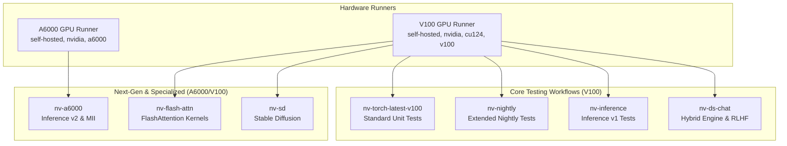
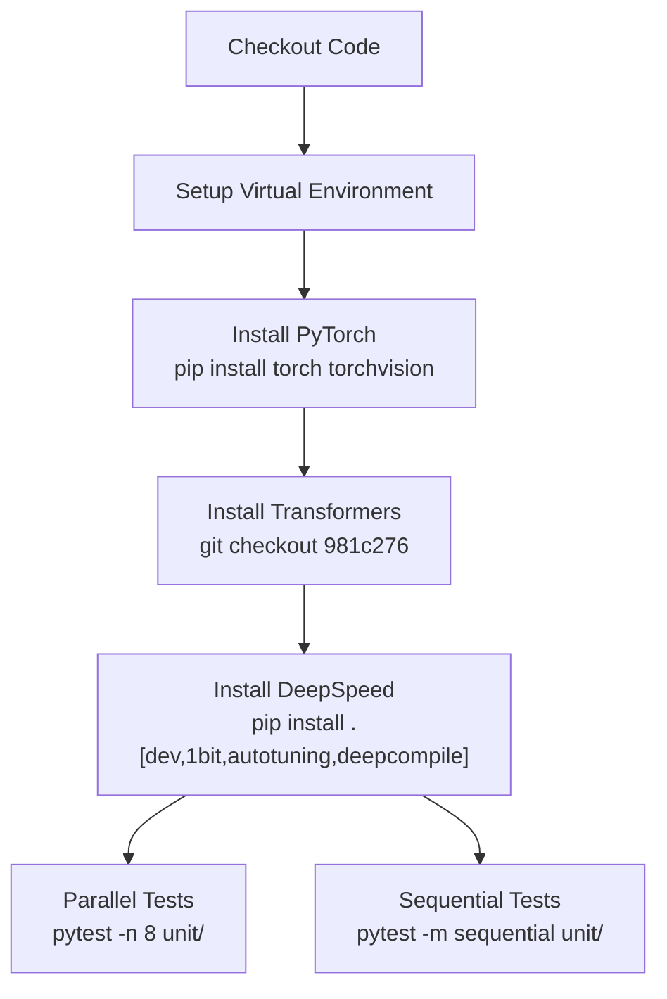
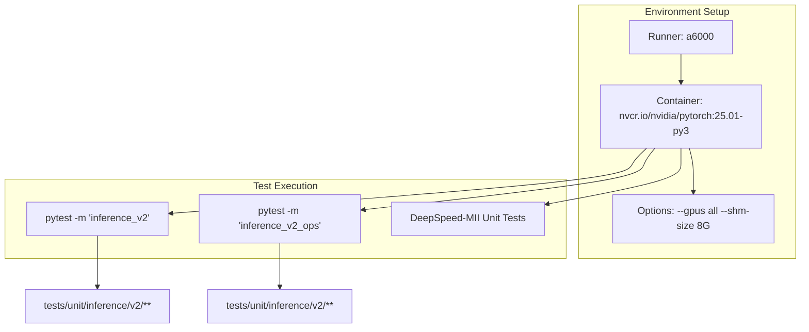

<!-- source: DeepWiki mcp.deepwiki.com · repo deepspeedai/DeepSpeed · page 16.2 NVIDIA GPU Testing · fetched 2026-10-21 -->

# NVIDIA GPU Testing

<details>
<summary>Relevant source files</summary>

The following files were used as context for generating this wiki page:

- [.github/workflows/amd-mi200.yml](.github/workflows/amd-mi200.yml)
- [.github/workflows/aws-accelerate.yml](.github/workflows/aws-accelerate.yml)
- [.github/workflows/aws-torch-latest.yml](.github/workflows/aws-torch-latest.yml)
- [.github/workflows/cpu-torch-latest.yml](.github/workflows/cpu-torch-latest.yml)
- [.github/workflows/formatting.yml](.github/workflows/formatting.yml)
- [.github/workflows/hpu-gaudi2-nightly.yml](.github/workflows/hpu-gaudi2-nightly.yml)
- [.github/workflows/hpu-gaudi2.yml](.github/workflows/hpu-gaudi2.yml)
- [.github/workflows/modal-accelerate.yml](.github/workflows/modal-accelerate.yml)
- [.github/workflows/modal-torch-latest.yml](.github/workflows/modal-torch-latest.yml)
- [.github/workflows/no-torch.yml](.github/workflows/no-torch.yml)
- [.github/workflows/nv-a6000.yml](.github/workflows/nv-a6000.yml)
- [.github/workflows/nv-accelerate-v100.yml](.github/workflows/nv-accelerate-v100.yml)
- [.github/workflows/nv-ds-chat.yml](.github/workflows/nv-ds-chat.yml)
- [.github/workflows/nv-flash-attn.yml](.github/workflows/nv-flash-attn.yml)
- [.github/workflows/nv-inference.yml](.github/workflows/nv-inference.yml)
- [.github/workflows/nv-lightning-v100.yml](.github/workflows/nv-lightning-v100.yml)
- [.github/workflows/nv-mii.yml](.github/workflows/nv-mii.yml)
- [.github/workflows/nv-nightly.yml](.github/workflows/nv-nightly.yml)
- [.github/workflows/nv-pre-compile-ops.yml](.github/workflows/nv-pre-compile-ops.yml)
- [.github/workflows/nv-sd.yml](.github/workflows/nv-sd.yml)
- [.github/workflows/nv-torch-latest-v100.yml](.github/workflows/nv-torch-latest-v100.yml)
- [.github/workflows/nv-torch-nightly-v100.yml](.github/workflows/nv-torch-nightly-v100.yml)
- [.github/workflows/nv-transformers-v100.yml](.github/workflows/nv-transformers-v100.yml)
- [.github/workflows/python.yml](.github/workflows/python.yml)
- [tests/unit/v1/compile/test_compile_autosp.py](tests/unit/v1/compile/test_compile_autosp.py)

</details>


## Purpose and Scope

This document describes DeepSpeed's NVIDIA GPU testing infrastructure, which validates training and inference functionality on NVIDIA CUDA-capable hardware. The CI system primarily utilizes self-hosted V100 and A6000 GPUs to run comprehensive test suites covering core functionality, inference optimizations (v1 and v2), Stable Diffusion, and integration with external libraries like HuggingFace Transformers and Accelerate.

For information about the overall CI/CD workflow architecture and trigger mechanisms, see page 16.1. For testing on other hardware platforms (Intel Gaudi2 HPU, CPU, etc.), see page 16.3.

## NVIDIA Testing Infrastructure Overview

DeepSpeed's NVIDIA testing infrastructure consists of multiple specialized workflows that target different hardware architectures and software components:



**Sources:** [.github/workflows/nv-torch-latest-v100.yml:9](), [.github/workflows/nv-inference.yml:26](), [.github/workflows/nv-a6000.yml:25](), [.github/workflows/nv-ds-chat.yml:29](), [.github/workflows/nv-nightly.yml:13]()

## Runner Configurations

Workflows execute on self-hosted runners with specific environment configurations:

| Hardware | Runner Labels | Typical Image/Environment |
|----------|---------------|---------------------------|
| **V100** | `[self-hosted, nvidia, cu124, v100]` | CUDA 12.4, PyTorch 2.1+ |
| **A6000**| `[self-hosted, nvidia, a6000]` | `nvcr.io/nvidia/pytorch:25.01-py3` |

**Sources:** [.github/workflows/nv-torch-latest-v100.yml:9](), [.github/workflows/nv-a6000.yml:25-27]()

---

## Core Training and Inference Workflows

### Standard Unit Testing: nv-torch-latest-v100
The `nv-torch-latest-v100` workflow provides the primary validation for the core engine.

**Workflow Diagram: nv-torch-latest-v100 Execution Flow**



**Sources:** [.github/workflows/nv-torch-latest-v100.yml:17-48]()

### Inference v1 Testing: nv-inference
The `nv-inference` workflow targets the legacy inference engine (v1), focusing on module injection and custom kernels.

*   **Trigger Paths:** Monitored on `deepspeed/inference/**` but excludes `v2` directories [[.github/workflows/nv-inference.yml:10-11]]().
*   **Key Command:** `pytest -m 'inference_ops'` and `pytest -m 'inference'` [[.github/workflows/nv-inference.yml:63-64]]().
*   **DeepSpeed Extras:** Installed with `[dev,1bit,autotuning,inf]` [[.github/workflows/nv-inference.yml:50]]().

**Sources:** [.github/workflows/nv-inference.yml:1-67]()

---

## Next-Generation Inference (v2) on A6000

The `nv-a6000` workflow is dedicated to the Inference v2 (FastGen) engine and DeepSpeed-MII integration. It utilizes a modern NVIDIA container (`pytorch:25.01-py3`) and targets the `a6000` hardware label.

### Inference v2 Workflow Detail



**Key Configuration:**
*   **SHM Size:** Configured to `8G` to support multi-GPU communication and ragged batching tests [[.github/workflows/nv-a6000.yml:30]]().
*   **JIT Optimization:** `unset TORCH_CUDA_ARCH_LIST` is called to ensure kernels are JIT-compiled only for the A6000 architecture (Ampere) [[.github/workflows/nv-a6000.yml:60]]().
*   **MII Integration:** Clones and installs `DeepSpeed-MII` to validate the orchestration layer [[.github/workflows/nv-a6000.yml:71-75]]().

**Sources:** [.github/workflows/nv-a6000.yml:1-76]()

---

## Specialized Workflows

### DeepSpeed-Chat and Hybrid Engine: nv-ds-chat
This workflow validates the `HybridEngine` which bridges training and inference for RLHF pipelines.

*   **Monitored Files:** `deepspeed/runtime/hybrid_engine.py`, `deepspeed/runtime/zero/stage3.py` [[.github/workflows/nv-ds-chat.yml:15-16]]().
*   **Integration:** Clones `DeepSpeedExamples` and runs tests in `applications/DeepSpeed-Chat/tests` [[.github/workflows/nv-ds-chat.yml:56-71]]().

**Sources:** [.github/workflows/nv-ds-chat.yml:1-81]()

### FlashAttention: nv-flash-attn
Validates the integration of FlashAttention kernels within DeepSpeed.

*   **Test Command:** `pytest tests/unit/ops/transformer/inference/test_flash_attn.py` (referenced via `nv-flash-attn.yml`).
*   **Architecture:** Requires V100 or newer for hardware compatibility.

### Stable Diffusion: nv-sd
Validates optimizations for generative vision models.

*   **Extras:** Installed with `[dev,1bit,autotuning,sd]` to include specific image-processing dependencies.

---

## Common Test Utilities and Patterns

### JIT Compilation Control
To prevent excessive compilation times for multi-architecture binaries during CI, all NVIDIA workflows unset the architecture list:
```bash
unset TORCH_CUDA_ARCH_LIST # only jit compile for current arch
```
**Sources:** [.github/workflows/nv-inference.yml:60](), [.github/workflows/nv-a6000.yml:60](), [.github/workflows/nv-ds-chat.yml:68]()

### Environment Reporting
Every workflow executes `ds_report` after installation to log the state of the `OpBuilder` system and verify which CUDA extensions (e.g., `fused_adam`, `transformer_inference`) are ready for JIT or pre-build [[.github/workflows/nv-inference.yml:52]](), [[.github/workflows/nv-a6000.yml:54]]().

### Pytest Markers for GPU Testing
| Marker | Description | Workflow |
| :--- | :--- | :--- |
| `inference` | Inference v1 model tests | `nv-inference` |
| `inference_ops` | Inference v1 kernel/op tests | `nv-inference` |
| `inference_v2` | FastGen / Ragged Batching tests | `nv-a6000` |
| `inference_v2_ops` | FastGen kernel tests | `nv-a6000` |
| `nightly` | Long-running regression tests | `nv-nightly` |

**Sources:** [tests/pytest.ini:5-13](), [.github/workflows/nv-inference.yml:63-64](), [.github/workflows/nv-a6000.yml:62-63]()

### Failure Reporting
Scheduled nightly runs (cron) utilize `JasonEtco/create-an-issue` to automatically open GitHub issues if the hardware-specific tests fail, ensuring visibility for regressions in hardware-specific kernels [[.github/workflows/nv-nightly.yml:56-62]](), [[.github/workflows/nv-ds-chat.yml:73-81]]().

**Sources:** [.github/workflows/nv-nightly.yml:1-62](), [.github/workflows/nv-ds-chat.yml:1-81]()

---

