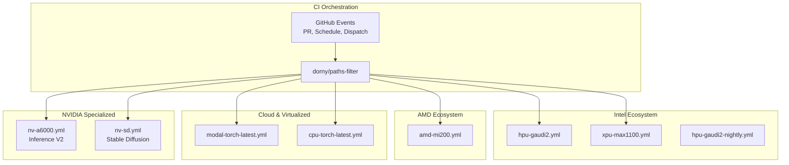
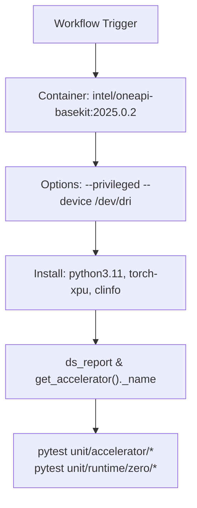
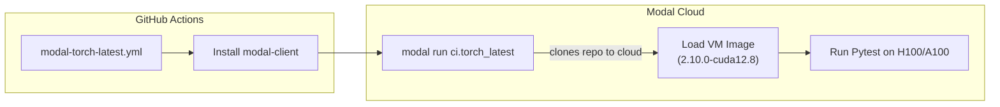

<!-- source: DeepWiki mcp.deepwiki.com · repo deepspeedai/DeepSpeed · page 16.3 Multi-Platform Testing · fetched 2026-10-21 -->

# Multi-Platform Testing

Relevant source files

The following files were used as context for generating this wiki page:

- [.github/workflows/amd-mi200.yml](.github/workflows/amd-mi200.yml)
- [.github/workflows/aws-accelerate.yml](.github/workflows/aws-accelerate.yml)
- [.github/workflows/aws-torch-latest-full.yml](.github/workflows/aws-torch-latest-full.yml)
- [.github/workflows/aws-torch-latest.yml](.github/workflows/aws-torch-latest.yml)
- [.github/workflows/cpu-torch-latest.yml](.github/workflows/cpu-torch-latest.yml)
- [.github/workflows/formatting.yml](.github/workflows/formatting.yml)
- [.github/workflows/hpu-gaudi2-nightly.yml](.github/workflows/hpu-gaudi2-nightly.yml)
- [.github/workflows/hpu-gaudi2.yml](.github/workflows/hpu-gaudi2.yml)
- [.github/workflows/modal-accelerate.yml](.github/workflows/modal-accelerate.yml)
- [.github/workflows/modal-torch-latest.yml](.github/workflows/modal-torch-latest.yml)
- [.github/workflows/no-torch.yml](.github/workflows/no-torch.yml)
- [.github/workflows/nv-a6000.yml](.github/workflows/nv-a6000.yml)
- [.github/workflows/nv-flash-attn.yml](.github/workflows/nv-flash-attn.yml)
- [.github/workflows/nv-pre-compile-ops.yml](.github/workflows/nv-pre-compile-ops.yml)
- [.github/workflows/nv-sd.yml](.github/workflows/nv-sd.yml)
- [.github/workflows/python.yml](.github/workflows/python.yml)
- [.github/workflows/xpu-compile.yml](.github/workflows/xpu-compile.yml)
- [.github/workflows/xpu-max1100.yml](.github/workflows/xpu-max1100.yml)
- [ci/__init__.py](ci/__init__.py)
- [ci/accelerate.py](ci/accelerate.py)
- [ci/torch_latest.py](ci/torch_latest.py)
- [deepspeed/io/fast_file_writer.py](deepspeed/io/fast_file_writer.py)
- [tests/torch_compile/ds_config_z2.json](tests/torch_compile/ds_config_z2.json)
- [tests/torch_compile/ds_config_z3.json](tests/torch_compile/ds_config_z3.json)
- [tests/torch_compile/test_compile.py](tests/torch_compile/test_compile.py)
- [tests/unit/ops/aio/test_fast_file_writer_fd_close.py](tests/unit/ops/aio/test_fast_file_writer_fd_close.py)
- [tests/unit/v1/compile/test_compile_autosp.py](tests/unit/v1/compile/test_compile_autosp.py)
- [tests/unit/v1/zero/test_zero.py](tests/unit/v1/zero/test_zero.py)
- [tests/unit/v1/zero/test_zero_autocast.py](tests/unit/v1/zero/test_zero_autocast.py)

## Purpose and Scope

This document describes DeepSpeed's continuous integration (CI) infrastructure for testing across diverse hardware platforms, including Intel Gaudi2 HPUs, Intel XPU (Max 1100), AMD (MI200), CPU-only environments, and cloud-based GPU testing via Modal. These workflows validate DeepSpeed's hardware abstraction layer and ensure that features like ZeRO, Pipeline Parallelism, and Inference optimizations function correctly across the multi-platform ecosystem.

## Multi-Platform Testing Architecture

DeepSpeed's CI infrastructure utilizes a distributed set of self-hosted and cloud runners to maintain platform-specific environments. Each platform requires unique Docker containers, communication libraries (HCCL, ROCm, SYCL, NCCL), and specialized test suites.

### Platform Testing Matrix

**Sources:** [.github/workflows/hpu-gaudi2.yml](), [.github/workflows/xpu-max1100.yml](), [.github/workflows/amd-mi200.yml](), [.github/workflows/modal-torch-latest.yml](), [.github/workflows/cpu-torch-latest.yml](), [.github/workflows/nv-a6000.yml](), [.github/workflows/nv-sd.yml]()

## Intel Gaudi2 HPU Testing

### HPU Workflow Configuration
The Intel Gaudi2 HPU testing validates compatibility with Habana Gaudi processors using the Habana Collective Communications Library (HCCL).

*   **Runner:** `[self-hosted, intel, gaudi2]` [.github/workflows/hpu-gaudi2.yml:41]()
*   **Container:** `vault.habana.ai/gaudi-docker/1.21.0/ubuntu22.04/habanalabs/pytorch-installer-2.6.0:latest` [.github/workflows/hpu-gaudi2.yml:43]()
*   **Runtime Options:** `--runtime=habana -e HABANA_VISIBLE_DEVICES=all` [.github/workflows/hpu-gaudi2.yml:46]()

### HPU Environment and Test Selection
HPU testing requires specific environment variables to manage execution mode and compilation:
*   `PT_HPU_LAZY_MODE: 0`: Forces eager execution for better debugging and compatibility with certain DeepSpeed features [.github/workflows/hpu-gaudi2.yml:49]().
*   `TORCHINDUCTOR_COMPILE_THREADS: 1`: Limits compilation overhead on the HPU host [.github/workflows/hpu-gaudi2.yml:50]().

The HPU workflow uses a whitelist of tests defined in `TEST_LIST` [.github/workflows/hpu-gaudi2.yml:51-99](). This includes core components like `test_accelerator.py`, `test_zero_optimizer.py`, and `test_pipe_module.py`.

**Sources:** [.github/workflows/hpu-gaudi2.yml:38-139](), [.github/workflows/hpu-gaudi2-nightly.yml:20-88]()

## Intel XPU Testing (Max 1100)

The XPU workflow targets Intel Data Center GPU Max Series using the oneAPI/SYCL backend.

### XPU Workflow Execution Flow

**Key Configuration:**
*   **Accelerator Check:** Validates the XPU backend via `get_accelerator()._name` [.github/workflows/xpu-max1100.yml:64]().
*   **MPI Setup:** Exports `FI_PROVIDER="tcp"` and `I_MPI_SHM=off` to ensure stable communication on Intel GPU clusters [.github/workflows/xpu-max1100.yml:71-72]().
*   **Scope:** Focuses on `runtime/zero/test_zeropp.py`, `runtime/zero/test_zero_config.py`, and `autotuning/*` [.github/workflows/xpu-max1100.yml:74-85]().

**Sources:** [.github/workflows/xpu-max1100.yml:36-86]()

## AMD MI200 Testing

AMD testing infrastructure ensures DeepSpeed runs efficiently on ROCm-based systems.

*   **Runner:** `[self-hosted, amd, mi200]` [.github/workflows/amd-mi200.yml:24]()
*   **PyTorch Index:** `https://download.pytorch.org/whl/rocm6.0` [.github/workflows/amd-mi200.yml:36]()
*   **ROCm Apex:** The workflow manually clones and builds the ROCm-specific version of `apex` to ensure compatibility with AMD's memory management [.github/workflows/amd-mi200.yml:49-57]().
*   **Execution:** Runs tests in parallel using `pytest -n 4` to optimize utilization of MI200 resources [.github/workflows/amd-mi200.yml:75]().

**Sources:** [.github/workflows/amd-mi200.yml:21-76]()

## CPU and Smoke Testing

### CPU-Torch-Latest
This workflow validates DeepSpeed on pure CPU environments, supporting multiple PyTorch presets (e.g., 2.7.1-cpu to 2.10.0-cpu) [.github/workflows/cpu-torch-latest.yml:12-15]().
*   **System Deps:** Requires `numactl` for memory affinity and `pdsh` for multi-node runner simulations [.github/workflows/cpu-torch-latest.yml:98]().
*   **Test Strategy:** Uses `--forked` to ensure process isolation and `-m 'sequential'` for tests that cannot be parallelized [.github/workflows/cpu-torch-latest.yml:205-210]().

### Python Smoke Test
The `python.yml` workflow performs a basic "install smoke" across Python versions 3.10, 3.11, and 3.12 [.github/workflows/python.yml:51](). It installs DeepSpeed on a `python-slim` container and runs `ds_report` to verify the build system and basic dependencies [.github/workflows/python.yml:83-90]().

**Sources:** [.github/workflows/cpu-torch-latest.yml](), [.github/workflows/python.yml]()

## Cloud Testing with Modal

DeepSpeed uses [Modal.com](https://modal.com) to provide elastic GPU capacity for testing the latest PyTorch and CUDA combinations.

### Modal Workflow Data Flow

**Key Features:**
*   **Dynamic Presets:** Supports manual runs with specific CUDA versions (e.g., `cuda12.8`) [.github/workflows/modal-torch-latest.yml:23]().
*   **Path Filtering:** Uses `dorny/paths-filter` to skip Modal runs if only documentation or blogs are changed [.github/workflows/modal-torch-latest.yml:75-93]().
*   **Implementation:** The actual VM definition and test logic reside in `ci/torch_latest.py` [.github/workflows/modal-torch-latest.yml:6-134]().

**Sources:** [.github/workflows/modal-torch-latest.yml:1-135]()

## Specialized NVIDIA Testing

While the primary NVIDIA testing is covered in other sections, multi-platform testing includes specialized workflows for high-end NVIDIA hardware:

### NVIDIA A6000 (Inference V2)
Targets the next-generation inference stack (`FastGen`).
*   **Container:** `nvcr.io/nvidia/pytorch:25.01-py3` [.github/workflows/nv-a6000.yml:27]().
*   **Scope:** Specifically runs `-m 'inference_v2'` and `-m 'inference_v2_ops'` [.github/workflows/nv-a6000.yml:62-63]().
*   **MII Integration:** Clones and tests `DeepSpeed-MII` alongside the core engine to ensure the inference ecosystem is intact [.github/workflows/nv-a6000.yml:71-75]().

### Stable Diffusion (NV-SD)
Validates specialized kernels for diffusion models.
*   **Triggers:** Changes to `deepspeed/ops/transformer/inference/diffusers_**` or `deepspeed/model_implementations/diffusers/**` [.github/workflows/nv-sd.yml:6-12]().
*   **Dependencies:** Requires `image-similarity-measures` to validate output quality against baselines [.github/workflows/nv-sd.yml:52]().

**Sources:** [.github/workflows/nv-a6000.yml](), [.github/workflows/nv-sd.yml]()

## Pre-Compile Ops Validation
The `nv-pre-compile-ops.yml` workflow ensures that DeepSpeed's JIT and pre-build systems work for all major CUDA architectures (7.0 to 9.0) [.github/workflows/nv-pre-compile-ops.yml:79](). It sets `DS_BUILD_OPS=1` to force compilation of all C++/CUDA extensions during the CI process, catching build regressions early [.github/workflows/nv-pre-compile-ops.yml:79]().

**Sources:** [.github/workflows/nv-pre-compile-ops.yml:47-83]()

---

