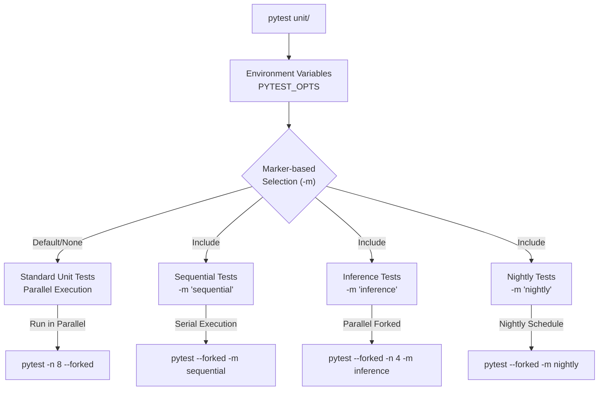
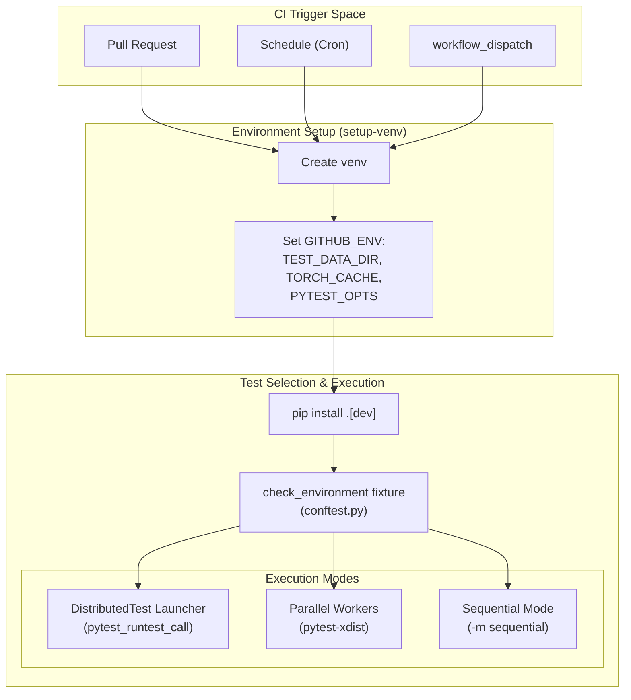

<!-- source: DeepWiki mcp.deepwiki.com · repo deepspeedai/DeepSpeed · page 16.4 Test Categorization and Execution · fetched 2026-10-21 -->

# Test Categorization and Execution

<details>
<summary>Relevant source files</summary>

The following files were used as context for generating this wiki page:

- [.github/workflows/nv-accelerate-v100.yml](.github/workflows/nv-accelerate-v100.yml)
- [.github/workflows/nv-ds-chat.yml](.github/workflows/nv-ds-chat.yml)
- [.github/workflows/nv-inference.yml](.github/workflows/nv-inference.yml)
- [.github/workflows/nv-lightning-v100.yml](.github/workflows/nv-lightning-v100.yml)
- [.github/workflows/nv-mii.yml](.github/workflows/nv-mii.yml)
- [.github/workflows/nv-nightly.yml](.github/workflows/nv-nightly.yml)
- [.github/workflows/nv-torch-latest-v100.yml](.github/workflows/nv-torch-latest-v100.yml)
- [.github/workflows/nv-torch-nightly-v100.yml](.github/workflows/nv-torch-nightly-v100.yml)
- [.github/workflows/nv-transformers-v100.yml](.github/workflows/nv-transformers-v100.yml)
- [.github/workflows/setup-venv/action.yml](.github/workflows/setup-venv/action.yml)
- [requirements/requirements-dev.txt](requirements/requirements-dev.txt)
- [requirements/requirements-inf.txt](requirements/requirements-inf.txt)
- [tests/conftest.py](tests/conftest.py)
- [tests/unit/inference/quantization/test_intX_quantization.py](tests/unit/inference/quantization/test_intX_quantization.py)
- [tests/unit/runtime/zero/test_zero_dynamic_class.py](tests/unit/runtime/zero/test_zero_dynamic_class.py)
- [tests/unit/runtime/zero/test_zero_nesting_init.py](tests/unit/runtime/zero/test_zero_nesting_init.py)

</details>


## Purpose and Scope

This document describes DeepSpeed's test categorization system and execution strategies across different hardware platforms. It covers how tests are organized using pytest markers, how different CI/CD workflows select and run test subsets, and the platform-specific test execution patterns.

For information about the overall CI/CD workflow architecture and GitHub Actions setup, see [GitHub Actions Workflow Architecture](#16.1). For details on multi-platform testing infrastructure, see [Multi-Platform Testing](#16.3).

## Test Categorization System

DeepSpeed uses pytest markers to categorize tests into distinct groups based on their characteristics, execution requirements, and scope. These markers enable selective test execution across different CI/CD workflows and hardware platforms.

### Pytest Marker Definitions

The test categorization system is managed through CLI arguments and markers passed to `pytest`. While many markers are used across the codebase, the following are the primary categories observed in the CI workflows:

| Marker | Purpose | Execution Pattern |
|--------|---------|-------------------|
| `sequential` | Tests requiring serial execution (no parallelism) | Run after parallel tests complete |
| `inference` | Inference model tests (v1 stack) | Forked execution with parallelism |
| `inference_ops` | Individual inference operator tests | Separate execution from model tests |
| `nightly` | Long-running or resource-intensive tests | Scheduled nightly runs |
| `deepspeed` | Integration tests within external repos (MII, HF) | Targeted integration testing |
| `seq_inference` | Sequential inference tests | Serial execution only |

**Sources:** [.github/workflows/nv-inference.yml:62-64](), [.github/workflows/nv-torch-latest-v100.yml:46-47](), [.github/workflows/nv-nightly.yml:53](), [.github/workflows/nv-mii.yml:54]()

### Default Test Execution vs Marker-Based Selection

DeepSpeed utilizes `pytest-xdist` for parallel execution and `pytest-forked` for process isolation.



**Sources:** [.github/workflows/nv-torch-latest-v100.yml:46-47](), [.github/workflows/nv-inference.yml:63-64](), [.github/workflows/setup-venv/action.yml:33]()

## Test Execution Strategies

### Parallel Execution with Forking

DeepSpeed tests use pytest's parallel execution capabilities to maximize throughput while ensuring test isolation. The `pytest-forked` plugin is critical because DeepSpeed's distributed runtime and CUDA context initialization often make it difficult to run multiple tests in the same process.

- **Parallel with Forking (`--forked -n N`)**: Each test runs in a forked subprocess. Standard unit tests typically use `-n 8` on V100 nodes [ .github/workflows/nv-torch-latest-v100.yml:46]().
- **Sequential with Forking (`--forked -m sequential`)**: Tests run serially but still in forked processes for isolation [.github/workflows/nv-torch-latest-v100.yml:47]().

### Test Environment Configuration

The `tests/conftest.py` file provides the logic for environment validation and custom test hooks.

- **Version Validation**: The `check_environment` fixture ensures that the `torch` and `cuda` versions match the expected versions passed via CLI flags `--torch_ver` and `--cuda_ver` [tests/conftest.py:42-60]().
- **Distributed Test Hook**: The `pytest_runtest_call` hook is overridden to handle `DistributedTest` classes. If a test class has `is_dist_test = True`, it uses a custom launcher rather than the default pytest execution [tests/conftest.py:64-71]().
- **Environment Teardown**: `pytest_runtest_teardown` manages the cleanup of distributed process pools if they are not marked for reuse [tests/conftest.py:76-81]().

**Sources:** [tests/conftest.py:31-81](), [requirements/requirements-dev.txt:10-13]()

## Platform-Specific Test Workflows

### NVIDIA V100 Standard Testing

The V100 workflow represents the primary testing platform for general unit tests. It uses a self-hosted runner with CUDA 12.4 [.github/workflows/nv-torch-latest-v100.yml:9]().

```bash
# Example execution from nv-torch-latest-v100.yml
pytest -x $PYTEST_OPTS --instafail --timeout 600 --forked -n 8 unit/ --torch_ver="2.6" --cuda_ver="12.4"
```

Key execution parameters defined in `setup-venv`:
- **`PYTEST_OPTS`**: Defaults to `--maxfail=100 --color=yes --durations=0 --verbose -rF` [.github/workflows/setup-venv/action.yml:33]().

**Sources:** [.github/workflows/nv-torch-latest-v100.yml:46](), [.github/workflows/setup-venv/action.yml:33]()

### Inference-Specific Testing

The inference workflow targets the `deepspeed/inference` directory. It excludes the `v2` stack to focus on legacy/v1 inference kernels and transformations [.github/workflows/nv-inference.yml:10-13]().

```bash
# Inference operator tests
pytest $PYTEST_OPTS -m 'inference_ops' unit/ --torch_ver="2.1" --cuda_ver="12.4"

# Inference model tests (parallel with 4 workers)
pytest $PYTEST_OPTS --forked -n 4 -m 'inference' unit/ --torch_ver="2.1" --cuda_ver="12.4"
```

**Sources:** [.github/workflows/nv-inference.yml:63-64]()

### Integration Testing Execution

DeepSpeed executes tests against external libraries to ensure no regressions in common integration patterns.

| Integration | Workflow | Execution Command |
|-------------|----------|-------------------|
| **HF Transformers** | `nv-transformers-v100` | `RUN_SLOW=1 pytest $PYTEST_OPTS tests/deepspeed` [.github/workflows/nv-transformers-v100.yml:52]() |
| **HF Accelerate** | `nv-accelerate-v100` | `pytest $PYTEST_OPTS tests/deepspeed` [.github/workflows/nv-accelerate-v100.yml:47]() |
| **DeepSpeed-MII** | `nv-mii` | `pytest $PYTEST_OPTS --forked -m "deepspeed" ./` [.github/workflows/nv-mii.yml:54]() |
| **DeepSpeed-Chat** | `nv-ds-chat` | `pytest $PYTEST_OPTS ./` [.github/workflows/nv-ds-chat.yml:71]() |

**Sources:** [.github/workflows/nv-transformers-v100.yml:52](), [.github/workflows/nv-accelerate-v100.yml:47](), [.github/workflows/nv-mii.yml:54](), [.github/workflows/nv-ds-chat.yml:71]()

## Nightly and Scheduled Tests

Scheduled workflows are used for comprehensive testing that is too slow for PR-level CI.

- **Nightly Unit Tests**: Runs tests marked with `nightly` [.github/workflows/nv-nightly.yml:53]().
- **Torch Nightly**: Tests DeepSpeed against the latest PyTorch nightly builds to catch breaking changes in upstream dependencies [.github/workflows/nv-torch-nightly-v100.yml:23]().
- **Failure Reporting**: Scheduled workflows use `JasonEtco/create-an-issue` to automatically open GitHub issues when the nightly CI fails [.github/workflows/nv-nightly.yml:55-62]().

**Sources:** [.github/workflows/nv-nightly.yml:53-62](), [.github/workflows/nv-torch-nightly-v100.yml:23-59]()

## Execution Flow Diagram

The following diagram illustrates the data flow from CI trigger to test execution.



**Sources:** [.github/workflows/setup-venv/action.yml:1-34](), [tests/conftest.py:42-71](), [.github/workflows/nv-torch-latest-v100.yml:1-48]()

## Summary of Test Execution by Platform

| Platform | Runner Tags | Primary Test Command |
|----------|-------------|----------------------|
| **NVIDIA V100** | `[self-hosted, nvidia, cu124, v100]` | `pytest -n 8 --forked unit/` |
| **Inference** | `[self-hosted, nvidia, cu124, v100]` | `pytest -m 'inference'` |
| **CPU** | `[self-hosted, linux]` | `DS_ACCELERATOR=cpu pip install .` |
| **MII** | `[self-hosted, nvidia, cu124, v100]` | `pytest -m 'deepspeed'` |

**Sources:** [.github/workflows/nv-torch-latest-v100.yml:9](), [.github/workflows/nv-inference.yml:26](), [.github/workflows/nv-mii.yml:9](), [.github/workflows/nv-inference.yml:50]()

---

