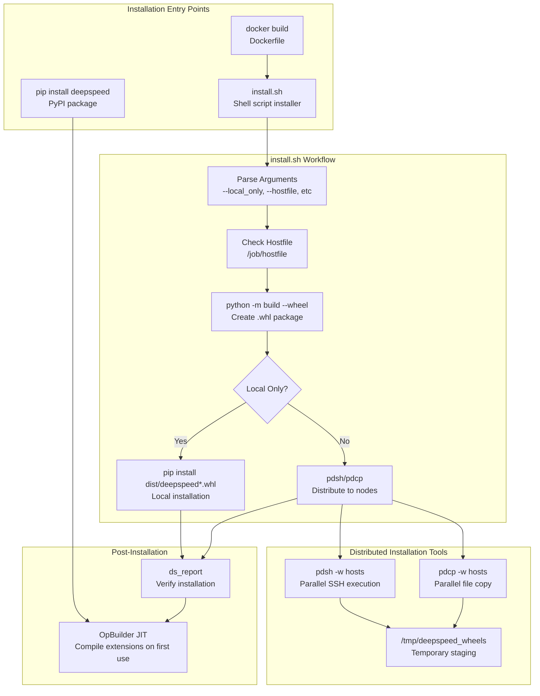
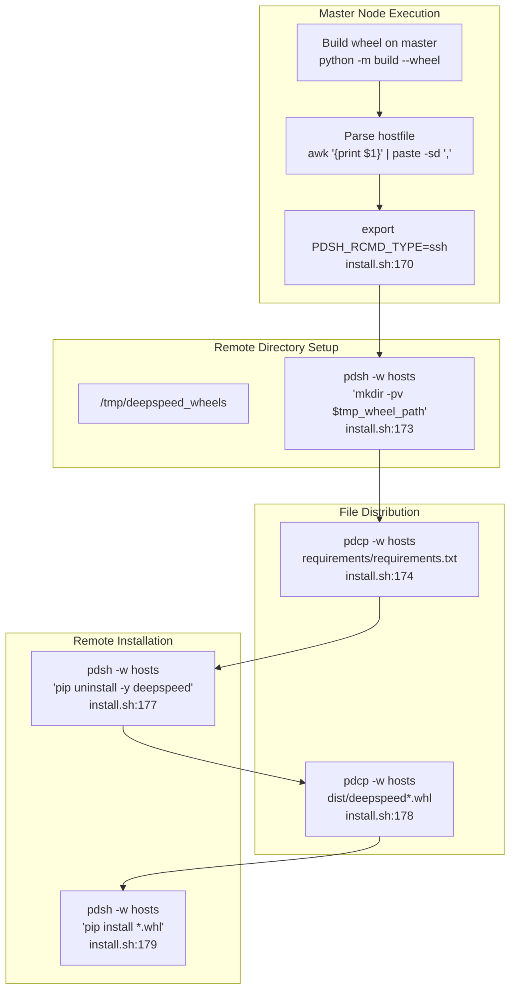

<!-- source: DeepWiki mcp.deepwiki.com · repo deepspeedai/DeepSpeed · page 17 Installation and Development Workflow · fetched 2026-10-21 -->

# Installation and Development Workflow

Relevant source files

The following files were used as context for generating this wiki page:

- [CONTRIBUTING.md](CONTRIBUTING.md)
- [Makefile](Makefile)
- [build_win.bat](build_win.bat)
- [docs/_tutorials/advanced-install.md](docs/_tutorials/advanced-install.md)
- [environment.yml](environment.yml)
- [install.sh](install.sh)
- [op_builder/builder.py](op_builder/builder.py)
- [op_builder/fused_adam.py](op_builder/fused_adam.py)
- [op_builder/fused_lamb.py](op_builder/fused_lamb.py)
- [op_builder/stochastic_transformer.py](op_builder/stochastic_transformer.py)
- [op_builder/transformer.py](op_builder/transformer.py)
- [setup.py](setup.py)

## Purpose and Scope

This document covers the installation, development workflow, and distributed deployment procedures for DeepSpeed. It explains how to install DeepSpeed on single nodes and across multi-node clusters, set up Docker environments for containerized deployments, configure development tools for contributing code, and use distributed deployment utilities.

For details about the build system and OpBuilder architecture, see [Build System and Custom Operations](#9). For CI/CD pipelines and automated testing, see [CI/CD Pipeline](#16). For multi-node job launching during training, see [Distributed Training Orchestration](#8).

---

## Installation Overview

DeepSpeed supports three primary installation modes, each designed for different deployment scenarios. By default, DeepSpeed uses Just-In-Time (JIT) compilation for its C++/CUDA extensions (ops), which requires `ninja` to be installed [docs/_tutorials/advanced-install.md:7-13]().

| Installation Mode | Use Case | Tool | Multi-Node Support |
|------------------|----------|------|-------------------|
| **PyPI Installation** | Standard users, quick setup | `pip install deepspeed` | No |
| **Local Installation** | Development, single-node clusters | `install.sh --local_only` | No |
| **Distributed Installation** | Multi-node clusters, production | `install.sh -H hostfile` | Yes (via pdsh/pdcp) |

### Installation Architecture

**Sources:** [install.sh:1-183](), [docs/_tutorials/advanced-install.md:7-13]()

---

## Local Installation

The `install.sh` script provides flexible installation options. When run without a hostfile or with `--local_only`, it performs a single-node installation [install.sh:149-152]().

### install.sh Command-Line Arguments

| Flag | Description | Default |
|------|-------------|---------|
| `-l, --local_only` | Install only on local machine | Auto-detected from hostfile |
| `-s, --pip_sudo` | Run pip install with sudo | No sudo |
| `-r, --allow_sudo` | Allow script to be run by root | Forbidden |
| `-n, --no_clean` | Keep prior build artifacts | Clean build |
| `-m, --pip_mirror` | Use specified pip mirror | Default pip mirror |
| `-H, --hostfile` | Path to MPI-style hostfile | `/job/hostfile` |
| `-e, --examples` | Checkout DeepSpeedExamples submodule | No |
| `-v, --verbose` | Verbose logging | Quiet |

**Sources:** [install.sh:10-28]()

### Build Artifact Cleanup

The script removes previous build artifacts before building unless `--no_clean` is specified:
- `deepspeed/git_version_info_installed.py`
- `dist/`
- `build/`
- `deepspeed.egg-info/`

The `rm_if_exist` function handles both files and directories [install.sh:119-126]().

**Sources:** [install.sh:128-134]()

---

## Pre-installing Ops

While JIT is the default, users can pre-compile ops by setting environment variables during installation [docs/_tutorials/advanced-install.md:33-40]().

| Variable | Target Op | Code Builder |
|----------|-----------|--------------|
| `DS_BUILD_OPS` | All compatible ops | `ALL_OPS` in [setup.py:183]() |
| `DS_BUILD_FUSED_ADAM` | FusedAdam | `FusedAdamBuilder` in [op_builder/fused_adam.py:11]() |
| `DS_BUILD_FUSED_LAMB` | FusedLamb | `FusedLambBuilder` in [op_builder/fused_lamb.py:11]() |
| `DS_BUILD_TRANSFORMER` | Transformer | `TransformerBuilder` in [op_builder/transformer.py:9]() |

**Sources:** [docs/_tutorials/advanced-install.md:58-75](), [setup.py:171-180]()

---

## Distributed Installation

Distributed installation deploys DeepSpeed across multiple nodes using parallel SSH tools (`pdsh` and `pdcp`). This mode is automatically activated when a valid hostfile exists [install.sh:164-169]().

### Distributed Installation Workflow

**Sources:** [install.sh:163-182]()

---

## Development Workflow

DeepSpeed uses `pre-commit` hooks to ensure consistent formatting across the codebase [CONTRIBUTING.md:5-11]().

### Formatting and Testing Commands

DeepSpeed provides a `Makefile` to automate common development tasks [Makefile:3-24]().

| Target | Action | Code Reference |
|--------|--------|----------------|
| `make format` | Creates venv, installs pre-commit, and runs formatting | [Makefile:13-24]() |
| `make test` | Runs unit tests using `pytest --forked` | [Makefile:10-11]() |

### Unit and Model Testing

1.  **Unit Tests**: Located in `tests/unit/`. Use `pytest --forked` to isolate CUDA functionality in distributed tests [CONTRIBUTING.md:33-42]().
2.  **Model Tests**: Located in `tests/model/`. These verify end-to-end convergence using `run_sanity_check.py` [CONTRIBUTING.md:52-59]().

### Contribution Requirements

*   **DCO**: All commits must be signed off using `git commit -s` [CONTRIBUTING.md:62-70]().
*   **New Features**: Require a 3-step process: Proposal (Issue), Implementation (PR + Tests + Docs), and Maintenance [CONTRIBUTING.md:79-105]().

**Sources:** [CONTRIBUTING.md:1-106](), [Makefile:1-24]()

---

## Platform Specifics

### Windows Support
DeepSpeed provides `build_win.bat` for building wheels on Windows [build_win.bat:1-15](). On Windows, `DS_BUILD_OPS` defaults to `1` (pre-install), whereas on Linux it defaults to `0` (JIT) [setup.py:152-153]().

### Conda Environment
A provided `environment.yml` includes the necessary toolchain (GCC 11.4, Ninja, CUDA 11.8) for building from source [environment.yml:1-22]().

**Sources:** [setup.py:152-153](), [build_win.bat:1-15](), [environment.yml:1-22]()

---

