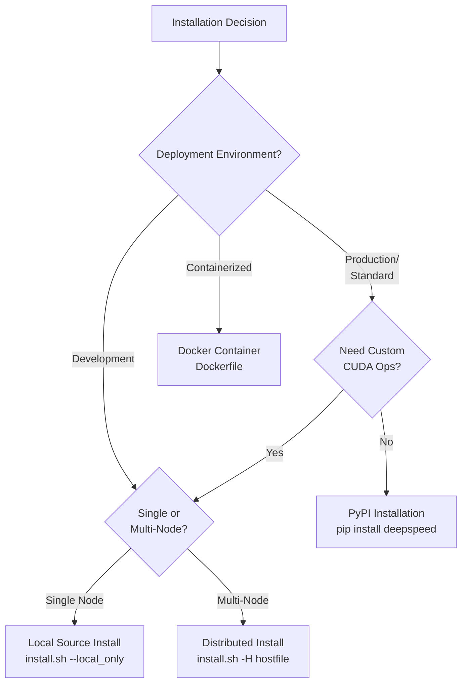
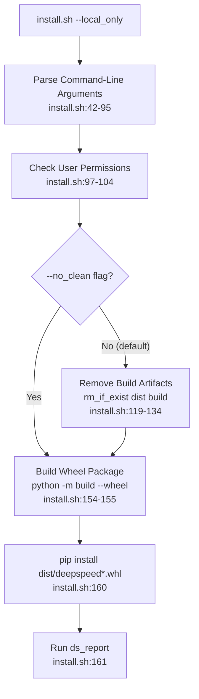
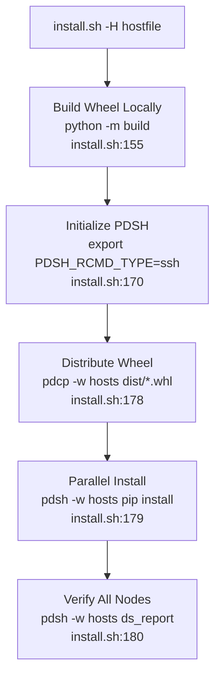

<!-- source: DeepWiki mcp.deepwiki.com · repo deepspeedai/DeepSpeed · page 17.1 Installation Methods · fetched 2026-10-21 -->

# Installation Methods

<details>
<summary>Relevant source files</summary>

The following files were used as context for generating this wiki page:

- [.gitignore](.gitignore)
- [build_win.bat](build_win.bat)
- [deepspeed/inference/config.py](deepspeed/inference/config.py)
- [deepspeed/pipe/__init__.py](deepspeed/pipe/__init__.py)
- [deepspeed/runtime/config_utils.py](deepspeed/runtime/config_utils.py)
- [deepspeed/runtime/pipe/__init__.py](deepspeed/runtime/pipe/__init__.py)
- [deepspeed/runtime/zero/linear.py](deepspeed/runtime/zero/linear.py)
- [deepspeed/runtime/zero/offload_config.py](deepspeed/runtime/zero/offload_config.py)
- [docs/_tutorials/advanced-install.md](docs/_tutorials/advanced-install.md)
- [docs/code-docs/source/conf.py](docs/code-docs/source/conf.py)
- [docs/code-docs/source/memory.rst](docs/code-docs/source/memory.rst)
- [environment.yml](environment.yml)
- [install.sh](install.sh)
- [op_builder/builder.py](op_builder/builder.py)
- [op_builder/fused_adam.py](op_builder/fused_adam.py)
- [op_builder/fused_lamb.py](op_builder/fused_lamb.py)
- [op_builder/stochastic_transformer.py](op_builder/stochastic_transformer.py)
- [op_builder/transformer.py](op_builder/transformer.py)
- [requirements/requirements-readthedocs.txt](requirements/requirements-readthedocs.txt)
- [requirements/requirements.txt](requirements/requirements.txt)
- [setup.py](setup.py)
- [tests/unit/runtime/test_autocast.py](tests/unit/runtime/test_autocast.py)
- [tests/unit/v1/zero/test_zero_functorch_linear.py](tests/unit/v1/zero/test_zero_functorch_linear.py)

</details>


This document describes the various methods available for installing DeepSpeed, including PyPI installation, local source installation, distributed multi-node installation, and Docker-based deployment. It covers the installation workflow, build system integration, and verification steps.

For information about the OpBuilder system and compilation of custom operations, see [OpBuilder Architecture](#9.1). For Docker container configuration details, see [Docker Environment Setup](#17.2). For development setup and contributing guidelines, see [Development Workflow and Contribution](#17.3).

---

## Installation Method Overview

DeepSpeed supports four primary installation methods, each suited to different deployment scenarios:

| Method | Use Case | Entry Point | Build Mode |
|--------|----------|-------------|------------|
| **PyPI** | Standard users, production | `pip install deepspeed` | Pre-built wheels |
| **Local Source** | Single-node development | `install.sh --local_only` | JIT or pre-build |
| **Distributed Source** | Multi-node clusters | `install.sh -H hostfile` | JIT or pre-build |
| **Docker** | Containerized deployment | `Dockerfile` | Pre-build |

The installation method determines when C++/CUDA extensions are compiled. PyPI releases include pre-compiled binaries for common configurations, while source installations can use just-in-time (JIT) compilation or pre-build all extensions via the `DS_BUILD_OPS` environment variable.

**Installation Decision Flow**



Sources: `[install.sh:10-27]()`, `[docs/_tutorials/advanced-install.md:7-17]()`

---

## PyPI Installation

The simplest installation method uses Python's package manager to install DeepSpeed. By default, this mode relies on JIT compilation for CUDA kernels.

### Standard Installation

```bash
pip install deepspeed
```

This installs the latest stable release. By default, all C++/CUDA extensions (referred to as "ops") are built Just-In-Time (JIT) using Torch's C++ extension loader, which relies on `ninja` to build and link them at runtime `[docs/_tutorials/advanced-install.md:7-13]()`.

### Pre-installing Ops via Pip

To avoid JIT overhead at runtime, you can force the compilation of extensions during the `pip install` phase by setting environment variables:

```bash
# Pre-build all compatible ops
DS_BUILD_OPS=1 pip install deepspeed

# Pre-build specific ops (e.g., CPUAdam)
DS_BUILD_CPU_ADAM=1 pip install deepspeed
```

The installer checks for compatibility before attempting to build. For example, it verifies the `installed_cuda_version` matches the version Torch was compiled with to prevent runtime errors `[op_builder/builder.py:90-113]()`.

Sources: `[docs/_tutorials/advanced-install.md:38-56]()`, `[setup.py:152-154]()`

---

## Local Source Installation

Local installation builds DeepSpeed from a cloned repository, enabling custom compilation and development workflows.

### Using install.sh

The `install.sh` script automates the build and installation process. It first attempts to build a wheel locally using `python -m build` and then installs it `[install.sh:154-160]()`.

```bash
# Clone repository
git clone https://github.com/deepspeedai/DeepSpeed.git
cd DeepSpeed

# Install locally
./install.sh --local_only
```

### Installation Script Options

The `install.sh` script accepts multiple command-line flags `[install.sh:10-27]()`:

| Flag | Description | Default |
|------|-------------|---------|
| `-l, --local_only` | Install only on local machine | Distributed if hostfile exists |
| `-s, --pip_sudo` | Run pip install with sudo | No sudo |
| `-r, --allow_sudo` | Allow script execution as root | Disallowed |
| `-n, --no_clean` | Skip cleaning prior build state | Clean before build |
| `-m, --pip_mirror` | Use specified pip mirror | Default pip mirror |
| `-H, --hostfile` | Path to MPI-style hostfile | `/job/hostfile` |
| `-v, --verbose` | Verbose logging | Quiet mode |

### Build Process Workflow

**Local Installation Workflow**



Sources: `[install.sh:1-183]()`

---

## Distributed Multi-Node Installation

For cluster deployments, `install.sh` can distribute and install DeepSpeed across multiple nodes simultaneously using `pdsh` and `pdcp`.

### Distributed Installation Process

```bash
# Install across cluster defined in hostfile
./install.sh -H /path/to/hostfile
```

If a hostfile is detected at `/job/hostfile` or provided via `-H`, the script switches to distributed mode `[install.sh:149-152]()`. It creates a temporary directory `/tmp/deepspeed_wheels` on all remote hosts, copies the locally built wheel and requirements, and executes the installation command in parallel `[install.sh:171-182]()`.

**Distributed Installation Architecture**



Sources: `[install.sh:163-182]()`

---

## Build System and Requirements

### Dependencies
DeepSpeed requires several core Python packages, including `torch`, `ninja`, `numpy`, and `pydantic` `[requirements/requirements.txt:1-12]()`. For specific features, "extras" are defined in `setup.py`:
- `1bit`: Requirements for 1-bit Adam/Lamb optimizers `[setup.py:83]()`.
- `dev`: Requirements for testing and development `[setup.py:86]()`.
- `autotuning`: Requirements for the DeepSpeed Autotuner `[setup.py:87]()`.

### OpBuilder Architecture
The `OpBuilder` class in `op_builder/builder.py` is the base for all DeepSpeed extensions. It handles:
- **Compatibility Checks**: The `is_compatible()` method checks if the system has the necessary headers and libraries `[setup.py:184]()`.
- **Version Validation**: `validate_torch_version` ensures the runtime Torch version matches the version used during compilation to prevent binary incompatibility `[op_builder/builder.py:153-162]()`.
- **Architecture Targeting**: Users can specify GPU architectures via `TORCH_CUDA_ARCH_LIST` to speed up compilation and ensure optimization for specific cards `[docs/_tutorials/advanced-install.md:154-158]()`.

### JIT vs Pre-build logic
The decision to build an op during installation is governed by `op_enabled(op_name)`, which checks if `DS_BUILD_OPS` or specific op variables (like `DS_BUILD_FUSED_ADAM`) are set `[setup.py:177-180]()`.

Sources: `[setup.py:82-95]()`, `[op_builder/builder.py:116-162]()`, `[requirements/requirements.txt:1-12]()`

---

## Installation Verification

### ds_report
The primary tool for verifying installation is `ds_report` (or `python -m deepspeed.env_report`). It provides a comprehensive status of:
1. **Installed Version**: Confirms the DeepSpeed version.
2. **Op Compatibility**: Shows which CUDA extensions are compatible with the current system.
3. **Build Status**: Indicates if ops are already compiled or will require JIT.

```bash
ds_report
```

Sources: `[docs/_tutorials/advanced-install.md:19-26]()`, `[install.sh:161]()`

---

