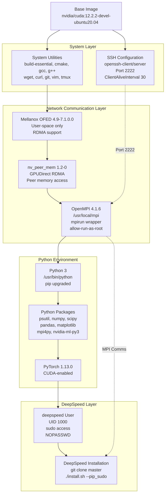
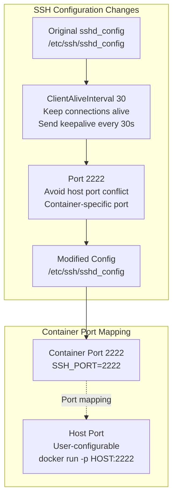
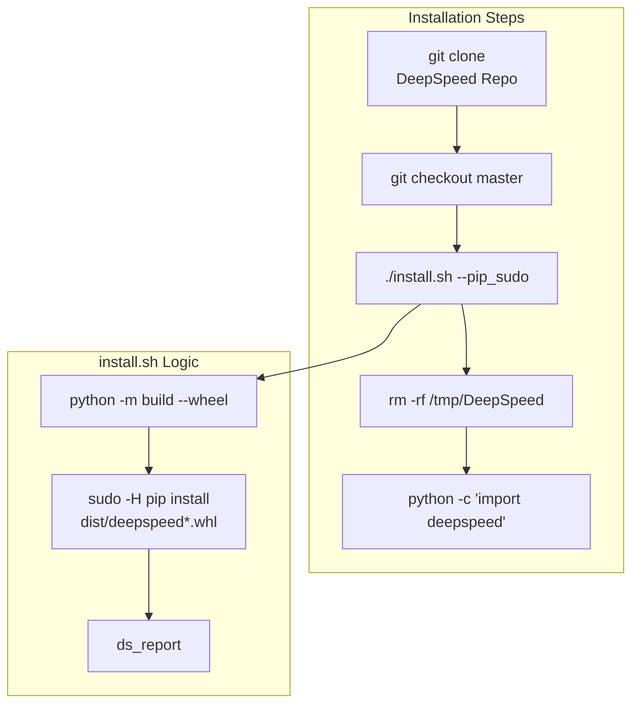

<!-- source: DeepWiki mcp.deepwiki.com · repo deepspeedai/DeepSpeed · page 17.2 Docker Environment Setup · fetched 2026-10-21 -->

# Docker Environment Setup

<details>
<summary>Relevant source files</summary>

The following files were used as context for generating this wiki page:

- [docker/Dockerfile](docker/Dockerfile)

</details>


## Purpose and Scope

This document describes the DeepSpeed Docker container configuration and architecture, covering the base image selection, system dependencies, network communication stack, Python environment, and DeepSpeed installation process. The Dockerfile provides a complete, reproducible environment for distributed training with GPU acceleration, CUDA support, and high-performance networking via RDMA and OpenMPI.

For general installation methods including pip and local installation, see [Installation Methods](#17.1). For distributed deployment using `pdsh` and hostfiles, see [Distributed Deployment](#17.4). For development workflows and testing, see [Development Workflow and Contribution](#17.3).

Sources: [docker/Dockerfile:1-184]()

---

## Container Architecture Overview

The DeepSpeed Docker image is built in layers, with each layer serving a specific purpose in the distributed training stack. The architecture follows a bottom-up dependency model: system utilities → networking stack → Python environment → ML frameworks → DeepSpeed.

### Architecture Components and Data Flow
The following diagram illustrates how high-level system components map to the configuration defined in the Dockerfile.

**DeepSpeed Container Architecture**


**Container Build Flow**: The image starts from NVIDIA's CUDA 12.2.2 development base, adds system utilities and SSH for multi-node coordination, installs the high-performance networking stack (OFED + GPUDirect), configures OpenMPI for distributed execution, sets up the Python environment with PyTorch, and finally installs DeepSpeed under a non-root user.

Sources: [docker/Dockerfile:1-10](), [docker/Dockerfile:14-23](), [docker/Dockerfile:36-50](), [docker/Dockerfile:54-90](), [docker/Dockerfile:93-106](), [docker/Dockerfile:152-183]()

---

## Base Image and System Dependencies

### CUDA Base Image

The container uses `nvidia/cuda:12.2.2-devel-ubuntu20.04` as the base image, providing CUDA Toolkit 12.2.2 with development headers and libraries required for compiling CUDA kernels [docker/Dockerfile:1]().

**Key Environment Variables**:
- `DEBIAN_FRONTEND=noninteractive` - Prevents interactive prompts during package installation [docker/Dockerfile:3]()
- `STAGE_DIR=/tmp` - Temporary directory for build artifacts [docker/Dockerfile:8-9]()

**System Packages Installed**:
- **Build tools**: `software-properties-common`, `build-essential`, `autotools-dev`, `cmake`, `g++`, `gcc`, `llvm-dev` [docker/Dockerfile:14-22]()
- **Network utilities**: `pdsh` (parallel distributed shell), `nfs-common`, `rsync`, `iputils-ping`, `net-tools` [docker/Dockerfile:17-21]()
- **Development tools**: `curl`, `wget`, `vim`, `tmux`, `emacs`, `less`, `unzip` [docker/Dockerfile:19]()
- **Monitoring**: `htop`, `iftop`, `iotop` [docker/Dockerfile:20]()
- **SSH**: `openssh-client`, `openssh-server`, `ca-certificates` [docker/Dockerfile:20]()

**Git Installation**: Latest Git is installed from the `ppa:git-core/ppa` repository to ensure compatibility with modern repositories [docker/Dockerfile:27-30]().

Sources: [docker/Dockerfile:1-23](), [docker/Dockerfile:25-30]()

---

## SSH Configuration for Multi-Node Communication

SSH is configured to support password-less authentication and keep connections alive for long-running distributed training jobs.

### SSH Daemon Configuration

**SSH Configuration Logic**


**SSH Modifications**:
1. **Client Liveness**: `ClientAliveInterval 30` is added to prevent SSH timeouts during long training runs [docker/Dockerfile:36]().
2. **Port Configuration**: SSH daemon port is changed from default 22 to 2222 to avoid conflicts with the host system [docker/Dockerfile:146-148]().
3. **Environment Variable**: `SSH_PORT=2222` is set for reference by launcher scripts [docker/Dockerfile:146]().

The configuration uses `sed` to modify the Port directive:
```bash
sed "0,/^Port 22/s//Port ${SSH_PORT}/" ${STAGE_DIR}/sshd_config > /etc/ssh/sshd_config
```

Sources: [docker/Dockerfile:33-38](), [docker/Dockerfile:144-148]()

---

## High-Performance Networking Stack

### Mellanox OFED (OpenFabrics Enterprise Distribution)

Mellanox OFED provides user-space RDMA (Remote Direct Memory Access) capabilities for low-latency, high-bandwidth inter-node communication.

**Installation Details**:
- **Version**: MLNX_OFED-4.9-7.1.0.0 [docker/Dockerfile:43]()
- **Flags**: 
  - `--user-space-only`: Installs only user-space components, no kernel modules [docker/Dockerfile:48]().
  - `--without-fw-update`: Skips firmware updates [docker/Dockerfile:48]().
  - `--all`: Installs all available packages [docker/Dockerfile:48]().
- **Dependencies**: `libnuma-dev` for NUMA-aware memory allocation [docker/Dockerfile:44]().

Sources: [docker/Dockerfile:41-50]()

### GPUDirect RDMA with nv_peer_mem

The `nv_peer_mem` kernel module enables GPUDirect RDMA, allowing direct memory access between GPUs and network adapters without CPU involvement.

**Build Variables**:
- `NV_PEER_MEM_VERSION=1.2` [docker/Dockerfile:55]()
- `NV_PEER_MEM_TAG=1.2-0` [docker/Dockerfile:56]()

The build process involves cloning from `https://github.com/Mellanox/nv_peer_memory.git`, running `build_module.sh`, and installing the resulting `.deb` package via `dkms` [docker/Dockerfile:58-67]().

Sources: [docker/Dockerfile:52-67]()

### OpenMPI Configuration

OpenMPI provides the MPI (Message Passing Interface) implementation for distributed training.

**OpenMPI Installation**:
- **Version**: 4.1.6 (base version 4.1) [docker/Dockerfile:72-73]()
- **Installation path**: `/usr/local/openmpi-4.1.6` with symlink at `/usr/local/mpi` [docker/Dockerfile:77-79]()
- **Parallel build**: Uses all available cores via `make -j"$(nproc)"` [docker/Dockerfile:78]()

**mpirun Wrapper**: The original `mpirun` is renamed to `mpirun.real` and replaced with a wrapper script that adds `--allow-run-as-root --prefix /usr/local/mpi` flags automatically [docker/Dockerfile:87-90]().

**Environment Configuration**:
- `PATH`: `/usr/local/mpi/bin:${PATH}` [docker/Dockerfile:84]()
- `LD_LIBRARY_PATH`: `/usr/local/lib:/usr/local/mpi/lib:/usr/local/mpi/lib64:${LD_LIBRARY_PATH}` [docker/Dockerfile:85]()

Sources: [docker/Dockerfile:69-90]()

---

## Python Environment and Dependencies

### Python Installation and Configuration

**Python Configuration**:
- **Version**: Python 3 (default for Ubuntu 20.04) [docker/Dockerfile:96]()
- **Binary location**: `/usr/bin/python` symlinked to `/usr/bin/python3` [docker/Dockerfile:98-99]()
- **pip**: Installed from bootstrap script [docker/Dockerfile:100-102]()

**System Libraries**: Additional system libraries are installed to support various Python packages [docker/Dockerfile:112-119]():
- `libsndfile-dev`: Audio file I/O
- `libcupti-dev`: CUDA Profiling Tools Interface
- `libaio-dev`: Asynchronous I/O (required for ZeRO-Infinity offloading)

**Python Package Categories** [docker/Dockerfile:120-141]():
- **Profiling**: `psutil`, `yappi`, `py3nvml`
- **Data Science**: `pandas`, `numpy`, `scipy`, `scikit-learn`, `pyarrow`
- **MPI integration**: `mpi4py`

Sources: [docker/Dockerfile:92-141]()

### PyTorch Installation

PyTorch 1.13.0 is installed with CUDA support [docker/Dockerfile:153-154](). A known issue with system-installed PyYAML is resolved by removing the system version [docker/Dockerfile:160-161]().

Sources: [docker/Dockerfile:150-161]()

---

## DeepSpeed User Configuration

A non-root `deepspeed` user is created for security and compatibility with cluster environments.

**User Configuration Details**:
- **Username**: `deepspeed` [docker/Dockerfile:168]()
- **UID**: 1000 (standard for first non-root user) [docker/Dockerfile:168]()
- **Sudo access**: Added to `sudo` group with NOPASSWD [docker/Dockerfile:169-170]()
- **Context switch**: All subsequent commands run as `deepspeed` user [docker/Dockerfile:172]()

Sources: [docker/Dockerfile:164-172]()

---

## DeepSpeed Installation Process

DeepSpeed is cloned and installed using the `install.sh` script with sudo privileges for pip.

**DeepSpeed Installation Workflow**


**Installation Sequence** [docker/Dockerfile:177-183]():
1. **Clone repository**: Clones into `${STAGE_DIR}/DeepSpeed` [docker/Dockerfile:177]().
2. **Run install script**: Uses `./install.sh --pip_sudo` [docker/Dockerfile:181](). The `--pip_sudo` flag causes `install.sh` to use `sudo -H` for pip installation [install.sh:136-140]().
3. **Verification**: Import test confirms successful installation [docker/Dockerfile:183]().

Sources: [docker/Dockerfile:174-183](), [install.sh:1-183]()

---

## Summary of Key Files and Components

| Component | Location/Configuration | Purpose |
|-----------|----------------------|---------|
| Base Image | `nvidia/cuda:12.2.2-devel-ubuntu20.04` | CUDA Toolkit and development environment |
| MLNX OFED | Version 4.9-7.1.0.0 | RDMA support for InfiniBand |
| nv_peer_mem | Version 1.2-0 | GPUDirect RDMA kernel module |
| OpenMPI | `/usr/local/mpi` (v4.1.6) | MPI implementation for distributed training |
| PyTorch | Version 1.13.0 | Deep learning framework |
| SSH Port | 2222 | Multi-node communication |
| DeepSpeed User | UID 1000, sudo NOPASSWD | Non-root execution context |

Sources: [docker/Dockerfile:1-184]()

---

