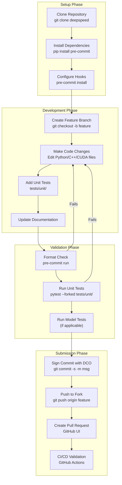
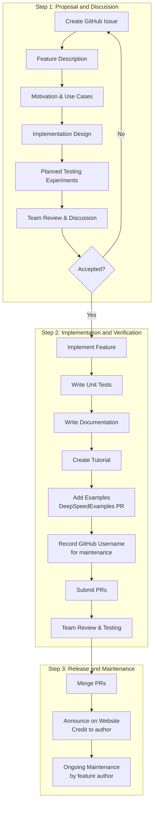
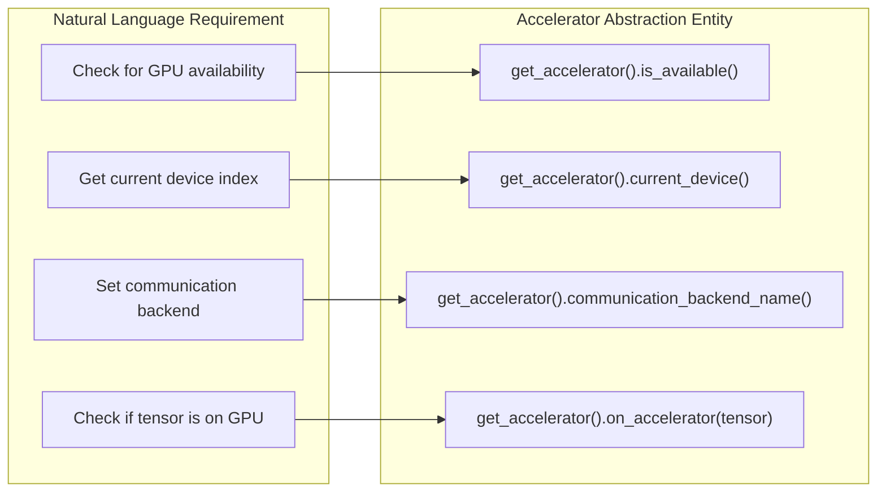

<!-- source: DeepWiki mcp.deepwiki.com · repo deepspeedai/DeepSpeed · page 17.3 Development Workflow and Contribution · fetched 2026-10-21 -->

# Development Workflow and Contribution

<details>
<summary>Relevant source files</summary>

The following files were used as context for generating this wiki page:

- [.pre-commit-config.yaml](.pre-commit-config.yaml)
- [CONTRIBUTING.md](CONTRIBUTING.md)
- [Makefile](Makefile)
- [csrc/xpu/adam/multi_tensor_apply.dp.hpp](csrc/xpu/adam/multi_tensor_apply.dp.hpp)
- [csrc/xpu/packbits/packing.cpp](csrc/xpu/packbits/packing.cpp)
- [deepspeed/env_report.py](deepspeed/env_report.py)
- [docs/_tutorials/accelerator-abstraction-interface.md](docs/_tutorials/accelerator-abstraction-interface.md)
- [docs/_tutorials/accelerator-setup-guide.md](docs/_tutorials/accelerator-setup-guide.md)
- [docs/assets/images/deepnvme_ops_report.png](docs/assets/images/deepnvme_ops_report.png)
- [op_builder/xpu/__init__.py](op_builder/xpu/__init__.py)
- [op_builder/xpu/builder.py](op_builder/xpu/builder.py)
- [op_builder/xpu/flash_attn.py](op_builder/xpu/flash_attn.py)
- [scripts/check-extraindexurl.py](scripts/check-extraindexurl.py)

</details>


## Purpose and Scope

This document describes the development workflow for contributing to DeepSpeed, including environment setup, code formatting requirements, testing procedures, and the contribution process. It covers both the technical prerequisites for development and the process for submitting changes.

For information about installation methods for end users, see [Installation Methods](#17.1). For Docker container deployment, see [Docker Environment Setup](#17.2). For distributed installation across clusters, see [Distributed Deployment](#17.4).

---

## Development Environment Setup

### Prerequisites Installation

DeepSpeed uses `pre-commit` to enforce code formatting and style consistency. Developers must install and configure pre-commit hooks before making commits:

```bash
# Install pre-commit
pip install pre-commit

# Install hooks (one-time setup)
pre-commit install
```

The pre-commit hooks run automatically on `git commit` and check:
- Code formatting (Python style via `yapf`) [ .pre-commit-config.yaml:25-28]()
- C++/CUDA formatting (via `clang-format`) [ .pre-commit-config.yaml:30-34]()
- License headers (via `scripts/check-license.py`) [ .pre-commit-config.yaml:47-52]()
- Prohibited strings like `--extra-index-url` (via `scripts/check-extraindexurl.py`) [ .pre-commit-config.yaml:84-90]()
- Direct `torch.cuda` or `torch.distributed` calls that should be wrapped by the accelerator abstraction [ .pre-commit-config.yaml:38-42](), [ .pre-commit-config.yaml:75-81]()

**Sources:** [CONTRIBUTING.md:5-11](), [.pre-commit-config.yaml:1-90]()

### Alternative Setup via Makefile

The repository provides a `Makefile` with common development tasks. Running `make format` automatically creates a virtual environment and installs pre-commit:

```bash
make format
```

This command:
1. Creates a `venv/` directory if it doesn't exist [ Makefile:14-15]()
2. Installs `pre-commit` in the virtual environment [ Makefile:17]()
3. Runs formatting checks on files modified compared to master [ Makefile:23]()

**Sources:** [Makefile:13-23]()

### Manual Pre-commit Execution

Developers can manually run pre-commit checks without committing:

```bash
# Run on files modified compared to master
pre-commit run --files $(git diff --name-only master)
```

If a formatting test fails, it will automatically fix the code and abort the commit. After reviewing the changes, add the modified files and recommit.

**Sources:** [CONTRIBUTING.md:13-20]()

---

## Development Workflow Overview



**Workflow Description:**

1. **Setup Phase**: Clone the repository, install development dependencies, and configure pre-commit hooks.
2. **Development Phase**: Create a feature branch, implement changes, add tests, and update documentation.
3. **Validation Phase**: Run formatting checks and tests locally before submission.
4. **Submission Phase**: Sign commits with DCO, push to fork, create PR, and await CI validation.

**Sources:** [CONTRIBUTING.md:1-106]()

---

## Testing Infrastructure

### Unit Testing with PyTest

DeepSpeed uses [PyTest](https://docs.pytest.org/) for unit testing. Tests are located in `tests/unit/` and must be run with the `--forked` flag to support CUDA functionality in distributed tests:

```bash
# Run all unit tests
pytest --forked tests/unit/

# Run specific test file
pytest --forked tests/unit/test_module.py

# Run with verbose output
pytest --forked -v tests/unit/
```

The `--forked` flag is required by `pytest-forked` to isolate CUDA state between tests.

**Sources:** [CONTRIBUTING.md:36-46]()

### Unit Test Execution via Makefile

The `Makefile` provides a convenient test target:

```bash
make test
```

This executes `pytest --forked tests/unit/` as defined in [Makefile:10-11]().

**Sources:** [Makefile:10-11]()

### Model Convergence Testing

Model tests validate end-to-end training convergence using [DeepSpeedExamples](https://github.com/deepspeedai/DeepSpeedExamples/). These tests are located in `tests/model/`:

```bash
# First install DeepSpeed
pip install .

# Run model tests
cd tests/model/
pytest run_sanity_check.py
```

Model tests do not require the `--forked` flag.

**Sources:** [CONTRIBUTING.md:52-60]()

---

## Developer Certificate of Origin (DCO)

### DCO Requirements

All contributions to DeepSpeed require commits to be signed with a Developer Certificate of Origin (DCO). The DCO declares that contributors have the right to submit their contributions under the project's license.

**Signing Commits:**

Include the `-s` flag when making commits:

```bash
git commit -s -m "Add feature X"
```

This appends a `Signed-off-by:` line to the commit message with your name and email.

**Sources:** [CONTRIBUTING.md:62-71]()

### DCO Validation

When a pull request is submitted, a DCO app automatically checks for signed commits. If any commits are missing DCO sign-off:

1. The DCO check will fail.
2. Click on the failing check for instructions.
3. Rebase and sign previous commits using:

```bash
git rebase --signoff HEAD~N  # N = number of commits to sign
git push --force-with-lease
```

**Important:** Creating PRs via the GitHub web interface does not include the DCO sign-off option. Always commit locally with `git commit -s`.

**Sources:** [CONTRIBUTING.md:67-70]()

---

## New Feature Contribution Process

### Three-Step Process

DeepSpeed follows a structured process for new feature contributions:



**Sources:** [CONTRIBUTING.md:79-106]()

### Step 1: Proposal Requirements

The initial GitHub issue must include:

| Component | Description |
|-----------|-------------|
| **Feature Description** | Clear explanation of the proposed functionality. |
| **Motivation** | Why this feature benefits DeepSpeed users. |
| **Design** | High-level implementation approach within DeepSpeed. |
| **Testing Plan** | Experiments to demonstrate effectiveness and correctness. |

**Testing Requirements:**

- **General features**: Test on at least one CV task (e.g., CIFAR-10) and one NLP task (e.g., SQuAD). [ CONTRIBUTING.md:89]()
- **Performance-only features**: Demonstrate consistent training/validation loss with improved performance. [ CONTRIBUTING.md:90]()
- **Convergence-affecting features**: Complete full training to show better/on-par final model quality. [ CONTRIBUTING.md:91]()

**Sources:** [CONTRIBUTING.md:82-91]()

---

## Cross-Accelerator Contribution

When contributing code that interacts with hardware (e.g., CUDA, XPU, NPU), contributors must use the **Accelerator Abstraction Interface** to ensure code is hardware-agnostic.

### Code Entity Mapping

The following diagram maps natural language requirements to specific code entities in the abstraction layer.



**Implementation Details:**
- **Runtime Calls**: Replace `torch.cuda.<interface>` with `get_accelerator().<interface>`. [ docs/_tutorials/accelerator-abstraction-interface.md:32-44]()
- **Device Names**: Use `get_accelerator().device_name()` instead of hardcoded `'cuda'`. [ docs/_tutorials/accelerator-abstraction-interface.md:58-60]()
- **Op Builders**: Hardware-specific operations are implemented via the `OpBuilder` hierarchy. For example, Intel XPU operations use `SYCLOpBuilder`. [ op_builder/xpu/builder.py:19-32]()

**Sources:** [docs/_tutorials/accelerator-abstraction-interface.md:25-78](), [op_builder/xpu/builder.py:119-128]()

---

## Environment Reporting and Debugging

For troubleshooting and environment validation, DeepSpeed provides the `env_report.py` module (exposed via `ds_report`).

### Report Components

| Function | Code Entity | Description |
|----------|-------------|-------------|
| **Op Report** | `op_report()` | Lists status of C++/CUDA/SYCL extensions (Installed vs Compatible). [ deepspeed/env_report.py:30-59]() |
| **JIT Check** | `is_ninja_available()` | Checks if `ninja` is available for JIT compilation. [ deepspeed/env_report.py:45]() |
| **Debug Info** | `debug_report()` | Prints versions for Torch, DeepSpeed, CUDA/HIP/CANN, and SHM size. [ deepspeed/env_report.py:132-164]() |

**Sources:** [deepspeed/env_report.py:30-177]()

---

## Code of Conduct

DeepSpeed has adopted the [Microsoft Open Source Code of Conduct](https://opensource.microsoft.com/codeofconduct/). Contributors are expected to follow this code of conduct in all interactions.

For questions or concerns, contact [opencode@microsoft.com](mailto:opencode@microsoft.com).

**Sources:** [CONTRIBUTING.md:72-77]()

---

