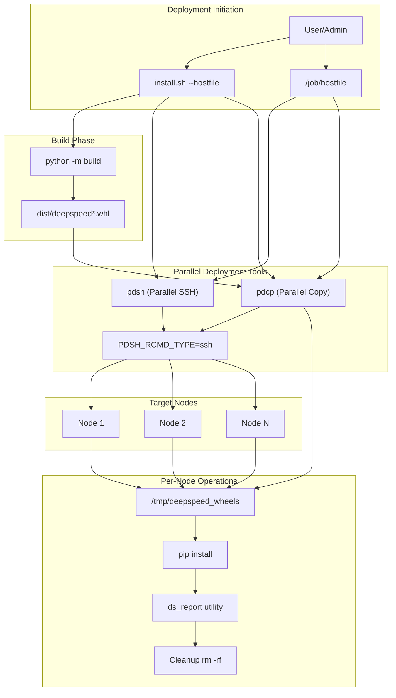
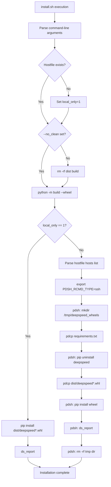
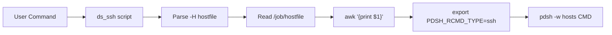

<!-- source: DeepWiki mcp.deepwiki.com · repo deepspeedai/DeepSpeed · page 17.4 Distributed Deployment · fetched 2026-10-21 -->

# Distributed Deployment

<details>
<summary>Relevant source files</summary>

The following files were used as context for generating this wiki page:

- [build_win.bat](build_win.bat)
- [deepspeed/constants.py](deepspeed/constants.py)
- [deepspeed/elasticity/elastic_agent.py](deepspeed/elasticity/elastic_agent.py)
- [deepspeed/launcher/constants.py](deepspeed/launcher/constants.py)
- [deepspeed/launcher/launch.py](deepspeed/launcher/launch.py)
- [deepspeed/launcher/launcher_helper.py](deepspeed/launcher/launcher_helper.py)
- [deepspeed/launcher/multinode_runner.py](deepspeed/launcher/multinode_runner.py)
- [deepspeed/launcher/runner.py](deepspeed/launcher/runner.py)
- [deepspeed/runtime/checkpoint_engine/nebula_checkpoint_engine.py](deepspeed/runtime/checkpoint_engine/nebula_checkpoint_engine.py)
- [deepspeed/runtime/checkpoint_engine/torch_checkpoint_engine.py](deepspeed/runtime/checkpoint_engine/torch_checkpoint_engine.py)
- [deepspeed/runtime/eigenvalue.py](deepspeed/runtime/eigenvalue.py)
- [docs/_tutorials/advanced-install.md](docs/_tutorials/advanced-install.md)
- [environment.yml](environment.yml)
- [install.sh](install.sh)
- [op_builder/builder.py](op_builder/builder.py)
- [op_builder/fused_adam.py](op_builder/fused_adam.py)
- [op_builder/fused_lamb.py](op_builder/fused_lamb.py)
- [op_builder/stochastic_transformer.py](op_builder/stochastic_transformer.py)
- [op_builder/transformer.py](op_builder/transformer.py)
- [setup.py](setup.py)
- [tests/unit/launcher/test_ds_arguments.py](tests/unit/launcher/test_ds_arguments.py)
- [tests/unit/launcher/test_multinode_runner.py](tests/unit/launcher/test_multinode_runner.py)
- [tests/unit/launcher/test_user_args.py](tests/unit/launcher/test_user_args.py)

</details>


## Purpose and Scope

This page describes how to deploy DeepSpeed across multiple nodes in a cluster environment. It covers the tools and scripts provided for distributed installation, including hostfile configuration, SSH-based deployment utilities, and containerized deployment strategies. For information about installing DeepSpeed on a single node, see [Installation Methods](17.1). For runtime multi-node job launching and execution, see [Launcher Architecture](8.1) and [Multi-Node Runners and Backends](8.2).

## Overview

DeepSpeed provides automated tools for deploying the framework across cluster nodes. The primary deployment mechanism uses the `install.sh` script with SSH-based parallel execution tools (`pdsh` and `pdcp`) to simultaneously install DeepSpeed on all nodes specified in a hostfile. This approach ensures consistent versions across the cluster and simplifies cluster management.

## Deployment Architecture



**Diagram: Distributed Deployment Flow**

The deployment process builds a wheel package locally, then uses parallel tools to copy and install it across all cluster nodes simultaneously.

Sources: [install.sh:149-183]()

## Hostfile Format

The hostfile follows the MPI-style format, specifying available compute nodes and their resources. Each line contains a hostname or IP address, optionally followed by resource specifications.

### Hostfile Structure

```text
node1.cluster.local slots=8
node2.cluster.local slots=8
192.168.1.103 slots=4
192.168.1.104 slots=4
```

**Format Specifications:**
- **Hostname/IP**: Fully qualified domain name or IP address. [deepspeed/launcher/runner.py:53-59]()
- **slots**: Number of GPU devices or worker slots on the node. [deepspeed/launcher/runner.py:58-59]()
- **Comments**: Lines starting with `#` are typically ignored by parsers.

### Hostfile Parsing

The `install.sh` script parses hostfiles using `awk` to extract hostnames for parallel operations:

```bash
hosts=`cat $hostfile | awk '{print $1}' | paste -sd "," -`;
```

Sources: [install.sh:164-165](), [deepspeed/launcher/runner.py:53-59]()

## The install.sh Script

The `install.sh` script is the primary tool for distributed deployment, supporting both local-only and cluster-wide installation modes.

### Command-Line Options

| Option | Long Form | Description | Default |
|--------|-----------|-------------|---------|
| `-l` | `--local_only` | Install only on local machine | Distributed if hostfile exists |
| `-s` | `--pip_sudo` | Run pip with sudo privileges | No sudo |
| `-r` | `--allow_sudo` | Allow script execution as root | Prohibited |
| `-n` | `--no_clean` | Skip cleaning prior build artifacts | Clean builds |
| `-m` | `--pip_mirror` | Specify pip mirror URL | Default pip mirror |
| `-H` | `--hostfile` | Path to hostfile | `/job/hostfile` |
| `-e` | `--examples` | Checkout example submodules | No examples |
| `-v` | `--verbose` | Enable verbose logging | Quiet mode |

Sources: [install.sh:10-95]()

### Distributed Installation Flow



Sources: [install.sh:149-183]()

### Key Implementation Details

**Build Artifacts Cleanup** [install.sh:128-134]()
Before building, the script removes previous build artifacts to ensure a clean build:
- `deepspeed/git_version_info_installed.py`
- `dist/` directory
- `build/` directory
- `deepspeed.egg-info/` directory

**Temporary Wheel Storage** [install.sh:171-181]()
During distributed installation, wheels are copied to `/tmp/deepspeed_wheels` on each node. This temporary directory is created, populated, and cleaned up automatically.

**Installation Verification** [install.sh:180]()
After installation, `ds_report` (or `python -m deepspeed.env_report`) runs on each node to verify the installation and report environment details. [docs/_tutorials/advanced-install.md:19-26]()

## PDSH and PDCP Tools

DeepSpeed's distributed deployment relies on two parallel execution tools that must be installed on the deployment node.

### PDSH (Parallel Distributed Shell)

`pdsh` executes commands across multiple hosts simultaneously using SSH. The `PDSHRunner` class in the launcher logic also uses these flags for runtime job execution. [deepspeed/launcher/multinode_runner.py:55-123]()

**Usage Pattern in install.sh:**
```bash
export PDSH_RCMD_TYPE=ssh
pdsh -w $hosts "pip install $tmp_wheel_path/deepspeed*.whl"
```

| Operation | Command | Purpose |
|-----------|---------|---------|
| Directory creation | `pdsh -w $hosts "mkdir -pv ..."` | Create temp directories | [install.sh:173]() |
| Uninstall previous | `pdsh -w $hosts "pip uninstall ..."` | Remove old versions | [install.sh:177]() |
| Verify installation | `pdsh -w $hosts "ds_report"` | Check environment | [install.sh:180]() |

### PDCP (Parallel Distributed Copy)

`pdcp` copies files to multiple hosts in parallel.

**File Distribution in install.sh:**
```bash
# Copy requirements file
pdcp -w $hosts requirements/requirements.txt ${tmp_wheel_path}/

# Copy wheel package
pdcp -w $hosts dist/deepspeed*.whl $tmp_wheel_path/
```
Sources: [install.sh:174-178]()

## ds_ssh Utility

The `ds_ssh` script (typically found in the `bin/` directory) provides a wrapper around `pdsh` for executing arbitrary commands across cluster nodes.



Sources: [install.sh:164-170](), [deepspeed/launcher/runner.py:7-9]()

## Build Configuration and Environment Variables

When deploying across a cluster, it is often necessary to pre-compile operations to ensure all nodes have the same kernels ready.

| Variable | Description | Source |
|----------|-------------|--------|
| `DS_BUILD_OPS` | If `1`, attempts to pre-compile all compatible extensions. | [docs/_tutorials/advanced-install.md:39-44]() |
| `DS_SKIP_CUDA_CHECK` | If `1`, allows compilation even if system CUDA and Torch CUDA versions mismatch. | [op_builder/builder.py:102-108]() |
| `TORCH_CUDA_ARCH_LIST` | Specifies which GPU architectures to build for (e.g., "7.0;8.0"). | [docs/_tutorials/advanced-install.md:154-158]() |
| `DS_ENABLE_NINJA` | Enables the use of the Ninja build system for faster compilation. | [setup.py:131-132]() |

Sources: [op_builder/builder.py:90-113](), [setup.py:151-179](), [docs/_tutorials/advanced-install.md:50-75]()

## Common Deployment Patterns

### Pattern 1: Fresh Cluster Installation
For a new cluster without existing DeepSpeed installation:
```bash
./install.sh -H /path/to/hostfile -v
```
This performs a clean build, distributes the wheel, installs, and verifies. [install.sh:149-183]()

### Pattern 2: Update Existing Installation
For updating DeepSpeed across the cluster while preserving build artifacts:
```bash
./install.sh -H /path/to/hostfile --no_clean
```
Sources: [install.sh:67-70]()

### Pattern 3: Development Deployment
For deploying local development changes with verbose logging:
```bash
./install.sh -H /path/to/hostfile -n -v
```
Sources: [install.sh:59-62]()

## Verification and Troubleshooting

### Post-Installation Verification
After distributed deployment, verify installation on all nodes using the DeepSpeed report utility:
```bash
pdsh -w $hosts "ds_report"
```
Sources: [install.sh:180](), [docs/_tutorials/advanced-install.md:19-26]()

### Common Issues
1. **SSH Authentication Failures**: Ensure `PDSH_RCMD_TYPE=ssh` is set and passwordless SSH is configured. [install.sh:170]()
2. **CUDA Mismatch**: If nodes have different CUDA versions than the build node, pre-compilation may fail unless `DS_SKIP_CUDA_CHECK=1` is used. [op_builder/builder.py:109-112]()
3. **Architecture Mismatch**: If kernels fail to run, ensure `TORCH_CUDA_ARCH_LIST` includes the target node architectures. [docs/_tutorials/advanced-install.md:142-149]()

Sources: [op_builder/builder.py:90-113](), [install.sh:149-183](), [docs/_tutorials/advanced-install.md:142-161]()

---

