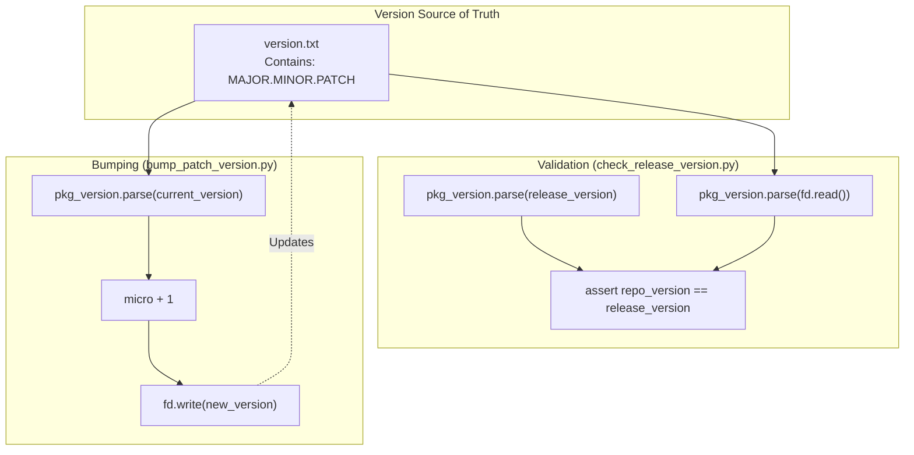
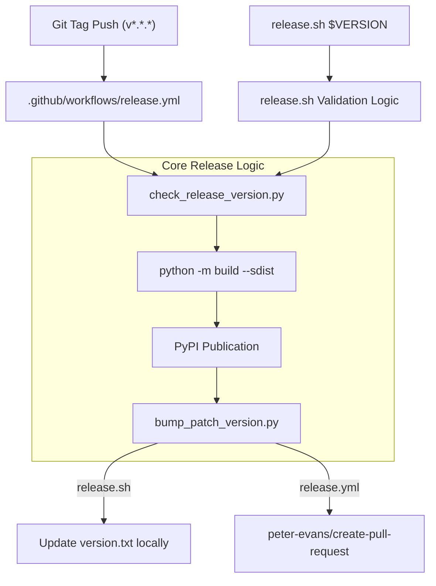

<!-- source: DeepWiki mcp.deepwiki.com · repo deepspeedai/DeepSpeed · page 18 Release Management · fetched 2026-10-21 -->

# Release Management

Relevant source files

The following files were used as context for generating this wiki page:

- [.github/workflows/release.yml](.github/workflows/release.yml)
- [MANIFEST.in](MANIFEST.in)
- [csrc/aio/py_lib/deepspeed_aio_thread.cpp](csrc/aio/py_lib/deepspeed_aio_thread.cpp)
- [deepspeed/utils/numa.py](deepspeed/utils/numa.py)
- [op_builder/cpu/async_io.py](op_builder/cpu/async_io.py)
- [op_builder/npu/__init__.py](op_builder/npu/__init__.py)
- [op_builder/npu/async_io.py](op_builder/npu/async_io.py)
- [op_builder/npu/builder.py](op_builder/npu/builder.py)
- [op_builder/npu/fused_adam.py](op_builder/npu/fused_adam.py)
- [op_builder/npu/inference.py](op_builder/npu/inference.py)
- [op_builder/npu/no_impl.py](op_builder/npu/no_impl.py)
- [op_builder/xpu/async_io.py](op_builder/xpu/async_io.py)
- [release/bump_patch_version.py](release/bump_patch_version.py)
- [release/check_release_version.py](release/check_release_version.py)
- [release/release.sh](release/release.sh)
- [version.txt](version.txt)

## Purpose and Scope

This document describes the DeepSpeed release management system, including version control mechanisms, release automation scripts, and the PyPI publication workflow. The release system ensures consistent versioning, automated validation, and streamlined package distribution through both manual scripts and GitHub Actions.

For information about build system configuration and compilation, see [Build System and Custom Operations](#9). For CI/CD testing that validates releases, see [CI/CD Pipeline](#16).

---

## Version Management System

DeepSpeed uses a centralized version management system based on a single source of truth: the `version.txt` file. This approach ensures version consistency across all release artifacts and automation pipelines.

For details, see [Version Management System](#18.1).

### Version File Structure

The version is stored in `version.txt` at the repository root in semantic versioning format (MAJOR.MINOR.PATCH):

[version.txt:1-1]()

### Version Validation

Before each release, the system validates that the intended release version matches the repository version. The validation script `check_release_version.py` performs this check:

[release/check_release_version.py:15-20]()

### Automatic Version Bumping

After a successful release, the system automatically increments the patch version number to prepare for the next development cycle. The `bump_patch_version.py` script handles this:

[release/bump_patch_version.py:17-22]()

### Version Management Diagram

**Sources:** [version.txt:1-1](), [release/check_release_version.py:15-20](), [release/bump_patch_version.py:17-22]()

---

## Release Process and Automation

The release process is orchestrated either by the `release.sh` shell script or via the GitHub Actions `release.yml` workflow.

For details, see [Release Process and Automation](#18.2).

### Release Script Orchestration

The `release.sh` script automates validation, building, and publication:

[release/release.sh:10-56]()

Key steps include:
- **Validation**: Checking version format and consistency [release/release.sh:12-26]().
- **Build**: Creating a source distribution (sdist) [release/release.sh:41]().
- **Publish**: Uploading to PyPI via `twine` [release/release.sh:49]().
- **Tagging**: Creating and pushing a git tag (e.g., `v0.19.3`) [release/release.sh:51-52]().

### Automated Release Workflow (GitHub Actions)

The repository includes a GitHub Actions workflow `.github/workflows/release.yml` that triggers on tag creation. This workflow automates the publication and the post-release version bump via a Pull Request:

[ .github/workflows/release.yml:3-6]()

The workflow performs:
1. **Validation**: Runs `check_release_version.py` [ .github/workflows/release.yml:25]().
2. **Build**: Generates the sdist package [ .github/workflows/release.yml:30]().
3. **Publish**: Uses `pypa/gh-action-pypi-publish` to upload to PyPI [ .github/workflows/release.yml:32-35]().
4. **Auto-PR**: Bumps the version and creates a Pull Request to update `version.txt` [ .github/workflows/release.yml:36-51]().

### Release Automation Diagram

**Sources:** [release/release.sh:1-56](), [.github/workflows/release.yml:1-53]()

---

## Package Manifest Configuration

The `MANIFEST.in` file specifies which files are included in the source distribution. This is critical for ensuring users can build DeepSpeed from the source package, especially for JIT-compiled ops like `AsyncIOBuilder`.

### Included File Categories

The manifest captures all necessary source code and pre-compiled assets:

[MANIFEST.in:1-9]()

| Category | Patterns |
|----------|----------|
| **Metadata** | `*.txt`, `README.md` |
| **Pre-compiled Kernels** | `deepspeed/inference/v2/kernels/.../*.so` |
| **C++/CUDA Source** | `recursive-include deepspeed *.cpp *.h *.cu *.tr` |
| **Ops Infrastructure** | `recursive-include op_builder *.py` |
| **Hardware Support** | `recursive-include accelerator *.py` |

For example, the `AsyncIOBuilder` requires the source files defined in its `sources()` method to be present in the package for JIT compilation:

[op_builder/xpu/async_io.py:22-36]()

**Sources:** [MANIFEST.in:1-9](), [op_builder/xpu/async_io.py:22-36]()

---

## Key Design Decisions

### Single Source of Truth
The `version.txt` file serves as the sole authoritative version source. This eliminates version conflicts between the Python package, git tags, and internal validation logic.

### Automated Version Lifecycle
The transition from a release (e.g., `0.19.3`) to the next development cycle (e.g., `0.19.4`) is handled automatically by `bump_patch_version.py`. This ensures that every release is immediately followed by a version increment, preventing the accidental reuse of release versions for development builds.

### Defense-in-Depth Validation
Validation occurs at multiple levels:
1. **Shell Script**: `release.sh` checks for the presence of `~/.pypirc` and basic string formats [release/release.sh:5-20]().
2. **Python Logic**: `check_release_version.py` performs rigorous semantic version comparison [release/check_release_version.py:15-20]().
3. **Build System**: The build process verifies that the generated tarball filename matches the expected version [release/release.sh:43-47]().

**Sources:** [version.txt:1-1](), [release/release.sh:1-56](), [release/check_release_version.py:1-21](), [release/bump_patch_version.py:1-23]()

---

