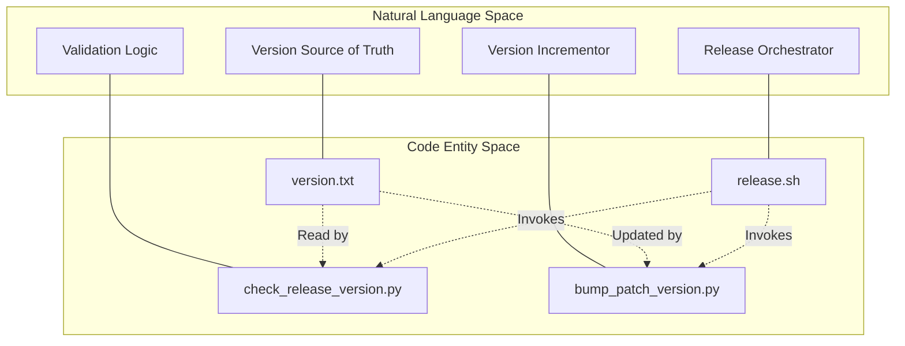
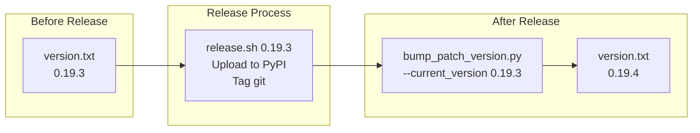
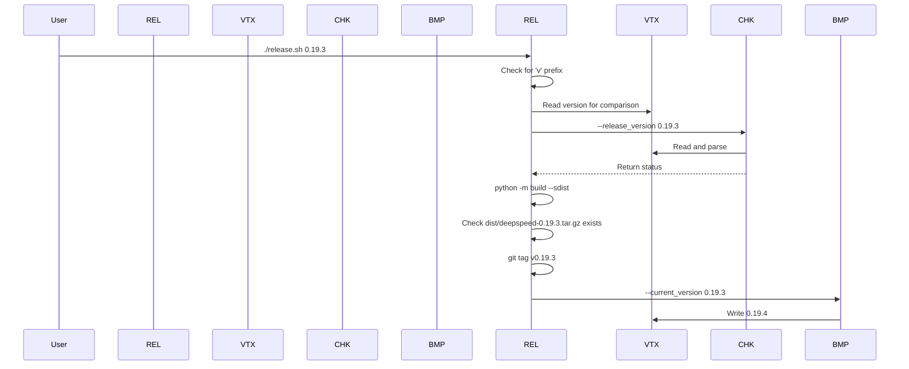

<!-- source: DeepWiki mcp.deepwiki.com · repo deepspeedai/DeepSpeed · page 18.1 Version Management System · fetched 2026-10-21 -->

# Version Management System

<details>
<summary>Relevant source files</summary>

The following files were used as context for generating this wiki page:

- [MANIFEST.in](MANIFEST.in)
- [release/bump_patch_version.py](release/bump_patch_version.py)
- [release/check_release_version.py](release/check_release_version.py)
- [release/release.sh](release/release.sh)
- [version.txt](version.txt)

</details>


## Purpose and Scope

This document describes DeepSpeed's version management system, which maintains a single source of truth for the project version in `version.txt` and provides automated tooling for version validation and incrementation. The version management system ensures consistency between repository state, PyPI releases, and git tags.

For information about the complete release process including PyPI upload and git tagging, see [Release Process and Automation](#18.2).

---

## Version File Architecture

DeepSpeed uses a centralized version management approach with `version.txt` as the single source of truth for the project version.

### Version File Format

The version follows semantic versioning with the format `MAJOR.MINOR.PATCH`:

```
# version.txt
0.19.3
```

The file contains only the version number followed by a newline, with no additional metadata or formatting.

**Sources:** [version.txt:1-2]()

### Distribution Manifest

The version file is explicitly included in source distributions via `MANIFEST.in`:

```
include *.txt README.md
```

This ensures `version.txt` is packaged with every distribution, allowing the version to be read at runtime if needed.

**Sources:** [MANIFEST.in:1]()

---

## Version Management Components

The version management system consists of three primary Python scripts that handle validation, checking, and incrementation.

### Code Entity to System Role Mapping

The following diagram maps specific code entities to their roles within the Version Management System.



**Sources:** [release/check_release_version.py:1-21](), [release/bump_patch_version.py:1-23](), [release/release.sh:1-56]()

---

## Version Validation System

### Release Version Checking

The `check_release_version.py` script validates that a proposed release version matches the current version in `version.txt`. This prevents accidental releases with mismatched version numbers.

**Validation Logic:**

| Step | Operation | File Reference |
|------|-----------|----------------|
| Parse argument | Extract `--release_version` from CLI | [release/check_release_version.py:11]() |
| Parse version | Use `packaging.version.parse()` | [release/check_release_version.py:15]() |
| Read file | Read and parse `version.txt` | [release/check_release_version.py:17-18]() |
| Validate | Assert versions match exactly | [release/check_release_version.py:20]() |

**Usage:**

```bash
python release/check_release_version.py --release_version 0.19.3
```

The script uses Python's `packaging.version` module to ensure both versions are parsed using the same semantic versioning rules.

**Sources:** [release/check_release_version.py:1-21]()

### Version Format Validation

The release script performs additional format validation:

1. **No 'v' prefix allowed**: The version number must be bare digits (e.g., `0.19.3` not `v0.19.3`) [release/release.sh:17-20]()
2. **Exact match with version.txt**: The release argument must match the file contents exactly [release/release.sh:22-26]()
3. **Valid semantic version**: Must pass `packaging.version.parse()` validation [release/release.sh:29]()

```bash
# In release.sh
if [[ $version == *"v"* ]]; then
    echo "please only include version number without 'v' prefix"
    exit 1
fi

if [ "${version}" != `cat version.txt` ]; then
    echo "version=${version} does not match version.txt"
    exit 1
fi
```

**Sources:** [release/release.sh:17-26]()

---

## Version Bumping Process

After a successful release, the patch version is automatically incremented to prepare for the next development cycle.



### Bump Patch Version Script

The `bump_patch_version.py` script implements automatic patch version incrementation:

**Algorithm:**

1. Parse current version from `--current_version` argument [release/bump_patch_version.py:17]()
2. Extract major, minor, and patch (micro) components [release/bump_patch_version.py:20]()
3. Increment patch component by 1 [release/bump_patch_version.py:20]()
4. Write new version to `version.txt` [release/bump_patch_version.py:19-20]()
5. Print version transition [release/bump_patch_version.py:22]()

**Implementation:**

```python
current_version = pkg_version.parse(args.current_version)

with open('./version.txt', 'w') as fd:
    fd.write(f'{current_version.major}.{current_version.minor}.{current_version.micro + 1}\n')

print(f'{current_version} -> {current_version.major}.{current_version.minor}.{current_version.micro + 1}')
```

**Sources:** [release/bump_patch_version.py:17-22]()

### Version Component Access

The script uses `packaging.version` attributes to access version components:

| Attribute | Semantic Versioning Component | Example Value |
|-----------|------------------------------|---------------|
| `.major` | Major version | `0` |
| `.minor` | Minor version | `19` |
| `.micro` | Patch version | `3` |

Note that `packaging.version` uses `.micro` instead of `.patch` for the third component.

**Sources:** [release/bump_patch_version.py:17-22]()

---

## Integration with Release Workflow

The version management system is tightly integrated with the release automation script `release.sh`.

### Release Execution Flow

The following diagram illustrates the execution flow and the interaction between release scripts and files.



**Validation Steps in release.sh:**

1. **Line 17-20**: Reject versions with 'v' prefix [release/release.sh:17-20]()
2. **Line 22-26**: Verify argument matches `version.txt` [release/release.sh:22-26]()
3. **Line 28-33**: Call `check_release_version.py` for validation [release/release.sh:28-33]()
4. **Line 43-47**: Verify built artifact matches expected version [release/release.sh:43-47]()
5. **Line 54-55**: Bump patch version after successful release [release/release.sh:54-55]()

**Sources:** [release/release.sh:1-56]()

### Build Artifact Validation

The release script validates that the built source distribution matches the requested version:

```bash
if [ ! -f dist/deepspeed-${version}.tar.gz ]; then
    echo "prepared version does not match version given ($version), bump version first?"
    ls dist
    exit 1
fi
```

This prevents uploading a mismatched artifact to PyPI if the build process or `version.txt` is inconsistent.

**Sources:** [release/release.sh:43-47]()

---

## Error Handling and Validation Failures

The version management system includes comprehensive error checking at each stage:

### Common Error Scenarios

| Error Condition | Detection Point | Error Message | Exit Code |
|----------------|-----------------|---------------|-----------|
| Version has 'v' prefix | `release.sh:17-20` | "please only include version number without 'v' prefix" | 1 |
| Argument doesn't match file | `release.sh:22-26` | "version={version} does not match version.txt" | 1 |
| Invalid version format | `check_release_version.py:20` | Assert failure with version mismatch | 1 |
| Built artifact mismatch | `release.sh:43-47` | "prepared version does not match version given" | 1 |

### Pre-Release Validation Sequence

Before any PyPI upload or git tagging occurs, the release script performs all validation:

```bash
# release.sh validation sequence
echo "checking that the version is valid"
python release/check_release_version.py --release_version ${version}
if [ $? != 0 ]; then
    echo 'please check the version number selected'
    exit 1
fi
```

This fail-fast approach prevents partial releases where the version is invalid.

**Sources:** [release/release.sh:28-33]()

---

## Version File I/O Patterns

The system uses consistent patterns for reading and writing the version file:

### Reading Pattern

```python
# Used in check_release_version.py
with open('./version.txt') as fd:
    repo_version = pkg_version.parse(fd.read())
```

The file is read entirely, then parsed using `packaging.version.parse()` which handles whitespace automatically.

**Sources:** [release/check_release_version.py:17-18]()

### Writing Pattern

```python
# Used in bump_patch_version.py
with open('./version.txt', 'w') as fd:
    fd.write(f'{current_version.major}.{current_version.minor}.{current_version.micro + 1}\n')
```

The file is overwritten completely with the new version and a trailing newline.

**Sources:** [release/bump_patch_version.py:19-20]()

### File Location

All scripts assume `version.txt` is located at the repository root (`./version.txt`), and must be executed from the repository root directory.

**Sources:** [release/check_release_version.py:17](), [release/bump_patch_version.py:19]()

---

## Dependencies

The version management system requires the following Python packages:

| Package | Purpose | Usage |
|---------|---------|-------|
| `argparse` | CLI argument parsing | Both bump and check scripts |
| `packaging` | Semantic version parsing | `pkg_version.parse()` for validation |

No DeepSpeed-specific dependencies are required, making the version management system independent of the rest of the codebase.

**Sources:** [release/bump_patch_version.py:6-7](), [release/check_release_version.py:6-7]()

---

## Git Tagging Integration

After successful PyPI upload, the release script creates and pushes a git tag with the 'v' prefix:

```bash
git tag v${version}
git push origin v${version}
```

This creates a permanent reference in the git history (e.g., `v0.19.3`) even though the version file itself does not include the 'v' prefix.

**Sources:** [release/release.sh:51-52]()

---

## Summary

The DeepSpeed version management system is a minimal, file-based approach with three key characteristics:

1. **Single Source of Truth**: `version.txt` contains the authoritative version.
2. **Automated Validation**: Multiple layers of validation prevent version mismatches.
3. **Post-Release Automation**: Automatic patch version bumping prepares for next development cycle.

The system integrates seamlessly with the release process while remaining simple enough to be easily understood and modified.

**Sources:** [version.txt](), [release/release.sh](), [release/bump_patch_version.py](), [release/check_release_version.py]()

---

