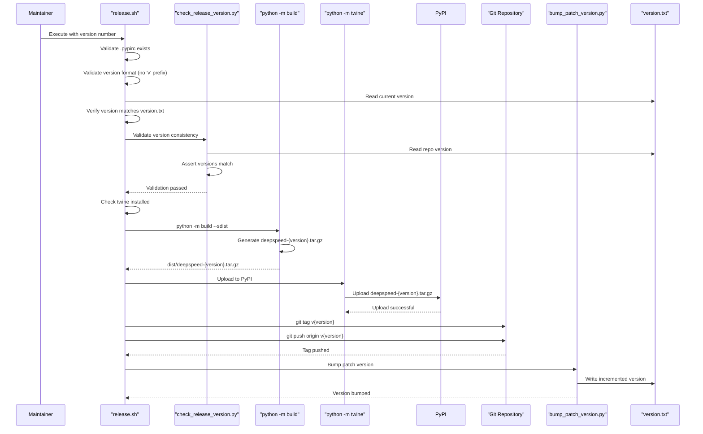
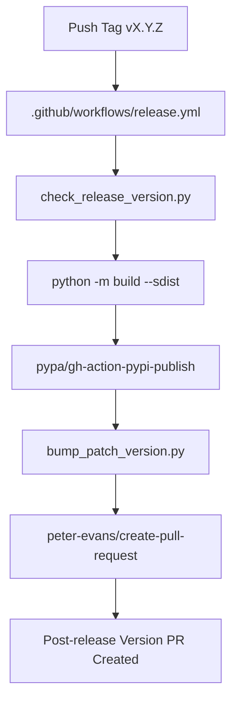
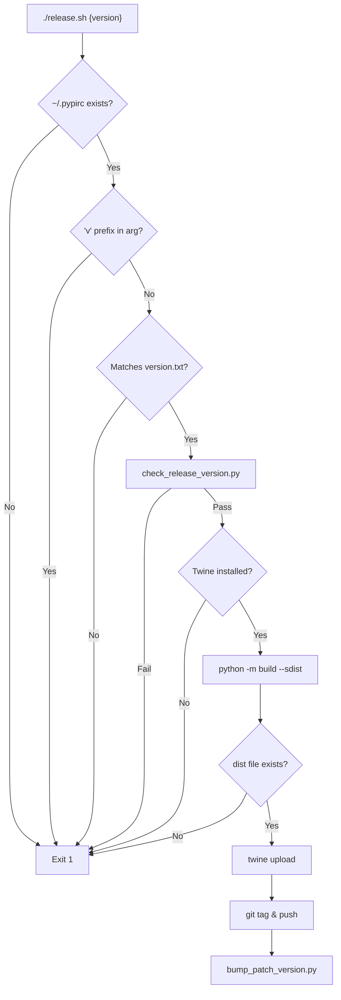

<!-- source: DeepWiki mcp.deepwiki.com · repo deepspeedai/DeepSpeed · page 18.2 Release Process and Automation · fetched 2026-10-21 -->

# Release Process and Automation

Relevant source files

The following files were used as context for generating this wiki page:

- [.github/workflows/release.yml](.github/workflows/release.yml)
- [MANIFEST.in](MANIFEST.in)
- [csrc/aio/py_lib/deepspeed_aio_thread.cpp](csrc/aio/py_lib/deepspeed_aio_thread.cpp)
- [deepspeed/utils/numa.py](deepspeed/utils/numa.py)
- [op_builder/cpu/async_io.py](op_builder/cpu/async_io.py)
- [op_builder/npu/__init__.py](op_builder/npu/__init__.py)
- [op_builder/npu/async_io.py](op_builder/npu/async_io.py)
- [op_builder/npu/builder.py](op_builder/npu/builder.py)
- [op_builder/npu/fused_adam.py](op_builder/npu/fused_adam.py)
- [op_builder/npu/inference.py](op_builder/npu/inference.py)
- [op_builder/npu/no_impl.py](op_builder/npu/no_impl.py)
- [op_builder/xpu/async_io.py](op_builder/xpu/async_io.py)
- [release/bump_patch_version.py](release/bump_patch_version.py)
- [release/check_release_version.py](release/check_release_version.py)
- [release/release.sh](release/release.sh)
- [version.txt](version.txt)

This document describes DeepSpeed's release process for publishing new versions to PyPI (Python Package Index). It covers the automated release workflow orchestrated by the `release.sh` script and the GitHub Actions automation that handles tagging, package building, PyPI upload, and post-release version management.

## Purpose and Scope

The release process encompasses:

- Pre-release validation of version numbers and environment.
- Automated GitHub Actions workflow triggered by version tags.
- Source distribution (sdist) creation using Python build tools.
- PyPI upload via Twine or GitHub Actions.
- Automatic patch version incrementing and Pull Request creation for the next development cycle.

## Release Workflow Overview

The release workflow can be initiated manually via the `release.sh` script or automatically via GitHub Actions when a tag is pushed. Both paths execute validation checks, build the distribution package, and upload to PyPI.

### Manual Orchestration (release.sh)

The `release.sh` script executes a series of validation checks, builds the distribution package, uploads to PyPI, and creates a git tag.

**Sources:** [release/release.sh:1-56](), [release/check_release_version.py:1-21](), [release/bump_patch_version.py:1-23](), [version.txt:1]()

### Automated Orchestration (GitHub Actions)

The `.github/workflows/release.yml` workflow automates the process when a tag matching `v*.*.*` is pushed to the repository.

**Sources:** [.github/workflows/release.yml:1-53]()

## Pre-Release Validation

The release process performs multiple validation checks before proceeding:

| Validation Check | Purpose | Code Entity |
|-----------------|---------|-------------|
| `.pypirc` existence | Ensures PyPI credentials configured for manual upload | `release.sh` [release/release.sh:5-8]() |
| Version format | Validates version string format (no 'v' prefix for script) | `release.sh` [release/release.sh:17-20]() |
| Version consistency | Matches input version against `version.txt` | `check_release_version.py` [release/check_release_version.py:15-20]() |
| Twine availability | Ensures upload tool installed for manual upload | `release.sh` [release/release.sh:35-39]() |

### Version Consistency Check
The `check_release_version.py` script uses the `packaging` library to ensure the requested release version matches the content of `version.txt`.

[release/check_release_version.py:15-20]()

## Build and Distribution

### Source Distribution Creation
Both manual and automated workflows use the `build` module to create a source distribution (sdist). The `DS_BUILD_STRING=" "` environment variable is used to ensure no custom build metadata is appended to the version string.

[release/release.sh:41](), [.github/workflows/release.yml:30]()

### Distribution Contents
The `MANIFEST.in` file defines the assets included in the source distribution. This is critical for users who compile custom C++/CUDA operators at runtime (JIT).

| File Pattern | Purpose |
|--------------|---------|
| `*.txt`, `README.md` | Core metadata and documentation |
| `deepspeed/inference/v2/kernels/.../*.so` | Pre-compiled V2 inference libraries |
| `recursive-include deepspeed *.cpp *.cu *.json` | Source for Python modules and C++ extensions |
| `recursive-include csrc *.cpp *.h *.cu` | Core C++ and CUDA kernel source code |
| `recursive-include op_builder *.py` | Logic for compiling extensions (e.g., `AsyncIOBuilder`) |

**Sources:** [MANIFEST.in:1-9](), [op_builder/xpu/async_io.py:12-36]()

## PyPI Publication

### Manual Upload
The `release.sh` script uses `twine` to upload the generated `.tar.gz` file to the `deepspeed` repository defined in the maintainer's `.pypirc`.

[release/release.sh:49]()

### Automated Upload
The GitHub Actions workflow uses the `pypa/gh-action-pypi-publish` action, authenticated via the `PYPI_API_TOKEN` secret.

[.github/workflows/release.yml:31-35]()

## Post-Release Automation

### Version Bumping
Once a release is successfully published, the system increments the patch version to prepare for the next development cycle. This is handled by `bump_patch_version.py`.

[release/bump_patch_version.py:17-22]()

### Automatic Pull Request
In the GitHub Actions workflow, after the version is bumped in `version.txt`, a Pull Request is automatically generated to update the `master` branch.

[.github/workflows/release.yml:39-51]()

| PR Attribute | Value |
|--------------|-------|
| **Branch** | `AutoPR/${RELEASE_VERSION}` |
| **Title** | `Update version.txt after ${RELEASE_VERSION} release` |
| **Paths** | `version.txt` |

**Sources:** [.github/workflows/release.yml:39-51](), [release/bump_patch_version.py:17-22]()

## Complete Decision Logic

The following diagram illustrates the error handling and flow within the `release.sh` orchestration:

**Sources:** [release/release.sh:1-56]()

---

