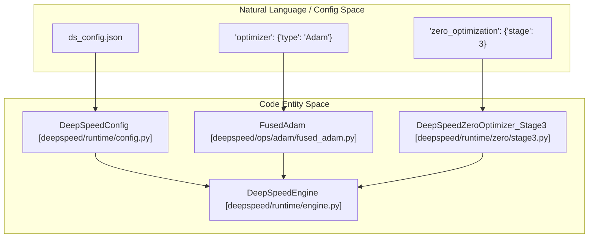

<!-- source: DeepWiki mcp.deepwiki.com · repo deepspeedai/DeepSpeed · page 19 Glossary · fetched 2026-10-21 -->

# Glossary

<details>
<summary>Relevant source files</summary>

The following files were used as context for generating this wiki page:

- [README.md](README.md)
- [azure/README.md](azure/README.md)
- [deepspeed/__init__.py](deepspeed/__init__.py)
- [deepspeed/compile/backend.py](deepspeed/compile/backend.py)
- [deepspeed/compile/graph_param.py](deepspeed/compile/graph_param.py)
- [deepspeed/compile/inductor.py](deepspeed/compile/inductor.py)
- [deepspeed/compile/partitioner.py](deepspeed/compile/partitioner.py)
- [deepspeed/compile/passes/offload_activation.py](deepspeed/compile/passes/offload_activation.py)
- [deepspeed/compile/passes/offload_adam_states.py](deepspeed/compile/passes/offload_adam_states.py)
- [deepspeed/compile/passes/offload_parameters.py](deepspeed/compile/passes/offload_parameters.py)
- [deepspeed/compile/passes/prefetch.py](deepspeed/compile/passes/prefetch.py)
- [deepspeed/compile/profilers/graph_profile.py](deepspeed/compile/profilers/graph_profile.py)
- [deepspeed/inference/engine.py](deepspeed/inference/engine.py)
- [deepspeed/module_inject/__init__.py](deepspeed/module_inject/__init__.py)
- [deepspeed/module_inject/auto_tp.py](deepspeed/module_inject/auto_tp.py)
- [deepspeed/module_inject/auto_tp_model_utils.py](deepspeed/module_inject/auto_tp_model_utils.py)
- [deepspeed/module_inject/autotp_config.py](deepspeed/module_inject/autotp_config.py)
- [deepspeed/module_inject/fusedqkv_utils.py](deepspeed/module_inject/fusedqkv_utils.py)
- [deepspeed/module_inject/layers.py](deepspeed/module_inject/layers.py)
- [deepspeed/module_inject/replace_module.py](deepspeed/module_inject/replace_module.py)
- [deepspeed/module_inject/replace_policy.py](deepspeed/module_inject/replace_policy.py)
- [deepspeed/module_inject/tp_shard.py](deepspeed/module_inject/tp_shard.py)
- [deepspeed/moe/layer.py](deepspeed/moe/layer.py)
- [deepspeed/moe/mappings.py](deepspeed/moe/mappings.py)
- [deepspeed/moe/sharded_moe.py](deepspeed/moe/sharded_moe.py)
- [deepspeed/ops/adam/__init__.py](deepspeed/ops/adam/__init__.py)
- [deepspeed/ops/adam/zenflow_cpu_adam.py](deepspeed/ops/adam/zenflow_cpu_adam.py)
- [deepspeed/ops/adam/zenflow_torch_adam.py](deepspeed/ops/adam/zenflow_torch_adam.py)
- [deepspeed/ops/transformer/inference/moe_inference.py](deepspeed/ops/transformer/inference/moe_inference.py)
- [deepspeed/runtime/activation_checkpointing/checkpointing.py](deepspeed/runtime/activation_checkpointing/checkpointing.py)
- [deepspeed/runtime/base_optimizer.py](deepspeed/runtime/base_optimizer.py)
- [deepspeed/runtime/bf16_optimizer.py](deepspeed/runtime/bf16_optimizer.py)
- [deepspeed/runtime/config.py](deepspeed/runtime/config.py)
- [deepspeed/runtime/constants.py](deepspeed/runtime/constants.py)
- [deepspeed/runtime/engine.py](deepspeed/runtime/engine.py)
- [deepspeed/runtime/fp16/fused_optimizer.py](deepspeed/runtime/fp16/fused_optimizer.py)
- [deepspeed/runtime/fp16/loss_scaler.py](deepspeed/runtime/fp16/loss_scaler.py)
- [deepspeed/runtime/fp16/unfused_optimizer.py](deepspeed/runtime/fp16/unfused_optimizer.py)
- [deepspeed/runtime/pipe/engine.py](deepspeed/runtime/pipe/engine.py)
- [deepspeed/runtime/pipe/module.py](deepspeed/runtime/pipe/module.py)
- [deepspeed/runtime/state_dict_factory.py](deepspeed/runtime/state_dict_factory.py)
- [deepspeed/runtime/superoffload/superoffload_stage3.py](deepspeed/runtime/superoffload/superoffload_stage3.py)
- [deepspeed/runtime/superoffload/superoffload_utils.py](deepspeed/runtime/superoffload/superoffload_utils.py)
- [deepspeed/runtime/utils.py](deepspeed/runtime/utils.py)
- [deepspeed/runtime/zenflow/__init__.py](deepspeed/runtime/zenflow/__init__.py)
- [deepspeed/runtime/zenflow/engine.py](deepspeed/runtime/zenflow/engine.py)
- [deepspeed/runtime/zenflow/engine_stage3.py](deepspeed/runtime/zenflow/engine_stage3.py)
- [deepspeed/runtime/zenflow/zenflow_config.py](deepspeed/runtime/zenflow/zenflow_config.py)
- [deepspeed/runtime/zenflow/zenflow_stage_1_and_2.py](deepspeed/runtime/zenflow/zenflow_stage_1_and_2.py)
- [deepspeed/runtime/zenflow/zenflow_utils.py](deepspeed/runtime/zenflow/zenflow_utils.py)
- [deepspeed/runtime/zero/config.py](deepspeed/runtime/zero/config.py)
- [deepspeed/runtime/zero/mics.py](deepspeed/runtime/zero/mics.py)
- [deepspeed/runtime/zero/parameter_offload.py](deepspeed/runtime/zero/parameter_offload.py)
- [deepspeed/runtime/zero/partition_parameters.py](deepspeed/runtime/zero/partition_parameters.py)
- [deepspeed/runtime/zero/partitioned_param_coordinator.py](deepspeed/runtime/zero/partitioned_param_coordinator.py)
- [deepspeed/runtime/zero/stage3.py](deepspeed/runtime/zero/stage3.py)
- [deepspeed/runtime/zero/stage_1_and_2.py](deepspeed/runtime/zero/stage_1_and_2.py)
- [deepspeed/runtime/zero/utils.py](deepspeed/runtime/zero/utils.py)
- [deepspeed/utils/groups.py](deepspeed/utils/groups.py)
- [docs/_config.yml](docs/_config.yml)
- [docs/_data/navigation.yml](docs/_data/navigation.yml)
- [docs/_pages/config-json.md](docs/_pages/config-json.md)
- [docs/_tutorials/azure.md](docs/_tutorials/azure.md)
- [docs/_tutorials/cifar-10.md](docs/_tutorials/cifar-10.md)
- [docs/_tutorials/getting-started.md](docs/_tutorials/getting-started.md)
- [docs/contributing.md](docs/contributing.md)
- [docs/index.md](docs/index.md)
- [tests/unit/compile/test_inductor_aot_kwargs.py](tests/unit/compile/test_inductor_aot_kwargs.py)
- [tests/unit/inference/test_inference.py](tests/unit/inference/test_inference.py)
- [tests/unit/model_parallelism/test_autotp_training.py](tests/unit/model_parallelism/test_autotp_training.py)
- [tests/unit/moe/test_moe.py](tests/unit/moe/test_moe.py)
- [tests/unit/ops/adam/test_zf_torch_adam.py](tests/unit/ops/adam/test_zf_torch_adam.py)
- [tests/unit/runtime/half_precision/test_dynamic_loss_scale.py](tests/unit/runtime/half_precision/test_dynamic_loss_scale.py)
- [tests/unit/runtime/half_precision/test_fp16.py](tests/unit/runtime/half_precision/test_fp16.py)
- [tests/unit/runtime/test_ds_initialize.py](tests/unit/runtime/test_ds_initialize.py)
- [tests/unit/runtime/zenflow/test_zf.py](tests/unit/runtime/zenflow/test_zf.py)
- [tests/unit/simple_model.py](tests/unit/simple_model.py)

</details>


This glossary defines codebase-specific terms, jargon, and domain concepts essential for navigating the DeepSpeed ecosystem. DeepSpeed optimizes large-scale deep learning through various forms of parallelism and memory efficiency techniques.

## Core Concepts

### DeepSpeedEngine
The central orchestrator that wraps a user's `torch.nn.Module`. It manages the training lifecycle, including forward passes, backward passes, and optimizer steps, while transparently handling distributed communication and memory optimizations.
*   **Implementation**: `DeepSpeedEngine` in [deepspeed/runtime/engine.py:241-241]().
*   **Key Method**: `step()` which handles gradient accumulation and optimizer updates [deepspeed/runtime/engine.py:2213-2213]().

### ZeRO (Zero Redundancy Optimizer)
A suite of memory optimization techniques that partition model states (parameters, gradients, and optimizer states) across distributed processes to reduce per-GPU memory footprint.
*   **Stage 1**: Partitions optimizer states.
*   **Stage 2**: Partitions optimizer states and gradients [deepspeed/runtime/zero/stage_1_and_2.py:126-126]().
*   **Stage 3**: Partitions optimizer states, gradients, and parameters [deepspeed/runtime/zero/stage3.py:136-136]().

### Pipeline Parallelism (PP)
A form of parallelism where model layers are partitioned into stages, and each stage is assigned to a different GPU. Data flows through these stages in a pipeline fashion using micro-batches.
*   **Implementation**: `PipelineEngine` [deepspeed/runtime/pipe/engine.py:60-60]() and `PipelineModule` [deepspeed/runtime/pipe/module.py:109-109]().

### Tensor Parallelism (TP) / AutoTP
A strategy that splits individual tensors (weights) across multiple GPUs to parallelize computation within a single layer. `AutoTP` refers to DeepSpeed's ability to automatically detect and shard supported model architectures.
*   **Logic**: `AutoTP` [deepspeed/module_inject/auto_tp.py:33-33]().
*   **Injection**: `replace_transformer_layer` [deepspeed/module_inject/replace_module.py:158-158]().

---

## Technical Terms & Abbreviations

| Term | Definition | Code Pointer |
| :--- | :--- | :--- |
| **AMP** | Automatic Mixed Precision. | [deepspeed/runtime/engine.py:58-58]() |
| **Bucket** | A memory buffer used to aggregate small tensors for coalesced communication (AllReduce/AllGather). | `IPGBucket` [deepspeed/runtime/zero/stage_1_and_2.py:111-111]() |
| **Offload** | Moving tensors (optimizer states or parameters) from GPU memory to CPU RAM or NVMe to save GPU space. | `DeepSpeedZeRoOffload` [deepspeed/runtime/zero/parameter_offload.py:34-34]() |
| **Micro-batch** | A subset of a training batch used in pipeline parallelism or gradient accumulation. | `train_micro_batch_size_per_gpu` [docs/_pages/config-json.md:19-19]() |
| **Tied Weights** | Parameters shared between different layers (e.g., embedding and LM head). | `tied_comms` [deepspeed/runtime/pipe/engine.py:152-152]() |
| **Wall Clock Timer** | Internal utility for measuring execution time of specific code blocks (Forward, Backward, etc.). | `SynchronizedWallClockTimer` [deepspeed/runtime/engine.py:83-83]() |

---

## System Architecture Diagrams

### From Configuration to Runtime Entities
This diagram illustrates how a JSON configuration is translated into active code objects during `deepspeed.initialize()`.

**Configuration Mapping**

**Sources:** [deepspeed/runtime/config.py:97-125](), [deepspeed/runtime/engine.py:241-300](), [deepspeed/runtime/zero/stage3.py:136-150]()

### ZeRO-3 Parameter Lifecycle
In ZeRO-3, parameters transition through various states to manage memory dynamically during the forward and backward passes.

**Parameter State Transitions**
```mermaid
state_diagram-v2
    [*] --> NOT_AVAILABLE: "Initialized (Partitioned)"
    NOT_AVAILABLE --> INFLIGHT: "all_gather_started() [partition_parameters.py]"
    INFLIGHT --> AVAILABLE: "wait() [partition_parameters.py]"
    AVAILABLE --> NOT_AVAILABLE: "release() [partition_parameters.py]"
    
    note right of AVAILABLE: "Full parameter exists on GPU"
    note right of NOT_AVAILABLE: "Only local shard exists"
```
**Sources:** [deepspeed/runtime/zero/partition_parameters.py:61-76](), [deepspeed/runtime/zero/stage3.py:82-111]()

---

## Jargon & Idioms

### "Gathering" Parameters
In the context of ZeRO-3, "gathering" refers to the process of performing an `AllGather` operation to reconstruct a full parameter from its distributed shards so that computation can occur.
*   **Implementation**: `GatheredParameters` context manager [deepspeed/runtime/zero/stage3.py:86-86]().

### "Fusing" Kernels
Combining multiple mathematical operations (e.g., Bias + Gelu + Add) into a single CUDA kernel launch to reduce memory bandwidth overhead and kernel launch latency.
*   **Implementation**: Transformer inference kernels in `deepspeed/ops/transformer/inference/` [deepspeed/inference/engine.py:31-32]().

### "Stall-Free" Offloading
Refers to the **ZenFlow** system which uses speculative execution and core binding to ensure that moving data between CPU and GPU does not block the compute stream.
*   **Logic**: `ZenFlowZeroOptimizer` [deepspeed/runtime/zenflow/zenflow_stage_1_and_2.py:15-15]().

### "Ragged Batching"
A technique used in Inference V2 (FastGen) where sequences of different lengths are packed into a single continuous buffer without padding to maximize throughput.
*   **Reference**: Mentioned in README [README.md:43-43]().

---

## Domain Concepts

### Loss Scaling
A technique used in FP16 training to prevent underflow of small gradient values by multiplying the loss by a large factor before backpropagation.
*   **Implementation**: `LossScaleConfig` and `CreateLossScaler` [deepspeed/runtime/fp16/loss_scaler.py:21-21]().

### Communication Backend
The underlying library used for distributed GPU communication (NCCL for NVIDIA, RCCL for AMD, OneCCL for Intel).
*   **Abstraction**: `deepspeed.comm` [deepspeed/runtime/engine.py:26-26]().

### Checkpoint Engine
The abstraction layer that handles saving and loading model states to different storage backends (Disk, NVMe, etc.).
*   **Implementation**: `create_checkpoint_engine` [deepspeed/runtime/checkpoint_engine/__init__.py]().

**Sources:**
*   `DeepSpeedEngine`: [deepspeed/runtime/engine.py:241-241]()
*   `ZeRO Stages`: [deepspeed/runtime/zero/stage_1_and_2.py:126-126](), [deepspeed/runtime/zero/stage3.py:136-136]()
*   `Pipeline Parallelism`: [deepspeed/runtime/pipe/engine.py:60-60]()
*   `AutoTP`: [deepspeed/module_inject/auto_tp.py:33-33]()
*   `Loss Scaling`: [deepspeed/runtime/fp16/loss_scaler.py:21-21]()