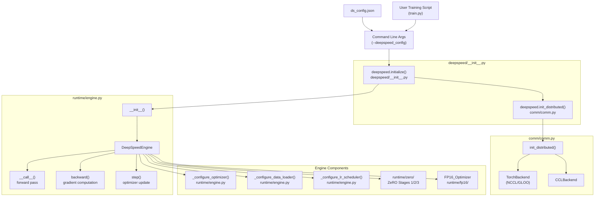
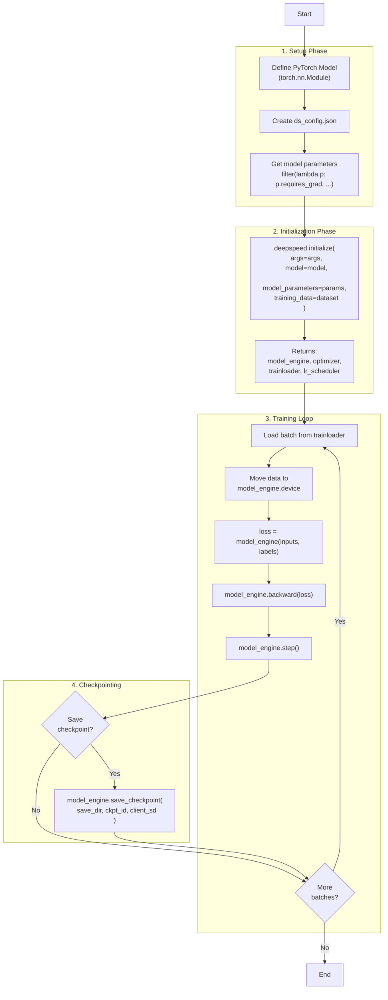

<!-- source: DeepWiki mcp.deepwiki.com · repo deepspeedai/DeepSpeed · page 2 Getting Started · fetched 2026-10-21 -->

# Getting Started

<details>
<summary>Relevant source files</summary>

The following files were used as context for generating this wiki page:

- [README.md](README.md)
- [azure/README.md](azure/README.md)
- [build_win.bat](build_win.bat)
- [docs/_config.yml](docs/_config.yml)
- [docs/_data/navigation.yml](docs/_data/navigation.yml)
- [docs/_tutorials/advanced-install.md](docs/_tutorials/advanced-install.md)
- [docs/_tutorials/azure.md](docs/_tutorials/azure.md)
- [docs/_tutorials/cifar-10.md](docs/_tutorials/cifar-10.md)
- [docs/_tutorials/getting-started.md](docs/_tutorials/getting-started.md)
- [docs/contributing.md](docs/contributing.md)
- [docs/index.md](docs/index.md)
- [environment.yml](environment.yml)
- [install.sh](install.sh)
- [op_builder/builder.py](op_builder/builder.py)
- [op_builder/fused_adam.py](op_builder/fused_adam.py)
- [op_builder/fused_lamb.py](op_builder/fused_lamb.py)
- [op_builder/stochastic_transformer.py](op_builder/stochastic_transformer.py)
- [op_builder/transformer.py](op_builder/transformer.py)
- [setup.py](setup.py)

</details>


## Purpose and Scope

This page provides an overview of DeepSpeed's core workflow and guides you through the initial setup required to start training models. It covers the basic concepts, initialization patterns, and launching mechanisms needed to get a training job running.

For detailed installation procedures including Docker setup and distributed environments, see [Installation](#2.1). For comprehensive API documentation and advanced usage patterns, see [Basic Usage and API](#2.2). For a complete reference of configuration options, see [Configuration System](#2.3).

---

## Prerequisites

Before installing DeepSpeed, ensure your system meets the following requirements:

### Software Requirements

| Component | Requirement |
|-----------|-------------|
| **PyTorch** | Must be installed **before** DeepSpeed for pre-compilation. Version >= 1.9 recommended |
| **Python** | Compatible with PyTorch's Python version requirements |
| **C++/CUDA Compiler** | `nvcc` (NVIDIA) or `hipcc` (AMD) for compiling custom operations |
| **Build Tools** | `ninja` for JIT compilation (installed automatically with PyTorch) |

### Hardware Requirements

DeepSpeed is tested and validated on the following hardware platforms:

| Platform | Accelerators | Backend |
|----------|-------------|---------|
| **NVIDIA** | Pascal, Volta, Ampere, Hopper, Blackwell architectures | NCCL |
| **AMD** | MI100, MI200, MI300 | RCCL / SDMA |
| **Intel** | Gaudi2/3 HPU, Data Center GPU Max (XPU), Xeon CPUs | HCCL, CCL |
| **Huawei** | Ascend NPU | HCCL |
| **Apple** | M-series (MPS) | N/A (no distributed) |

**Note**: DeepSpeed supports a wide range of accelerators via its abstraction layer. For AMD GPUs, DeepSpeed now supports System DMA (SDMA) for ZeRO-3 to offload collectives off compute units.

Sources: [README.md:27-28](), [README.md:114-131](), [docs/_tutorials/getting-started.md:13-15](), [op_builder/builder.py:62-78]()

---

## Installation Overview

The quickest installation method is via PyPI:

```bash
pip install deepspeed
```

After installation, verify your environment using the DeepSpeed environment report tool:

```bash
ds_report
```

This command displays which DeepSpeed extensions/operations are compatible with your system and whether they are currently built.

**Default Compilation Strategy**: DeepSpeed uses Just-In-Time (JIT) compilation for custom operations. On first use, operations are compiled automatically using torch's JIT C++ extension loader. For pre-compilation, you can set `DS_BUILD_OPS=1` during install.

Sources: [docs/_tutorials/advanced-install.md:7-17](), [docs/_tutorials/advanced-install.md:38-44](), [setup.py:152-155]()

---

## Core Concepts

### DeepSpeed Architecture Overview



**DeepSpeed Architecture: Core Components and Code Structure**

The central abstraction in DeepSpeed is the `DeepSpeedEngine` class defined in [runtime/engine.py](). The engine is created via `deepspeed.initialize()` and provides three primary methods: `__call__()` for forward pass, `backward()` for gradient computation, and `step()` for parameter updates.

Sources: [deepspeed/__init__.py](), [runtime/engine.py](), [docs/_tutorials/getting-started.md:20-38]()

### Key Components

**DeepSpeedEngine** ([runtime/engine.py]()): The main engine class that wraps your PyTorch model. It handles distributed data parallel, mixed precision, and ZeRO optimizations transparently.

**OpBuilder System** ([op_builder/builder.py]()): The `OpBuilder` base class and its children (e.g., `FusedAdamBuilder`, `AsyncIOBuilder`) manage the compilation and loading of C++/CUDA extensions.

**Launcher System** ([launcher/runner.py]()): The `deepspeed` command-line tool orchestrates multi-node job launching, supporting backends like PDSH, OpenMPI, and Slurm.

Sources: [runtime/engine.py](), [op_builder/builder.py](), [launcher/runner.py]()

---

## Basic Workflow

### Complete Training Workflow



**DeepSpeed Training Workflow: From Model Definition to Training**

Sources: [docs/_tutorials/getting-started.md:25-132](), [docs/_tutorials/cifar-10.md:126-168]()

---

## Initialization

### The `deepspeed.initialize()` API

The entry point for DeepSpeed training is the `deepspeed.initialize()` function. It sets up the distributed environment and wraps your model in a `DeepSpeedEngine`.

**Function Signature** ([docs/_tutorials/cifar-10.md:115-124]()):

```python
model_engine, optimizer, trainloader, lr_scheduler = deepspeed.initialize(
    args=cmd_args,              # Command-line arguments
    model=model,                # Your torch.nn.Module
    model_parameters=params,    # Model parameters to optimize
    training_data=trainset,     # Training dataset (optional)
    optimizer=None,             # Custom optimizer (optional)
    lr_scheduler=None,          # Custom LR scheduler (optional)
)
```

**Typical Initialization Pattern:**

```python
import deepspeed
parameters = filter(lambda p: p.requires_grad, net.parameters())
model_engine, optimizer, trainloader, _ = deepspeed.initialize(
    args=args,
    model=net,
    model_parameters=parameters,
    training_data=trainset
)
```

**Important Notes:**
- Replace `torch.distributed.init_process_group()` with `deepspeed.init_distributed()`.
- DeepSpeed automatically executes the learning rate schedule at every training step if using a DeepSpeed-managed scheduler.
- All processes must call `initialize()`.

Sources: [docs/_tutorials/getting-started.md:28-54](), [docs/_tutorials/cifar-10.md:128-138]()

---

## Training Loop

### Training API

The `DeepSpeedEngine` provides a simple three-method API for training:

```python
for step, batch in enumerate(trainloader):
    # 1. Forward pass
    loss = model_engine(batch)
    
    # 2. Backward pass - handles loss scaling and gradient averaging
    model_engine.backward(loss)
    
    # 3. Parameter update - handles optimizer step and LR scheduling
    model_engine.step()
```

**Automatic Operations Handled by DeepSpeedEngine:**

| Operation | Implementation |
|-----------|----------------|
| **Gradient Averaging** | Averaged across data parallel processes after `train_batch_size`. |
| **Loss Scaling** | Automatically handles scaling in FP16/mixed precision to avoid underflow. |
| **LR Scheduling** | DeepSpeed calls `step()` on the scheduler at every training step. |

Sources: [docs/_tutorials/getting-started.md:63-89](), [docs/_tutorials/cifar-10.md:157-167]()

---

## Configuration System

DeepSpeed features are controlled via a JSON configuration file.

**Minimal Configuration Example** ([docs/_tutorials/cifar-10.md:178-203]()):

```json
{
  "train_batch_size": 4,
  "optimizer": {
    "type": "Adam",
    "params": {
      "lr": 0.001
    }
  },
  "fp16": {
    "enabled": true
  },
  "zero_optimization": {
    "stage": 2
  }
}
```

For a full set of features, see the [Configuration System](#2.3) child page.

Sources: [docs/_tutorials/getting-started.md:146-161](), [docs/_tutorials/cifar-10.md:178-203]()

---

## Launching Training Jobs

DeepSpeed includes a launcher to handle distributed environment setup.

**Single Node Launch:**
```bash
deepspeed your_script.py --deepspeed_config ds_config.json
```

**Multi-Node Launch:**
DeepSpeed uses an MPI-style hostfile to define resources.
```bash
deepspeed --hostfile=my_hostfile your_script.py --deepspeed_config ds_config.json
```

**Hostfile Format** ([install.sh:23]()):
```
worker-1 slots=8
worker-2 slots=8
```

Sources: [docs/_tutorials/getting-started.md:212-213](), [install.sh:11-27](), [launcher/runner.py]()

---

## Checkpointing

Saving and loading training state is handled via `save_checkpoint` and `load_checkpoint`.

```python
# Save checkpoint
model_engine.save_checkpoint(save_dir, ckpt_id, client_sd=client_sd)

# Load checkpoint
_, client_sd = model_engine.load_checkpoint(load_dir, ckpt_id)
```

**Important**: All processes must call these methods to ensure master weights and optimizer states are saved/restored correctly.

Sources: [docs/_tutorials/getting-started.md:100-137]()

---

## Next Steps

Explore the detailed child pages for specific topics:

- **[Installation](#2.1)** — Detailed setup for different platforms (NVIDIA, AMD, Intel).
- **[Basic Usage and API](#2.2)** — Deep dive into the engine APIs and training loop.
- **[Configuration System](#2.3)** — Full reference for the JSON configuration parameters.

Sources: [docs/_config.yml:35-66](), [docs/_data/navigation.yml:24-50]()

---

