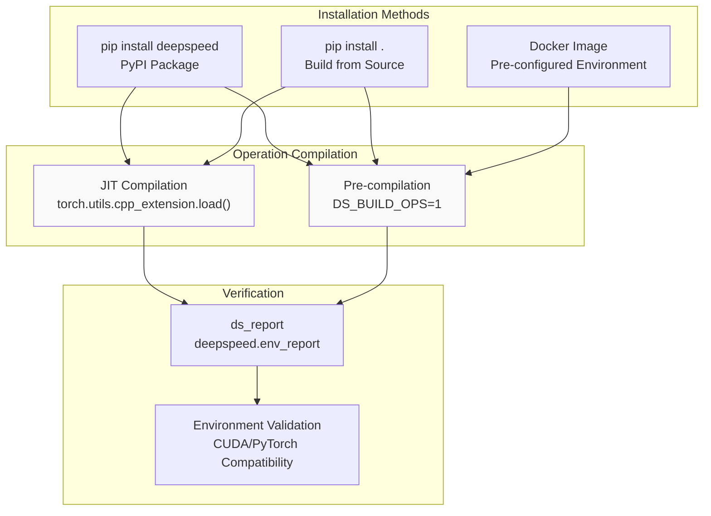
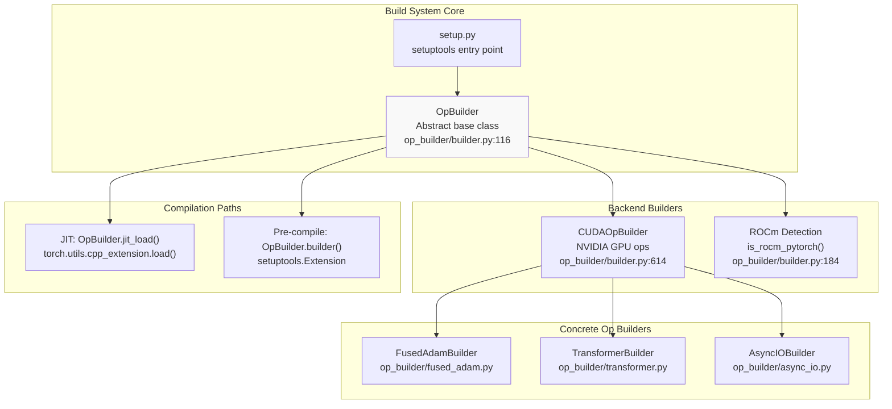

<!-- source: DeepWiki mcp.deepwiki.com · repo deepspeedai/DeepSpeed · page 2.1 Installation · fetched 2026-10-21 -->

# Installation

<details>
<summary>Relevant source files</summary>

The following files were used as context for generating this wiki page:

- [.github/workflows/setup-venv/action.yml](.github/workflows/setup-venv/action.yml)
- [.gitignore](.gitignore)
- [build_win.bat](build_win.bat)
- [deepspeed/inference/config.py](deepspeed/inference/config.py)
- [deepspeed/pipe/__init__.py](deepspeed/pipe/__init__.py)
- [deepspeed/runtime/config_utils.py](deepspeed/runtime/config_utils.py)
- [deepspeed/runtime/pipe/__init__.py](deepspeed/runtime/pipe/__init__.py)
- [deepspeed/runtime/zero/linear.py](deepspeed/runtime/zero/linear.py)
- [deepspeed/runtime/zero/offload_config.py](deepspeed/runtime/zero/offload_config.py)
- [docker/Dockerfile](docker/Dockerfile)
- [docs/_tutorials/advanced-install.md](docs/_tutorials/advanced-install.md)
- [docs/code-docs/source/conf.py](docs/code-docs/source/conf.py)
- [docs/code-docs/source/memory.rst](docs/code-docs/source/memory.rst)
- [environment.yml](environment.yml)
- [install.sh](install.sh)
- [op_builder/builder.py](op_builder/builder.py)
- [op_builder/fused_adam.py](op_builder/fused_adam.py)
- [op_builder/fused_lamb.py](op_builder/fused_lamb.py)
- [op_builder/stochastic_transformer.py](op_builder/stochastic_transformer.py)
- [op_builder/transformer.py](op_builder/transformer.py)
- [requirements/requirements-dev.txt](requirements/requirements-dev.txt)
- [requirements/requirements-inf.txt](requirements/requirements-inf.txt)
- [requirements/requirements-readthedocs.txt](requirements/requirements-readthedocs.txt)
- [requirements/requirements.txt](requirements/requirements.txt)
- [setup.py](setup.py)
- [tests/conftest.py](tests/conftest.py)
- [tests/unit/inference/quantization/test_intX_quantization.py](tests/unit/inference/quantization/test_intX_quantization.py)
- [tests/unit/runtime/test_autocast.py](tests/unit/runtime/test_autocast.py)
- [tests/unit/runtime/zero/test_zero_dynamic_class.py](tests/unit/runtime/zero/test_zero_dynamic_class.py)
- [tests/unit/runtime/zero/test_zero_nesting_init.py](tests/unit/runtime/zero/test_zero_nesting_init.py)
- [tests/unit/v1/zero/test_zero_functorch_linear.py](tests/unit/v1/zero/test_zero_functorch_linear.py)

</details>


This document describes how to install DeepSpeed, covering installation methods, build system architecture, operation compilation strategies, and platform-specific considerations.

For basic usage patterns after installation, see [Basic Usage and API](#2.2). For distributed launching and multi-node setup, see [Launcher Architecture](#8.1). For build system internals, see [Launcher Architecture](#8.1).

## Installation Methods Overview

DeepSpeed supports three primary installation methods with different operation compilation strategies:



**Sources:** [docs/_tutorials/advanced-install.md:7-17](), [setup.py:152-159](), [install.sh:154-183]()

## Quick Installation via PyPI

The simplest installation method uses pip to install the latest DeepSpeed release:

```bash
pip install deepspeed
```

This installation:
- Installs core DeepSpeed Python package and dependencies listed in `requirements/requirements.txt` [requirements/requirements.txt:1-12]().
- Does NOT pre-compile C++/CUDA operations by default on Linux [setup.py:151-153]().
- Operations compile just-in-time (JIT) on first use via `torch.utils.cpp_extension.load()` [op_builder/builder.py:544-611]().
- Stores compiled ops in `/tmp/torch_extensions` by default, or as configured by `TORCH_EXTENSIONS_DIR` [op_builder/builder.py:27-27]().

**Requirements:**
- PyTorch >= 2.0.0 recommended [requirements/requirements.txt:10-10]().
- CUDA toolkit (nvcc) for GPU operations [op_builder/builder.py:47-59]().
- `ninja` build system for JIT compilation [requirements/requirements.txt:4-4]().

**Sources:** [docs/_tutorials/advanced-install.md:7-17](), [requirements/requirements.txt:1-12](), [setup.py:151-153]()

## Verification with ds_report

After installation, verify the installation and check operation compatibility:

```bash
ds_report
```

The `ds_report` utility provides a comprehensive environment report. It is used to debug installation or compatibility issues by checking which "ops" are compatible with the current machine [docs/_tutorials/advanced-install.md:19-26]().

| Information Category | Details Reported |
|---------------------|------------------|
| **Environment Info** | PyTorch version, CUDA version, DeepSpeed version |
| **Operation Status** | Which ops are installed vs compatible |
| **Build Tools** | ninja availability, nvcc version |

**Sources:** [docs/_tutorials/advanced-install.md:19-26](), [op_builder/builder.py:306-310]()

## Build System Architecture

DeepSpeed's build system centers on the `OpBuilder` hierarchy defined in [op_builder/builder.py]().



### OpBuilder Base Class

The `OpBuilder` class [op_builder/builder.py:116-612]() defines the interface all operation builders must implement. It manages both JIT and pre-compilation logic.

**Key Methods:**

| Method | Purpose | Location |
|--------|---------|----------|
| `absolute_name()` | Python module path for operation | [op_builder/builder.py:132-137]() |
| `sources()` | List of C++/CUDA source files | [op_builder/builder.py:139-144]() |
| `load()` | Load pre-installed or JIT compile | [op_builder/builder.py:525-542]() |
| `jit_load()` | JIT compile and load operation | [op_builder/builder.py:544-611]() |
| `is_compatible()` | Check system compatibility | [op_builder/builder.py:306-310]() |

**Sources:** [op_builder/builder.py:116-612](), [setup.py:183-203]()

## JIT vs Pre-compilation

### Just-In-Time (JIT) Compilation

**Default behavior** on Linux [setup.py:152-153](). DeepSpeed uses `torch.utils.cpp_extension.load` to compile extensions at runtime.

**JIT compilation process** [op_builder/builder.py:544-611]():
1. Check if the op is already in `_loaded_ops`.
2. Verify `ninja` is installed.
3. Call `torch.utils.cpp_extension.load()` using source files provided by `sources()`.
4. Cache the resulting shared object in `TORCH_EXTENSIONS_DIR`.

**Sources:** [op_builder/builder.py:544-611](), [docs/_tutorials/advanced-install.md:10-13]()

### Pre-compilation

**Explicit pre-compilation** compiles compatible operations during the installation phase. This is triggered by setting `DS_BUILD_OPS=1` [docs/_tutorials/advanced-install.md:39-44]().

**Selective pre-compilation flags:**
- `DS_BUILD_AIO`: Builds asynchronous (NVMe) I/O op [docs/_tutorials/advanced-install.md:60]().
- `DS_BUILD_FUSED_ADAM`: Builds the FusedAdam op [docs/_tutorials/advanced-install.md:65]().
- `DS_BUILD_CPU_ADAM`: Builds the CPUAdam op [docs/_tutorials/advanced-install.md:62]().
- `DS_BUILD_TRANSFORMER`: Builds the transformer op [docs/_tutorials/advanced-install.md:72]().

**Sources:** [docs/_tutorials/advanced-install.md:28-75](), [setup.py:156-181]()

## System Requirements and Dependencies

### Core Requirements

**Mandatory dependencies** defined in `requirements/requirements.txt`:
- `torch >= 2.0.0` [requirements/requirements.txt:10]()
- `ninja` [requirements/requirements.txt:4]()
- `numpy` [requirements/requirements.txt:5]()
- `psutil` [requirements/requirements.txt:7]()
- `pydantic >= 2.0.0` [requirements/requirements.txt:9]()

### Compute Capability Selection

DeepSpeed determines default compute capabilities based on the installed CUDA version [op_builder/builder.py:62-78]().

**Default Logic:**
- Base: `6.0;6.1;7.0` [op_builder/builder.py:28]().
- CUDA 11.x: Adds `8.0`, `8.6`, or `9.0` depending on minor version [op_builder/builder.py:67-73]().
- CUDA 12.x: Adds `8.0;8.6;9.0` and potentially `10.0;12.0` [op_builder/builder.py:74-77]().

Users can override this via `TORCH_CUDA_ARCH_LIST` [docs/_tutorials/advanced-install.md:157-157]().

**Sources:** [op_builder/builder.py:62-78](), [requirements/requirements.txt:1-12]()

## Platform-Specific Installation

### NVIDIA CUDA

DeepSpeed strictly validates the CUDA version mismatch between the system `nvcc` and the version PyTorch was compiled with [op_builder/builder.py:90-113]().

**Compatibility Rules:**
- Exact match is preferred.
- Minor version mismatches are allowed for specific versions (e.g., CUDA 11.0 through 11.8) [op_builder/builder.py:83-87]().
- Can be bypassed with `DS_SKIP_CUDA_CHECK=1` [op_builder/builder.py:102]().

### Windows

Windows installation defaults to pre-compiling ops (`DS_BUILD_OPS=1`) [setup.py:152-153]().
- Requires Visual CPP build tools [setup.py:10]().
- Uses `build_win.bat` to create wheels [setup.py:16]().

### Distributed Installation Across Clusters

For multi-node clusters, DeepSpeed provides an `install.sh` script that leverages `pdsh` and `pdcp` to distribute and install wheels across all nodes listed in a hostfile [install.sh:163-182]().

**Flow of `install.sh`:**
1. Build a local wheel using `python -m build --wheel` [install.sh:155]().
2. Read hosts from the hostfile (default `/job/hostfile`) [install.sh:164-169]().
3. Use `pdcp` to copy requirements and the wheel to `/tmp/deepspeed_wheels` on all nodes [install.sh:174-178]().
4. Use `pdsh` to run `pip install` on all remote nodes [install.sh:179]().

**Sources:** [install.sh:1-183](), [setup.py:8-19](), [op_builder/builder.py:83-113]()

## Docker Environment Setup

DeepSpeed includes a comprehensive `Dockerfile` for creating reproducible environments.

**Key Components of the Docker Image:**
- **Base:** NVIDIA CUDA devel images [docker/Dockerfile:1]().
- **System Deps:** `libaio-dev`, `openmpi-bin`, `pdsh` [docker/Dockerfile:38-51]().
- **Python Deps:** Installs `requirements.txt` and `requirements-dev.txt` [docker/Dockerfile:106-111]().
- **DeepSpeed:** Clones and installs DeepSpeed with `DS_BUILD_OPS=1` to ensure all kernels are pre-compiled [docker/Dockerfile:158-166]().

**Sources:** [docker/Dockerfile:1-184](), [requirements/requirements-dev.txt:1-21]()

---

