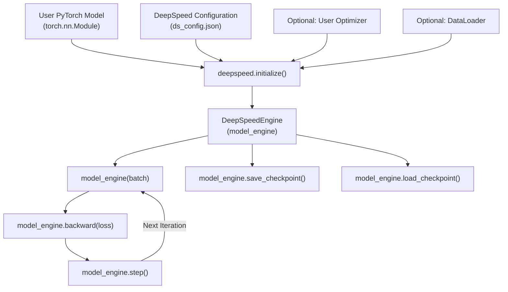
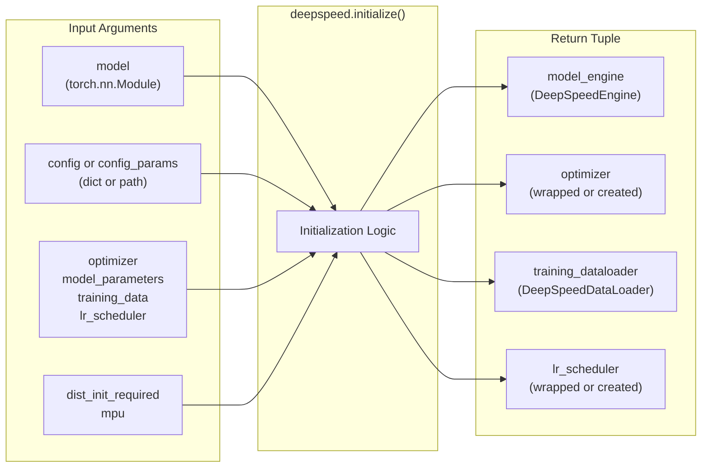
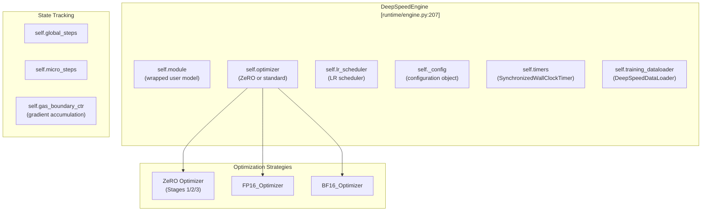
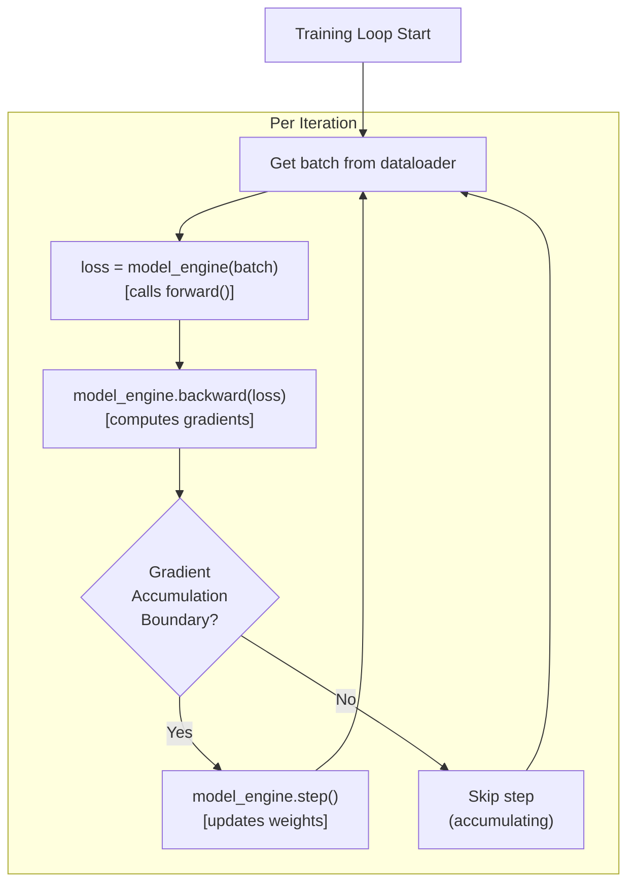
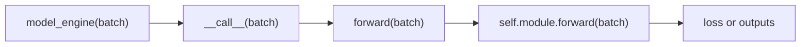
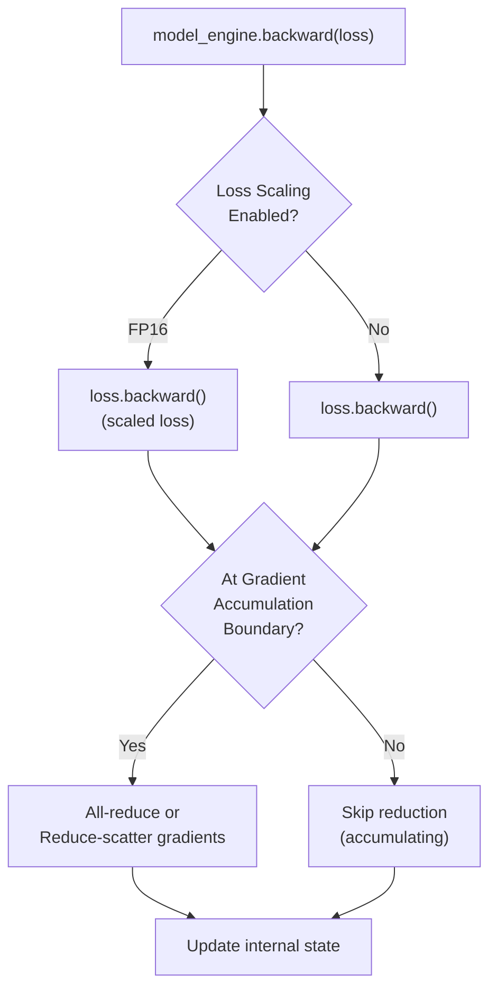
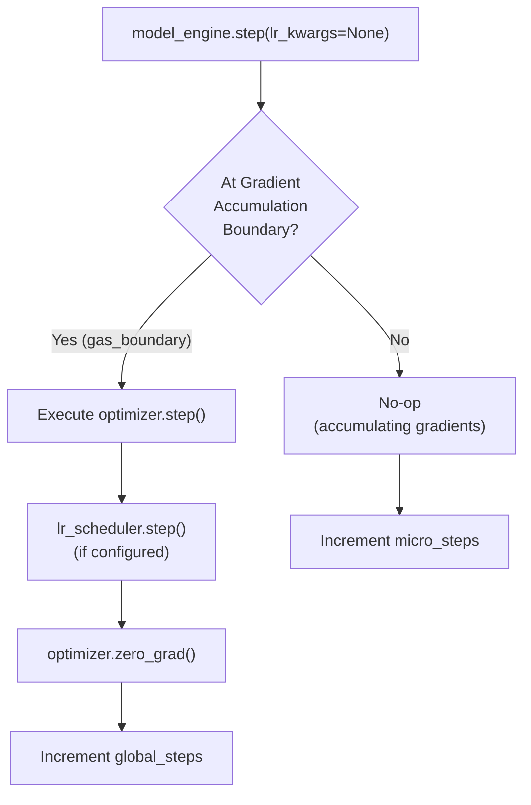
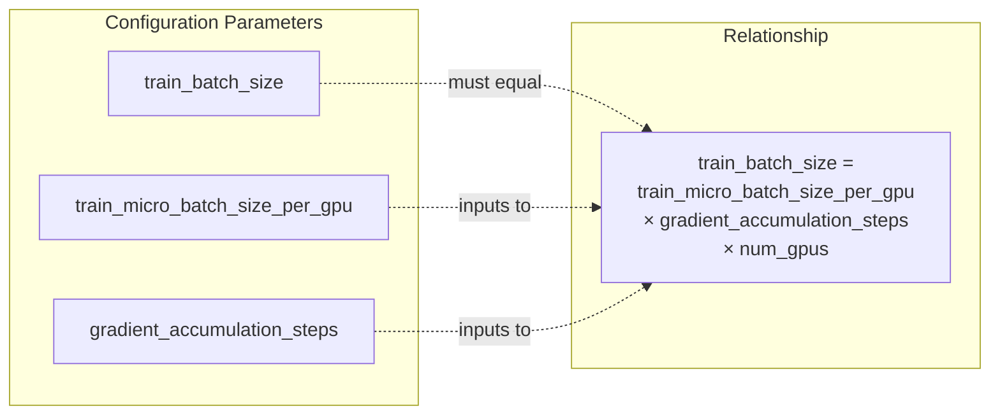

<!-- source: DeepWiki mcp.deepwiki.com · repo deepspeedai/DeepSpeed · page 2.2 Basic Usage and API · fetched 2026-10-21 -->

# Basic Usage and API

<details>
<summary>Relevant source files</summary>

The following files were used as context for generating this wiki page:

- [README.md](README.md)
- [azure/README.md](azure/README.md)
- [deepspeed/runtime/activation_checkpointing/checkpointing.py](deepspeed/runtime/activation_checkpointing/checkpointing.py)
- [deepspeed/runtime/base_optimizer.py](deepspeed/runtime/base_optimizer.py)
- [deepspeed/runtime/bf16_optimizer.py](deepspeed/runtime/bf16_optimizer.py)
- [deepspeed/runtime/config.py](deepspeed/runtime/config.py)
- [deepspeed/runtime/constants.py](deepspeed/runtime/constants.py)
- [deepspeed/runtime/engine.py](deepspeed/runtime/engine.py)
- [deepspeed/runtime/utils.py](deepspeed/runtime/utils.py)
- [deepspeed/runtime/zero/config.py](deepspeed/runtime/zero/config.py)
- [deepspeed/runtime/zero/mics.py](deepspeed/runtime/zero/mics.py)
- [deepspeed/runtime/zero/parameter_offload.py](deepspeed/runtime/zero/parameter_offload.py)
- [deepspeed/runtime/zero/partition_parameters.py](deepspeed/runtime/zero/partition_parameters.py)
- [deepspeed/runtime/zero/partitioned_param_coordinator.py](deepspeed/runtime/zero/partitioned_param_coordinator.py)
- [deepspeed/runtime/zero/stage3.py](deepspeed/runtime/zero/stage3.py)
- [deepspeed/runtime/zero/stage_1_and_2.py](deepspeed/runtime/zero/stage_1_and_2.py)
- [deepspeed/runtime/zero/utils.py](deepspeed/runtime/zero/utils.py)
- [docs/_config.yml](docs/_config.yml)
- [docs/_data/navigation.yml](docs/_data/navigation.yml)
- [docs/_pages/config-json.md](docs/_pages/config-json.md)
- [docs/_tutorials/azure.md](docs/_tutorials/azure.md)
- [docs/_tutorials/cifar-10.md](docs/_tutorials/cifar-10.md)
- [docs/_tutorials/getting-started.md](docs/_tutorials/getting-started.md)
- [docs/contributing.md](docs/contributing.md)
- [docs/index.md](docs/index.md)

</details>


This page introduces the fundamental DeepSpeed API for distributed training. It covers the `deepspeed.initialize()` function, the `DeepSpeedEngine` object, and the basic training loop structure. For installation instructions, see [Installation](#2.1). For detailed configuration options, see [Configuration System](#2.3). For advanced training features like ZeRO optimization and pipeline parallelism, see [Core Training Engine](#3) and [Pipeline Parallelism](#4).

---

## API Overview

DeepSpeed wraps your PyTorch model in a `DeepSpeedEngine` that manages all aspects of distributed training, optimization, and memory management. The API is designed to require minimal code changes from standard PyTorch training scripts.

**Core Workflow Diagram**



**Sources:** [deepspeed/runtime/engine.py:207-460](), [docs/_tutorials/getting-started.md:18-47]()

---

## The `deepspeed.initialize()` Function

The `deepspeed.initialize()` function is the entry point for all DeepSpeed training. It configures the distributed environment, wraps your model, and returns a `DeepSpeedEngine` instance along with optimizer, dataloader, and scheduler objects.

### Function Signature and Return Values



**Key Parameters:**

| Parameter | Type | Description |
|-----------|------|-------------|
| `model` | `torch.nn.Module` | Your PyTorch model to be trained |
| `config` or `config_params` | `str` or `dict` | Path to JSON config file or dictionary with configuration |
| `optimizer` | `torch.optim.Optimizer` (optional) | User-defined optimizer; if None, created from config |
| `model_parameters` | Iterable (optional) | Parameters to optimize; defaults to `model.parameters()` |
| `training_data` | `torch.utils.data.Dataset` (optional) | Training dataset; DeepSpeed will create DataLoader |
| `lr_scheduler` | Learning rate scheduler (optional) | User-defined scheduler; if None, created from config |
| `mpu` | Model parallel unit (optional) | For tensor/pipeline parallelism coordination |
| `dist_init_required` | `bool` (optional) | Whether to initialize `torch.distributed`; default auto-detects |

**Return Values:**

The function returns a 4-tuple: `(model_engine, optimizer, training_dataloader, lr_scheduler)`

- `model_engine`: The `DeepSpeedEngine` instance wrapping your model [deepspeed/runtime/engine.py:207]()
- `optimizer`: The optimizer (wrapped or created by DeepSpeed) [deepspeed/runtime/engine.py:241]()
- `training_dataloader`: The `DeepSpeedDataLoader` if `training_data` was provided [deepspeed/runtime/engine.py:244]()
- `lr_scheduler`: The learning rate scheduler if configured [deepspeed/runtime/engine.py:242]()

**Sources:** [deepspeed/runtime/engine.py:210-223](), [docs/_tutorials/getting-started.md:25-38]()

### Minimal Initialization Example

```python
import deepspeed

# Option 1: Config from file
model_engine, optimizer, _, _ = deepspeed.initialize(
    model=model,
    config="ds_config.json"
)

# Option 2: Config as dictionary
ds_config = {
    "train_batch_size": 16,
    "fp16": {"enabled": True}
}
model_engine, optimizer, _, _ = deepspeed.initialize(
    model=model,
    config_params=ds_config
)
```

**Sources:** [docs/_tutorials/getting-started.md:25-31](), [deepspeed/runtime/engine.py:239-240]()

---

## The DeepSpeedEngine Object

The `DeepSpeedEngine` class ([deepspeed/runtime/engine.py:207]()) is the core training engine that orchestrates all distributed training operations. It inherits from `torch.nn.Module` and can be called like a standard PyTorch model.

### Key Components



**Sources:** [deepspeed/runtime/engine.py:207-266](), [deepspeed/runtime/engine.py:336-372](), [deepspeed/runtime/zero/stage_1_and_2.py:126](), [deepspeed/runtime/zero/stage3.py:136](), [deepspeed/runtime/bf16_optimizer.py:36]()

### Engine Attributes

| Attribute | Description |
|-----------|-------------|
| `module` | The original PyTorch model (accessible via `model_engine.module`) [deepspeed/runtime/engine.py:233]() |
| `optimizer` | The wrapped or created optimizer instance [deepspeed/runtime/engine.py:241]() |
| `lr_scheduler` | The learning rate scheduler [deepspeed/runtime/engine.py:242]() |
| `global_steps` | Total number of optimizer steps taken [deepspeed/runtime/engine.py:248]() |
| `micro_steps` | Current micro-batch step within gradient accumulation [deepspeed/runtime/engine.py:249]() |
| `train_batch_size()` | Method returning effective global batch size [deepspeed/runtime/engine.py:659]() |
| `train_micro_batch_size_per_gpu()` | Method returning per-GPU micro-batch size [deepspeed/runtime/engine.py:666]() |
| `gradient_accumulation_steps()` | Method returning number of gradient accumulation steps [deepspeed/runtime/engine.py:670]() |

**Sources:** [deepspeed/runtime/engine.py:233-264](), [deepspeed/runtime/engine.py:659-673]()

---

## Basic Training Loop

DeepSpeed maintains a PyTorch-like training loop with three core methods: forward pass (calling the engine), backward pass, and optimizer step.

### Standard Training Loop Pattern



**Sources:** [docs/code-docs/source/training.rst:7-17](), [deepspeed/runtime/engine.py:1706-1850]()

### Code Example

```python
for step, batch in enumerate(data_loader):
    # Forward pass - returns loss
    loss = model_engine(batch)
    
    # Backward pass - computes gradients
    model_engine.backward(loss)
    
    # Optimizer step - updates weights (respects gradient accumulation)
    model_engine.step()
```

**Note:** Starting from DeepSpeed v0.18.3, you can call `loss.backward()` directly instead of `model_engine.backward(loss)` when using compatible PyTorch versions. The engine tracks gradient computation internally via hooks [deepspeed/runtime/engine.py:434-457]().

**Sources:** [docs/code-docs/source/training.rst:7-23](), [deepspeed/runtime/engine.py:1706-1850]()

---

## Core API Methods

### Forward Pass: `__call__()` and `forward()`

The engine can be called directly like a standard PyTorch module. It delegates to the wrapped model's forward method [deepspeed/runtime/engine.py:1496]().

**Method Mapping:**



**Key Points:**
- Pass input batch directly to the engine: `loss = model_engine(input_batch)`
- The engine handles data movement to the correct device via `move_to_device` [deepspeed/runtime/utils.py:188]()
- For ZeRO-3, parameters are automatically gathered and released via the `PartitionedParameterCoordinator` [deepspeed/runtime/zero/partitioned_param_coordinator.py:64]()

**Sources:** [deepspeed/runtime/engine.py:1496-1510](), [docs/code-docs/source/training.rst:24-26](), [deepspeed/runtime/zero/parameter_offload.py:112]()

### Backward Pass: `backward()`

Computes gradients with support for gradient accumulation, mixed precision, and ZeRO optimizations [deepspeed/runtime/engine.py:1706]().

**Backward Pass Flow:**



**Important:** 
- Only scalar losses are supported for `model_engine.backward(loss)` [deepspeed/runtime/engine.py:1721]().
- Gradient accumulation is handled automatically based on configuration [deepspeed/runtime/engine.py:1762]().

**Sources:** [deepspeed/runtime/engine.py:1706-1850](), [docs/code-docs/source/training.rst:28-32]()

### Optimizer Step: `step()`

Updates model parameters after gradient computation. Automatically handles gradient accumulation boundaries [deepspeed/runtime/engine.py:1852]().

**Step Execution Logic:**



**Key Behaviors:**
- Respects `gradient_accumulation_steps` from configuration [deepspeed/runtime/engine.py:1866]().
- Automatically manages learning rate scheduling if configured [deepspeed/runtime/engine.py:1955]().
- Returns `True` if step was executed, `False` if skipped (accumulating) [deepspeed/runtime/engine.py:1980]().

**Sources:** [deepspeed/runtime/engine.py:1852-2073](), [deepspeed/runtime/engine.py:248-249]()

---

## Gradient Accumulation

DeepSpeed automatically handles gradient accumulation to simulate larger batch sizes without proportional memory increase.

**Gradient Accumulation Configuration:**



**Configuration Example:**

```json
{
  "train_batch_size": 128,
  "train_micro_batch_size_per_gpu": 4,
  "gradient_accumulation_steps": 8,
  "steps_per_print": 10
}
```

With 4 GPUs:
- Effective batch size = 128
- Each GPU processes 4 samples per micro-step
- 8 micro-steps before weight update
- Calculation: 4 × 8 × 4 = 128 ✓

**Sources:** [docs/_pages/config-json.md:7-30](), [deepspeed/runtime/engine.py:659-673]()

---

## API Method Reference Table

| Method | Purpose | Key Arguments | Returns |
|--------|---------|---------------|---------|
| `deepspeed.initialize()` | Initialize DeepSpeed engine | `model`, `config`, `optimizer`, etc. | `(engine, optimizer, dataloader, scheduler)` |
| `model_engine(input)` | Forward pass | Model inputs | Model outputs (loss, logits, etc.) |
| `backward(loss)` | Backward pass | Scalar loss tensor | None |
| `step(lr_kwargs)` | Optimizer step | Optional LR kwargs | `bool` (True if step executed) |
| `save_checkpoint(dir, tag)` | Save model/optimizer state | Directory path, checkpoint tag | None |
| `load_checkpoint(dir, tag)` | Load model/optimizer state | Directory path, checkpoint tag | Load info tuple |
| `get_batch_info()` | Query batch configuration | None | `(train_bs, micro_bs, gas)` |
| `train_batch_size()` | Get effective batch size | None | `int` |
| `zero_grad()` | Zero out gradients | None | None |

**Sources:** [deepspeed/runtime/engine.py:207-2000](), [docs/code-docs/source/training.rst:1-200]()

---

## Configuration Integration

The `deepspeed.initialize()` function accepts configuration in two ways:

**Method 1: JSON File**
```python
model_engine, _, _, _ = deepspeed.initialize(
    model=model,
    config="path/to/ds_config.json"
)
```

**Method 2: Python Dictionary**
```python
config_dict = {
    "train_batch_size": 16,
    "optimizer": {"type": "Adam", "params": {"lr": 0.001}}
}
model_engine, _, _, _ = deepspeed.initialize(
    model=model,
    config_params=config_dict
)
```

For detailed configuration options, see [Configuration System](#2.3).

**Sources:** [deepspeed/runtime/config.py:1-100](), [deepspeed/runtime/engine.py:276-278]()

---

