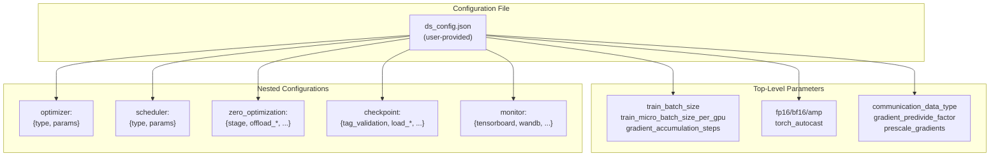
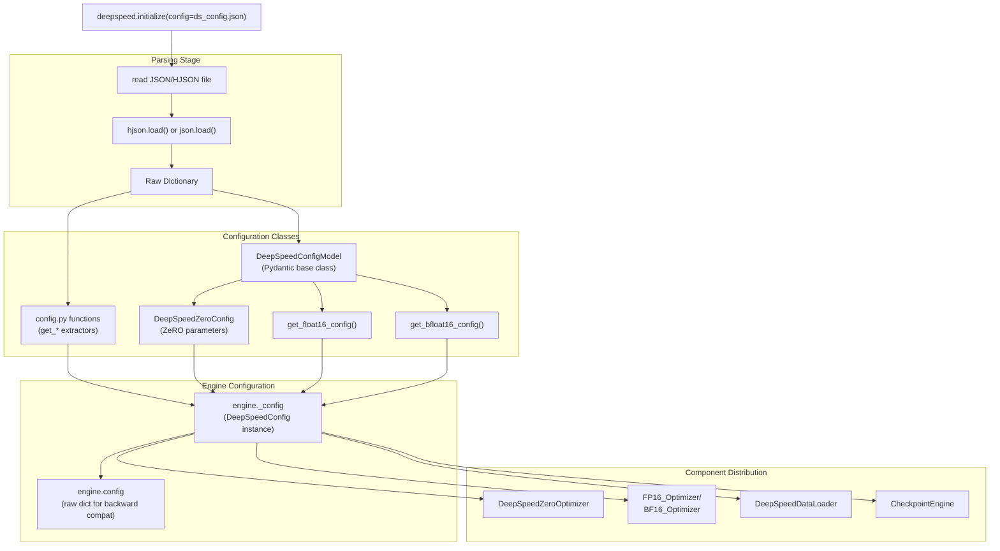
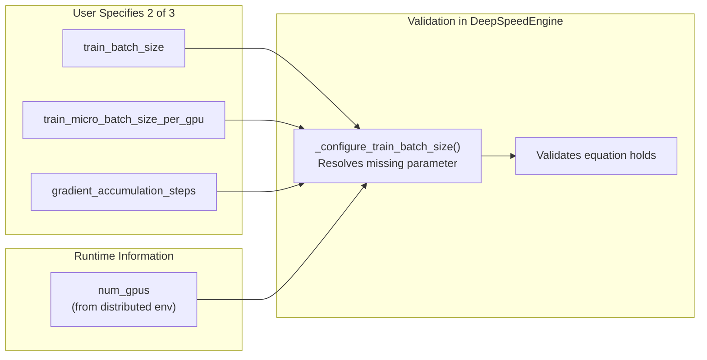
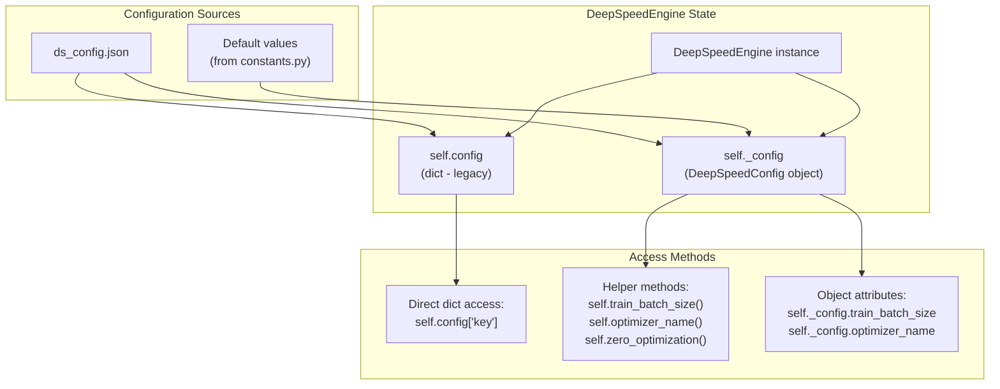
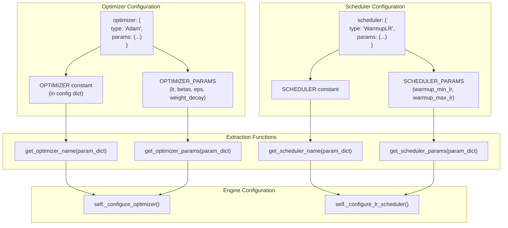
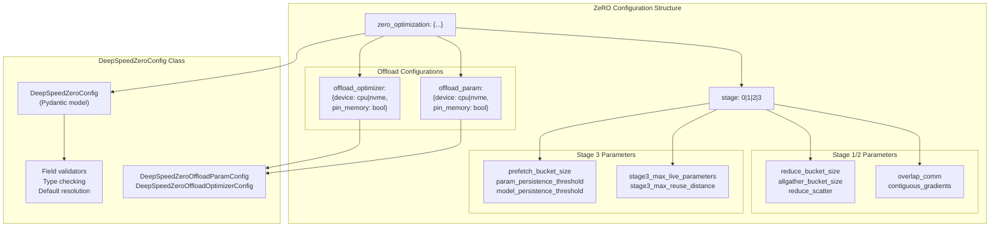
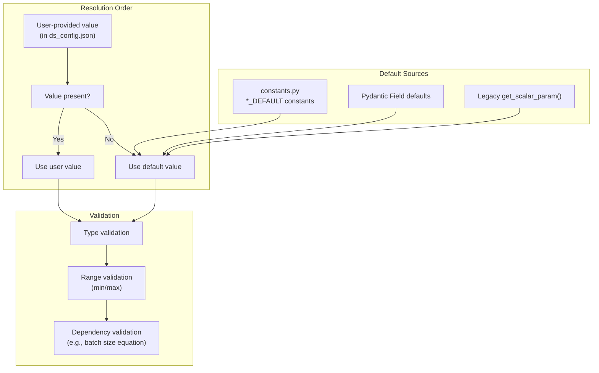
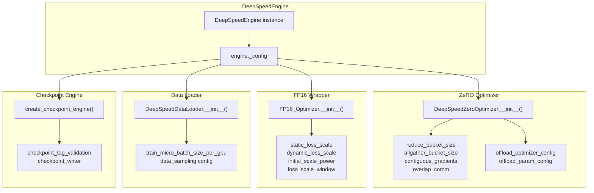

<!-- source: DeepWiki mcp.deepwiki.com · repo deepspeedai/DeepSpeed · page 2.3 Configuration System · fetched 2026-10-21 -->

# Configuration System

<details>
<summary>Relevant source files</summary>

The following files were used as context for generating this wiki page:

- [.gitignore](.gitignore)
- [deepspeed/inference/config.py](deepspeed/inference/config.py)
- [deepspeed/pipe/__init__.py](deepspeed/pipe/__init__.py)
- [deepspeed/runtime/activation_checkpointing/checkpointing.py](deepspeed/runtime/activation_checkpointing/checkpointing.py)
- [deepspeed/runtime/base_optimizer.py](deepspeed/runtime/base_optimizer.py)
- [deepspeed/runtime/bf16_optimizer.py](deepspeed/runtime/bf16_optimizer.py)
- [deepspeed/runtime/config.py](deepspeed/runtime/config.py)
- [deepspeed/runtime/config_utils.py](deepspeed/runtime/config_utils.py)
- [deepspeed/runtime/constants.py](deepspeed/runtime/constants.py)
- [deepspeed/runtime/engine.py](deepspeed/runtime/engine.py)
- [deepspeed/runtime/pipe/__init__.py](deepspeed/runtime/pipe/__init__.py)
- [deepspeed/runtime/utils.py](deepspeed/runtime/utils.py)
- [deepspeed/runtime/zero/config.py](deepspeed/runtime/zero/config.py)
- [deepspeed/runtime/zero/linear.py](deepspeed/runtime/zero/linear.py)
- [deepspeed/runtime/zero/mics.py](deepspeed/runtime/zero/mics.py)
- [deepspeed/runtime/zero/offload_config.py](deepspeed/runtime/zero/offload_config.py)
- [deepspeed/runtime/zero/parameter_offload.py](deepspeed/runtime/zero/parameter_offload.py)
- [deepspeed/runtime/zero/partition_parameters.py](deepspeed/runtime/zero/partition_parameters.py)
- [deepspeed/runtime/zero/partitioned_param_coordinator.py](deepspeed/runtime/zero/partitioned_param_coordinator.py)
- [deepspeed/runtime/zero/stage3.py](deepspeed/runtime/zero/stage3.py)
- [deepspeed/runtime/zero/stage_1_and_2.py](deepspeed/runtime/zero/stage_1_and_2.py)
- [deepspeed/runtime/zero/utils.py](deepspeed/runtime/zero/utils.py)
- [docs/_pages/config-json.md](docs/_pages/config-json.md)
- [docs/_posts/2020-09-09-sparse-attention.md](docs/_posts/2020-09-09-sparse-attention.md)
- [docs/_tutorials/megatron.md](docs/_tutorials/megatron.md)
- [docs/_tutorials/one-cycle.md](docs/_tutorials/one-cycle.md)
- [docs/_tutorials/pipeline.md](docs/_tutorials/pipeline.md)
- [docs/_tutorials/pytorch-profiler.md](docs/_tutorials/pytorch-profiler.md)
- [docs/_tutorials/sparse-attention.md](docs/_tutorials/sparse-attention.md)
- [docs/_tutorials/zero-offload.md](docs/_tutorials/zero-offload.md)
- [docs/_tutorials/zero.md](docs/_tutorials/zero.md)
- [docs/code-docs/source/conf.py](docs/code-docs/source/conf.py)
- [docs/code-docs/source/memory.rst](docs/code-docs/source/memory.rst)
- [requirements/requirements-readthedocs.txt](requirements/requirements-readthedocs.txt)
- [requirements/requirements-sparse_attn.txt](requirements/requirements-sparse_attn.txt)
- [requirements/requirements.txt](requirements/requirements.txt)
- [tests/unit/runtime/test_autocast.py](tests/unit/runtime/test_autocast.py)
- [tests/unit/v1/zero/test_zero_functorch_linear.py](tests/unit/v1/zero/test_zero_functorch_linear.py)

</details>


## Purpose and Scope

The Configuration System in DeepSpeed provides a centralized mechanism for controlling all aspects of training and inference through a JSON configuration file (`ds_config.json`). This system parses, validates, and distributes configuration parameters to all DeepSpeed components including the training engine, optimizers, ZeRO stages, and various optimization features.

For information about how the DeepSpeedEngine uses configuration during initialization, see [DeepSpeedEngine Architecture](#3.1). For details on ZeRO-specific configuration parameters, see [Training Loop and Gradient Management](#3.3).

## Configuration File Structure

DeepSpeed accepts configuration through a JSON or HJSON file, typically named `ds_config.json`. This file contains nested dictionaries that control all aspects of the training process.



**Configuration File Organization**

Sources: [docs/_pages/config-json.md:7-30](), [deepspeed/runtime/constants.py:11-100]()

## Configuration Loading and Parsing

### Loading Process

The configuration loading process begins when the user calls `deepspeed.initialize()` and involves parsing, validation, and distribution of parameters.



**Configuration Parsing Flow from File to Engine Components**

Sources: [deepspeed/runtime/config.py:11-32](), [deepspeed/runtime/engine.py:204-283]()

### Configuration Classes

The configuration system uses a combination of Pydantic models and legacy extraction functions:

| Class/Module | Purpose | Key Methods |
|--------------|---------|-------------|
| `DeepSpeedConfigModel` | Base class using Pydantic for validation [deepspeed/runtime/config_utils.py:31]() | Field validation, type checking |
| `DeepSpeedZeroConfig` | ZeRO optimization parameters [deepspeed/runtime/zero/config.py:90]() | Stage, offload settings, bucket sizes |
| `get_float16_config()` | FP16 precision configuration [deepspeed/runtime/precision_config.py]() | Loss scale, hysteresis, min scale |
| `get_bfloat16_config()` | BF16 precision configuration [deepspeed/runtime/precision_config.py]() | Enabled flag, overflow check |
| `get_zero_config()` | Extract ZeRO configuration [deepspeed/runtime/zero/config.py:71]() | Returns `DeepSpeedZeroConfig` instance |
| `DtypeEnum` | Enumeration for data types [deepspeed/runtime/config.py:101]() | Maps strings like "fp16" to `torch.float16` |

Sources: [deepspeed/runtime/config.py:101-125](), [deepspeed/runtime/zero/config.py:90-232](), [deepspeed/runtime/config_utils.py:31-40]()

## Core Configuration Components

### Batch Size Resolution

DeepSpeed requires exactly two of three batch-related parameters to be specified. The third is automatically calculated.

**Batch Size Relationship:**
`train_batch_size = train_micro_batch_size_per_gpu × gradient_accumulation_steps × num_gpus` [docs/_pages/config-json.md:9]()



**Batch Size Parameter Resolution**

Sources: [deepspeed/runtime/engine.py:1000-1100](), [deepspeed/runtime/config.py:197-200]()

### Configuration Parameter Access Pattern

The `DeepSpeedEngine` accesses configuration through two interfaces:



**Two-Level Configuration Access in DeepSpeedEngine**

Sources: [deepspeed/runtime/engine.py:233-234](), [deepspeed/runtime/engine.py:828-865]()

## Configuration Parameter Categories

### Training Parameters

| Parameter | Type | Default | Description |
|-----------|------|---------|-------------|
| `train_batch_size` | int | None | Effective training batch size [deepspeed/runtime/constants.py:19]() |
| `train_micro_batch_size_per_gpu` | int | None | Batch size per GPU per step [deepspeed/runtime/constants.py:95]() |
| `gradient_accumulation_steps` | int | 1 | Steps to accumulate gradients [deepspeed/runtime/constants.py:107]() |
| `steps_per_print` | int | None | Logging frequency [deepspeed/runtime/constants.py:81]() |
| `sparse_gradients` | bool | False | Enable CSR gradient sparsity [deepspeed/runtime/constants.py:111]() |

Sources: [deepspeed/runtime/constants.py:11-112](), [docs/_pages/config-json.md:7-30]()

### Precision Configuration

DeepSpeed supports multiple precision modes configured through nested dictionaries.

**FP16 Configuration:**
```json
{
  "fp16": {
    "enabled": true,
    "loss_scale": 0,
    "initial_scale_power": 16,
    "loss_scale_window": 1000,
    "hysteresis": 2,
    "min_loss_scale": 1
  }
}
```
Sources: [deepspeed/runtime/constants.py:156-168](), [docs/_pages/config-json.md:208-288]()

**BF16 Configuration:**
```json
{
  "bf16": {
    "enabled": true,
    "immediate_grad_update": false,
    "check_overflow": false
  }
}
```
Sources: [deepspeed/runtime/constants.py:119-126](), [deepspeed/runtime/bf16_optimizer.py:41-50]()

**Torch Autocast Configuration:**
```json
{
  "torch_autocast": {
    "enabled": true,
    "dtype": "bf16",
    "lower_precision_safe_modules": ["torch.nn.Linear"]
  }
}
```
Sources: [deepspeed/runtime/config.py:168-194]()

### Optimizer and Scheduler Configuration

DeepSpeed natively supports optimizers like **Adam**, **AdamW**, **Lamb**, and **Muon** [docs/_pages/config-json.md:39]().



**Optimizer and Scheduler Configuration Processing**

Sources: [deepspeed/runtime/config.py:71-87](), [deepspeed/runtime/constants.py:61-70](), [docs/_pages/config-json.md:33-180]()

### ZeRO Optimization Configuration

ZeRO configuration is handled by the `DeepSpeedZeroConfig` class [deepspeed/runtime/zero/config.py:90]().



**ZeRO Configuration Hierarchy**

Sources: [deepspeed/runtime/zero/config.py:90-200](), [deepspeed/runtime/zero/offload_config.py:12]()

## Configuration Validation and Defaults

### Default Value Resolution

The configuration system uses a multi-layered approach to default values, leveraging `get_scalar_param` [deepspeed/runtime/config_utils.py:18]() and Pydantic field defaults.



**Configuration Default Resolution and Validation Process**

Sources: [deepspeed/runtime/config.py:17-21](), [deepspeed/runtime/config_utils.py:10-31](), [deepspeed/runtime/constants.py:19-210]()

## Configuration Access Patterns in Runtime

### Component-Specific Configuration Access

DeepSpeed components ingest configuration objects during initialization to set internal state.

| Component | Configuration Ingested |
|-----------|------------------------|
| `DeepSpeedZeroOptimizer` | `offload_optimizer_config`, `zenflow_config` [deepspeed/runtime/zero/stage_1_and_2.py:156-157]() |
| `DeepSpeedZeroOptimizer_Stage3` | `offload_optimizer_config`, `offload_param_config`, `zenflow_config` [deepspeed/runtime/zero/stage3.py:169-171]() |
| `BF16_Optimizer` | `bfloat16_config` [deepspeed/runtime/bf16_optimizer.py:41]() |
| `DeepSpeedZeRoOffload` | `offload_param_config`, `ds_config` [deepspeed/runtime/zero/parameter_offload.py:118-127]() |
| `PartitionedParameterCoordinator` | `prefetch_bucket_sz`, `max_reuse_distance_in_numel` [deepspeed/runtime/zero/partitioned_param_coordinator.py:82-84]() |



**Configuration Distribution to DeepSpeed Components**

Sources: [deepspeed/runtime/engine.py:354-383](), [deepspeed/runtime/zero/stage_1_and_2.py:138-173](), [deepspeed/runtime/zero/stage3.py:148-198]()

### Summary

The DeepSpeed Configuration System provides:
1. **Centralized Control**: Single JSON/HJSON file controls all training aspects.
2. **Type Safety**: `DeepSpeedConfigModel` (Pydantic) provides validation [deepspeed/runtime/config_utils.py:31]().
3. **Resolution Logic**: Automatic calculation of missing batch parameters [docs/_pages/config-json.md:9]().
4. **Hardware Abstraction**: Configuration of CPU/NVMe offloading via `OffloadDeviceEnum` [deepspeed/runtime/zero/offload_config.py:12]().
5. **Precision Management**: Structured configuration for FP16, BF16, and Autocast [deepspeed/runtime/config.py:101-180]().

Sources: [deepspeed/runtime/config.py:1-210](), [deepspeed/runtime/engine.py:204-410]()

---

