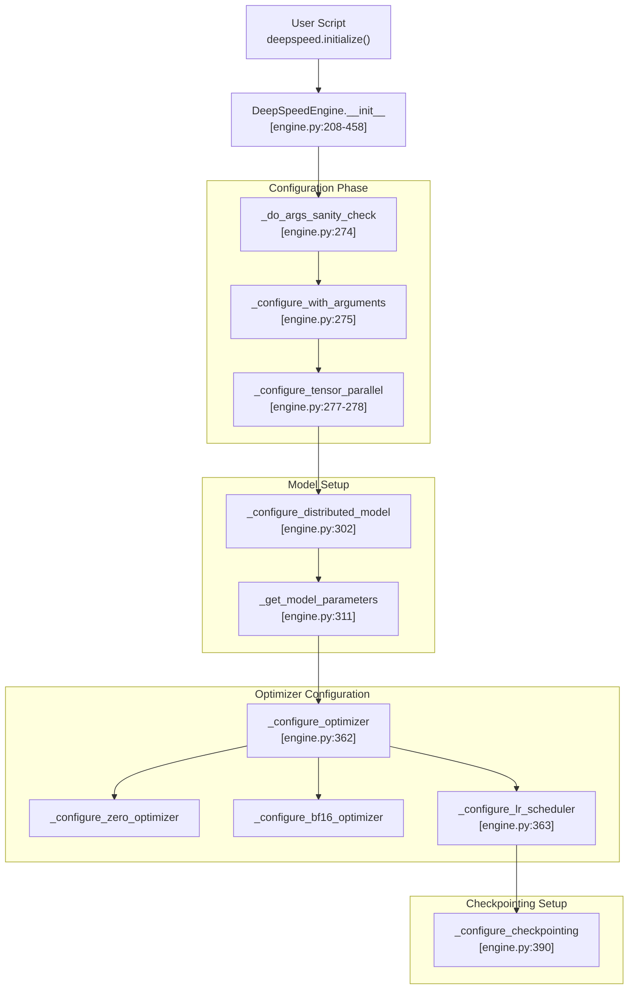
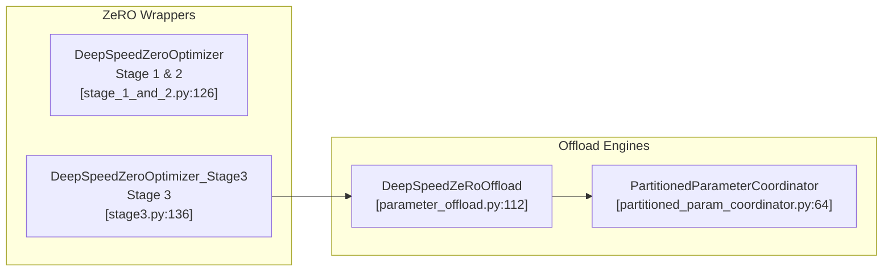
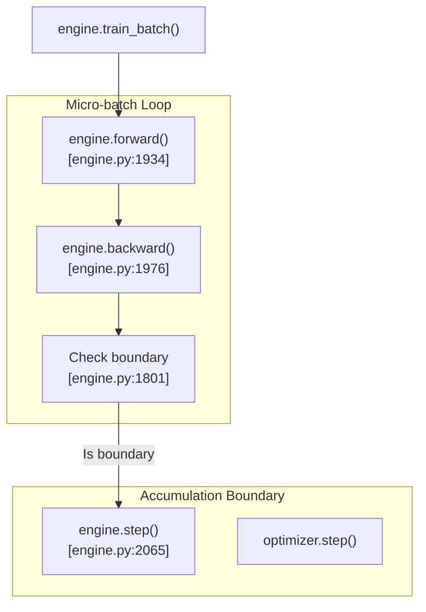

<!-- source: DeepWiki mcp.deepwiki.com · repo deepspeedai/DeepSpeed · page 3 Core Training Engine · fetched 2026-10-21 -->

# Core Training Engine

Relevant source files

The following files were used as context for generating this wiki page:

- [README.md](README.md)
- [azure/README.md](azure/README.md)
- [deepspeed/runtime/activation_checkpointing/checkpointing.py](deepspeed/runtime/activation_checkpointing/checkpointing.py)
- [deepspeed/runtime/base_optimizer.py](deepspeed/runtime/base_optimizer.py)
- [deepspeed/runtime/bf16_optimizer.py](deepspeed/runtime/bf16_optimizer.py)
- [deepspeed/runtime/config.py](deepspeed/runtime/config.py)
- [deepspeed/runtime/constants.py](deepspeed/runtime/constants.py)
- [deepspeed/runtime/engine.py](deepspeed/runtime/engine.py)
- [deepspeed/runtime/utils.py](deepspeed/runtime/utils.py)
- [deepspeed/runtime/zero/config.py](deepspeed/runtime/zero/config.py)
- [deepspeed/runtime/zero/mics.py](deepspeed/runtime/zero/mics.py)
- [deepspeed/runtime/zero/parameter_offload.py](deepspeed/runtime/zero/parameter_offload.py)
- [deepspeed/runtime/zero/partition_parameters.py](deepspeed/runtime/zero/partition_parameters.py)
- [deepspeed/runtime/zero/partitioned_param_coordinator.py](deepspeed/runtime/zero/partitioned_param_coordinator.py)
- [deepspeed/runtime/zero/stage3.py](deepspeed/runtime/zero/stage3.py)
- [deepspeed/runtime/zero/stage_1_and_2.py](deepspeed/runtime/zero/stage_1_and_2.py)
- [deepspeed/runtime/zero/utils.py](deepspeed/runtime/zero/utils.py)
- [docs/_config.yml](docs/_config.yml)
- [docs/_data/navigation.yml](docs/_data/navigation.yml)
- [docs/_pages/config-json.md](docs/_pages/config-json.md)
- [docs/_tutorials/azure.md](docs/_tutorials/azure.md)
- [docs/_tutorials/cifar-10.md](docs/_tutorials/cifar-10.md)
- [docs/_tutorials/getting-started.md](docs/_tutorials/getting-started.md)
- [docs/contributing.md](docs/contributing.md)
- [docs/index.md](docs/index.md)

## Purpose and Scope

The Core Training Engine is the central orchestration system in DeepSpeed that manages the training loop, optimizer integration, gradient management, and memory optimization. This document deep-dives into the `DeepSpeedEngine` class, the primary orchestrator that integrates ZeRO optimizers, mixed-precision mechanisms, and checkpointing strategies.

For details on specific subsystems, see the child pages:
- [DeepSpeedEngine Architecture](#3.1) — Internal initialization and component integration.
- [ZeRO Memory Optimization](#3.2) — Partitioning strategies for memory efficiency.
- [Training Loop and Gradient Management](#3.3) — Step-by-step execution and accumulation.
- [Mixed Precision Training](#3.4) — Loss scaling and lower precision (FP16/BF16/AMP) support.
- [Checkpointing System](#3.5) — ZeRO-aware and Universal Checkpointing.
- [Optimizers and Learning Rate Schedules](#3.6) — Built-in high-performance optimizers.
- [ZenFlow and SuperOffload](#3.7) — Stall-free offloading and Superchip optimizations.

## DeepSpeedEngine Architecture

The `DeepSpeedEngine` class ([deepspeed/runtime/engine.py:205-565]()) is the central entry point for DeepSpeed training. It wraps the user's model and provides unified APIs for training operations.

### Engine Initialization Flow

**Sources:** [deepspeed/runtime/engine.py:205-458]()

### Key Engine Attributes

| Attribute | Type | Purpose |
|-----------|------|---------|
| `module` | `torch.nn.Module` | The user's model, potentially wrapped for distributed training |
| `optimizer` | `ZeROOptimizer` | Optimizer wrapper providing ZeRO optimizations [deepspeed/runtime/base_optimizer.py:18]() |
| `lr_scheduler` | `_LRScheduler` | Learning rate scheduler |
| `global_steps` | `int` | Total number of optimizer steps executed |
| `micro_steps` | `int` | Micro-batches processed in current accumulation cycle |

**Sources:** [deepspeed/runtime/engine.py:231-263]()

## Memory Optimization and ZeRO

DeepSpeed utilizes the Zero Redundancy Optimizer (ZeRO) to eliminate memory redundancies by partitioning model states across GPUs. The engine selects the appropriate wrapper based on the `zero_optimization` configuration.

- **Stage 1 & 2**: Partitions optimizer states and gradients. Managed by `DeepSpeedZeroOptimizer` ([deepspeed/runtime/zero/stage_1_and_2.py:126]()).
- **Stage 3**: Partitions parameters, collecting them on-demand during forward/backward passes. Managed by `DeepSpeedZeroOptimizer_Stage3` ([deepspeed/runtime/zero/stage3.py:136]()).

For details, see [ZeRO Memory Optimization](#3.2).

**Sources:** [deepspeed/runtime/zero/stage_1_and_2.py:126-173](), [deepspeed/runtime/zero/stage3.py:136-198](), [deepspeed/runtime/zero/parameter_offload.py:112-180]()

## Training Execution Flow

The training loop follows a structured forward-backward-step pattern managed by the engine, handling micro-batching and gradient accumulation boundaries.

### Gradient Accumulation
The engine tracks boundaries using `is_gradient_accumulation_boundary` ([deepspeed/runtime/engine.py:1801]()) and automatically scales losses if `scale_wrt_gas` is enabled ([deepspeed/runtime/engine.py:2009]()).

For details, see [Training Loop and Gradient Management](#3.3).

**Sources:** [deepspeed/runtime/engine.py:1801-1821](), [deepspeed/runtime/engine.py:1934-2154]()

## Mixed Precision Training

DeepSpeed supports multiple mixed-precision modes to accelerate training and reduce memory usage:
- **FP16**: Uses `FP16_Optimizer` with loss scaling ([deepspeed/runtime/fp16/fused_optimizer.py]()).
- **BF16**: Uses `BF16_Optimizer` which does not require loss scaling ([deepspeed/runtime/bf16_optimizer.py:36]()).
- **AMP**: Integration with PyTorch Automatic Mixed Precision.

For details, see [Mixed Precision Training](#3.4).

**Sources:** [deepspeed/runtime/bf16_optimizer.py:36-110](), [deepspeed/runtime/engine.py:1176-1289]()

## Checkpointing and Offloading

### Checkpointing System
DeepSpeed provides a robust checkpointing system that is aware of ZeRO's partitioned states. It supports saving/loading partitioned states and "Universal Checkpointing" for changing hardware configurations ([deepspeed/runtime/engine.py:2573]()).

For details, see [Checkpointing System](#3.5).

### Advanced Offloading (ZenFlow & SuperOffload)
- **ZenFlow**: A stall-free offloading engine that uses selective gradient offloading to overlap computation with host-device communication ([deepspeed/runtime/zenflow/zenflow_stage_1_and_2.py:25]()).
- **SuperOffload**: Optimized for Superchips (e.g., NVIDIA GH200), providing speculation-then-validation mechanisms to maximize throughput.

For details, see [ZenFlow and SuperOffload](#3.7).

**Sources:** [deepspeed/runtime/engine.py:2573-2650](), [deepspeed/runtime/zenflow/zenflow_stage_1_and_2.py:25-50]()

## Summary of Key Classes

| Class | Purpose | File |
|-------|---------|------|
| `DeepSpeedEngine` | Main training orchestration engine | [deepspeed/runtime/engine.py:205]() |
| `DeepSpeedZeroOptimizer` | ZeRO Stage 1 & 2 optimizer wrapper | [deepspeed/runtime/zero/stage_1_and_2.py:126]() |
| `DeepSpeedZeroOptimizer_Stage3` | ZeRO Stage 3 parameter partitioning | [deepspeed/runtime/zero/stage3.py:136]() |
| `BF16_Optimizer` | BFloat16 mixed precision management | [deepspeed/runtime/bf16_optimizer.py:36]() |
| `DeepSpeedZeRoOffload` | Orchestrates parameter offloading to CPU/NVMe | [deepspeed/runtime/zero/parameter_offload.py:112]() |

**Sources:** [deepspeed/runtime/engine.py:205](), [deepspeed/runtime/zero/stage_1_and_2.py:126](), [deepspeed/runtime/zero/stage3.py:136](), [deepspeed/runtime/bf16_optimizer.py:36](), [deepspeed/runtime/zero/parameter_offload.py:112]()

---

