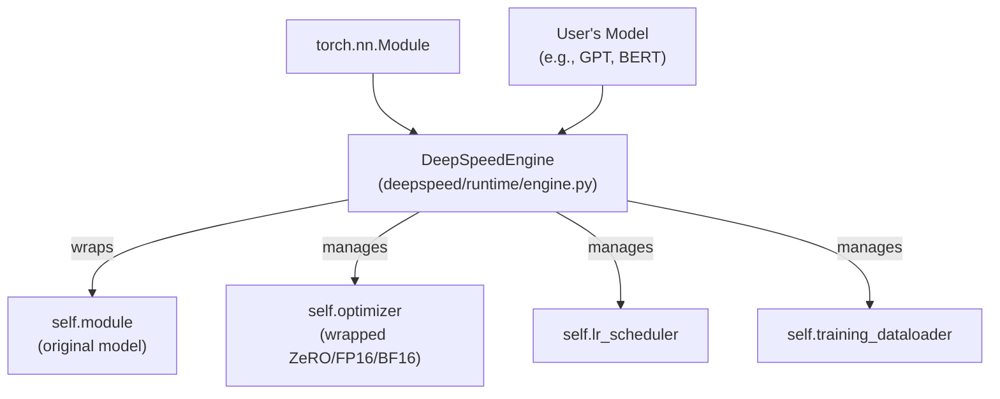
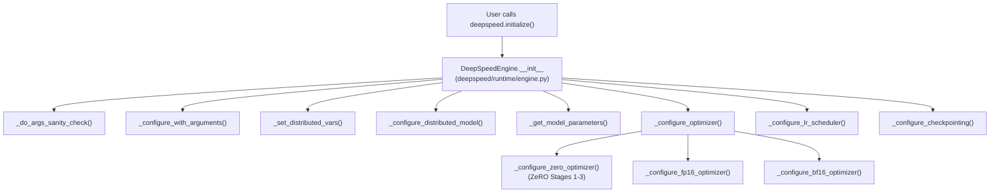
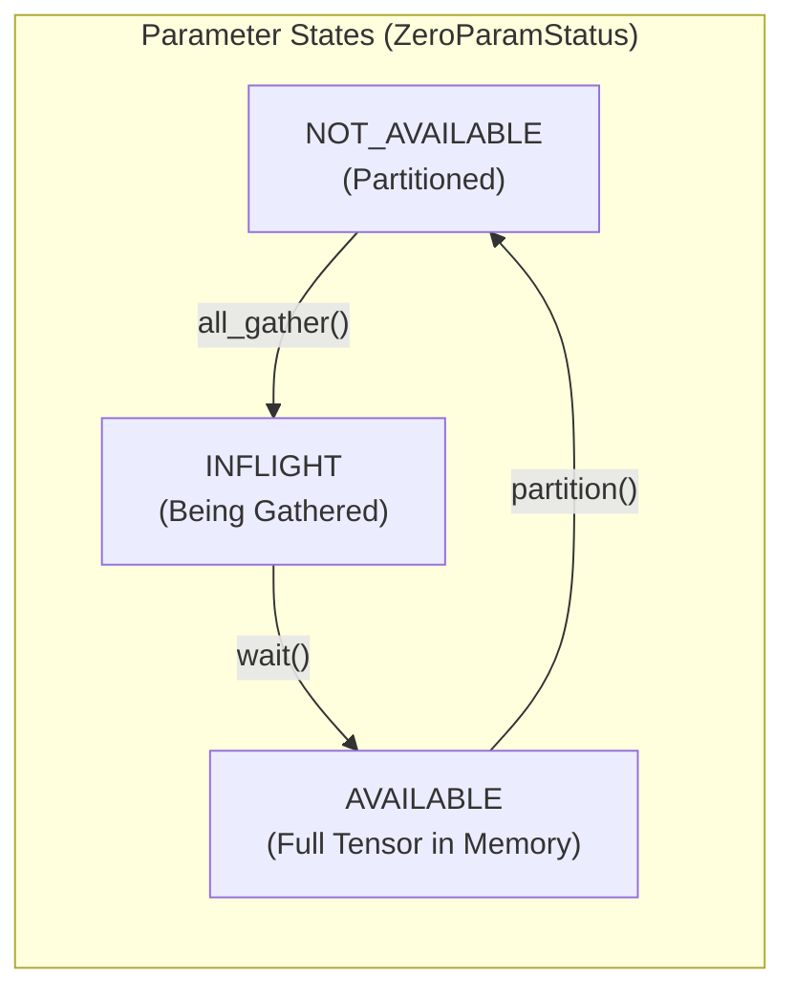

<!-- source: DeepWiki mcp.deepwiki.com · repo deepspeedai/DeepSpeed · page 3.1 DeepSpeedEngine Architecture · fetched 2026-10-21 -->

# DeepSpeedEngine Architecture

Relevant source files

The following files were used as context for generating this wiki page:

- [deepspeed/runtime/activation_checkpointing/checkpointing.py](deepspeed/runtime/activation_checkpointing/checkpointing.py)
- [deepspeed/runtime/base_optimizer.py](deepspeed/runtime/base_optimizer.py)
- [deepspeed/runtime/bf16_optimizer.py](deepspeed/runtime/bf16_optimizer.py)
- [deepspeed/runtime/compiler.py](deepspeed/runtime/compiler.py)
- [deepspeed/runtime/config.py](deepspeed/runtime/config.py)
- [deepspeed/runtime/constants.py](deepspeed/runtime/constants.py)
- [deepspeed/runtime/engine.py](deepspeed/runtime/engine.py)
- [deepspeed/runtime/utils.py](deepspeed/runtime/utils.py)
- [deepspeed/runtime/zero/config.py](deepspeed/runtime/zero/config.py)
- [deepspeed/runtime/zero/mics.py](deepspeed/runtime/zero/mics.py)
- [deepspeed/runtime/zero/mics_utils.py](deepspeed/runtime/zero/mics_utils.py)
- [deepspeed/runtime/zero/muon/__init__.py](deepspeed/runtime/zero/muon/__init__.py)
- [deepspeed/runtime/zero/muon/muon_optimizer.py](deepspeed/runtime/zero/muon/muon_optimizer.py)
- [deepspeed/runtime/zero/muon/original_muon.py](deepspeed/runtime/zero/muon/original_muon.py)
- [deepspeed/runtime/zero/parameter_offload.py](deepspeed/runtime/zero/parameter_offload.py)
- [deepspeed/runtime/zero/partition_parameters.py](deepspeed/runtime/zero/partition_parameters.py)
- [deepspeed/runtime/zero/partitioned_param_coordinator.py](deepspeed/runtime/zero/partitioned_param_coordinator.py)
- [deepspeed/runtime/zero/stage3.py](deepspeed/runtime/zero/stage3.py)
- [deepspeed/runtime/zero/stage_1_and_2.py](deepspeed/runtime/zero/stage_1_and_2.py)
- [deepspeed/runtime/zero/utils.py](deepspeed/runtime/zero/utils.py)
- [deepspeed/sequence/fpdt_layer.py](deepspeed/sequence/fpdt_layer.py)
- [deepspeed/utils/logging.py](deepspeed/utils/logging.py)
- [deepspeed/utils/timer.py](deepspeed/utils/timer.py)
- [deepspeed/utils/torch.py](deepspeed/utils/torch.py)
- [docs/_pages/config-json.md](docs/_pages/config-json.md)
- [tests/unit/ops/muon/test_muon.py](tests/unit/ops/muon/test_muon.py)
- [tests/unit/v1/zero/test_zero_torch_func.py](tests/unit/v1/zero/test_zero_torch_func.py)

## Purpose and Scope

This document describes the architecture of `DeepSpeedEngine`, the core orchestrator class for DeepSpeed training. The `DeepSpeedEngine` manages the entire training lifecycle including model initialization, optimizer configuration, forward/backward passes, gradient synchronization, and checkpointing. 

**Sources:** [deepspeed/runtime/engine.py:1-420]()

---

## DeepSpeedEngine Overview

The `DeepSpeedEngine` class is the central component that wraps a PyTorch model and orchestrates all DeepSpeed functionality. It inherits from `torch.nn.Module` [deepspeed/runtime/engine.py:201-204]() and acts as a drop-in replacement for the original model, providing additional capabilities for distributed training, mixed precision, and memory optimization.

### Class Definition and Integration

**Sources:** [deepspeed/runtime/engine.py:201-218](), [deepspeed/runtime/engine.py:294-304]()

### Core Responsibilities

| Responsibility | Description | Key Methods/Attributes |
|----------------|-------------|------------------------|
| **Model Management** | Wraps and configures the user model for distributed training | `self.module`, `_configure_distributed_model()` [deepspeed/runtime/engine.py:295-300]() |
| **Optimizer Wrapping** | Wraps user optimizer with ZeRO, FP16, or BF16 optimizers | `self.optimizer`, `_configure_optimizer()` [deepspeed/runtime/engine.py:355-360]() |
| **Training Loop** | Provides forward/backward/step interface | `forward()`, `backward()`, `step()` [deepspeed/runtime/engine.py:1664-2209]() |
| **Gradient Management** | Handles gradient accumulation and synchronization | `self.gradient_accumulation_steps`, `_is_gradient_accumulation_boundary` [deepspeed/runtime/engine.py:256-260]() |
| **Checkpointing** | Manages model and optimizer state persistence | `save_checkpoint()`, `load_checkpoint()` [deepspeed/runtime/engine.py:3092-3391]() |
| **Configuration** | Parses and applies ds_config.json settings | `self._config`, `self.config` [deepspeed/runtime/engine.py:233-234]() |

**Sources:** [deepspeed/runtime/engine.py:204-262](), [deepspeed/runtime/engine.py:326-368]()

---

## Initialization Flow

The `DeepSpeedEngine` is typically initialized via `deepspeed.initialize()`. The initialization process involves several critical configuration steps to prepare the distributed environment and wrap components.

### Initialization Sequence

**Sources:** [deepspeed/runtime/engine.py:204-422]()

### Key Initialization Steps

#### 1. Configuration Loading
The engine loads configuration from a JSON file or dictionary, parsing it into a `DeepSpeedConfig` instance [deepspeed/runtime/engine.py:233-234](). This includes batch size parameters, optimizer settings, and ZeRO configurations.

#### 2. Distributed Setup
The `_set_distributed_vars()` method [deepspeed/runtime/engine.py:1270-1322]() initializes rank and world size information using `deepspeed.comm` [deepspeed/runtime/engine.py:26]().

#### 3. Model Wrapping
The `_configure_distributed_model()` method [deepspeed/runtime/engine.py:1495-1595]() determines the wrapping strategy. For ZeRO Stage 3, it integrates with `DeepSpeedZeRoOffload` [deepspeed/runtime/zero/parameter_offload.py:112]() to enable parameter partitioning.

#### 4. Optimizer Wrapping Logic
The engine wraps the user's optimizer based on the precision and ZeRO stage:
*   **ZeRO Stage 1 & 2**: Wrapped by `DeepSpeedZeroOptimizer` [deepspeed/runtime/zero/stage_1_and_2.py:126]().
*   **ZeRO Stage 3**: Wrapped by `DeepSpeedZeroOptimizer_Stage3` [deepspeed/runtime/zero/stage3.py:136]().
*   **FP16**: Wrapped by `FP16_Optimizer` [deepspeed/runtime/fp16/fused_optimizer.py:33]().
*   **BF16**: Wrapped by `BF16_Optimizer` [deepspeed/runtime/bf16_optimizer.py:36]().

**Sources:** [deepspeed/runtime/engine.py:1839-2073]()

---

## Training Loop Architecture

DeepSpeed replaces the standard PyTorch training loop pattern with its own methods to manage gradient accumulation and synchronization.

### Forward Pass
The `forward()` method [deepspeed/runtime/engine.py:1664]() handles:
1.  **Pipeline Parallelism**: If the model is a `PipelineModule`, it delegates to the pipeline engine [deepspeed/runtime/engine.py:1674]().
2.  **Autocast**: Integrates with `torch.autocast` if configured [deepspeed/runtime/engine.py:1713]().
3.  **ZeRO-3 Hooks**: If ZeRO-3 is enabled, parameter fetching hooks are triggered via `ZeROOrderedDict` [deepspeed/runtime/zero/parameter_offload.py:40]().

### Backward Pass
The `backward()` method [deepspeed/runtime/engine.py:1735]() manages:
1.  **Loss Scaling**: Applies loss scaling for FP16 training [deepspeed/runtime/engine.py:1765]().
2.  **Gradient Accumulation**: Increments `self.micro_steps` and determines if a boundary is reached [deepspeed/runtime/engine.py:1780-1800]().
3.  **Synchronization**: Controls whether gradient reduction (AllReduce) should occur [deepspeed/runtime/engine.py:1745]().

### Optimizer Step
The `step()` method [deepspeed/runtime/engine.py:2209]() performs the update:
1.  **Boundary Check**: Only executes if `_is_gradient_accumulation_boundary` is true [deepspeed/runtime/engine.py:2220]().
2.  **Optimizer Update**: Calls `self.optimizer.step()` [deepspeed/runtime/engine.py:2285]().
3.  **LR Scheduler**: Automatically updates the learning rate scheduler [deepspeed/runtime/engine.py:2303]().
4.  **Zero Grad**: Automatically clears gradients after the step [deepspeed/runtime/engine.py:2317]().

**Sources:** [deepspeed/runtime/engine.py:1664-2392]()

---

## Optimizer and Precision Integration

The engine serves as a container for specialized optimizers that handle memory and precision.

### Precision Management

| Mode | Optimizer Class | Key Feature |
|------|-----------------|-------------|
| **FP16** | `FP16_Optimizer` | Dynamic loss scaling, FP32 master weights [deepspeed/runtime/fp16/fused_optimizer.py:33]() |
| **BF16** | `BF16_Optimizer` | BF16/FP32 group management, no loss scaling needed [deepspeed/runtime/bf16_optimizer.py:36]() |
| **ZeRO-1/2** | `DeepSpeedZeroOptimizer` | Partitioned optimizer states and gradients [deepspeed/runtime/zero/stage_1_and_2.py:126]() |
| **ZeRO-3** | `DeepSpeedZeroOptimizer_Stage3` | Partitioned parameters, gradients, and states [deepspeed/runtime/zero/stage3.py:136]() |

**Sources:** [deepspeed/runtime/engine.py:1839-2073]()

### ZeRO Stage 3 Parameter Coordination
ZeRO-3 utilizes a `PartitionedParameterCoordinator` [deepspeed/runtime/zero/partitioned_param_coordinator.py:64]() to manage the lifecycle of parameters.

**Sources:** [deepspeed/runtime/zero/partition_parameters.py:25-36](), [deepspeed/runtime/zero/partitioned_param_coordinator.py:64-150]()

---

## Checkpoint Management

DeepSpeedEngine provides `save_checkpoint()` [deepspeed/runtime/engine.py:3092]() and `load_checkpoint()` [deepspeed/runtime/engine.py:3391]() to handle complex distributed state.

### State Dictionary Components
The engine aggregates state from multiple components [deepspeed/runtime/engine.py:3197-3322]():
*   **Module**: `self.module.state_dict()`
*   **Optimizer**: `self.optimizer.state_dict()`
*   **LR Scheduler**: `self.lr_scheduler.state_dict()`
*   **Metadata**: `global_steps`, `skipped_steps`, `global_samples`.

### ZeRO-Aware Checkpointing
For ZeRO stages, the checkpointing system must handle partitioned states. ZeRO-3 specifically can save "sharded" checkpoints where each rank saves its own partition, or "universal" checkpoints that can be loaded on different GPU counts [deepspeed/runtime/zero/stage3.py:1500-1800]().

**Sources:** [deepspeed/runtime/engine.py:3092-3656]()

---

## Batch Size and Gradient Accumulation

The engine enforces a specific relationship between batch size parameters to ensure consistency across the distributed cluster.

### Batch Size Calculation
The global training batch size is calculated as:
`train_batch_size = train_micro_batch_size_per_gpu * gradient_accumulation_steps * dp_world_size` [deepspeed/runtime/engine.py:562-576]().

| Parameter | Source | Description |
|-----------|--------|-------------|
| `train_batch_size` | `ds_config.json` | Total samples per optimizer update |
| `train_micro_batch_size_per_gpu` | `ds_config.json` | Samples processed per GPU per forward/backward |
| `gradient_accumulation_steps` | `ds_config.json` | Number of micro-batches to accumulate before update |

**Sources:** [deepspeed/runtime/constants.py:19-108](), [docs/_pages/config-json.md:12-30]()

---

## Summary of Key Internal State

| Variable | Type | Purpose |
|----------|------|---------|
| `self.global_steps` | `int` | Count of successful optimizer updates [deepspeed/runtime/engine.py:227]() |
| `self.micro_steps` | `int` | Count of micro-batches since last update [deepspeed/runtime/engine.py:230]() |
| `self._is_gradient_accumulation_boundary` | `bool` | True if current step is an update boundary [deepspeed/runtime/engine.py:256]() |
| `self.optimizer` | `ZeROOptimizer` | The wrapped DeepSpeed optimizer [deepspeed/runtime/engine.py:220]() |
| `self.checkpoint_engine` | `CheckpointEngine` | Backend for file I/O operations [deepspeed/runtime/engine.py:251]() |

**Sources:** [deepspeed/runtime/engine.py:201-262]()

---

