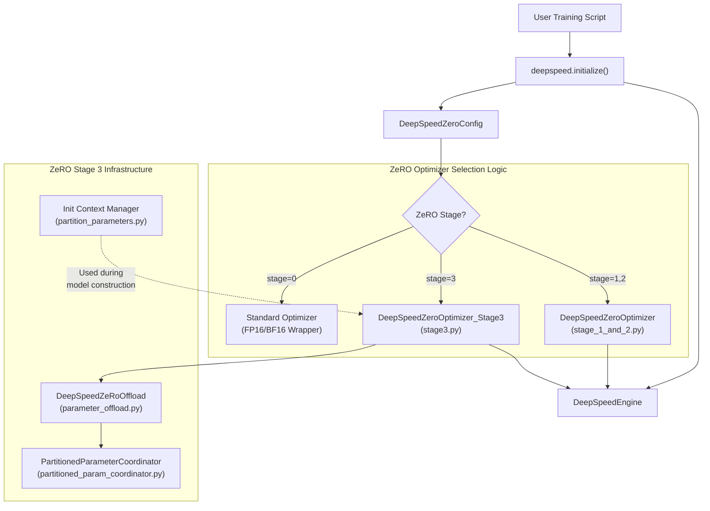
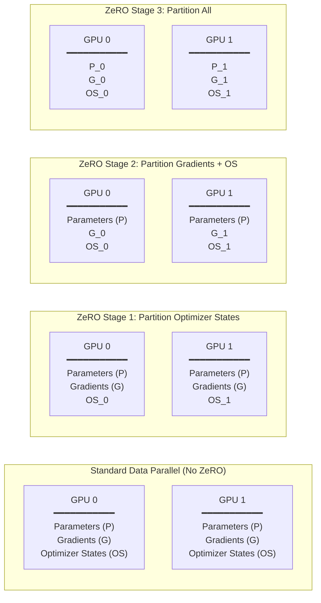
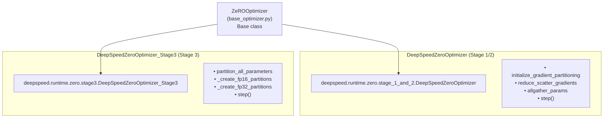
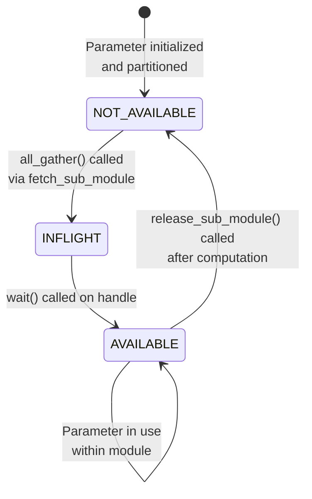

<!-- source: DeepWiki mcp.deepwiki.com · repo deepspeedai/DeepSpeed · page 3.2 ZeRO Memory Optimization · fetched 2026-10-21 -->

# ZeRO Memory Optimization

<details>
<summary>Relevant source files</summary>

The following files were used as context for generating this wiki page:

- [deepspeed/runtime/activation_checkpointing/checkpointing.py](deepspeed/runtime/activation_checkpointing/checkpointing.py)
- [deepspeed/runtime/base_optimizer.py](deepspeed/runtime/base_optimizer.py)
- [deepspeed/runtime/bf16_optimizer.py](deepspeed/runtime/bf16_optimizer.py)
- [deepspeed/runtime/config.py](deepspeed/runtime/config.py)
- [deepspeed/runtime/constants.py](deepspeed/runtime/constants.py)
- [deepspeed/runtime/engine.py](deepspeed/runtime/engine.py)
- [deepspeed/runtime/utils.py](deepspeed/runtime/utils.py)
- [deepspeed/runtime/zero/config.py](deepspeed/runtime/zero/config.py)
- [deepspeed/runtime/zero/leaf_module_config.py](deepspeed/runtime/zero/leaf_module_config.py)
- [deepspeed/runtime/zero/mics.py](deepspeed/runtime/zero/mics.py)
- [deepspeed/runtime/zero/parameter_offload.py](deepspeed/runtime/zero/parameter_offload.py)
- [deepspeed/runtime/zero/partition_parameters.py](deepspeed/runtime/zero/partition_parameters.py)
- [deepspeed/runtime/zero/partitioned_param_coordinator.py](deepspeed/runtime/zero/partitioned_param_coordinator.py)
- [deepspeed/runtime/zero/stage3.py](deepspeed/runtime/zero/stage3.py)
- [deepspeed/runtime/zero/stage_1_and_2.py](deepspeed/runtime/zero/stage_1_and_2.py)
- [deepspeed/runtime/zero/utils.py](deepspeed/runtime/zero/utils.py)
- [deepspeed/utils/__init__.py](deepspeed/utils/__init__.py)
- [deepspeed/utils/mixed_precision_linkage.py](deepspeed/utils/mixed_precision_linkage.py)
- [deepspeed/utils/tensor_fragment.py](deepspeed/utils/tensor_fragment.py)
- [deepspeed/utils/z3_leaf_module.py](deepspeed/utils/z3_leaf_module.py)
- [docs/_pages/config-json.md](docs/_pages/config-json.md)
- [docs/_posts/2020-09-09-sparse-attention.md](docs/_posts/2020-09-09-sparse-attention.md)
- [docs/_tutorials/megatron.md](docs/_tutorials/megatron.md)
- [docs/_tutorials/one-cycle.md](docs/_tutorials/one-cycle.md)
- [docs/_tutorials/pipeline.md](docs/_tutorials/pipeline.md)
- [docs/_tutorials/pytorch-profiler.md](docs/_tutorials/pytorch-profiler.md)
- [docs/_tutorials/sparse-attention.md](docs/_tutorials/sparse-attention.md)
- [docs/_tutorials/zero-offload.md](docs/_tutorials/zero-offload.md)
- [docs/_tutorials/zero.md](docs/_tutorials/zero.md)
- [docs/code-docs/source/zero3.rst](docs/code-docs/source/zero3.rst)
- [requirements/requirements-sparse_attn.txt](requirements/requirements-sparse_attn.txt)
- [tests/unit/runtime/zero/test_zero_leaf_module.py](tests/unit/runtime/zero/test_zero_leaf_module.py)
- [tests/unit/runtime/zero/test_zero_tensor_fragment.py](tests/unit/runtime/zero/test_zero_tensor_fragment.py)

</details>


## Purpose and Scope

This page introduces the **ZeRO (Zero Redundancy Optimizer)** memory optimization strategy in DeepSpeed, which enables training of large models by partitioning model states across distributed processes. This page covers the high-level concepts, architecture, and configuration of ZeRO optimization.

For detailed implementation of specific stages, see:
- **ZeRO Stages 1 and 2**: [ZeRO Stages 1 and 2](#3.2.1) - Optimizer state and gradient partitioning
- **ZeRO Stage 3**: [ZeRO Stage 3 and Parameter Partitioning](#3.2.2) - Parameter partitioning  
- **Parameter Lifecycle and Offloading**: [Parameter Lifecycle and Offloading](#3.2.3) - Parameter states and CPU/NVMe offloading

For the overall training engine architecture, see [DeepSpeedEngine Architecture](#3.1).

## Overview

ZeRO addresses the memory redundancy problem in data-parallel training where each GPU maintains a full copy of the model's:
1. **Optimizer states** (e.g., momentum and variance in Adam)
2. **Gradients**
3. **Parameters**

By partitioning these states across data-parallel processes, ZeRO reduces per-GPU memory consumption proportionally to the data-parallel degree, enabling training of models with billions or trillions of parameters.

### The Three Stages

ZeRO implements progressive optimization through three stages defined in the `ZeroStageEnum`:

| Stage | What is Partitioned | Memory Reduction Factor | Communication Overhead |
|-------|---------------------|------------------------|----------------------|
| **Stage 0** | None (baseline DDP) | 1x | Gradient AllReduce |
| **Stage 1** | Optimizer States | ~4x | Gradient AllReduce |
| **Stage 2** | Gradients + Optimizer States | ~8x | Gradient ReduceScatter |
| **Stage 3** | Parameters + Gradients + Optimizer States | Linear with DP degree | Parameter AllGather |

**Sources:** [deepspeed/runtime/zero/config.py:81-87](), [deepspeed/runtime/zero/config.py:95-100]()

## High-Level Architecture

### ZeRO Optimizer Selection

The `DeepSpeedEngine` selects the appropriate ZeRO implementation based on the `stage` parameter in the configuration.



**Diagram: ZeRO Optimizer Selection and Integration Flow**

The engine determines the optimizer wrapper during initialization. For Stage 3, it further initializes the `DeepSpeedZeRoOffload` and `PartitionedParameterCoordinator` to manage the dynamic parameter lifecycle.

**Sources:** [deepspeed/runtime/engine.py:30-34](), [deepspeed/runtime/zero/config.py:95-100](), [deepspeed/runtime/zero/parameter_offload.py:112-156]()

### Memory State Partitioning



**Diagram: Progressive Memory Partitioning Across ZeRO Stages**

**Sources:** [deepspeed/runtime/zero/stage_1_and_2.py:126-136](), [deepspeed/runtime/zero/stage3.py:136-146]()

## Configuration

### Basic Configuration Structure

ZeRO is configured through the `zero_optimization` section in the DeepSpeed configuration JSON. The `DeepSpeedZeroConfig` class validates these parameters using Pydantic.

```json
{
  "zero_optimization": {
    "stage": 3,
    "contiguous_gradients": true,
    "overlap_comm": true,
    "reduce_scatter": true,
    "reduce_bucket_size": 500000000,
    "allgather_bucket_size": 500000000,
    "offload_optimizer": {
      "device": "cpu",
      "pin_memory": true
    },
    "offload_param": {
      "device": "cpu",
      "pin_memory": true
    }
  }
}
```

**Sources:** [deepspeed/runtime/zero/config.py:90-170](), [docs/_pages/config-json.md:283-439]()

### Key Configuration Parameters

| Parameter | Type | Purpose | Stages |
|-----------|------|---------|--------|
| `stage` | int (0-3) | Selects ZeRO optimization stage | All |
| `contiguous_gradients` | bool | Copies gradients to contiguous buffer to avoid fragmentation | 1, 2, 3 |
| `overlap_comm` | bool | Overlaps gradient reduction with backward computation | 2, 3 |
| `reduce_scatter` | bool | Uses reduce-scatter instead of allreduce for gradients | 2, 3 |
| `reduce_bucket_size` | int | Number of elements reduced/allreduced at once | 1, 2, 3 |
| `allgather_bucket_size` | int | Number of elements allgathered at once | 1, 2, 3 |
| `offload_optimizer` | dict | Configuration for offloading optimizer states to CPU/NVMe | 1, 2, 3 |
| `offload_param` | dict | Configuration for offloading parameters to CPU/NVMe | 3 only |

**Sources:** [deepspeed/runtime/zero/config.py:102-170](), [deepspeed/runtime/zero/stage_1_and_2.py:147-154]()

### Stage 3 Specific Parameters

| Parameter | Purpose | Default |
|-----------|---------|---------|
| `stage3_max_live_parameters` | Maximum number of parameters kept in GPU memory | 1e9 |
| `stage3_max_reuse_distance` | Maximum distance between parameter reuses before release | 1e9 |
| `stage3_prefetch_bucket_size` | Number of parameters prefetched together | 5e7 |
| `stage3_param_persistence_threshold` | Parameters smaller than this remain persistently allocated | 1e5 |

**Sources:** [deepspeed/runtime/zero/config.py:206-253](), [deepspeed/runtime/zero/partitioned_param_coordinator.py:105-113]()

## Key Classes and Components

### Optimizer Classes

The ZeRO optimizers inherit from a common `ZeROOptimizer` base class.



**Diagram: ZeRO Optimizer Class Hierarchy**

**Sources:** [deepspeed/runtime/zero/stage_1_and_2.py:126](), [deepspeed/runtime/zero/stage3.py:136]()

### Stage 3 Parameter Management

Stage 3 uses a complex orchestration system to gather parameters on-demand.

| Component | Class/Entity | File | Role |
|-----------|--------------|------|------|
| **Coordinator** | `PartitionedParameterCoordinator` | [deepspeed/runtime/zero/partitioned_param_coordinator.py:64]() | Tracks module order and handles async parameter fetching/release. |
| **Offload Mgr** | `DeepSpeedZeRoOffload` | [deepspeed/runtime/zero/parameter_offload.py:112]() | Manages the offloading logic and hooks into the module forward/backward. |
| **Context Mgr** | `Init` | [deepspeed/runtime/zero/partition_parameters.py:410]() | Used to automatically partition parameters during model initialization. |
| **Status Tracker** | `ZeroParamStatus` | [deepspeed/runtime/zero/partition_parameters.py:228]() | Enum for parameter state: `NOT_AVAILABLE`, `INFLIGHT`, `AVAILABLE`. |

**Sources:** [deepspeed/runtime/zero/partition_parameters.py:228-237](), [deepspeed/runtime/zero/parameter_offload.py:112-134](), [deepspeed/runtime/zero/partitioned_param_coordinator.py:64-93]()

### Parameter State Machine

Parameters in ZeRO Stage 3 transition through states managed by the `PartitionedParameterCoordinator`.



**Diagram: Parameter State Transitions in ZeRO-3**

**Sources:** [deepspeed/runtime/zero/partition_parameters.py:228-237](), [deepspeed/runtime/zero/partitioned_param_coordinator.py:64-150]()

## Communication Patterns

### Gradient Reduction

- **Stage 1**: Uses AllReduce to synchronize gradients across all ranks. Every rank receives the full averaged gradient, but only updates its own partition of optimizer states. [deepspeed/runtime/zero/stage_1_and_2.py:1114-1168]()
- **Stage 2**: Uses ReduceScatter. Each rank receives only the partition of the averaged gradient that corresponds to its optimizer state partition. [deepspeed/runtime/zero/stage_1_and_2.py:1273-1347]()
- **Stage 3**: Similar to Stage 2, but gradients are reduced into partitioned buffers that may be offloaded to CPU/NVMe. [deepspeed/runtime/zero/stage3.py:1580-1650]()

### Parameter Gathering (Stage 3)

In Stage 3, parameters are gathered using `all_gather` before a module's forward or backward pass. The `PartitionedParameterCoordinator` manages an `allgather_stream` to overlap this communication with computation.

**Sources:** [deepspeed/runtime/zero/partitioned_param_coordinator.py:120-133](), [deepspeed/runtime/zero/partitioned_param_coordinator.py:387-456]()

## Summary

ZeRO memory optimization is the foundational technology in DeepSpeed for training massive models. By intelligently partitioning model states and utilizing hierarchical memory (GPU, CPU, NVMe), it removes the memory barriers of standard data parallelism.

For further details, refer to the specific stage documentation:
- [ZeRO Stages 1 and 2](#3.2.1)
- [ZeRO Stage 3 and Parameter Partitioning](#3.2.2)
- [Parameter Lifecycle and Offloading](#3.2.3)

---

