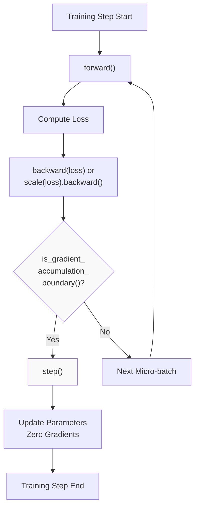
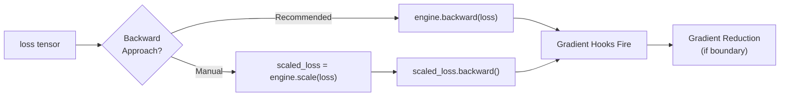
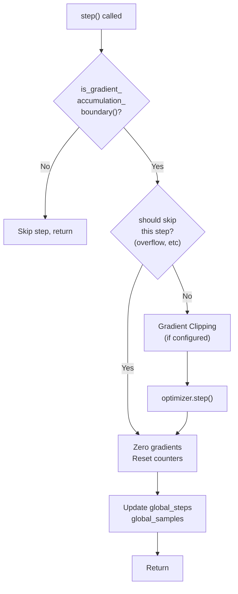
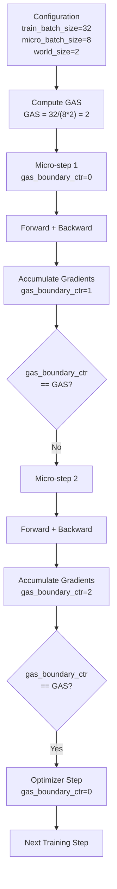
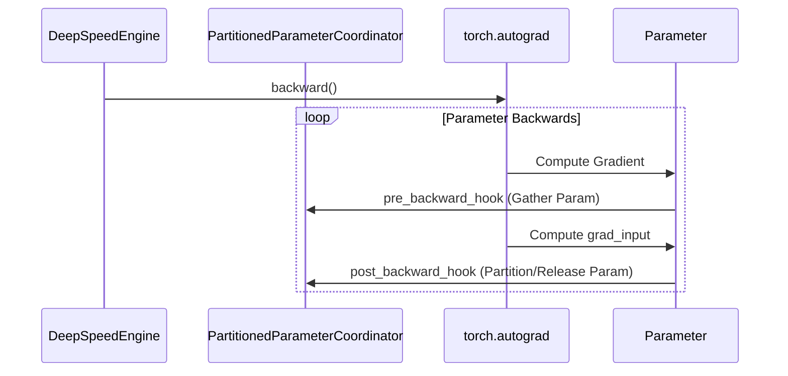
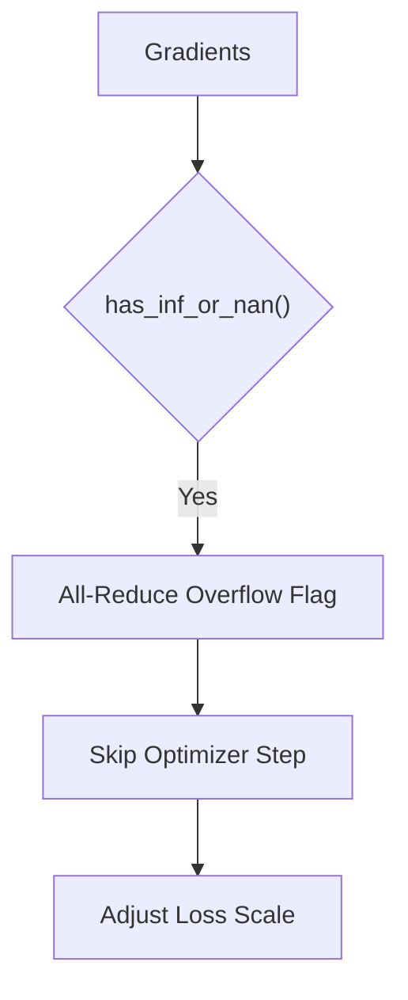

<!-- source: DeepWiki mcp.deepwiki.com · repo deepspeedai/DeepSpeed · page 3.3 Training Loop and Gradient Management · fetched 2026-10-21 -->

# Training Loop and Gradient Management

Relevant source files

The following files were used as context for generating this wiki page:

- [csrc/quantization/quant_reduce.cu](csrc/quantization/quant_reduce.cu)
- [csrc/quantization/swizzled_quantize.cu](csrc/quantization/swizzled_quantize.cu)
- [deepspeed/runtime/activation_checkpointing/checkpointing.py](deepspeed/runtime/activation_checkpointing/checkpointing.py)
- [deepspeed/runtime/base_optimizer.py](deepspeed/runtime/base_optimizer.py)
- [deepspeed/runtime/bf16_optimizer.py](deepspeed/runtime/bf16_optimizer.py)
- [deepspeed/runtime/comm/coalesced_collectives.py](deepspeed/runtime/comm/coalesced_collectives.py)
- [deepspeed/runtime/config.py](deepspeed/runtime/config.py)
- [deepspeed/runtime/constants.py](deepspeed/runtime/constants.py)
- [deepspeed/runtime/engine.py](deepspeed/runtime/engine.py)
- [deepspeed/runtime/utils.py](deepspeed/runtime/utils.py)
- [deepspeed/runtime/zero/config.py](deepspeed/runtime/zero/config.py)
- [deepspeed/runtime/zero/mics.py](deepspeed/runtime/zero/mics.py)
- [deepspeed/runtime/zero/parameter_offload.py](deepspeed/runtime/zero/parameter_offload.py)
- [deepspeed/runtime/zero/partition_parameters.py](deepspeed/runtime/zero/partition_parameters.py)
- [deepspeed/runtime/zero/partitioned_param_coordinator.py](deepspeed/runtime/zero/partitioned_param_coordinator.py)
- [deepspeed/runtime/zero/stage3.py](deepspeed/runtime/zero/stage3.py)
- [deepspeed/runtime/zero/stage_1_and_2.py](deepspeed/runtime/zero/stage_1_and_2.py)
- [deepspeed/runtime/zero/utils.py](deepspeed/runtime/zero/utils.py)
- [docs/_pages/config-json.md](docs/_pages/config-json.md)
- [tests/unit/runtime/comm/test_coalesced_collectives.py](tests/unit/runtime/comm/test_coalesced_collectives.py)

## Purpose and Scope

This page describes the training loop mechanics and gradient management in DeepSpeed, focusing on how the `DeepSpeedEngine` orchestrates forward passes, backward passes, gradient accumulation, and optimizer steps. It covers the hook-based gradient computation system, gradient reduction strategies, gradient clipping, and overflow detection.

For information about the overall `DeepSpeedEngine` architecture and initialization, see [DeepSpeedEngine Architecture](3.1). For ZeRO-specific memory optimization and parameter/gradient partitioning strategies, see [ZeRO Memory Optimization](3.2) and its sub-pages. For mixed precision training details including FP16/BF16 and loss scaling, see [Mixed Precision Training](3.4).

## Basic Training Loop

### Standard Training Pattern

DeepSpeed follows a standard PyTorch-style training loop with three primary operations: forward propagation, backward propagation, and optimizer step. The `DeepSpeedEngine` wraps the user's model and optimizer to intercept these operations and apply optimizations.

**Diagram: Training Loop Flow with Gradient Accumulation**

The engine maintains internal state to track gradient accumulation progress and determines when to perform the actual optimizer step.

**Sources:** [deepspeed/runtime/engine.py:1414-1570]()

### Forward Pass Implementation

The `forward()` method is called implicitly when the model engine is invoked as a callable. It delegates to the wrapped module's forward method while managing timing instrumentation.

| Method | Location | Description |
|--------|----------|-------------|
| `__call__()` | [deepspeed/runtime/engine.py:1414-1415]() | Makes engine callable, delegates to forward |
| `forward()` | [deepspeed/runtime/engine.py:1417-1437]() | Wraps module forward with timing |

The forward pass increments the micro-step counter (`self.micro_steps`) which is used to track gradient accumulation progress.

**Sources:** [deepspeed/runtime/engine.py:1414-1437]()

### Backward Pass Implementation

DeepSpeed provides two approaches for backward propagation:

1. **Engine-managed backward**: `engine.backward(loss)` - Recommended approach
2. **User-managed backward**: `scaled_loss = engine.scale(loss); scaled_loss.backward()` - For manual control

**Diagram: Backward Pass Execution Paths**

The `backward()` method performs several key operations:

| Operation | Implementation |
|-----------|----------------|
| Loss validation | Ensures scalar loss for `engine.backward()` via `maybe_loss_for_backward` |
| Loss scaling | Applies scaler based on mixed precision mode |
| Backward invocation | Calls `torch.autograd.backward()` |
| Hook execution | Gradient hooks fire during backward |
| Boundary checking | Determines if optimizer step should occur |
| Pre/post processing | Manages backward state via `_backward_pre_hook` and `_backward_post_hook` |

**Sources:** [deepspeed/runtime/engine.py:1439-1530](), [deepspeed/runtime/engine.py:91-91]()

### Optimizer Step

The `step()` method performs parameter updates when gradient accumulation is complete. It coordinates between the `DeepSpeedEngine` and the underlying optimizer wrapper (ZeRO, FP16, BF16, etc.).

**Diagram: Optimizer Step Logic Flow**

Key state variables updated during step:

| Variable | Location | Purpose |
|----------|----------|---------|
| `micro_steps` | [deepspeed/runtime/engine.py:235]() | Counts micro-batches processed |
| `global_steps` | [deepspeed/runtime/engine.py:233]() | Total optimizer steps taken |
| `global_samples` | [deepspeed/runtime/engine.py:234]() | Total samples processed |
| `skipped_steps` | [deepspeed/runtime/engine.py:236]() | Steps skipped due to overflow |
| `gas_boundary_ctr` | [deepspeed/runtime/engine.py:248]() | Gradient accumulation counter |

**Sources:** [deepspeed/runtime/engine.py:1532-1570]()

## Gradient Accumulation

### Accumulation Mechanics

Gradient accumulation allows training with effective batch sizes larger than what fits in GPU memory by accumulating gradients over multiple micro-batches before performing a parameter update.

**Key Configuration:**
- `train_batch_size`: Effective training batch size. [docs/_pages/config-json.md:12-16]()
- `train_micro_batch_size_per_gpu`: Batch size per GPU per forward/backward pass. [docs/_pages/config-json.md:19-23]()
- `gradient_accumulation_steps`: Number of training steps to accumulate before averaging. [docs/_pages/config-json.md:25-29]()

**Diagram: Gradient Accumulation Over Multiple Micro-batches**

**Sources:** [deepspeed/runtime/engine.py:667-692](), [docs/_pages/config-json.md:7-30]()

### Boundary Detection

The `is_gradient_accumulation_boundary()` method determines whether the current step should trigger an optimizer update.

| Method | Returns | When True |
|--------|---------|-----------|
| `is_gradient_accumulation_boundary()` | bool | Current step completes gradient accumulation cycle |
| `_is_gradient_accumulation_boundary()` | bool | Internal cached version, updated during step |

The boundary is reached when `(micro_steps + 1) % gradient_accumulation_steps == 0`.

**Sources:** [deepspeed/runtime/engine.py:1600-1611](), [deepspeed/runtime/engine.py:262]()

## Gradient Hook System

### Hook Registration and Management

DeepSpeed uses PyTorch's autograd hook mechanism to intercept gradient computation. The system varies by ZeRO stage.

| Optimization Mode | Hook Definition | Registration Call Site |
|-------------------|-----------------|------------------------|
| ZeRO Stage 1 & 2 | `DeepSpeedZeroOptimizer` | [deepspeed/runtime/zero/stage_1_and_2.py:611-693]() |
| ZeRO Stage 3 | `DeepSpeedZeroOptimizer_Stage3` | [deepspeed/runtime/zero/stage3.py:110-110]() |
| Standard BF16 | `BF16_Optimizer` | [deepspeed/runtime/bf16_optimizer.py:118-119]() |

**Sources:** [deepspeed/runtime/zero/stage_1_and_2.py:611-693](), [deepspeed/runtime/zero/stage3.py:110-110](), [deepspeed/runtime/bf16_optimizer.py:118-119]()

### Backward Hook Execution

In ZeRO-3, parameters are partitioned. Hooks are registered during module initialization to manage parameter gathering and release.

**Diagram: ZeRO-3 Parameter Lifecycle during Backward**

**Sources:** [deepspeed/runtime/zero/stage3.py:82-111](), [deepspeed/runtime/zero/partitioned_param_coordinator.py:64-150]()

## Gradient Reduction and Synchronization

### Communication Patterns

| Mode | Communication Op | implementation |
|------|------------------|----------------|
| ZeRO Stage 1 | All-Reduce | [deepspeed/runtime/zero/stage_1_and_2.py:900-1042]() |
| ZeRO Stage 2 | Reduce-Scatter | [deepspeed/runtime/zero/stage_1_and_2.py:900-1042]() |
| ZeRO Stage 3 | Coalesced Reduce-Scatter | [deepspeed/runtime/zero/stage3.py:1575-1767]() |

**Sources:** [deepspeed/runtime/zero/stage_1_and_2.py:900-1042](), [deepspeed/runtime/zero/stage3.py:1575-1767]()

### Gradient Buckets and Coalescing

DeepSpeed uses bucketed reductions to minimize communication overhead.

| Class | Purpose | Location |
|-------|---------|----------|
| `IPGBucket` | ZeRO-1/2 gradient/parameter bucket | [deepspeed/runtime/zero/stage_1_and_2.py:110-124]() |
| `IPGBucketZ3` | ZeRO-3 parameter bucket | [deepspeed/runtime/zero/stage3.py:115-131]() |

**Sources:** [deepspeed/runtime/zero/stage_1_and_2.py:110-124](), [deepspeed/runtime/zero/stage3.py:115-131]()

## Gradient Clipping

DeepSpeed implements global gradient clipping, accounting for distributed partitions.

| Function | Role | Location |
|----------|------|----------|
| `clip_grad_norm_` | Global norm calculation and scaling | [deepspeed/runtime/utils.py:359-459]() |
| `get_global_norm_of_tensors` | Distributed-aware norm collection | [deepspeed/runtime/utils.py:461-512]() |

**Sources:** [deepspeed/runtime/utils.py:359-512]()

## Overflow Detection

The `CheckOverflow` mechanism is used primarily in mixed precision (FP16) training to detect `NaN`/`Inf` and trigger loss scale adjustments.

**Diagram: Overflow Detection Logic**

**Sources:** [deepspeed/runtime/utils.py:225-334](), [deepspeed/runtime/engine.py:1532-1570]()

## Loss Scaling Integration

The `DeepSpeedEngine.scale()` method manages the loss scaling required for low-precision training.

| Component | Logic | Location |
|-----------|-------|----------|
| `DeepSpeedEngine.scale` | Entry point for loss scaling | [deepspeed/runtime/engine.py:1372-1412]() |
| `CreateLossScaler` | Factory for dynamic/static scalers | [deepspeed/runtime/fp16/loss_scaler.py:1-40]() |

**Sources:** [deepspeed/runtime/engine.py:1372-1412](), [deepspeed/runtime/zero/stage3.py:21-21]()

---

