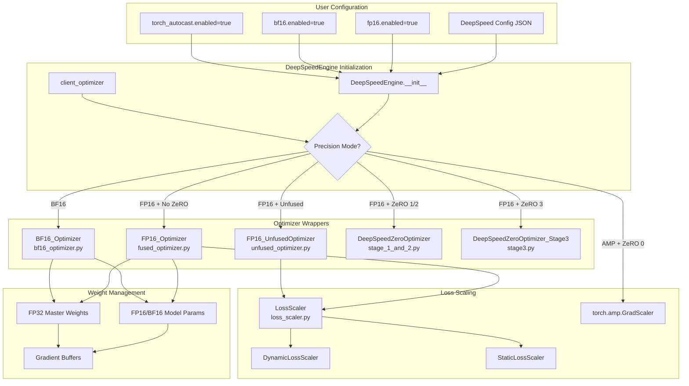
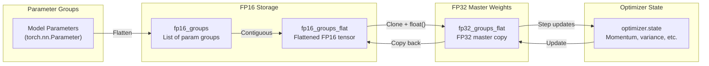
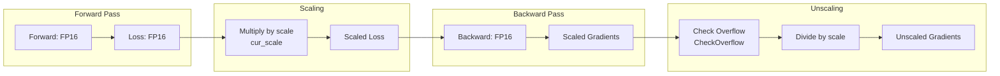
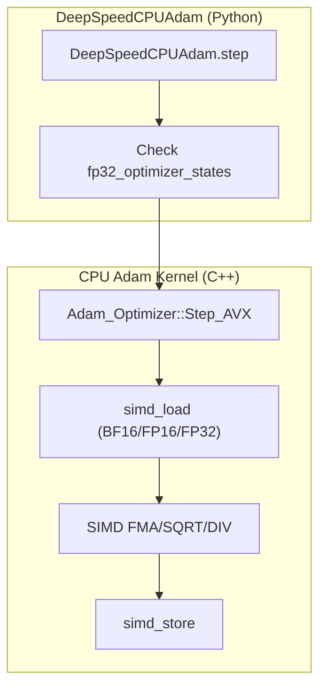

<!-- source: DeepWiki mcp.deepwiki.com · repo deepspeedai/DeepSpeed · page 3.4 Mixed Precision Training · fetched 2026-10-21 -->

# Mixed Precision Training

Relevant source files

The following files were used as context for generating this wiki page:

- [csrc/adagrad/cpu_adagrad.cpp](csrc/adagrad/cpu_adagrad.cpp)
- [csrc/adam/cpu_adam.cpp](csrc/adam/cpu_adam.cpp)
- [csrc/adam/cpu_adam_impl.cpp](csrc/adam/cpu_adam_impl.cpp)
- [csrc/includes/cpu_adagrad.h](csrc/includes/cpu_adagrad.h)
- [csrc/includes/cpu_adam.h](csrc/includes/cpu_adam.h)
- [csrc/includes/cpu_lion.h](csrc/includes/cpu_lion.h)
- [csrc/includes/simd.h](csrc/includes/simd.h)
- [csrc/lion/cpu_lion_impl.cpp](csrc/lion/cpu_lion_impl.cpp)
- [csrc/xpu/includes/cpu_adam.h](csrc/xpu/includes/cpu_adam.h)
- [deepspeed/ops/adam/cpu_adam.py](deepspeed/ops/adam/cpu_adam.py)
- [deepspeed/runtime/fp16/fused_optimizer.py](deepspeed/runtime/fp16/fused_optimizer.py)
- [deepspeed/runtime/fp16/loss_scaler.py](deepspeed/runtime/fp16/loss_scaler.py)
- [deepspeed/runtime/fp16/unfused_optimizer.py](deepspeed/runtime/fp16/unfused_optimizer.py)
- [deepspeed/runtime/pipe/engine.py](deepspeed/runtime/pipe/engine.py)
- [deepspeed/runtime/pipe/module.py](deepspeed/runtime/pipe/module.py)
- [deepspeed/runtime/precision_config.py](deepspeed/runtime/precision_config.py)
- [deepspeed/runtime/torch_autocast.py](deepspeed/runtime/torch_autocast.py)
- [op_builder/cpu_adagrad.py](op_builder/cpu_adagrad.py)
- [op_builder/cpu_adam.py](op_builder/cpu_adam.py)
- [op_builder/npu/cpu_adagrad.py](op_builder/npu/cpu_adagrad.py)
- [op_builder/npu/cpu_adam.py](op_builder/npu/cpu_adam.py)
- [tests/unit/ops/adagrad/test_cpu_adagrad.py](tests/unit/ops/adagrad/test_cpu_adagrad.py)
- [tests/unit/ops/adam/test_cpu_adam.py](tests/unit/ops/adam/test_cpu_adam.py)
- [tests/unit/runtime/half_precision/test_dynamic_loss_scale.py](tests/unit/runtime/half_precision/test_dynamic_loss_scale.py)
- [tests/unit/runtime/half_precision/test_fp16.py](tests/unit/runtime/half_precision/test_fp16.py)
- [tests/unit/runtime/test_ds_initialize.py](tests/unit/runtime/test_ds_initialize.py)
- [tests/unit/runtime/test_precision_config_loss_scale.py](tests/unit/runtime/test_precision_config_loss_scale.py)
- [tests/unit/v1/half_precision/test_bf16.py](tests/unit/v1/half_precision/test_bf16.py)

This page covers DeepSpeed's mixed precision training capabilities, including FP16, BF16, and PyTorch AMP support. Mixed precision training uses lower-precision floating-point formats during training to reduce memory consumption and accelerate computation while maintaining model quality through careful handling of numerical precision.

For optimizer state partitioning that works with mixed precision, see [ZeRO Memory Optimization](#3.2). For pipeline parallelism with mixed precision, see [Mixed Precision in Pipeline Parallelism](#4.3).

---

## Overview

DeepSpeed supports three mixed precision training modes:

| Mode | Precision | Loss Scaling | Primary Use Case |
|------|-----------|--------------|------------------|
| **FP16** | 16-bit float | Required (dynamic or static) | NVIDIA GPUs with Tensor Cores |
| **BF16** | 16-bit bfloat | Not required | Hardware supporting BF16 (A100, H100) |
| **PyTorch AMP** | Mixed (autocast) | Built-in GradScaler | Fine-grained control over precision |

All modes maintain master weights in FP32 for numerical stability, performing forward/backward in lower precision and optimizer steps in FP32.

Sources: [deepspeed/runtime/fp16/fused_optimizer.py:44-54](), [deepspeed/runtime/bf16_optimizer.py:35-108](), [deepspeed/runtime/pipe/engine.py:85-86]()

---

## Mixed Precision Architecture

### System Components

**Mixed Precision Training System Architecture**: Shows how configuration flows through the DeepSpeedEngine to create appropriate optimizer wrappers with loss scaling and weight management.

Sources: [deepspeed/runtime/fp16/fused_optimizer.py:33-89](), [deepspeed/runtime/bf16_optimizer.py:35-108](), [deepspeed/runtime/fp16/unfused_optimizer.py:31-88]()

---

## FP16 Training

### FP16_Optimizer (Fused)

The fused FP16 optimizer (`FP16_Optimizer`) provides high-performance FP16 training by maintaining flattened FP32 master weights and using optimized CUDA kernels.

**Key Characteristics:**
- Flattens model parameters into contiguous FP16 and FP32 buffers [deepspeed/runtime/fp16/fused_optimizer.py:78-80]().
- Uses fused Adam/AdamW kernels for efficient updates.
- Supports dynamic and static loss scaling [deepspeed/runtime/fp16/fused_optimizer.py:44-48]().
- Maintains model FP16 weights as slices of a flattened buffer [deepspeed/runtime/fp16/fused_optimizer.py:92-96]().

**Weight Management:**

**FP16 Fused Weight Management**: FP16 model parameters are flattened for efficiency, with FP32 master copies maintained for optimizer updates.

Sources: [deepspeed/runtime/fp16/fused_optimizer.py:78-101](), [deepspeed/runtime/fp16/fused_optimizer.py:123-133]()

### FP16_UnfusedOptimizer

The unfused variant (`FP16_UnfusedOptimizer`) supports optimizers that cannot work with flattened parameters (e.g., LAMB) or when using Mixture of Experts (MoE) where parameters might be split into shared and expert groups.

**Key Differences from Fused:**
- Parameters remain in original structure (not flattened) [deepspeed/runtime/fp16/unfused_optimizer.py:70-73]().
- Compatible with LAMB and other complex optimizers [deepspeed/runtime/fp16/unfused_optimizer.py:24-29]().
- Handles MoE by splitting params into shared and expert groups for norm computation [deepspeed/runtime/fp16/unfused_optimizer.py:133-147]().

Sources: [deepspeed/runtime/fp16/unfused_optimizer.py:65-88](), [deepspeed/runtime/fp16/unfused_optimizer.py:124-172]()

---

## BF16 Training

### BF16_Optimizer

The BF16 optimizer provides FP16-like memory savings without loss scaling complexity due to bfloat16's wider exponent range.

**Architecture:**
- Maintains master weights in FP32 to avoid precision loss during accumulation.
- Forward and backward passes occur in BF16.
- Supports gradient accumulation in FP32 for improved stability [deepspeed/runtime/pipe/engine.py:85]().

Sources: [deepspeed/runtime/bf16_optimizer.py:35-108](), [deepspeed/runtime/pipe/engine.py:16-22]()

---

## Loss Scaling

### Purpose and Mechanism

FP16 has a limited dynamic range compared to FP32. Small gradients can underflow to zero. Loss scaling multiplies the loss by a factor before the backward pass to shift gradients into a representable range, then unscales them before the optimizer step.

**Loss Scaling Flow:**

Sources: [deepspeed/runtime/fp16/fused_optimizer.py:165-180](), [deepspeed/runtime/fp16/loss_scaler.py:14-16](), [deepspeed/runtime/fp16/unfused_optimizer.py:150-161]()

### Dynamic Loss Scaling

DeepSpeed primarily uses dynamic loss scaling, which automatically adjusts the scale factor based on whether overflows are detected.

**Scaling Algorithm Logic:**
- If overflow is detected: Reduce the scale (usually by half) and skip the optimizer step [deepspeed/runtime/fp16/fused_optimizer.py:167-173]().
- If no overflow for N steps: Increase the scale (usually doubling it) to maximize precision.

Sources: [deepspeed/runtime/fp16/fused_optimizer.py:165-173](), [deepspeed/runtime/fp16/loss_scaler.py:52-71]()

---

## CPU Adam and Low Precision

For training on heterogeneous systems (CPU/GPU), DeepSpeed provides `DeepSpeedCPUAdam`. This optimizer is highly optimized for CPU execution using SIMD instructions (AVX2/AVX512).

**Key Precision Features:**
- **fp32_optimizer_states**: If set to `False`, momentum and variance are kept in the parameter dtype (e.g., BF16) to reduce memory footprint [deepspeed/ops/adam/cpu_adam.py:61-64]().
- **SIMD Kernels**: Implementation uses `AVX_Data` and SIMD intrinsics to handle `float`, `half` (FP16), and `BFloat16` efficiently on CPU [csrc/includes/simd.h:119-148]().

Sources: [deepspeed/ops/adam/cpu_adam.py:13-65](), [csrc/includes/cpu_adam.h:111-198](), [csrc/includes/simd.h:158-186]()

---

## Code Entity Summary

| Code Entity | File Path | Role |
|-------------|-----------|------|
| `FP16_Optimizer` | [deepspeed/runtime/fp16/fused_optimizer.py:33]() | Orchestrates FP16 training with flattened weights and fused kernels. |
| `FP16_UnfusedOptimizer` | [deepspeed/runtime/fp16/unfused_optimizer.py:24]() | Handles FP16 training without flattening, used for LAMB and MoE. |
| `CheckOverflow` | [deepspeed/runtime/fp16/fused_optimizer.py:120]() | Utility to check for Inf/NaN in gradients across the model. |
| `LossScaleConfig` | [deepspeed/runtime/fp16/loss_scaler.py:14]() | Configuration container for loss scaling parameters. |
| `DeepSpeedCPUAdam` | [deepspeed/ops/adam/cpu_adam.py:13]() | CPU-based Adam optimizer supporting BF16/FP16 parameters and states. |
| `Adam_Optimizer` | [csrc/includes/cpu_adam.h:24]() | C++ implementation of Adam update logic with SIMD support. |
| `simd_load` / `simd_store` | [csrc/includes/simd.h:128-186]() | Specialized templates for loading/storing different precisions into SIMD registers. |

Sources: All files listed in table.

---

