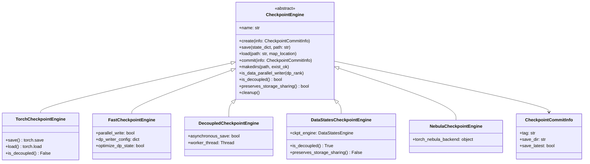
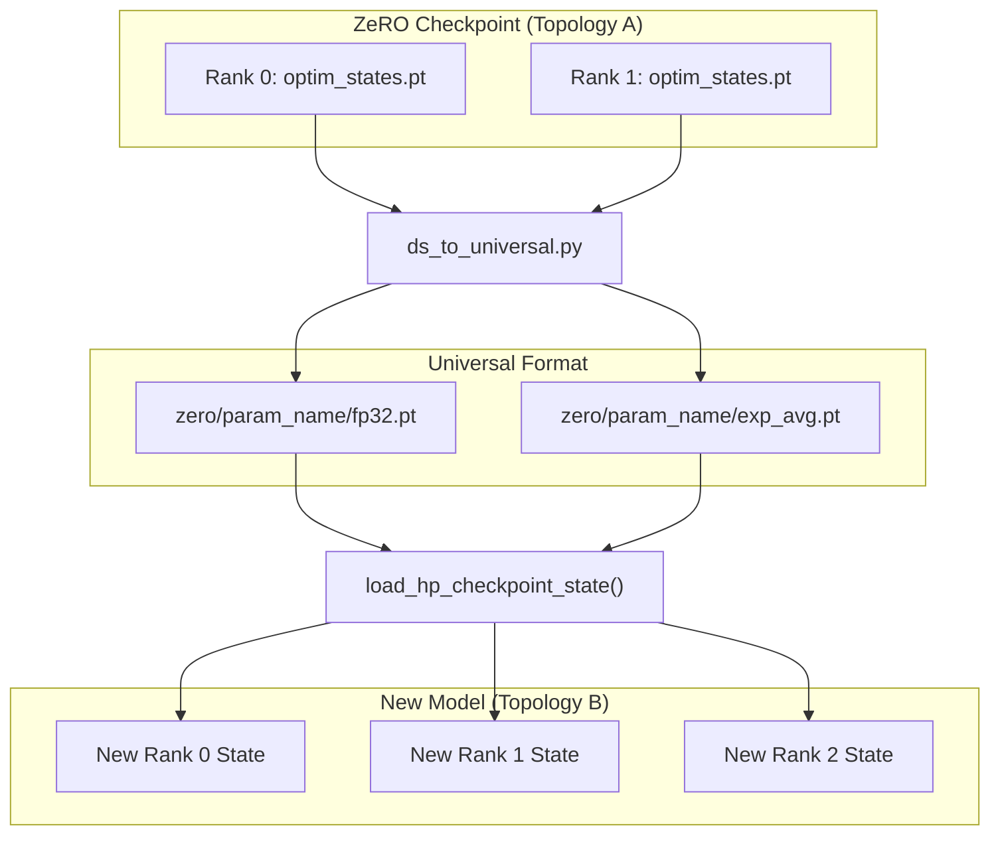
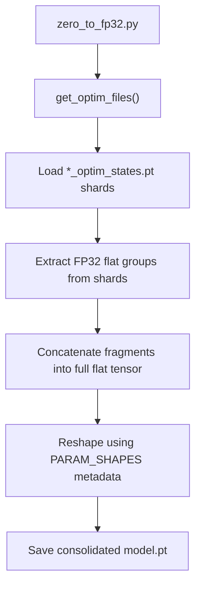
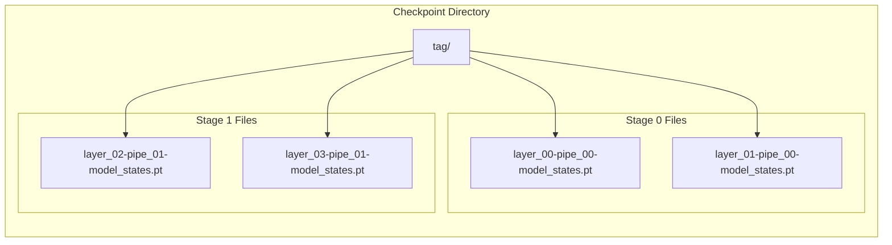
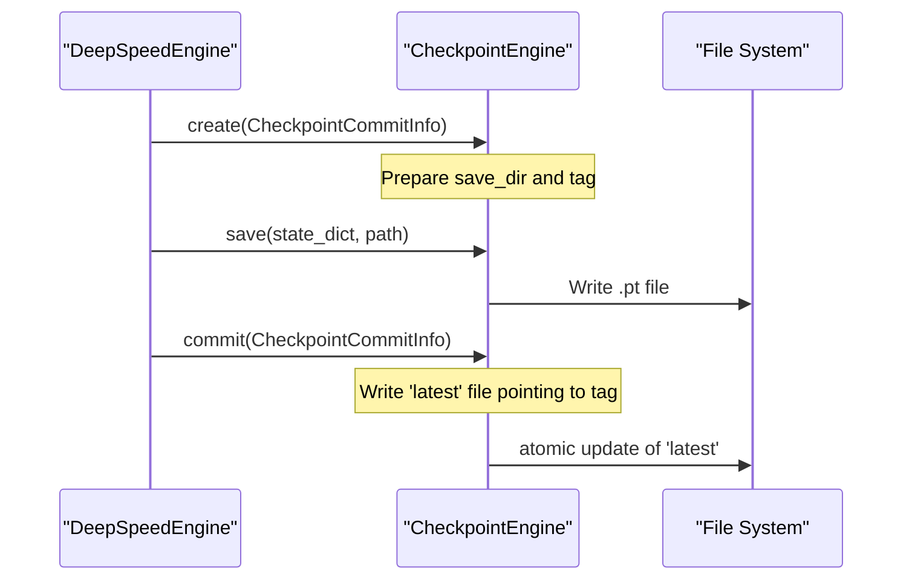

<!-- source: DeepWiki mcp.deepwiki.com · repo deepspeedai/DeepSpeed · page 3.5 Checkpointing System · fetched 2026-10-21 -->

# Checkpointing System

Relevant source files

The following files were used as context for generating this wiki page:

- [deepspeed/checkpoint/__init__.py](deepspeed/checkpoint/__init__.py)
- [deepspeed/checkpoint/constants.py](deepspeed/checkpoint/constants.py)
- [deepspeed/checkpoint/deepspeed_checkpoint.py](deepspeed/checkpoint/deepspeed_checkpoint.py)
- [deepspeed/checkpoint/ds_to_universal.py](deepspeed/checkpoint/ds_to_universal.py)
- [deepspeed/checkpoint/reshape_3d_utils.py](deepspeed/checkpoint/reshape_3d_utils.py)
- [deepspeed/checkpoint/reshape_utils.py](deepspeed/checkpoint/reshape_utils.py)
- [deepspeed/checkpoint/universal_checkpoint.py](deepspeed/checkpoint/universal_checkpoint.py)
- [deepspeed/checkpoint/zero_checkpoint.py](deepspeed/checkpoint/zero_checkpoint.py)
- [deepspeed/datastates/README.md](deepspeed/datastates/README.md)
- [deepspeed/datastates/__init__.py](deepspeed/datastates/__init__.py)
- [deepspeed/datastates/config.py](deepspeed/datastates/config.py)
- [deepspeed/nebula/__init__.py](deepspeed/nebula/__init__.py)
- [deepspeed/nebula/config.py](deepspeed/nebula/config.py)
- [deepspeed/nebula/constants.py](deepspeed/nebula/constants.py)
- [deepspeed/runtime/checkpoint_engine/README.md](deepspeed/runtime/checkpoint_engine/README.md)
- [deepspeed/runtime/checkpoint_engine/__init__.py](deepspeed/runtime/checkpoint_engine/__init__.py)
- [deepspeed/runtime/checkpoint_engine/checkpoint_engine.py](deepspeed/runtime/checkpoint_engine/checkpoint_engine.py)
- [deepspeed/runtime/checkpoint_engine/datastates_checkpoint_engine.py](deepspeed/runtime/checkpoint_engine/datastates_checkpoint_engine.py)
- [deepspeed/runtime/checkpoint_engine/utils.py](deepspeed/runtime/checkpoint_engine/utils.py)
- [deepspeed/utils/zero_to_fp32.py](deepspeed/utils/zero_to_fp32.py)
- [docs/_tutorials/datastates-async-checkpointing.md](docs/_tutorials/datastates-async-checkpointing.md)
- [docs/_tutorials/universal-checkpointing.md](docs/_tutorials/universal-checkpointing.md)
- [tests/unit/checkpoint/common.py](tests/unit/checkpoint/common.py)
- [tests/unit/checkpoint/test_autotp_uc_checkpoint.py](tests/unit/checkpoint/test_autotp_uc_checkpoint.py)
- [tests/unit/checkpoint/test_convert_checkpoint.py](tests/unit/checkpoint/test_convert_checkpoint.py)
- [tests/unit/checkpoint/test_moe_checkpoint.py](tests/unit/checkpoint/test_moe_checkpoint.py)
- [tests/unit/checkpoint/test_universal_checkpoint.py](tests/unit/checkpoint/test_universal_checkpoint.py)
- [tests/unit/checkpoint/test_zero_optimizer.py](tests/unit/checkpoint/test_zero_optimizer.py)
- [tests/unit/compression/test_compression.py](tests/unit/compression/test_compression.py)
- [tests/unit/model_parallelism/test_configurable_parallel_mp.py](tests/unit/model_parallelism/test_configurable_parallel_mp.py)
- [tests/unit/model_parallelism/test_configurable_parallel_pp.py](tests/unit/model_parallelism/test_configurable_parallel_pp.py)
- [tests/unit/moe/test_moe_tp.py](tests/unit/moe/test_moe_tp.py)
- [tests/unit/profiling/flops_profiler/test_flops_profiler.py](tests/unit/profiling/flops_profiler/test_flops_profiler.py)
- [tests/unit/runtime/half_precision/onebit/test_onebit.py](tests/unit/runtime/half_precision/onebit/test_onebit.py)
- [tests/unit/runtime/tensor_parallel/test_autotp_universal_checkpoint.py](tests/unit/runtime/tensor_parallel/test_autotp_universal_checkpoint.py)

## Purpose and Scope

The DeepSpeed Checkpointing System manages the persistence of model states, optimizer states, and training metadata to disk. It is designed to handle the complexities of distributed training, including ZeRO-aware partitioning, pipeline parallelism, and high-performance asynchronous I/O. Key features include **Universal Checkpointing** for topology-agnostic resumption and specialized **Checkpoint Engines** for minimized training interruption.

---

## Checkpoint Engine Architecture

DeepSpeed provides an abstract `CheckpointEngine` base class with multiple concrete implementations. This abstraction allows the training engine to swap storage backends (e.g., standard Torch, asynchronous I/O, or specialized hardware-accelerated backends) without changing the core training loop.

### CheckpointEngine Base Interface

The `CheckpointEngine` abstract base class defines the core operations for checkpoint management:

**Sources**: [deepspeed/runtime/checkpoint_engine/checkpoint_engine.py:21-64](), [deepspeed/runtime/checkpoint_engine/__init__.py:1-12]()

### Checkpoint Engine Implementations

| Engine | Description | Key File |
|--------|-------------|----------|
| `TorchCheckpointEngine` | Default engine using `torch.save` and `torch.load`. Blocking and synchronous. | [deepspeed/runtime/checkpoint_engine/torch_checkpoint_engine.py]() |
| `FastCheckpointEngine` | Optimized for ZeRO states; supports parallel writing across DP ranks. | [deepspeed/runtime/checkpoint_engine/fast_checkpoint_engine.py]() |
| `DecoupledCheckpointEngine` | Offloads I/O to a background thread to overlap checkpointing with compute. | [deepspeed/runtime/checkpoint_engine/decoupled_checkpoint_engine.py]() |
| `DataStatesCheckpointEngine` | Integrates with `DataStates-LLM` for lazy, asynchronous multi-level checkpointing. | [deepspeed/runtime/checkpoint_engine/datastates_checkpoint_engine.py:1-60]() |
| `NebulaCheckpointEngine` | Backend for Microsoft Nebula checkpointing service. | [deepspeed/runtime/checkpoint_engine/utils.py:29-36]() |

---

## Universal Checkpointing

Universal Checkpointing (UC) allows a model to be saved in one parallelism configuration (e.g., TP=2, PP=2, DP=4) and resumed in a completely different one (e.g., TP=4, PP=1, DP=4). This is achieved by converting sharded ZeRO checkpoints into a consolidated, topology-neutral format.

### The Conversion Workflow

The conversion is typically performed offline using the `ds_to_universal.py` utility.

1.  **Extraction**: Shards are extracted from ZeRO 1, 2, or 3 checkpoints. For ZeRO-3, the script iterates through DP ranks to reconstruct full parameters from partitioned fragments.
2.  **Normalization**: Parameters are mapped to a universal naming scheme. Metadata such as `PARAM_SHAPES` and `PARAM_SLICE_MAPPINGS` are used to align fragments.
3.  **Restoration**: During `load_checkpoint`, if `load_universal` is enabled in the config, the engine uses `load_hp_checkpoint_state` to slice the universal weights into the new target topology.

**Sources**: [deepspeed/checkpoint/ds_to_universal.py:112-171](), [deepspeed/checkpoint/universal_checkpoint.py:99-171](), [docs/_tutorials/universal-checkpointing.md:21-61]()

### Key Constants and Metadata
DeepSpeed uses specific keys in the `state_dict` to track how parameters were sharded:
- `SINGLE_PARTITION_OF_FP32_GROUPS`: ZeRO-1/2 optimizer state partitions. [deepspeed/checkpoint/constants.py:18]()
- `FP32_FLAT_GROUPS`: ZeRO-3 flattened parameter groups. [deepspeed/checkpoint/constants.py:14]()
- `PARAM_SLICE_MAPPINGS`: Maps parameter fragments to their global offsets. [deepspeed/checkpoint/constants.py:68]()

---

## ZeRO-Aware Checkpointing

ZeRO stages partition optimizer states and parameters across GPUs. Checkpointing must account for this partitioning to ensure that a restart can correctly reconstruct the full model state.

### ZeRO-3 Model State Reconstruction
In ZeRO-3, parameters are sharded. The utility `zero_to_fp32.py` can be used to consolidate these into a single FP32 master model.

- **Buffers**: Collected from `mp_rank_00_model_states.pt` as they are typically replicated. [deepspeed/utils/zero_to_fp32.py:114]()
- **Parameters**: Reconstructed by iterating through all `*_optim_states.pt` files, extracting the `fp32_flat_groups`, and reshaping them based on `PARAM_SHAPES`. [deepspeed/utils/zero_to_fp32.py:184-185]()

### Implementation of `zero_to_fp32` logic:

**Sources**: [deepspeed/utils/zero_to_fp32.py:148-185](), [deepspeed/utils/zero_to_fp32.py:34-36]()

---

## Pipeline Parallelism Checkpointing

Pipeline parallel training requires each stage to save its own subset of layers.

### Checkpoint File Organization

### PipelineModule Checkpoint Logic
The `PipelineModule` manages layer-wise saving.
- **Save**: Iterates through `forward_funcs`. If a layer has a `state_dict()`, it is saved using `ckpt_layer_path`. [deepspeed/runtime/pipe/module.py:601-638]()
- **Load**: Uses a glob pattern `layer_{idx:02d}-*model_states.pt` to find relevant files for the local stage's layers. [deepspeed/runtime/pipe/module.py:639-663]()
- **Synchronization**: After loading, `_synchronize_tied_weights()` ensures that parameters shared across stages (like embeddings) are identical. [deepspeed/runtime/pipe/module.py:655-662]()

**Sources**: [deepspeed/runtime/pipe/module.py:582-590](), [deepspeed/runtime/pipe/module.py:639-663]()

---

## Checkpoint Commit Workflow

The commit process ensures all ranks have finished writing before marking a checkpoint as "latest".

**Sources**: [deepspeed/runtime/checkpoint_engine/checkpoint_engine.py:27-45](), [deepspeed/runtime/checkpoint_engine/utils.py:15-49]()

---

## Performance Considerations

1.  **Storage Sharing**: `TorchCheckpointEngine` and `FastCheckpointEngine` preserve PyTorch tensor storage sharing, which is critical for memory efficiency when saving models with tied weights. [deepspeed/runtime/checkpoint_engine/checkpoint_engine.py:62-63]()
2.  **Asynchronous Transfers**: `DataStatesCheckpointEngine` and `DecoupledCheckpointEngine` use background threads or pinned host memory caches to prevent I/O blocking. [deepspeed/datastates/config.py:1-22](), [deepspeed/runtime/checkpoint_engine/decoupled_checkpoint_engine.py]()
3.  **Parallel Writing**: For large pipeline models, `checkpoint_parallel_write_pipeline` allows multiple DP ranks to write different layers simultaneously. [deepspeed/runtime/pipe/engine.py:224]()

**Sources**: [deepspeed/runtime/checkpoint_engine/checkpoint_engine.py:62-63](), [docs/_tutorials/datastates-async-checkpointing.md:1-56]()

---

