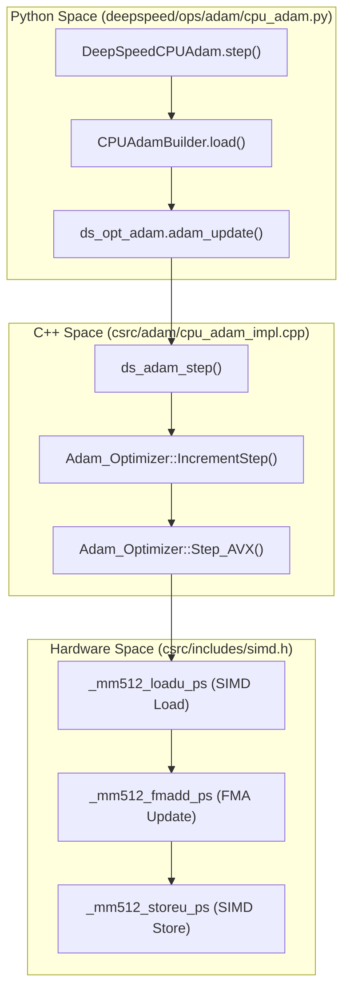
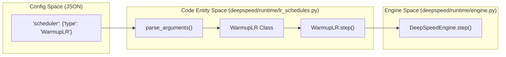

<!-- source: DeepWiki mcp.deepwiki.com · repo deepspeedai/DeepSpeed · page 3.6 Optimizers and Learning Rate Schedules · fetched 2026-10-21 -->

# Optimizers and Learning Rate Schedules

Relevant source files

The following files were used as context for generating this wiki page:

- [csrc/adagrad/cpu_adagrad.cpp](csrc/adagrad/cpu_adagrad.cpp)
- [csrc/adam/cpu_adam.cpp](csrc/adam/cpu_adam.cpp)
- [csrc/adam/cpu_adam_impl.cpp](csrc/adam/cpu_adam_impl.cpp)
- [csrc/includes/cpu_adagrad.h](csrc/includes/cpu_adagrad.h)
- [csrc/includes/cpu_adam.h](csrc/includes/cpu_adam.h)
- [csrc/includes/cpu_lion.h](csrc/includes/cpu_lion.h)
- [csrc/includes/simd.h](csrc/includes/simd.h)
- [csrc/lion/cpu_lion_impl.cpp](csrc/lion/cpu_lion_impl.cpp)
- [csrc/xpu/includes/cpu_adam.h](csrc/xpu/includes/cpu_adam.h)
- [deepspeed/comm/config.py](deepspeed/comm/config.py)
- [deepspeed/monitor/comet.py](deepspeed/monitor/comet.py)
- [deepspeed/monitor/config.py](deepspeed/monitor/config.py)
- [deepspeed/monitor/monitor.py](deepspeed/monitor/monitor.py)
- [deepspeed/monitor/utils.py](deepspeed/monitor/utils.py)
- [deepspeed/ops/adam/cpu_adam.py](deepspeed/ops/adam/cpu_adam.py)
- [deepspeed/runtime/comm/__init__.py](deepspeed/runtime/comm/__init__.py)
- [deepspeed/runtime/comm/compressed.py](deepspeed/runtime/comm/compressed.py)
- [deepspeed/runtime/comm/hccl.py](deepspeed/runtime/comm/hccl.py)
- [deepspeed/runtime/comm/mpi.py](deepspeed/runtime/comm/mpi.py)
- [deepspeed/runtime/comm/nccl.py](deepspeed/runtime/comm/nccl.py)
- [deepspeed/runtime/comm/utils.py](deepspeed/runtime/comm/utils.py)
- [deepspeed/runtime/compiler.py](deepspeed/runtime/compiler.py)
- [deepspeed/runtime/compression/__init__.py](deepspeed/runtime/compression/__init__.py)
- [deepspeed/runtime/compression/cupy.py](deepspeed/runtime/compression/cupy.py)
- [deepspeed/runtime/fp16/onebit/__init__.py](deepspeed/runtime/fp16/onebit/__init__.py)
- [deepspeed/runtime/fp16/onebit/adam.py](deepspeed/runtime/fp16/onebit/adam.py)
- [deepspeed/runtime/fp16/onebit/lamb.py](deepspeed/runtime/fp16/onebit/lamb.py)
- [deepspeed/runtime/fp16/onebit/zoadam.py](deepspeed/runtime/fp16/onebit/zoadam.py)
- [deepspeed/runtime/lr_schedules.py](deepspeed/runtime/lr_schedules.py)
- [deepspeed/runtime/zero/mics_utils.py](deepspeed/runtime/zero/mics_utils.py)
- [deepspeed/runtime/zero/muon/__init__.py](deepspeed/runtime/zero/muon/__init__.py)
- [deepspeed/runtime/zero/muon/muon_optimizer.py](deepspeed/runtime/zero/muon/muon_optimizer.py)
- [deepspeed/runtime/zero/muon/original_muon.py](deepspeed/runtime/zero/muon/original_muon.py)
- [deepspeed/sequence/fpdt_layer.py](deepspeed/sequence/fpdt_layer.py)
- [deepspeed/utils/logging.py](deepspeed/utils/logging.py)
- [deepspeed/utils/timer.py](deepspeed/utils/timer.py)
- [deepspeed/utils/torch.py](deepspeed/utils/torch.py)
- [docs/_tutorials/monitor.md](docs/_tutorials/monitor.md)
- [docs/assets/images/comet_monitor.png](docs/assets/images/comet_monitor.png)
- [docs/code-docs/source/monitor.rst](docs/code-docs/source/monitor.rst)
- [op_builder/cpu_adagrad.py](op_builder/cpu_adagrad.py)
- [op_builder/cpu_adam.py](op_builder/cpu_adam.py)
- [op_builder/npu/cpu_adagrad.py](op_builder/npu/cpu_adagrad.py)
- [op_builder/npu/cpu_adam.py](op_builder/npu/cpu_adam.py)
- [tests/unit/monitor/test_monitor.py](tests/unit/monitor/test_monitor.py)
- [tests/unit/ops/adagrad/test_cpu_adagrad.py](tests/unit/ops/adagrad/test_cpu_adagrad.py)
- [tests/unit/ops/adam/test_cpu_adam.py](tests/unit/ops/adam/test_cpu_adam.py)
- [tests/unit/ops/muon/test_muon.py](tests/unit/ops/muon/test_muon.py)
- [tests/unit/runtime/pipe/test_topology.py](tests/unit/runtime/pipe/test_topology.py)
- [tests/unit/runtime/test_ds_config_model.py](tests/unit/runtime/test_ds_config_model.py)
- [tests/unit/runtime/test_lr_schedulers.py](tests/unit/runtime/test_lr_schedulers.py)
- [tests/unit/v1/half_precision/test_bf16.py](tests/unit/v1/half_precision/test_bf16.py)
- [tests/unit/v1/zero/test_zero_torch_func.py](tests/unit/v1/zero/test_zero_torch_func.py)

DeepSpeed provides a suite of high-performance optimizers and learning rate (LR) schedulers designed to maximize throughput and memory efficiency in large-scale distributed training. These include CPU-offloaded variants for ZeRO-Offload, fused CUDA kernels for GPU-bound workloads, and communication-efficient 1-bit optimizers.

## Built-in Optimizers

DeepSpeed implements several optimized versions of standard algorithms. A key design pattern is the use of `OpBuilder` to JIT-compile specialized C++/CUDA kernels for these optimizers [op_builder/cpu_adam.py:9-11]().

### DeepSpeedCPUAdam
`DeepSpeedCPUAdam` is a high-performance implementation of Adam and AdamW designed specifically for CPU execution [deepspeed/ops/adam/cpu_adam.py:13-30](). It is a critical component of **ZeRO-Offload**, allowing optimizer states to reside in CPU memory while maintaining high throughput via SIMD vectorization [deepspeed/ops/adam/cpu_adam.py:35-39]().

*   **Speedup:** Provides 5x to 7x speedup over `torch.optim.Adam` [deepspeed/ops/adam/cpu_adam.py:31]().
*   **Precision:** Supports `fp32_optimizer_states` to keep momentum and variance in full precision even if parameters are BF16/FP16 [deepspeed/ops/adam/cpu_adam.py:61-64]().
*   **SIMD Optimization:** Uses AVX-512 or AVX-256 instructions to parallelize the update step across parameter chunks [csrc/includes/cpu_adam.h:111-125]().

### Optimizer Data Flow (CPUAdam)

The following diagram illustrates the interaction between the Python frontend and the C++ SIMD backend for `DeepSpeedCPUAdam`.

**Diagram: CPUAdam System Bridge**

**Sources:** [deepspeed/ops/adam/cpu_adam.py:91-107](), [csrc/adam/cpu_adam.cpp:8-14](), [csrc/includes/cpu_adam.h:112-120](), [csrc/includes/simd.h:33-45]().

### Other Specialized Optimizers
*   **CPUAdagrad:** Similar to CPUAdam, optimized for CPU-offloading using SIMD [csrc/includes/cpu_adagrad.h:1-20]().
*   **OnebitLamb / OnebitAdam:** Communication-efficient optimizers that compress gradients to 1-bit after a "freeze" stage to reduce inter-node communication overhead [deepspeed/runtime/fp16/onebit/lamb.py:16-26]().
*   **Muon:** An implementation of the Muon optimizer designed for ZeRO contexts [deepspeed/runtime/zero/muon/muon_optimizer.py:10-25]().

## Learning Rate Schedulers

DeepSpeed provides a robust LR scheduling system that integrates with the `DeepSpeedEngine`. These schedulers are defined in `deepspeed/runtime/lr_schedules.py` and can be configured via the DeepSpeed JSON configuration file [deepspeed/runtime/lr_schedules.py:18-24]().

### Supported Schedules
| Schedule Name | Configuration Key | Description |
| :--- | :--- | :--- |
| **WarmupLR** | `WarmupLR` | Increases LR linearly or logarithmically over a set number of steps [deepspeed/runtime/lr_schedules.py:48-54](). |
| **WarmupDecayLR**| `WarmupDecayLR` | Linear warmup followed by a periodic or step-based decay [deepspeed/runtime/lr_schedules.py:22](). |
| **OneCycle** | `OneCycle` | Implements the 1Cycle policy with momentum and LR cycles [deepspeed/runtime/lr_schedules.py:20, 76-107](). |
| **WarmupCosineLR**| `WarmupCosineLR` | Linear warmup followed by cosine annealing [deepspeed/runtime/lr_schedules.py:23, 118-121](). |

### Configuration and Parsing
The scheduler parameters are parsed from the `lr_schedule` section of the DeepSpeed config. The `add_tuning_arguments` function defines the CLI/JSON schema for these parameters [deepspeed/runtime/lr_schedules.py:61-122]().

**Diagram: LR Scheduler Entity Mapping**

**Sources:** [deepspeed/runtime/lr_schedules.py:18-24](), [deepspeed/runtime/lr_schedules.py:61-65]().

## 1-Bit Optimizers and Compression

For environments with limited interconnect bandwidth, DeepSpeed's 1-bit optimizers significantly reduce communication volume.

### OnebitLamb Logic
1.  **Warmup Phase:** The optimizer behaves like standard LAMB for a configured number of `freeze_step` iterations [deepspeed/runtime/fp16/onebit/lamb.py:103]().
2.  **Compression Phase:** After the warmup, the optimizer "freezes" the variance and communicates 1-bit compressed gradients [deepspeed/runtime/fp16/onebit/lamb.py:16-19]().
3.  **Backend Integration:** It supports multiple communication backends including NCCL, MPI, and HCCL (for Huawei Ascend) [deepspeed/runtime/fp16/onebit/lamb.py:116-133]().

## Monitoring and Logging

Optimizers and schedulers are monitored via the DeepSpeed Monitor system.
*   **Timers:** DeepSpeed uses `SynchronizedWallClockTimer` to measure the latency of the `step` operation [deepspeed/utils/timer.py:19-20, 44-45]().
*   **Logging:** The `log_dist` utility ensures that optimizer state (like LR changes) is logged primarily from Rank 0 to prevent stdout flooding in large clusters [deepspeed/utils/logging.py:113-125]().

**Sources:**
*   `deepspeed/ops/adam/cpu_adam.py` [13-95]()
*   `deepspeed/runtime/lr_schedules.py` [18-122]()
*   `csrc/includes/cpu_adam.h` [24-109]()
*   `csrc/includes/simd.h` [30-45]()
*   `deepspeed/runtime/fp16/onebit/lamb.py` [16-135]()
*   `deepspeed/utils/timer.py` [11-21]()

---

