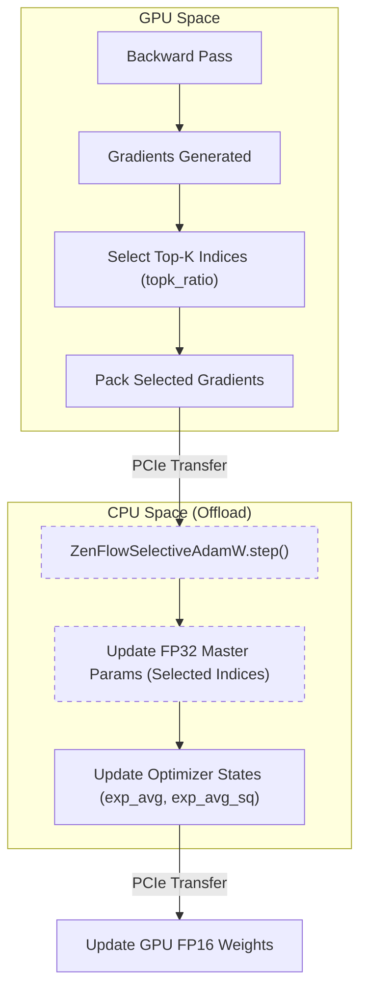
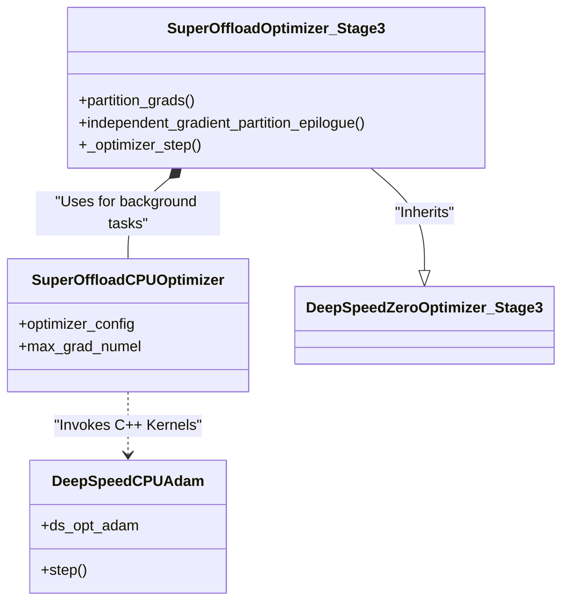

<!-- source: DeepWiki mcp.deepwiki.com · repo deepspeedai/DeepSpeed · page 3.7 ZenFlow and SuperOffload · fetched 2026-10-21 -->

# ZenFlow and SuperOffload

<details>
<summary>Relevant source files</summary>

The following files were used as context for generating this wiki page:

- [csrc/adagrad/cpu_adagrad.cpp](csrc/adagrad/cpu_adagrad.cpp)
- [csrc/adam/cpu_adam.cpp](csrc/adam/cpu_adam.cpp)
- [csrc/adam/cpu_adam_impl.cpp](csrc/adam/cpu_adam_impl.cpp)
- [csrc/includes/cpu_adagrad.h](csrc/includes/cpu_adagrad.h)
- [csrc/includes/cpu_adam.h](csrc/includes/cpu_adam.h)
- [csrc/includes/cpu_lion.h](csrc/includes/cpu_lion.h)
- [csrc/includes/simd.h](csrc/includes/simd.h)
- [csrc/lion/cpu_lion_impl.cpp](csrc/lion/cpu_lion_impl.cpp)
- [csrc/xpu/includes/cpu_adam.h](csrc/xpu/includes/cpu_adam.h)
- [deepspeed/ops/adam/__init__.py](deepspeed/ops/adam/__init__.py)
- [deepspeed/ops/adam/cpu_adam.py](deepspeed/ops/adam/cpu_adam.py)
- [deepspeed/ops/adam/zenflow_cpu_adam.py](deepspeed/ops/adam/zenflow_cpu_adam.py)
- [deepspeed/ops/adam/zenflow_torch_adam.py](deepspeed/ops/adam/zenflow_torch_adam.py)
- [deepspeed/runtime/superoffload/superoffload_stage3.py](deepspeed/runtime/superoffload/superoffload_stage3.py)
- [deepspeed/runtime/superoffload/superoffload_utils.py](deepspeed/runtime/superoffload/superoffload_utils.py)
- [deepspeed/runtime/zenflow/__init__.py](deepspeed/runtime/zenflow/__init__.py)
- [deepspeed/runtime/zenflow/engine.py](deepspeed/runtime/zenflow/engine.py)
- [deepspeed/runtime/zenflow/engine_stage3.py](deepspeed/runtime/zenflow/engine_stage3.py)
- [deepspeed/runtime/zenflow/zenflow_config.py](deepspeed/runtime/zenflow/zenflow_config.py)
- [deepspeed/runtime/zenflow/zenflow_stage_1_and_2.py](deepspeed/runtime/zenflow/zenflow_stage_1_and_2.py)
- [deepspeed/runtime/zenflow/zenflow_utils.py](deepspeed/runtime/zenflow/zenflow_utils.py)
- [op_builder/cpu_adagrad.py](op_builder/cpu_adagrad.py)
- [op_builder/cpu_adam.py](op_builder/cpu_adam.py)
- [op_builder/npu/cpu_adagrad.py](op_builder/npu/cpu_adagrad.py)
- [op_builder/npu/cpu_adam.py](op_builder/npu/cpu_adam.py)
- [tests/unit/ops/adagrad/test_cpu_adagrad.py](tests/unit/ops/adagrad/test_cpu_adagrad.py)
- [tests/unit/ops/adam/test_cpu_adam.py](tests/unit/ops/adam/test_cpu_adam.py)
- [tests/unit/ops/adam/test_zf_torch_adam.py](tests/unit/ops/adam/test_zf_torch_adam.py)
- [tests/unit/runtime/zenflow/test_zf.py](tests/unit/runtime/zenflow/test_zf.py)
- [tests/unit/v1/half_precision/test_bf16.py](tests/unit/v1/half_precision/test_bf16.py)

</details>


ZenFlow and SuperOffload are advanced memory optimization and performance enhancement features in DeepSpeed designed to provide stall-free offloading. **ZenFlow** implements selective gradient offloading to reduce the communication overhead between the CPU and GPU during ZeRO-Offload training. **SuperOffload** utilizes a "speculation-then-validation" strategy specifically optimized for NVIDIA Grace Hopper Superchips, enabling asynchronous optimizer updates that hide the latency of CPU-side computation.

## ZenFlow: Selective Gradient Offloading

ZenFlow addresses the bottleneck of transferring all gradients to the CPU in ZeRO-Offload scenarios. By identifying and offloading only the most significant gradients (selective offloading), it reduces PCIe traffic while maintaining model convergence.

### ZenFlow Architecture
ZenFlow operates by wrapping standard ZeRO optimizers and intercepting the gradient synchronization process. It uses a `ZenFlowSelectiveAdamW` optimizer that can handle sparse updates to parameters based on importance metrics.

**Key Components:**
*   `ZenFlowConfig`: Manages parameters such as `topk_ratio`, `select_strategy`, and `update_interval` [deepspeed/runtime/zenflow/zenflow_stage_1_and_2.py:60-72]().
*   `ZenFlowZeroOptimizer`: The base class for ZenFlow-enabled ZeRO Stage 1 and 2 [deepspeed/runtime/zenflow/zenflow_stage_1_and_2.py:47-56]().
*   `ZenFlowSelectiveAdamW`: A specialized AdamW implementation that applies updates only to selected indices [deepspeed/ops/adam/zenflow_torch_adam.py:43-59]().

### ZenFlow Data Flow
The following diagram illustrates how ZenFlow selects gradients and updates the model across the CPU-GPU boundary.

**ZenFlow Selection and Update Logic**

Sources: [deepspeed/runtime/zenflow/zenflow_stage_1_and_2.py:155-178](), [deepspeed/ops/adam/zenflow_torch_adam.py:98-157]()

## SuperOffload: Speculative Execution for Superchips

SuperOffload is designed for high-bandwidth CPU-GPU interconnects (like NVLink-C2C in NVIDIA Grace Hopper). It implements a speculative execution model where the GPU continues training while the CPU asynchronously computes optimizer updates in the background.

### SuperOffloadOptimizer_Stage3
`SuperOffloadOptimizer_Stage3` extends `DeepSpeedZeroOptimizer_Stage3` to decouple the optimizer step from the training loop [deepspeed/runtime/superoffload/superoffload_stage3.py:27-37]().

**Implementation Details:**
1.  **Task Queuing**: Gradients are partitioned and sent to a `SuperOffloadCPUOptimizer` which manages a pool of background threads [deepspeed/runtime/superoffload/superoffload_stage3.py:57-59]().
2.  **Async Updates**: The function `_reassign_or_swap_out_partitioned_parameters_async` copies updated parameters back to the GPU using non-blocking transfers [deepspeed/runtime/superoffload/superoffload_stage3.py:129-132]().
3.  **Sub-group Management**: Parameters are divided into sub-groups to allow fine-grained overlapping of computation and communication [deepspeed/runtime/superoffload/superoffload_stage3.py:61-89]().

### SuperOffload Code Entities
The following diagram maps the logical SuperOffload components to their specific code implementations.

**SuperOffload Code Mapping**

Sources: [deepspeed/runtime/superoffload/superoffload_stage3.py:27-45](), [deepspeed/ops/adam/cpu_adam.py:13-25](), [deepspeed/runtime/superoffload/superoffload_stage3.py:57-59]()

## CPU Optimizer Kernels (DeepSpeedCPUAdam)

Both ZenFlow and SuperOffload rely on highly optimized CPU kernels to minimize the latency of offloaded computation. `DeepSpeedCPUAdam` provides a vectorized implementation that is 5x to 7x faster than standard PyTorch CPU Adam [deepspeed/ops/adam/cpu_adam.py:26-39]().

### Vectorization with SIMD
The core logic is implemented in C++ using SIMD instructions (AVX-512 or AVX-256) to process multiple parameters in a single clock cycle.

*   **SIMD Abstraction**: `csrc/includes/simd.h` defines macros like `SIMD_LOAD`, `SIMD_FMA`, and `SIMD_STORE` to abstract over different AVX versions [csrc/includes/simd.h:33-45]().
*   **Kernel Implementation**: `Adam_Optimizer::Step_AVX` performs the actual Adam update logic (momentum, variance, and weight decay) using these SIMD primitives [csrc/includes/cpu_adam.h:112-198]().
*   **BFloat16 Support**: The kernels include specialized logic for loading and storing BFloat16 data into 32-bit registers for computation [csrc/includes/simd.h:47-86]().

### Optimizer C++ Interface
The C++ kernels are bound to Python using PyBind11, exposing the following functions:
| Function | Description |
| :--- | :--- |
| `create_adam` | Initializes the C++ optimizer state [csrc/adam/cpu_adam.cpp:12](). |
| `adam_update` | Performs the vectorized parameter update [csrc/adam/cpu_adam.cpp:10](). |
| `destroy_adam` | Cleans up allocated memory to prevent leaks [csrc/adam/cpu_adam.cpp:13](). |

Sources: [deepspeed/ops/adam/cpu_adam.py:91-94](), [csrc/adam/cpu_adam.cpp:8-14](), [csrc/includes/cpu_adam.h:155-195]()

## Configuration and Usage

### ZenFlow Configuration
ZenFlow is enabled via the `zenflow` field in the DeepSpeed configuration JSON.

```json
{
  "zenflow": {
    "enabled": true,
    "topk_ratio": 0.1,
    "select_strategy": "epoch",
    "update_interval": 1,
    "offload": true
  }
}
```
Sources: [deepspeed/runtime/zenflow/zenflow_stage_1_and_2.py:60-72]()

### SuperOffload Compatibility
SuperOffload requires an NVIDIA CUDA environment and is specifically optimized for systems with high CPU-GPU bandwidth [deepspeed/runtime/superoffload/superoffload_stage3.py:20-25](). It is initialized automatically when the `super_offload` flag is detected in a ZeRO-3 configuration.

Sources: [deepspeed/runtime/superoffload/superoffload_stage3.py:27-45](), [deepspeed/runtime/superoffload/superoffload_stage3.py:102-107]()

---

