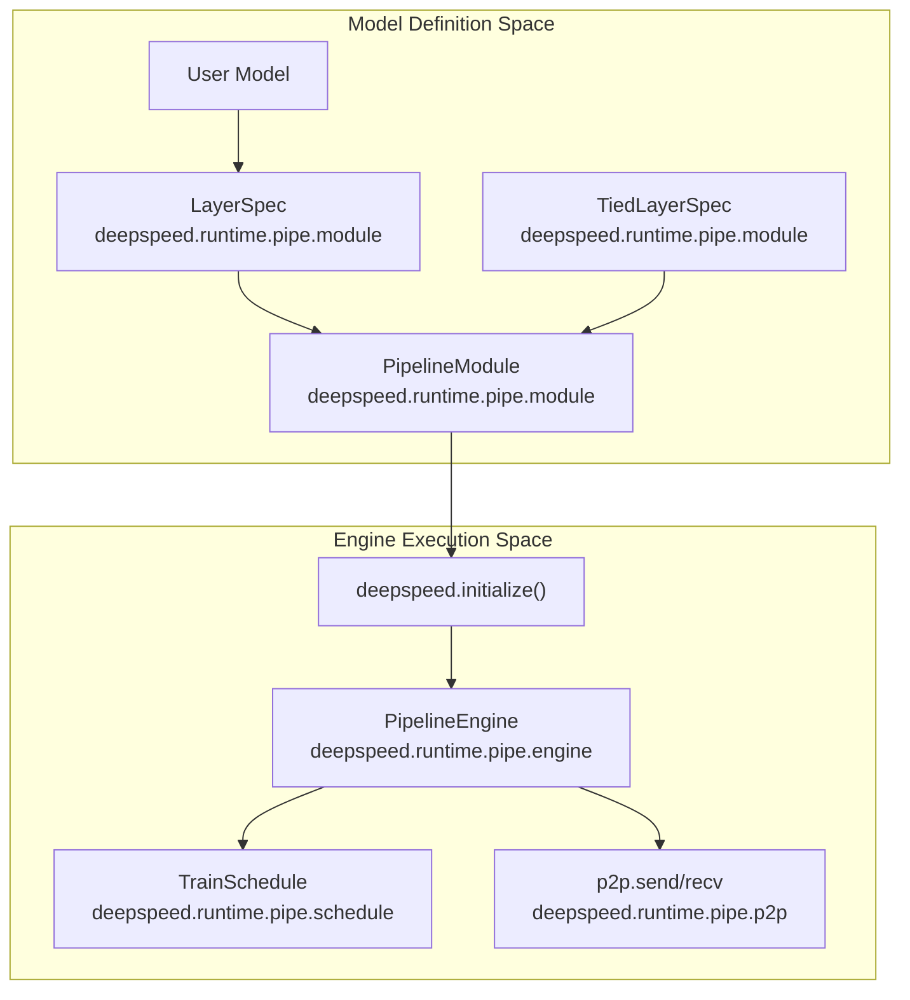
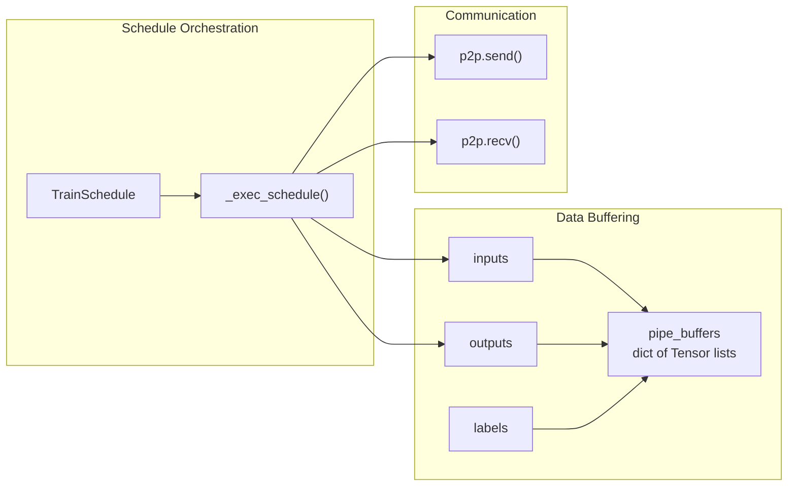

<!-- source: DeepWiki mcp.deepwiki.com · repo deepspeedai/DeepSpeed · page 4 Pipeline Parallelism · fetched 2026-10-21 -->

# Pipeline Parallelism

Relevant source files

The following files were used as context for generating this wiki page:

- [deepspeed/runtime/fp16/fused_optimizer.py](deepspeed/runtime/fp16/fused_optimizer.py)
- [deepspeed/runtime/fp16/loss_scaler.py](deepspeed/runtime/fp16/loss_scaler.py)
- [deepspeed/runtime/fp16/unfused_optimizer.py](deepspeed/runtime/fp16/unfused_optimizer.py)
- [deepspeed/runtime/pipe/engine.py](deepspeed/runtime/pipe/engine.py)
- [deepspeed/runtime/pipe/module.py](deepspeed/runtime/pipe/module.py)
- [docs/_posts/2020-09-09-sparse-attention.md](docs/_posts/2020-09-09-sparse-attention.md)
- [docs/_tutorials/megatron.md](docs/_tutorials/megatron.md)
- [docs/_tutorials/one-cycle.md](docs/_tutorials/one-cycle.md)
- [docs/_tutorials/pipeline.md](docs/_tutorials/pipeline.md)
- [docs/_tutorials/pytorch-profiler.md](docs/_tutorials/pytorch-profiler.md)
- [docs/_tutorials/sparse-attention.md](docs/_tutorials/sparse-attention.md)
- [docs/_tutorials/zero-offload.md](docs/_tutorials/zero-offload.md)
- [docs/_tutorials/zero.md](docs/_tutorials/zero.md)
- [requirements/requirements-sparse_attn.txt](requirements/requirements-sparse_attn.txt)
- [tests/unit/runtime/half_precision/test_dynamic_loss_scale.py](tests/unit/runtime/half_precision/test_dynamic_loss_scale.py)
- [tests/unit/runtime/half_precision/test_fp16.py](tests/unit/runtime/half_precision/test_fp16.py)
- [tests/unit/runtime/test_ds_initialize.py](tests/unit/runtime/test_ds_initialize.py)

Pipeline parallelism is a model parallelism strategy that partitions neural network layers across multiple devices (pipeline stages), enabling training of models larger than can fit on a single device. Each stage processes different micro-batches concurrently, allowing for better hardware utilization. This document describes DeepSpeed's implementation via `PipelineModule` and `PipelineEngine`.

**Scope**: This page covers the pipeline parallelism implementation in the `deepspeed/runtime/pipe/` directory. For information about other parallelism strategies, see [Automatic Tensor Parallelism](#6) and [Sequence Parallelism and Mixture of Experts](#10). For general training orchestration, see [DeepSpeedEngine Architecture](#3.1).

**Key Components**:
- `PipelineModule`: Model definition and layer partitioning across stages.
- `PipelineEngine`: Runtime execution engine for pipeline parallel training.
- `LayerSpec`: Building blocks for specifying pipeline stages.
- Schedule execution: Coordinating forward/backward passes across stages.

---

## Overview and Motivation

Pipeline parallelism divides a model's layers into sequential stages, with each stage assigned to a different device. During training, the global batch is split into micro-batches that flow through the pipeline stages. This allows multiple micro-batches to be in flight simultaneously, overlapping computation across stages.

**Key Characteristics**:
- Layers are partitioned sequentially across pipeline stages.
- Point-to-point communication between adjacent stages only.
- Requires gradient accumulation across multiple micro-batches.
- Incompatible with ZeRO Stage 2 and Stage 3 (enforced at [deepspeed/runtime/pipe/engine.py:76-77]()).

**When to Use**:
- Model is too large to fit on a single device.
- Model has a sequential structure suitable for pipelining.
- Available devices exceed what tensor parallelism alone can utilize.
- Can be combined with data parallelism and tensor/model parallelism (3D parallelism).

Sources: [deepspeed/runtime/pipe/engine.py:60-94](), [deepspeed/runtime/pipe/module.py:86-123]()

---

## PipelineModule and PipelineEngine

The architecture of pipeline parallelism in DeepSpeed revolves around two primary classes: `PipelineModule` for defining the model and `PipelineEngine` for executing the training.

For details, see [PipelineModule and PipelineEngine](#4.1).

### PipelineModule: Model Specification
`PipelineModule` represents the forward pass as a sequence of layers. The model is implicitly defined by the `layers` attribute, where the output of one layer is the input to the next [deepspeed/runtime/pipe/module.py:86-104](). Layers are partitioned across stages using methods like `uniform` or `parameters` [deepspeed/runtime/pipe/module.py:133-134]().

### PipelineEngine: Runtime Execution
`PipelineEngine` extends `DeepSpeedEngine` to handle the complexities of pipeline execution [deepspeed/runtime/pipe/engine.py:60-65](). It manages stage-specific information such as `prev_stage` and `next_stage` [deepspeed/runtime/pipe/engine.py:116-117]() and coordinates the flow of micro-batches.

**Architecture Diagram: Pipeline Components and Code Entities**

Sources: [deepspeed/runtime/pipe/module.py:30-137](), [deepspeed/runtime/pipe/engine.py:60-117]()

---

## Pipeline Scheduling and Communication

The efficiency of pipeline parallelism depends on how micro-batches are scheduled and how data is communicated between stages.

For details, see [Pipeline Scheduling and Communication](#4.2).

### Micro-batch Scheduling
DeepSpeed uses a schedule to interleave forward and backward passes. The `TrainSchedule` class generates the sequence of operations (steps) for each stage to maximize GPU utilization while respecting data dependencies [deepspeed/runtime/pipe/engine.py:384-388]().

### Inter-stage Communication
Communication is handled by the `p2p` module [deepspeed/runtime/pipe/p2p.py](). Stages exchange activation tensors during the forward pass and gradient tensors during the backward pass [deepspeed/runtime/pipe/engine.py:712-880](). To minimize memory usage, DeepSpeed can partition these tensors across model-parallel groups if `pipe_partitioned` or `grad_partitioned` is enabled [deepspeed/runtime/pipe/engine.py:143-146]().

**Diagram: Scheduling and Buffer Management**

Sources: [deepspeed/runtime/pipe/engine.py:176-183](), [deepspeed/runtime/pipe/engine.py:384-388](), [deepspeed/runtime/pipe/p2p.py]()

---

## Mixed Precision in Pipeline Parallelism

Pipeline parallelism supports mixed-precision training, primarily through FP16 and BF16 optimizers.

For details, see [Mixed Precision in Pipeline Parallelism](#4.3).

### Optimizer Integration
When using mixed precision, the `PipelineEngine` integrates with `FP16_Optimizer` [deepspeed/runtime/fp16/fused_optimizer.py:33]() or `BF16_Optimizer` [deepspeed/runtime/bf16_optimizer.py](). The engine handles loss scaling to prevent underflow/overflow during the gradient accumulation across micro-batches [deepspeed/runtime/fp16/loss_scaler.py:187]().

### Loss Scaling
Loss is scaled by the number of micro-batches (gradient accumulation steps) to ensure the effective batch size is correctly accounted for [deepspeed/runtime/pipe/engine.py:586-600](). In FP16 mode, the `DynamicLossScaler` monitors for overflows and adjusts the scale factor accordingly [deepspeed/runtime/fp16/loss_scaler.py:198-205]().

Sources: [deepspeed/runtime/pipe/engine.py:85-86](), [deepspeed/runtime/fp16/fused_optimizer.py:33-60](), [deepspeed/runtime/fp16/loss_scaler.py:187-205]()

---

