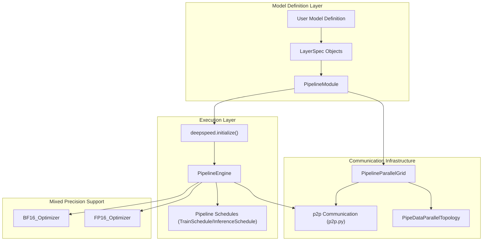
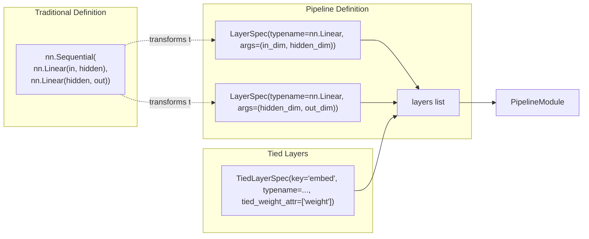
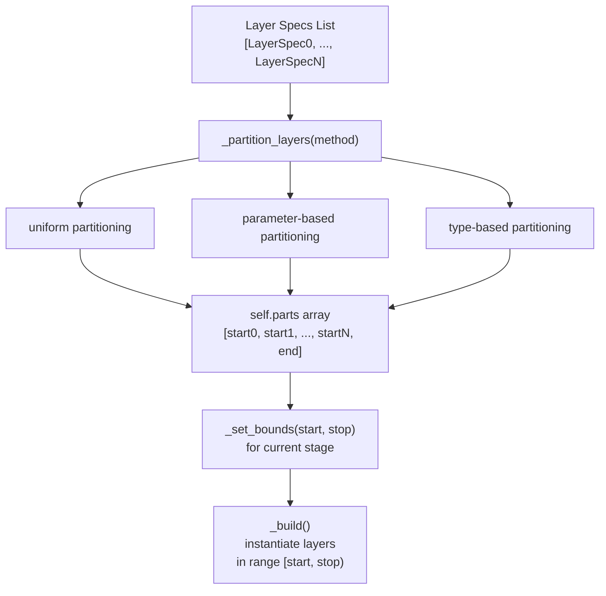
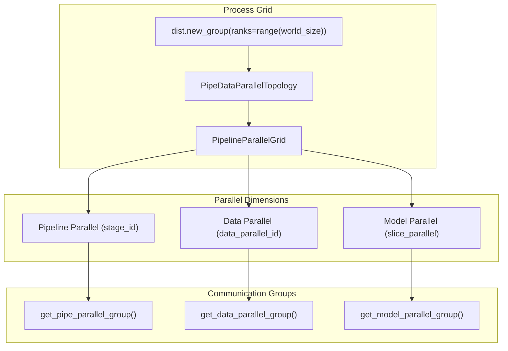
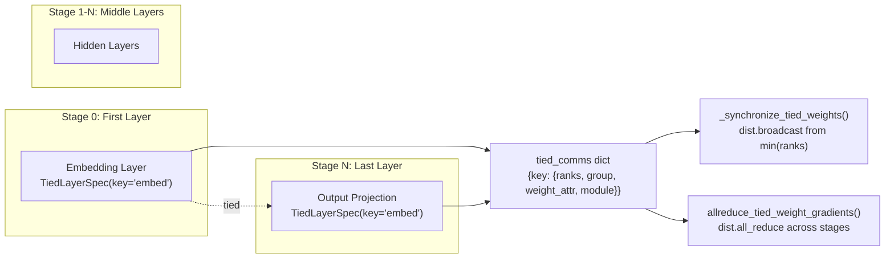
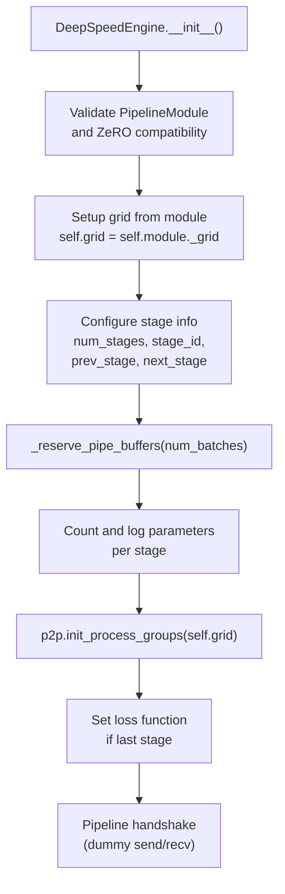
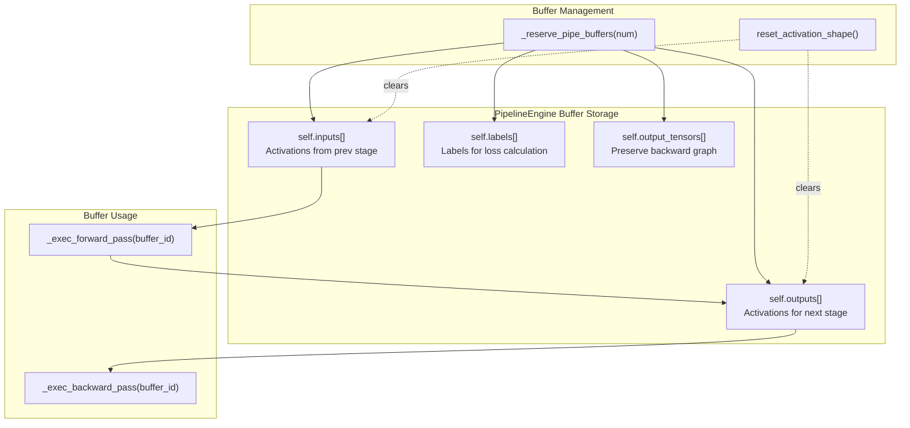
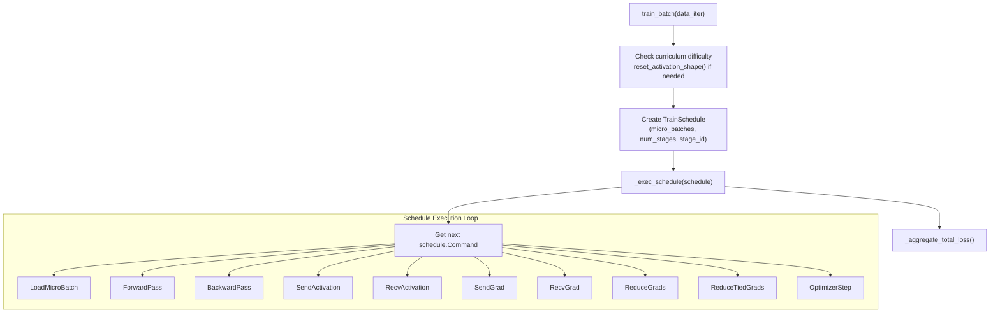
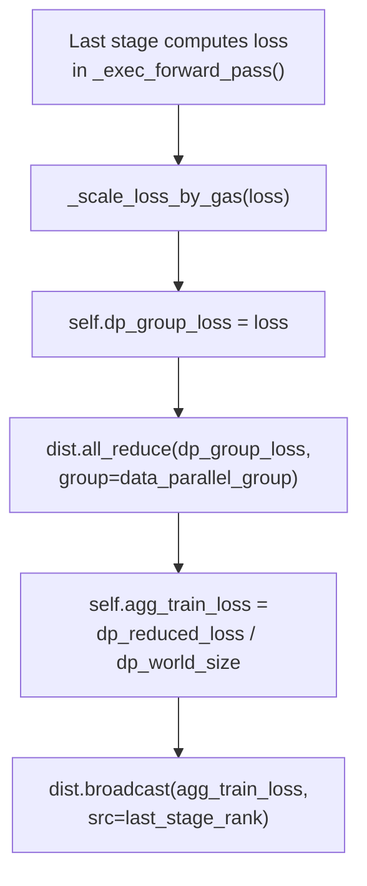
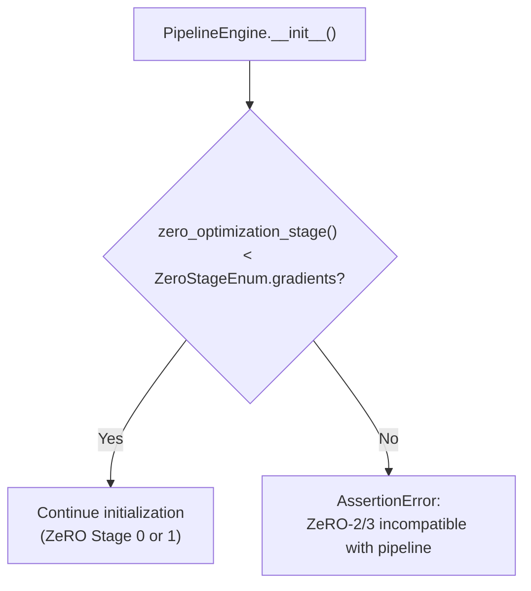

<!-- source: DeepWiki mcp.deepwiki.com · repo deepspeedai/DeepSpeed · page 4.1 PipelineModule and PipelineEngine · fetched 2026-10-21 -->

# PipelineModule and PipelineEngine

<details>
<summary>Relevant source files</summary>

The following files were used as context for generating this wiki page:

- [deepspeed/runtime/fp16/fused_optimizer.py](deepspeed/runtime/fp16/fused_optimizer.py)
- [deepspeed/runtime/fp16/loss_scaler.py](deepspeed/runtime/fp16/loss_scaler.py)
- [deepspeed/runtime/fp16/unfused_optimizer.py](deepspeed/runtime/fp16/unfused_optimizer.py)
- [deepspeed/runtime/pipe/engine.py](deepspeed/runtime/pipe/engine.py)
- [deepspeed/runtime/pipe/module.py](deepspeed/runtime/pipe/module.py)
- [tests/unit/runtime/half_precision/test_dynamic_loss_scale.py](tests/unit/runtime/half_precision/test_dynamic_loss_scale.py)
- [tests/unit/runtime/half_precision/test_fp16.py](tests/unit/runtime/half_precision/test_fp16.py)
- [tests/unit/runtime/test_ds_initialize.py](tests/unit/runtime/test_ds_initialize.py)

</details>


This page documents DeepSpeed's pipeline parallelism implementation, consisting of `PipelineModule` for model definition and `PipelineEngine` for execution. Pipeline parallelism splits a model across multiple GPUs/nodes by dividing it into sequential stages, enabling training of models too large to fit on a single device.

**Scope**: This page covers the pipeline parallelism module definition (`PipelineModule`, `LayerSpec`) and execution engine (`PipelineEngine`) including scheduling, communication, and buffer management. For ZeRO memory optimization, see [3.2](). For mixed precision training with pipeline parallelism, see [4.3](). For general training engine details, see [3.1]().

**Note**: Pipeline parallelism is **incompatible with ZeRO Stage 2 and 3** as validated in [deepspeed/runtime/pipe/engine.py:76-77]().

---

## Architecture Overview

Pipeline parallelism divides a model into stages and processes micro-batches in a pipelined fashion. The system consists of two primary components:

**Pipeline Parallel System Components**



**Sources**: [deepspeed/runtime/pipe/engine.py:60-74](), [deepspeed/runtime/pipe/module.py:86-123]()

---

## PipelineModule: Model Definition

`PipelineModule` transforms a sequential model into a pipeline-parallel representation by partitioning layers across stages.

### Layer Specification with LayerSpec and TiedLayerSpec

**LayerSpec Diagram: From Sequential to Pipeline Definition**



**Sources**: [deepspeed/runtime/pipe/module.py:30-75](), [deepspeed/runtime/pipe/module.py:77-84]()

**LayerSpec** stores layer type and construction parameters without instantiating the layer until assigned to a specific stage:

| Class | Purpose | Key Attributes |
|-------|---------|----------------|
| `LayerSpec` | Define a standard layer | `typename`, `module_args`, `module_kwargs` |
| `TiedLayerSpec` | Define a layer with weights tied across stages | `key`, `tied_weight_attr`, `forward_fn` |

**Building Layers**: The `build()` method instantiates layers only on ranks that own them [deepspeed/runtime/pipe/module.py:69-74]().

**Sources**: [deepspeed/runtime/pipe/module.py:30-84]()

### Layer Partitioning Across Pipeline Stages

**Layer Partitioning Flow**



**Sources**: [deepspeed/runtime/pipe/module.py:393-444]()

**Partitioning Methods** (configured via `partition_method` parameter):

| Method | Description | Implementation |
|--------|-------------|----------------|
| `uniform` | Equal number of layers per stage | [deepspeed/runtime/pipe/module.py:403-405]() |
| `parameters` | Balance based on trainable parameter count | [deepspeed/runtime/pipe/module.py:406-408]() |
| `type:LayerName` | Balance based on specific layer type regex | [deepspeed/runtime/pipe/module.py:409-414]() |

**Layer Ownership**: Each stage builds only its assigned layers. The `_local_start` and `_local_stop` indices define the layer range for the current stage [deepspeed/runtime/pipe/module.py:542-550]().

**Sources**: [deepspeed/runtime/pipe/module.py:393-444]()

### Topology and Communication Groups

**Pipeline Topology Structure**



**Sources**: [deepspeed/runtime/pipe/module.py:162-183]()

**Key Grid Attributes**:

- `self._grid`: Instance of `PipelineParallelGrid` [deepspeed/runtime/pipe/module.py:183]()
- `self.stage_id`: Current pipeline stage rank [deepspeed/runtime/pipe/module.py:185]()
- `self._topo`: Process topology defining parallel dimensions [deepspeed/runtime/pipe/module.py:169-180]()

**Sources**: [deepspeed/runtime/pipe/module.py:162-186]()

### Tied Weights and Cross-Stage Communication

Tied weights share parameters across non-adjacent stages (e.g., embedding and output layers).

**Tied Weights Communication Pattern**



**Sources**: [deepspeed/runtime/pipe/module.py:454-530]()

**Tied Weight Management**:

1. **Index tied modules** via `_index_tied_modules()` to create communication groups [deepspeed/runtime/pipe/module.py:478-530]()
2. **Synchronize weights** at initialization via `_synchronize_tied_weights()` [deepspeed/runtime/pipe/module.py:469-476]()
3. **Reduce gradients** during backward pass via `allreduce_tied_weight_gradients()` [deepspeed/runtime/pipe/module.py:454-459]()

**Weight Replication Marking**: Tied weights not owned by current rank are marked with `p.ds_pipe_replicated = True` to avoid double-counting in FP16 optimizer [deepspeed/runtime/pipe/module.py:522-524]().

**Sources**: [deepspeed/runtime/pipe/module.py:454-530]()

### Activation Checkpointing

Activation checkpointing reduces memory by recomputing activations during backward pass.

**Configuration Parameters**:

| Parameter | Description | Default |
|-----------|-------------|---------|
| `activation_checkpoint_interval` | Checkpoint every N layers | 0 (disabled) |
| `activation_checkpoint_func` | Checkpointing function | `checkpointing.checkpoint` |
| `checkpointable_layers` | Layer types eligible for checkpointing | None (all) |

**Sources**: [deepspeed/runtime/pipe/module.py:203-222]()

**Checkpointing Logic** in forward pass [deepspeed/runtime/pipe/module.py:370-391]():
- If `activation_checkpoint_interval` is 0, layers execute normally.
- Otherwise, layers are grouped into intervals and wrapped with `self.activation_checkpoint_func`.

**Checkpointability Determination** via `_is_checkpointable()` [deepspeed/runtime/pipe/module.py:664-683]():
- For GPT models: Checkpoint transformer layers regardless of `checkpointable_layers`.
- For other models: Use `checkpointable_layers` list if provided.
- Default: Checkpoint any layer with parameters.

**Sources**: [deepspeed/runtime/pipe/module.py:203-222](), [deepspeed/runtime/pipe/module.py:340-391](), [deepspeed/runtime/pipe/module.py:664-683]()

---

## PipelineEngine: Execution Engine

`PipelineEngine` extends `DeepSpeedEngine` to execute pipeline-parallel training and inference.

### PipelineEngine Initialization

**Initialization Flow and Validation**



**Sources**: [deepspeed/runtime/pipe/engine.py:72-257]()

**Key Initialization Steps**:

1. **ZeRO Incompatibility Check** [deepspeed/runtime/pipe/engine.py:76-77]():
   ```python
   assert self.zero_optimization_stage() < ZeroStageEnum.gradients, "ZeRO-2 and ZeRO-3 are incompatible with pipeline parallelism"
   ```

2. **Disable Backward Allreduce** [deepspeed/runtime/pipe/engine.py:80](): Pipeline engine schedules reductions manually via `self.enable_backward_allreduce = False`.

3. **Grid and Stage Setup** [deepspeed/runtime/pipe/engine.py:102-117](): Extracts the `PipelineParallelGrid` and calculates stage neighbors.

4. **Pipeline Handshake** [deepspeed/runtime/pipe/engine.py:231-240](): Performs a dummy send/receive to ensure communication groups are correctly initialized.

**Sources**: [deepspeed/runtime/pipe/engine.py:72-257]()

### Pipeline Buffers

**Pipeline Buffer Structure**



**Sources**: [deepspeed/runtime/pipe/engine.py:176-196](), [deepspeed/runtime/pipe/engine.py:305-320]()

**Buffer Fields**:

| Field | Purpose | Used By |
|-------|---------|---------|
| `inputs` | Store batch input or received activations | All stages |
| `labels` | Store labels from data loader | Last stage only |
| `outputs` | Store forward pass outputs | All stages |
| `output_tensors` | Preserve backward graph for partitioned tensors | All stages (partitioned mode) |

**Buffer Reservation** via `_reserve_pipe_buffers(num_buffers)` [deepspeed/runtime/pipe/engine.py:305-319]() ensures sufficient slots for all micro-batches in the pipeline.

**Dynamic Shapes**: When activation shapes change (e.g., curriculum learning), call `reset_activation_shape()` [deepspeed/runtime/pipe/engine.py:321-336]() to clear cached metadata and buffers.

**Sources**: [deepspeed/runtime/pipe/engine.py:176-196](), [deepspeed/runtime/pipe/engine.py:305-336]()

### Training and Evaluation

**Training Batch Execution Flow**



**Sources**: [deepspeed/runtime/pipe/engine.py:337-425]()

**Train Batch Steps**:

1. **Curriculum Learning Check** [deepspeed/runtime/pipe/engine.py:365-373](): Resets buffers if training difficulty changes.
2. **Schedule Creation** [deepspeed/runtime/pipe/engine.py:385-388](): `TrainSchedule` generates the micro-batch execution sequence.
3. **Schedule Execution** [deepspeed/runtime/pipe/engine.py:388](): Calls `_exec_schedule` which iterates through commands.
4. **Loss Aggregation** [deepspeed/runtime/pipe/engine.py:391](): Averages loss across DP ranks and broadcasts to all stages.

**Sources**: [deepspeed/runtime/pipe/engine.py:337-514]()

### Pipeline Scheduling

**Schedule Command Handlers**

| Command Type | Implementation Method | Purpose |
|--------------|-----------------------|---------|
| `LoadMicroBatch` | `_exec_load_micro_batch` | Load data/labels from iterator [deepspeed/runtime/pipe/engine.py:700-710]() |
| `ForwardPass` | `_exec_forward_pass` | Execute stage forward layers [deepspeed/runtime/pipe/engine.py:712-804]() |
| `BackwardPass` | `_exec_backward_pass` | Execute stage backward layers [deepspeed/runtime/pipe/engine.py:805-881]() |
| `SendActivation` | `_exec_send_activations` | P2P send activations to next stage [deepspeed/runtime/pipe/engine.py:993-1031]() |
| `RecvActivation` | `_exec_recv_activations` | P2P recv activations from prev stage [deepspeed/runtime/pipe/engine.py:1033-1065]() |
| `SendGrad` | `_exec_send_grads` | P2P send gradients to prev stage [deepspeed/runtime/pipe/engine.py:1067-1109]() |
| `RecvGrad` | `_exec_recv_grads` | P2P recv gradients from next stage [deepspeed/runtime/pipe/engine.py:1111-1141]() |
| `ReduceGrads` | `_exec_reduce_grads` | All-reduce gradients across DP group [deepspeed/runtime/pipe/engine.py:292-303]() |
| `OptimizerStep` | `_exec_optimizer_step` | Call `self.optimizer.step()` [deepspeed/runtime/pipe/engine.py:1157-1167]() |

**Sources**: [deepspeed/runtime/pipe/engine.py:700-1167]()

### Loss Aggregation

**Loss Aggregation Flow**



**Sources**: [deepspeed/runtime/pipe/engine.py:586-650]()

**Aggregation Steps** in `_aggregate_total_loss()`:

1. **Scale by GAS** [deepspeed/runtime/pipe/engine.py:590](): Divides loss by gradient accumulation steps.
2. **DP Reduction** [deepspeed/runtime/pipe/engine.py:603-624](): AllReduce and average across data parallel ranks.
3. **Pipeline Broadcast** [deepspeed/runtime/pipe/engine.py:631-632](): Broadcasts the final loss from the last stage to all other pipeline stages.

**Sources**: [deepspeed/runtime/pipe/engine.py:586-650]()

---

## Integration with Mixed Precision

### BF16 Optimizer Integration

`PipelineEngine` detects and integrates with `BF16_Optimizer` [deepspeed/runtime/pipe/engine.py:85]():

```python
self.using_bf16_optimizer = type(self.optimizer) == BF16_Optimizer
```

**BF16-Specific Gradient Reduction** [deepspeed/runtime/pipe/engine.py:295-300]():
- If using BF16, it calls `self._bf16_reduce_grads()` which utilizes high-precision accumulation.
- Otherwise, it uses `self.allreduce_gradients()`.

**Sources**: [deepspeed/runtime/pipe/engine.py:85](), [deepspeed/runtime/pipe/engine.py:286-303]()

### FP16 Optimizer Integration

FP16 training uses `FP16_Optimizer` [deepspeed/runtime/fp16/fused_optimizer.py:33]() or `FP16_UnfusedOptimizer` [deepspeed/runtime/fp16/unfused_optimizer.py:24]().

**Pipeline-Specific Considerations**:
- **Gradient Boundary Control** [deepspeed/runtime/pipe/engine.py:672-681](): `_force_grad_boundary` forces reduction at the end of a pipeline batch.
- **Backward AllReduce Disabled** [deepspeed/runtime/pipe/engine.py:80](): The engine manually schedules reductions to avoid conflicts with pipeline communication.

**Sources**: [deepspeed/runtime/pipe/engine.py:672-681](), [deepspeed/runtime/fp16/fused_optimizer.py:60]()

---

## Limitations and Compatibility

### ZeRO Incompatibility

**ZeRO Stage Validation**



**Sources**: [deepspeed/runtime/pipe/engine.py:76-77]()

**Allowed Configurations**:

| ZeRO Stage | Pipeline Parallel | Status |
|------------|-------------------|--------|
| 0 | ✓ | Supported |
| 1 | ✓ | Supported (Optimizer State Partitioning) |
| 2 | ✗ | **Incompatible** (Gradient Partitioning) |
| 3 | ✗ | **Incompatible** (Parameter Partitioning) |

**Reason**: ZeRO Stage 2+ partitions gradients/parameters across data parallel ranks, which conflicts with the pipeline's stage-based layer ownership and point-to-point communication patterns.

**Sources**: [deepspeed/runtime/pipe/engine.py:76-77]()

### Pipeline-Specific Features

**Features Unique to Pipeline Parallelism**:

1. **Gradient Accumulation Required**: Pipeline always uses micro-batches to maximize throughput.
2. **Manual Reduction Scheduling**: The engine controls when gradients are reduced via `_exec_reduce_grads()`.
3. **Stage-Specific Data Loading**: Only the first stage (input) and last stage (labels) load data [deepspeed/runtime/pipe/engine.py:654-662]().
4. **Tied Weight Synchronization**: Shared weights (e.g., embeddings) are synchronized across non-adjacent stages [deepspeed/runtime/pipe/module.py:454-476]().

**Sources**: [deepspeed/runtime/pipe/engine.py:80](), [deepspeed/runtime/pipe/engine.py:274-290](), [deepspeed/runtime/pipe/engine.py:652-670]()

---

