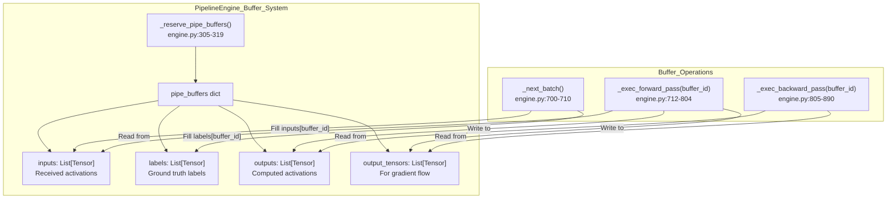
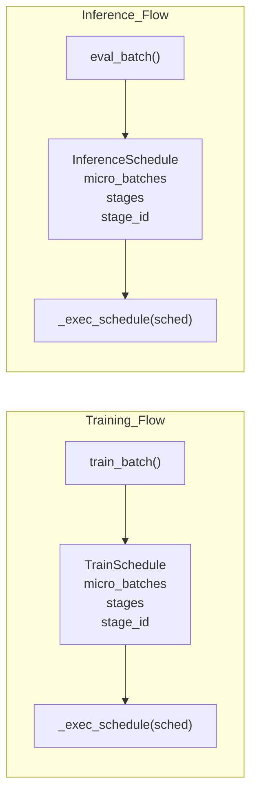
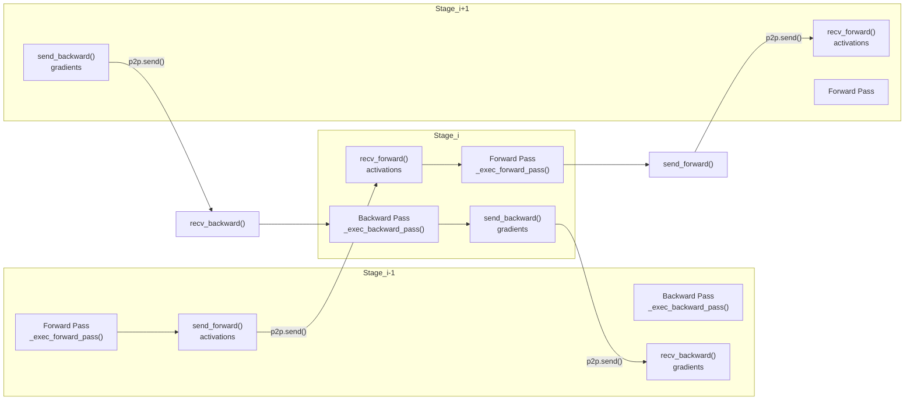
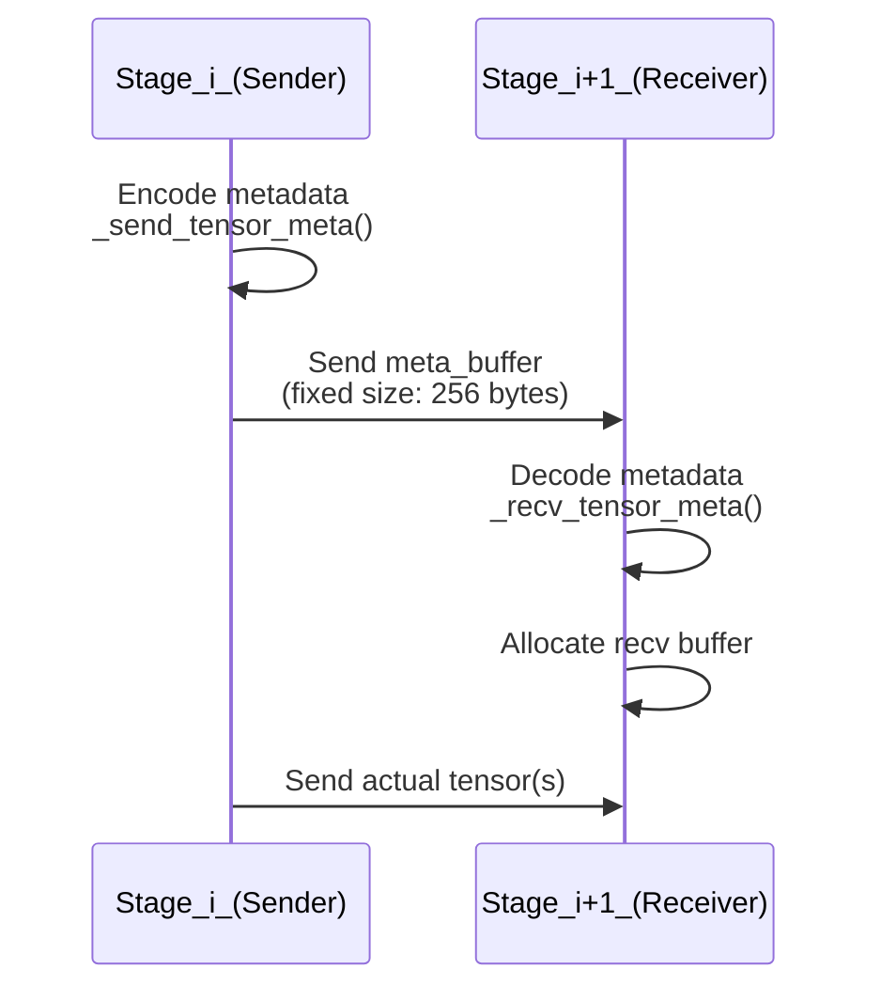
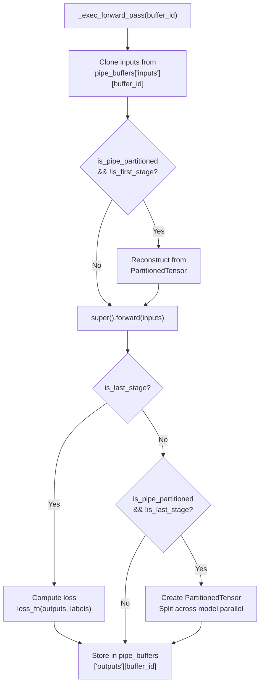
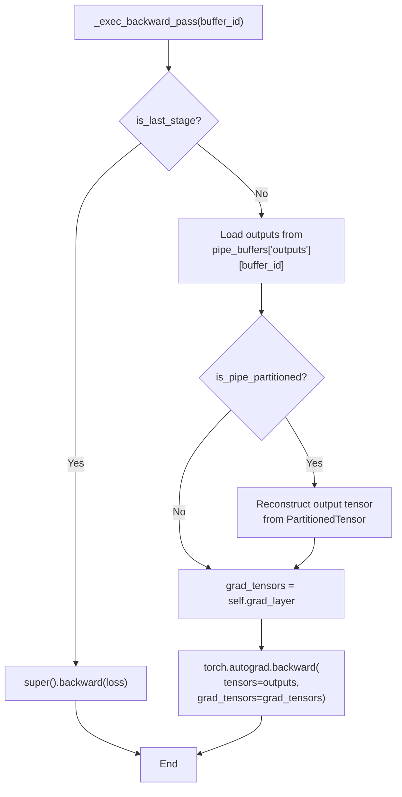

<!-- source: DeepWiki mcp.deepwiki.com · repo deepspeedai/DeepSpeed · page 4.2 Pipeline Scheduling and Communication · fetched 2026-10-21 -->

# Pipeline Scheduling and Communication

<details>
<summary>Relevant source files</summary>

The following files were used as context for generating this wiki page:

- [deepspeed/comm/__init__.py](deepspeed/comm/__init__.py)
- [deepspeed/comm/comm.py](deepspeed/comm/comm.py)
- [deepspeed/comm/torch.py](deepspeed/comm/torch.py)
- [deepspeed/comm/utils.py](deepspeed/comm/utils.py)
- [deepspeed/runtime/fp16/fused_optimizer.py](deepspeed/runtime/fp16/fused_optimizer.py)
- [deepspeed/runtime/fp16/loss_scaler.py](deepspeed/runtime/fp16/loss_scaler.py)
- [deepspeed/runtime/fp16/unfused_optimizer.py](deepspeed/runtime/fp16/unfused_optimizer.py)
- [deepspeed/runtime/pipe/engine.py](deepspeed/runtime/pipe/engine.py)
- [deepspeed/runtime/pipe/module.py](deepspeed/runtime/pipe/module.py)
- [deepspeed/utils/comms_logging.py](deepspeed/utils/comms_logging.py)
- [docs/_tutorials/comms-logging.md](docs/_tutorials/comms-logging.md)
- [tests/unit/runtime/half_precision/test_dynamic_loss_scale.py](tests/unit/runtime/half_precision/test_dynamic_loss_scale.py)
- [tests/unit/runtime/half_precision/test_fp16.py](tests/unit/runtime/half_precision/test_fp16.py)
- [tests/unit/runtime/test_ds_initialize.py](tests/unit/runtime/test_ds_initialize.py)

</details>


This page describes the scheduling mechanisms and inter-stage communication patterns used in DeepSpeed pipeline parallelism. It covers how micro-batches are scheduled across pipeline stages, how activations and gradients are communicated between stages, and the buffer management strategies employed.

For information about the overall pipeline module architecture and initialization, see [PipelineModule and PipelineEngine](#4.1). For mixed precision training specifics in pipeline parallelism, see [Mixed Precision in Pipeline Parallelism](#4.3).

## Overview

Pipeline parallelism divides a model into sequential stages, with each stage executing on a different GPU. To maintain high GPU utilization, the pipeline processes multiple micro-batches concurrently using a scheduling algorithm that interleaves forward and backward passes. The `PipelineEngine` manages this scheduling, buffer allocation, and point-to-point (P2P) communication between adjacent stages.

**Sources:** [deepspeed/runtime/pipe/engine.py:60-74]()

## Pipeline Buffers

The `PipelineEngine` maintains a set of buffers to store intermediate activations, gradients, and labels for each micro-batch currently in flight. These buffers enable overlapping computation across different micro-batches.

### Buffer Structure

The pipeline buffers are organized as a dictionary with four key types:

```python
self.pipe_buffers = {
    'inputs': [],      # batch input and received activations
    'labels': [],      # labels from batch input
    'outputs': [],     # activations to send to next stage
    'output_tensors': [],  # tensor objects to preserve backward graph
}
```

Each list contains slots indexed by `buffer_id`, which corresponds to the micro-batch index modulo the number of buffers allocated.

**Buffer Management Diagram**



**Sources:** [deepspeed/runtime/pipe/engine.py:176-196](), [deepspeed/runtime/pipe/engine.py:305-319]()

### Buffer Reservation

Buffers are lazily allocated using `_reserve_pipe_buffers(num_buffers)`, which ensures at least `num_buffers` slots exist in each buffer list. The method only extends the lists if more buffers are needed:

| Operation | Method | Line Reference |
|-----------|--------|----------------|
| Reserve buffers | `_reserve_pipe_buffers(num_buffers)` | [engine.py:305-319]() |
| Reset buffers | `reset_activation_shape()` | [engine.py:321-335]() |
| Access buffer | `pipe_buffers['inputs'][buffer_id]` | Throughout engine.py |

The `reset_activation_shape()` method clears all cached metadata and buffers when the shape of activations changes (e.g., during curriculum learning with varying sequence lengths).

**Sources:** [deepspeed/runtime/pipe/engine.py:305-335]()

## Pipeline Scheduling

The pipeline uses schedule objects to determine the order of forward and backward passes across micro-batches. Different schedules optimize for training versus inference.

### Schedule Types

Two main schedule classes are used:

| Schedule Class | Purpose | Usage |
|----------------|---------|-------|
| `schedule.TrainSchedule` | Training with gradient accumulation | [engine.py:385-388]() |
| `schedule.InferenceSchedule` | Evaluation without gradients | [engine.py:486]() |

Both schedules are initialized with:
- `micro_batches`: Number of micro-batches (gradient accumulation steps)
- `stages`: Total number of pipeline stages
- `stage_id`: This stage's position in the pipeline

**Schedule Initialization**



**Sources:** [deepspeed/runtime/pipe/engine.py:385-388](), [deepspeed/runtime/pipe/engine.py:486]()

### Micro-batch Concept

The total training batch is divided into `micro_batches` smaller batches that flow through the pipeline sequentially. This enables:

1. **Memory efficiency**: Only one micro-batch's activations need to be stored per stage
2. **Pipeline parallelism**: Multiple micro-batches can be in different pipeline stages simultaneously
3. **Gradient accumulation**: Gradients from all micro-batches are accumulated before the optimizer step

The relationship between batch sizes is:

```
train_batch_size = micro_batch_size × micro_batches × data_parallel_size
```

**Sources:** [deepspeed/runtime/pipe/engine.py:98-111]()

### Schedule Execution

The `_exec_schedule(sched)` method executes the schedule by iterating through its commands. Each command specifies an operation (forward, backward, send, receive) and the associated `buffer_id`:

**Sources:** [deepspeed/runtime/pipe/engine.py:1142-1190]()

## Point-to-Point Communication

Communication between adjacent pipeline stages uses the `p2p` module, which provides send and receive primitives for activations and gradients.

### P2P Initialization

Process groups for peer-to-peer communication are initialized once during engine construction:

```python
if self.is_pipe_parallel:
    p2p.init_process_groups(self.grid)
```

This creates communication groups between each pair of adjacent stages. The engine also performs a warm-up exchange to initialize communication channels:

```python
# Initialize pipeline communicators
if is_even(self.stage_id):
    if not self.is_last_stage():
        p2p.send(self.loss, self.next_stage)
    if not self.is_first_stage():
        p2p.recv(self.loss, self.prev_stage)
else:
    if not self.is_first_stage():
        p2p.recv(self.loss, self.prev_stage)
    if not self.is_last_stage():
        p2p.send(self.loss, self.next_stage)
```

The alternating send/recv order based on even/odd stage prevents deadlocks.

**Sources:** [deepspeed/runtime/pipe/engine.py:172-174](), [deepspeed/runtime/pipe/engine.py:229-240]()

### Communication Operations

The engine provides four primary communication methods:

| Method | Purpose | Direction | Line Reference |
|--------|---------|-----------|----------------|
| `send_forward(tensor_objs, buffer_id)` | Send activations forward | stage → stage+1 | [engine.py:1030-1061]() |
| `recv_forward(buffer_id)` | Receive activations | stage-1 → stage | [engine.py:1063-1088]() |
| `send_backward(tensor_objs, buffer_id)` | Send gradients backward | stage → stage-1 | [engine.py:1090-1114]() |
| `recv_backward(buffer_id)` | Receive gradients | stage+1 → stage | [engine.py:1116-1139]() |

**Communication Flow Diagram**



**Sources:** [deepspeed/runtime/pipe/engine.py:1030-1139]()

### Metadata Exchange

Before sending tensors, the engine exchanges metadata describing tensor shapes and types. This is necessary because tensor shapes may vary dynamically (e.g., variable sequence lengths):

**Metadata Protocol**



The metadata buffer size is fixed at 256 bytes (`TENSOR_META_SIZE = 256`), containing:
- Number of tensors
- Shape of each tensor
- Data type of each tensor
- Whether tensors are partitioned

**Sources:** [deepspeed/runtime/pipe/engine.py:45](), [deepspeed/runtime/pipe/engine.py:1009-1028]()

## Forward and Backward Pass Execution

### Forward Pass

The `_exec_forward_pass(buffer_id)` method executes a forward pass for a specific micro-batch:

1. **Load inputs**: Clone inputs from `pipe_buffers['inputs'][buffer_id]`
2. **Handle partitioned inputs** (if model parallelism is enabled): Reconstruct full tensor from partitioned slices
3. **Execute forward**: Call `super().forward(inputs)` to run the stage's layers
4. **Partition outputs** (if model parallelism is enabled): Split output tensor across model parallel ranks
5. **Store outputs**: Save to `pipe_buffers['outputs'][buffer_id]`
6. **Compute loss** (last stage only): Apply loss function to outputs and labels

**Forward Pass Data Flow**



**Sources:** [deepspeed/runtime/pipe/engine.py:712-804]()

### Backward Pass

The `_exec_backward_pass(buffer_id)` method executes a backward pass:

1. **Last stage**: Simply calls `super().backward(self.loss)` to backpropagate through the loss
2. **Other stages**:
   - Reconstruct partitioned outputs (if needed)
   - Receive gradient from next stage: `grad_tensors = self.grad_layer`
   - Execute backward: `torch.autograd.backward(tensors=outputs, grad_tensors=grad_tensors)`
   - Partition gradients (if needed) before sending to previous stage

**Backward Pass Flow**



**Sources:** [deepspeed/runtime/pipe/engine.py:805-890]()

## Partitioned Tensors

When model parallelism is combined with pipeline parallelism, tensors can be partitioned across the model parallel group within each pipeline stage. The engine supports two partitioning modes:

| Configuration Option | Description | Purpose |
|---------------------|-------------|---------|
| `pipe_partitioned` | Partition activations sent forward | Reduce activation memory and communication |
| `grad_partitioned` | Partition gradients sent backward | Reduce gradient memory and communication |

### Partitioned Tensor Protocol

When `is_pipe_partitioned` is enabled:

1. **Forward pass (sender)**:
   - Create `PartitionedTensor` from full activation
   - Send metadata (tensor shape, partition info)
   - Send only local partition slice

2. **Forward pass (receiver)**:
   - Receive metadata
   - Receive local partition slice
   - Reconstruct full tensor using `PartitionedTensor.from_meta()` during forward computation

3. **Backward pass** follows similar pattern in reverse

**Sources:** [deepspeed/runtime/pipe/engine.py:141-146](), [deepspeed/runtime/pipe/engine.py:721-733](), [deepspeed/runtime/pipe/engine.py:745-762]()

## Gradient Reduction

After backward passes complete for all micro-batches, gradients must be reduced across the data parallel group before the optimizer step.

### Reduction Execution

The `_exec_reduce_grads()` method handles gradient all-reduce:

```python
def _exec_reduce_grads(self):
    self._force_grad_boundary = True
    if self.pipeline_enable_backward_allreduce:
        if self.using_bf16_optimizer:
            self._bf16_reduce_grads()
        else:
            self.allreduce_gradients(bucket_size=MEMORY_OPT_ALLREDUCE_SIZE)
    self._force_grad_boundary = False
```

The `_force_grad_boundary` flag signals to the base engine that this is a gradient accumulation boundary, triggering the all-reduce and optimizer step.

### Tied Weights

For tied weights (parameters shared across pipeline stages), a special reduction is needed:

```python
def _exec_reduce_tied_grads(self):
    if self.zero_optimization_partition_gradients():
        self.optimizer.overlapping_partition_gradients_reduce_epilogue()
    
    weight_group_list = self.module.get_tied_weights_and_groups()
    for weight, group in weight_group_list:
        grad = weight._hp_grad if self.using_bf16_optimizer else weight.grad
        if grad is not None:
            dist.all_reduce(grad, group=group)
```

Tied weights are reduced across their specific communication group (only the stages that share that weight).

**Sources:** [deepspeed/runtime/pipe/engine.py:274-300]()

## Timers and Profiling

The pipeline engine includes detailed timers to profile communication overhead:

| Timer Name | Measures | Line Reference |
|------------|----------|----------------|
| `PIPE_SEND_OUTPUT_TIMER` | Time sending activations forward | [deepspeed/runtime/pipe/engine.py:39]() |
| `PIPE_SEND_GRAD_TIMER` | Time sending gradients backward | [deepspeed/runtime/pipe/engine.py:40]() |
| `PIPE_RECV_INPUT_TIMER` | Time receiving activations | [deepspeed/runtime/pipe/engine.py:41]() |
| `PIPE_RECV_GRAD_TIMER` | Time receiving gradients | [deepspeed/runtime/pipe/engine.py:42]() |

These timers can be logged periodically to identify communication bottlenecks:

```python
if self.steps_per_print() is not None and self.wall_clock_breakdown():
    self.timers.log([
        PIPE_SEND_OUTPUT_TIMER,
        PIPE_SEND_GRAD_TIMER,
        PIPE_RECV_INPUT_TIMER,
        PIPE_RECV_GRAD_TIMER,
    ])
```

**Sources:** [deepspeed/runtime/pipe/engine.py:37-42](), [deepspeed/runtime/pipe/engine.py:415-422]()

## Summary

The pipeline scheduling and communication system in DeepSpeed consists of:

1. **Buffer Management**: Circular buffers indexed by `buffer_id` store activations, gradients, and labels for micro-batches in flight.
2. **Schedule Objects**: `TrainSchedule` and `InferenceSchedule` determine the order of forward/backward operations.
3. **P2P Communication**: The `p2p` module handles point-to-point send/receive between adjacent stages.
4. **Metadata Exchange**: Shape and type information is sent before tensors to handle dynamic shapes via `TENSOR_META_SIZE` buffers.
5. **Partitioned Tensors**: Optional partitioning of activations/gradients across model parallel ranks to reduce memory.
6. **Gradient Reduction**: All-reduce across data parallel group and special handling for tied weights.

This architecture enables efficient pipeline parallelism by overlapping computation across micro-batches while managing memory through buffer reuse and optional tensor partitioning.

**Sources:** [deepspeed/runtime/pipe/engine.py:60-1190](), [deepspeed/runtime/pipe/module.py:1-699]()

---

