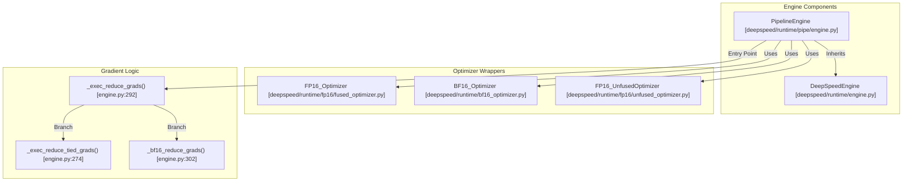
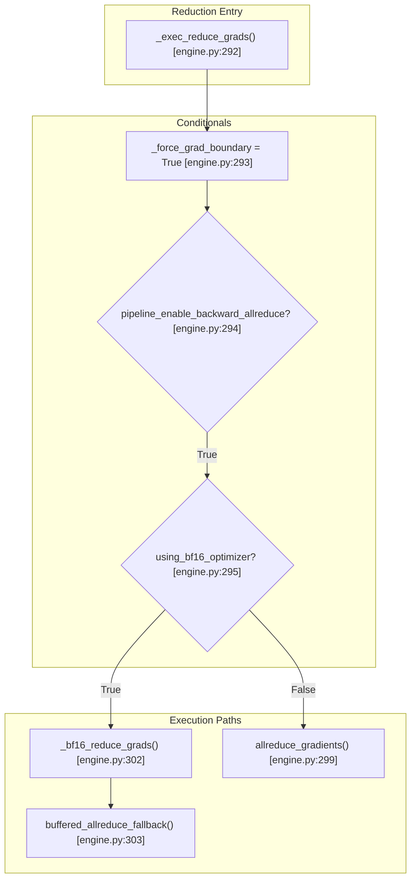

<!-- source: DeepWiki mcp.deepwiki.com · repo deepspeedai/DeepSpeed · page 4.3 Mixed Precision in Pipeline Parallelism · fetched 2026-10-21 -->

# Mixed Precision in Pipeline Parallelism

<details>
<summary>Relevant source files</summary>

The following files were used as context for generating this wiki page:

- [deepspeed/runtime/fp16/fused_optimizer.py](deepspeed/runtime/fp16/fused_optimizer.py)
- [deepspeed/runtime/fp16/loss_scaler.py](deepspeed/runtime/fp16/loss_scaler.py)
- [deepspeed/runtime/fp16/unfused_optimizer.py](deepspeed/runtime/fp16/unfused_optimizer.py)
- [deepspeed/runtime/pipe/engine.py](deepspeed/runtime/pipe/engine.py)
- [deepspeed/runtime/pipe/module.py](deepspeed/runtime/pipe/module.py)
- [tests/unit/runtime/half_precision/test_dynamic_loss_scale.py](tests/unit/runtime/half_precision/test_dynamic_loss_scale.py)
- [tests/unit/runtime/half_precision/test_fp16.py](tests/unit/runtime/half_precision/test_fp16.py)
- [tests/unit/runtime/test_ds_initialize.py](tests/unit/runtime/test_ds_initialize.py)

</details>


This page describes how mixed precision training (FP16 and BF16) integrates with pipeline parallelism in DeepSpeed. For general mixed precision training without pipeline parallelism, see [Mixed Precision Training](#3.4). For pipeline architecture and scheduling, see [PipelineModule and PipelineEngine](#4.1) and [Pipeline Scheduling and Communication](#4.2).

## Purpose and Scope

Pipeline parallelism introduces unique challenges for mixed precision training due to distributed gradient computation across pipeline stages, tied parameters that span multiple stages, and the need to coordinate loss scaling across the pipeline. This page covers:

- How FP16 and BF16 optimizers are integrated into the `PipelineEngine`.
- Pipeline-specific gradient reduction and synchronization for mixed precision.
- Loss scaling coordination across pipeline stages.
- Tied parameter gradient handling in mixed precision.
- Configuration patterns and compatibility constraints.

## Mixed Precision Integration Architecture

The `PipelineEngine` extends the base `DeepSpeedEngine` with specialized handling for mixed precision optimizers in a pipeline-parallel context.

### System Components to Code Entities

The following diagram maps high-level mixed precision concepts to specific classes and attributes in the codebase.


Sources: [deepspeed/runtime/pipe/engine.py:60-85](), [deepspeed/runtime/pipe/engine.py:274-303]()

## BF16 vs FP16 in Pipeline Context

The `PipelineEngine` detects and handles BF16 and FP16 optimizers differently due to their distinct gradient accumulation behaviors.

| Aspect | FP16 | BF16 |
|--------|------|------|
| **Optimizer Detection** | `type(self.optimizer) != BF16_Optimizer` | `type(self.optimizer) == BF16_Optimizer` [deepspeed/runtime/pipe/engine.py:85]() |
| **Gradient Storage** | Model params (FP16) + Optimizer state (FP32) | Hardcoded for FP32 gradient accumulation [deepspeed/runtime/pipe/engine.py:85]() |
| **Loss Scaling** | Dynamic or static loss scaling required | No loss scaling (better numerical stability) |
| **Gradient Reduction** | `allreduce_gradients()` | `_bf16_reduce_grads()` path [deepspeed/runtime/pipe/engine.py:297]() |
| **Tied Parameter Handling** | Uses `weight.grad` [deepspeed/runtime/pipe/engine.py:288]() | Uses `weight._hp_grad` [deepspeed/runtime/pipe/engine.py:288]() |

Sources: [deepspeed/runtime/pipe/engine.py:84-85](), [deepspeed/runtime/pipe/engine.py:288-290]()

## Pipeline-Aware Gradient Reduction

The `PipelineEngine` implements a custom gradient reduction strategy that coordinates with pipeline scheduling and handles mixed precision correctly.

### Gradient Reduction Logic Flow

This diagram illustrates how the `PipelineEngine` selects the appropriate reduction path based on the precision configuration.


Sources: [deepspeed/runtime/pipe/engine.py:292-303]()

### _exec_reduce_grads() Implementation

The gradient reduction method in `PipelineEngine` handles both FP16 and BF16 paths by checking `self.using_bf16_optimizer`:

[deepspeed/runtime/pipe/engine.py:292-300]()
```python
def _exec_reduce_grads(self):
    self._force_grad_boundary = True
    if self.pipeline_enable_backward_allreduce:
        if self.using_bf16_optimizer:
            # PP+BF16 work for ZeRO Stage 1
            self._bf16_reduce_grads()
        else:
            self.allreduce_gradients(bucket_size=MEMORY_OPT_ALLREDUCE_SIZE)
    self._force_grad_boundary = False
```

### BF16 Gradient Reduction

BF16 uses a fallback buffered all-reduce to ensure numerical stability and performance:

[deepspeed/runtime/pipe/engine.py:302-303]()
```python
def _bf16_reduce_grads(self):
    self.buffered_allreduce_fallback(grads=None, elements_per_buffer=MEMORY_OPT_ALLREDUCE_SIZE)
```

Sources: [deepspeed/runtime/pipe/engine.py:292-303]()

## Tied Parameter Gradient Synchronization

Pipeline parallelism can have tied parameters (shared weights) that span multiple pipeline stages (e.g., word embeddings and output projections). Mixed precision requires special handling of these gradients.

### Tied Gradient Reduction Implementation

[deepspeed/runtime/pipe/engine.py:274-290]()
```python
def _exec_reduce_tied_grads(self):
    # ZeRO Stage 1 handling
    if self.zero_optimization_partition_gradients():
        self.optimizer.overlapping_partition_gradients_reduce_epilogue()

    weight_group_list = self.module.get_tied_weights_and_groups()
    for weight, group in weight_group_list:
        # Select high-precision gradient if using BF16
        grad = weight._hp_grad if self.using_bf16_optimizer else weight.grad
        if grad is not None:
            dist.all_reduce(grad, group=group)
```

**Key Implementation Details:**
- **ZeRO Stage 1**: If gradient partitioning is enabled, the `overlapping_partition_gradients_reduce_epilogue` is called to finalize the partition reduction [deepspeed/runtime/pipe/engine.py:284]().
- **Attribute Selection**: BF16 optimizer stores high-precision gradients in `_hp_grad`, while FP16 uses the standard `grad` attribute [deepspeed/runtime/pipe/engine.py:288]().
- **Process Groups**: Gradients are reduced across the specific process group defined for the tied weights [deepspeed/runtime/pipe/engine.py:290]().

Sources: [deepspeed/runtime/pipe/engine.py:274-290]()

## Loss Scaling in Pipeline Parallelism

Loss scaling is applied per-stage during backward passes. In pipeline parallelism, the final loss is computed at the last stage and backpropagated through the micro-batches.

### Loss Scaler Configuration

The `LossScaleConfig` class manages whether scaling is active and how it behaves.

[deepspeed/runtime/fp16/loss_scaler.py:71-122]()
- **FP16**: `use_grad_scaling` is set to `True` [deepspeed/runtime/fp16/loss_scaler.py:90]().
- **BF16**: Gradient scaling is disabled (`use_grad_scaling = False`) [deepspeed/runtime/fp16/loss_scaler.py:91]().
- **Initial Scale**: Default is $2^{32}$ for fused optimizers and $2^{16}$ for unfused [deepspeed/runtime/fp16/loss_scaler.py:55-62]().

### Overflow Handling

The `FP16_Optimizer` and `FP16_UnfusedOptimizer` use a `CheckOverflow` utility to detect NaNs or Infs across all parameters.

[deepspeed/runtime/fp16/fused_optimizer.py:164-173]()
```python
self.overflow = self.overflow_checker.check_using_norm(norm_groups)
if self.loss_scale_config.use_grad_scaling:
    self._update_scale(self.overflow)
    if self.overflow:
        return self.overflow # Skip step
```

Sources: [deepspeed/runtime/fp16/loss_scaler.py:71-122](), [deepspeed/runtime/fp16/fused_optimizer.py:164-173](), [deepspeed/runtime/fp16/unfused_optimizer.py:149-157]()

## ZeRO Compatibility and Constraints

Pipeline parallelism has strict constraints regarding ZeRO optimization stages.

[deepspeed/runtime/pipe/engine.py:76-77]()
```python
assert self.zero_optimization_stage() < ZeroStageEnum.gradients, \
    "ZeRO-2 and ZeRO-3 are incompatible with pipeline parallelism"
```

| ZeRO Stage | Pipeline Parallelism Support | Mixed Precision Notes |
|------------|------------------------------|----------------------|
| **ZeRO-1** | Supported | Optimizer states are partitioned. Compatible with PP + FP16/BF16. |
| **ZeRO-2** | Not Supported | Gradient partitioning conflicts with pipeline micro-batch scheduling. |
| **ZeRO-3** | Not Supported | Parameter partitioning conflicts with pipeline stage isolation. |

Sources: [deepspeed/runtime/pipe/engine.py:76-77](), [deepspeed/runtime/zero/config.py:26]()

## Gradient Boundary Management

In `PipelineEngine`, gradient reductions and optimizer steps are decoupled from the standard `backward()` call to align with the pipeline schedule.

[deepspeed/runtime/pipe/engine.py:672-681]()
```python
def is_gradient_accumulation_boundary(self):
    return self._force_grad_boundary
```

The `_force_grad_boundary` flag is set to `True` only during the execution of specific pipeline instructions like `_exec_reduce_grads()` [deepspeed/runtime/pipe/engine.py:293](). This ensures that the mixed-precision optimizer only performs unscaling, overflow checks, and weight updates at the end of a full micro-batch sequence.

Sources: [deepspeed/runtime/pipe/engine.py:672-681](), [deepspeed/runtime/pipe/engine.py:293]()

## Summary of Key Functions

| Function | Location | Role |
|----------|----------|------|
| `PipelineEngine.__init__` | `engine.py:72` | Initializes precision-specific flags like `using_bf16_optimizer`. |
| `_exec_reduce_grads` | `engine.py:292` | Coordinates gradient all-reduces for DP ranks in PP context. |
| `_exec_reduce_tied_grads` | `engine.py:274` | Synchronizes shared weights across pipeline stages. |
| `LossScaleConfig.__init__` | `loss_scaler.py:81` | Sets up scaling parameters based on model dtype. |
| `FP16_Optimizer.step` | `fused_optimizer.py:149` | Handles overflow detection and master weight updates. |

Sources: [deepspeed/runtime/pipe/engine.py](), [deepspeed/runtime/fp16/loss_scaler.py](), [deepspeed/runtime/fp16/fused_optimizer.py]()

---

