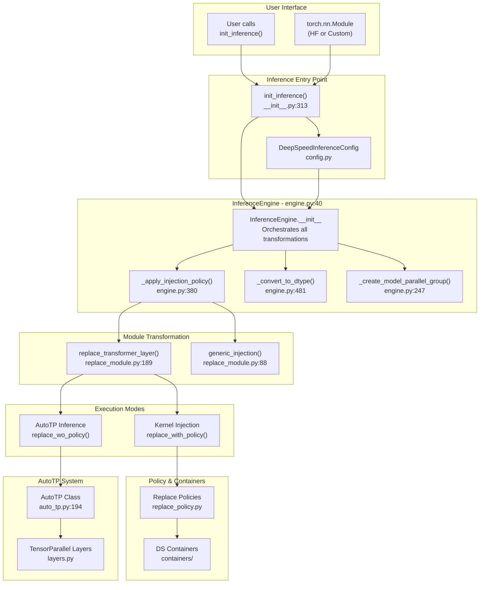
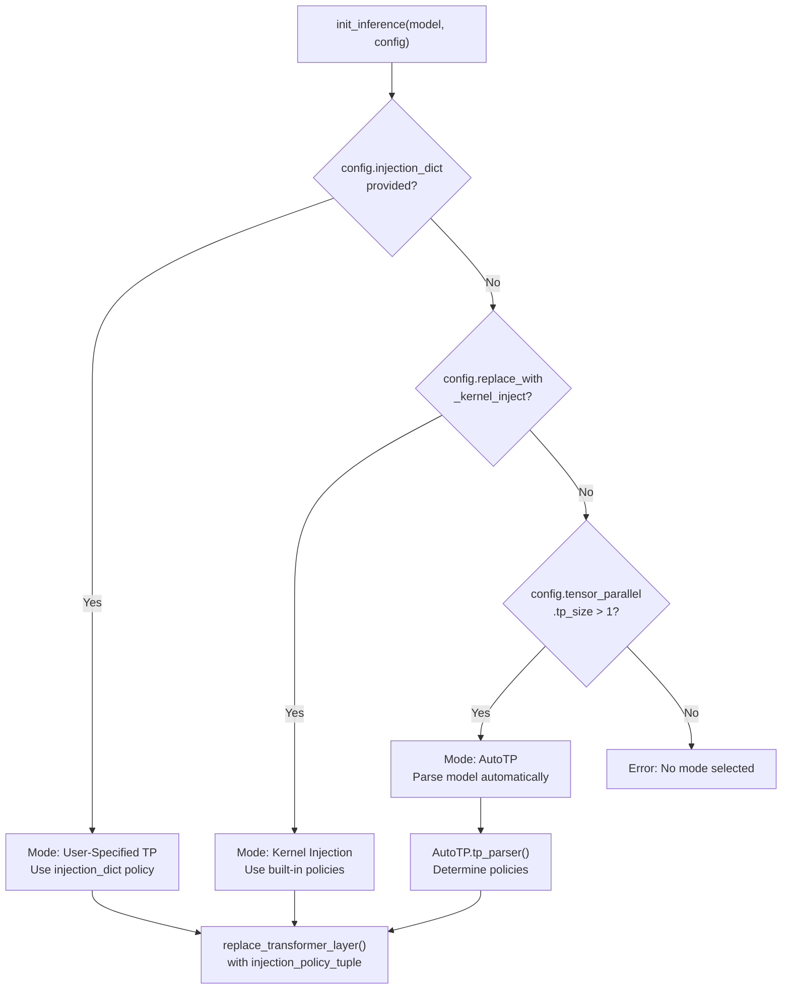

<!-- source: DeepWiki mcp.deepwiki.com · repo deepspeedai/DeepSpeed · page 5 Inference Optimization · fetched 2026-10-21 -->

# Inference Optimization

<details>
<summary>Relevant source files</summary>

The following files were used as context for generating this wiki page:

- [deepspeed/__init__.py](deepspeed/__init__.py)
- [deepspeed/inference/engine.py](deepspeed/inference/engine.py)
- [deepspeed/module_inject/__init__.py](deepspeed/module_inject/__init__.py)
- [deepspeed/module_inject/auto_tp.py](deepspeed/module_inject/auto_tp.py)
- [deepspeed/module_inject/auto_tp_model_utils.py](deepspeed/module_inject/auto_tp_model_utils.py)
- [deepspeed/module_inject/autotp_config.py](deepspeed/module_inject/autotp_config.py)
- [deepspeed/module_inject/fusedqkv_utils.py](deepspeed/module_inject/fusedqkv_utils.py)
- [deepspeed/module_inject/layers.py](deepspeed/module_inject/layers.py)
- [deepspeed/module_inject/replace_module.py](deepspeed/module_inject/replace_module.py)
- [deepspeed/module_inject/replace_policy.py](deepspeed/module_inject/replace_policy.py)
- [deepspeed/module_inject/tp_shard.py](deepspeed/module_inject/tp_shard.py)
- [deepspeed/runtime/state_dict_factory.py](deepspeed/runtime/state_dict_factory.py)
- [docs/_pages/compression.md](docs/_pages/compression.md)
- [docs/_pages/inference.md](docs/_pages/inference.md)
- [docs/_tutorials/inference-tutorial.md](docs/_tutorials/inference-tutorial.md)
- [docs/assets/images/accelerate-dark.png](docs/assets/images/accelerate-dark.png)
- [docs/assets/images/accelerate-light.png](docs/assets/images/accelerate-light.png)
- [docs/assets/images/accelerate.png](docs/assets/images/accelerate.png)
- [tests/unit/inference/test_inference.py](tests/unit/inference/test_inference.py)
- [tests/unit/model_parallelism/test_autotp_training.py](tests/unit/model_parallelism/test_autotp_training.py)

</details>


## Purpose and Scope

This document covers DeepSpeed's inference optimization capabilities, which provide memory-efficient and high-performance inference for large language models and transformer architectures. The system supports both hand-optimized CUDA kernel fusion and automatic tensor parallelism to accelerate model inference while reducing memory footprint.

**Related Pages:**
- For **Inference Engine (v1)** architecture and initialization, see [InferenceEngine Overview](#5.1).
- For **Module Replacement**, see [Module Injection and Replacement System](#5.2).
- For **AutoTP** logic and policies, see [Policy-Based and AutoTP Injection](#5.3).
- For **Fused Kernels**, see [Transformer Inference Kernels](#5.4).
- For **FastGen (v2)**, see [Inference Engine V2 (FastGen)](#5.6).

## Overview

DeepSpeed inference optimization provides two primary execution modes:

1. **Kernel Injection Mode**: Replaces model layers with hand-optimized CUDA/C++ kernels for specific architectures (BERT, GPT-2, Llama, etc.).
2. **AutoTP Mode**: Applies automatic tensor parallelism using PyTorch layers when kernel injection is not available or disabled.

The inference system is initialized through `deepspeed.init_inference()` which wraps user models in an `InferenceEngine` that orchestrates all optimization transformations.

**Sources:** [deepspeed/__init__.py:313-388](), [deepspeed/inference/engine.py:40-164]()

## System Architecture



**Diagram: Inference System Initialization Flow**

The initialization process follows these steps:
1. User calls `init_inference()` with a model and configuration.
2. `InferenceEngine` is created and validates the `DeepSpeedInferenceConfig` [deepspeed/inference/engine.py:59-72]().
3. Model parallelism groups are created if `tp_size > 1` [deepspeed/inference/engine.py:119-121]().
4. Module injection policy is applied through `replace_transformer_layer()` [deepspeed/inference/engine.py:150-164]().
5. Model is converted to target dtype (fp16, bf16, int8) [deepspeed/inference/engine.py:113-114]().

**Sources:** [deepspeed/__init__.py:313-388](), [deepspeed/inference/engine.py:45-184](), [deepspeed/module_inject/replace_module.py:189-558]()

## Execution Modes

### Mode Selection Logic



**Diagram: Execution Mode Selection**

The `InferenceEngine` selects an execution mode based on the configuration:

| Mode | Condition | Description |
|------|-----------|-------------|
| **User-Specified TP** | `injection_dict` provided | User provides explicit layer names/classes for tensor parallelism [deepspeed/inference/engine.py:131-150](). |
| **Kernel Injection** | `replace_with_kernel_inject=True` | Uses hand-optimized kernels for supported architectures [deepspeed/inference/engine.py:152-154](). |
| **AutoTP** | `tp_size > 1` and no injection dict | Automatically determines parallelism strategy via `AutoTP.tp_parser` [deepspeed/inference/engine.py:155-164](). |

**Sources:** [deepspeed/inference/engine.py:131-164](), [deepspeed/module_inject/auto_tp.py:288-339]()

## Core Features

### Kernel Injection Mode
Kernel injection mode uses model-specific policies to replace standard transformer layers with optimized `DeepSpeedTransformerInference` modules [deepspeed/inference/engine.py:32](). These modules utilize fused CUDA kernels for attention, layer normalization, and activations.

For details, see [Module Injection and Replacement System](#5.2) and [Transformer Inference Kernels](#5.4).

### AutoTP Mode
AutoTP automatically determines which layers require partitioning and communication. It identifies linear layers and applies `ColumnParallel` or `RowParallel` transformations [deepspeed/module_inject/layers.py:140-201](). It specifically handles fused QKV projections for various architectures like Bloom, GLM, and Llama [deepspeed/module_inject/fusedqkv_utils.py:29-144]().

For details, see [Policy-Based and AutoTP Injection](#5.3).

### CUDA Graph Optimization
For encoder-only models (like BERT), DeepSpeed can capture the execution graph to eliminate kernel launch overhead [deepspeed/inference/engine.py:496-513]().

For details, see [CUDA Graph Optimization](#5.5).

### Inference Engine V2 (FastGen)
FastGen is the next-generation engine designed for high-throughput LLM serving. It features:
- **Ragged Batching**: Efficiently handles varying sequence lengths.
- **Advanced KV-Cache Management**: Optimized memory allocation for long-context generation.
- **Model-Specific Optimizations**: Tailored implementations for Llama, Mistral, and Mixtral.

For details, see [Inference Engine V2 (FastGen)](#5.6).

## Usage Example

```python
import deepspeed
import torch
from transformers import pipeline

# 1. Initialize standard model
pipe = pipeline("text-generation", model="EleutherAI/gpt-neo-2.7B")

# 2. Wrap with DeepSpeed Inference
pipe.model = deepspeed.init_inference(
    pipe.model,
    tensor_parallel={"tp_size": 2},
    dtype=torch.float16,
    replace_with_kernel_inject=True
)

# 3. Run optimized inference
output = pipe("DeepSpeed is")
```

**Sources:** [docs/_tutorials/inference-tutorial.md:103-125](), [deepspeed/__init__.py:313-388]()

## Summary of Optimization Components

| Component | Purpose | Key Code Entity |
|-----------|---------|-----------------|
| **Orchestrator** | Entry point and engine management | `InferenceEngine` [deepspeed/inference/engine.py:40]() |
| **Injection** | Swapping modules for kernels | `replace_transformer_layer` [deepspeed/module_inject/replace_module.py:189]() |
| **AutoTP** | Automatic model partitioning | `AutoTP` [deepspeed/module_inject/auto_tp.py:194]() |
| **Kernels** | High-performance fused ops | `DeepSpeedTransformerInference` [deepspeed/model_implementations/transformers/ds_transformer.py]() |
| **Checkpoints** | Flexible TP-aware loading | `SDLoaderFactory` [deepspeed/runtime/state_dict_factory.py:21]() |

**Sources:** [deepspeed/inference/engine.py](), [deepspeed/module_inject/replace_module.py](), [deepspeed/module_inject/auto_tp.py](), [deepspeed/runtime/state_dict_factory.py]()

---

