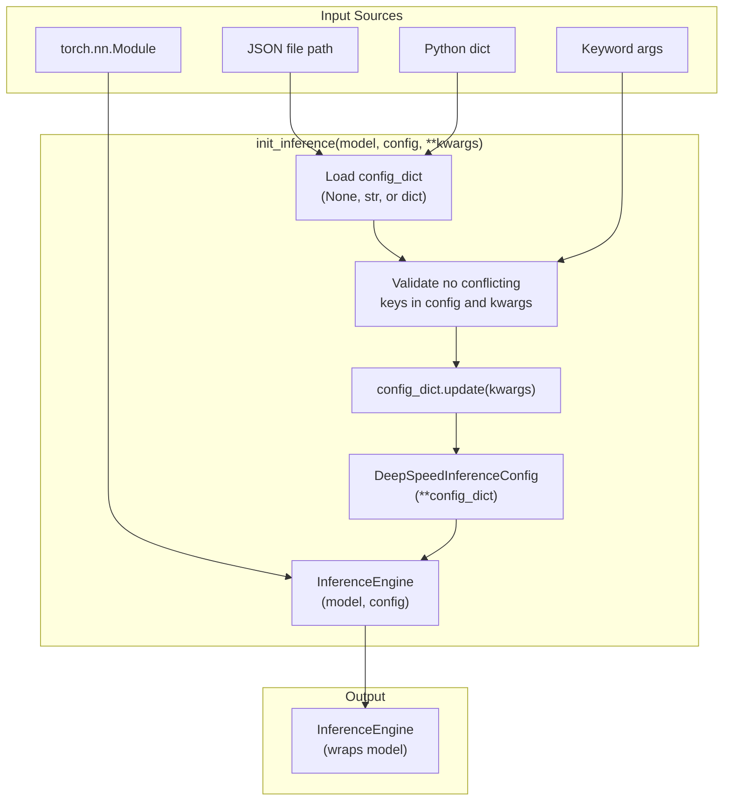
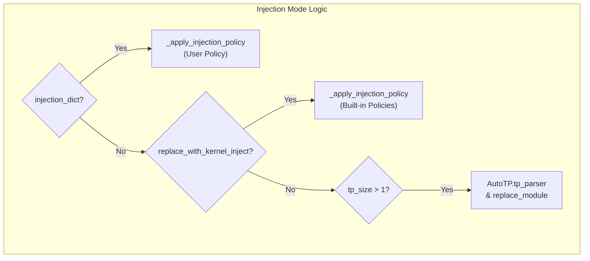

<!-- source: DeepWiki mcp.deepwiki.com · repo deepspeedai/DeepSpeed · page 5.1 InferenceEngine Overview · fetched 2026-10-21 -->

# InferenceEngine Overview

<details>
<summary>Relevant source files</summary>

The following files were used as context for generating this wiki page:

- [deepspeed/__init__.py](deepspeed/__init__.py)
- [deepspeed/inference/engine.py](deepspeed/inference/engine.py)
- [deepspeed/model_implementations/transformers/ds_transformer.py](deepspeed/model_implementations/transformers/ds_transformer.py)
- [deepspeed/module_inject/__init__.py](deepspeed/module_inject/__init__.py)
- [deepspeed/module_inject/auto_tp.py](deepspeed/module_inject/auto_tp.py)
- [deepspeed/module_inject/auto_tp_model_utils.py](deepspeed/module_inject/auto_tp_model_utils.py)
- [deepspeed/module_inject/autotp_config.py](deepspeed/module_inject/autotp_config.py)
- [deepspeed/module_inject/fusedqkv_utils.py](deepspeed/module_inject/fusedqkv_utils.py)
- [deepspeed/module_inject/layers.py](deepspeed/module_inject/layers.py)
- [deepspeed/module_inject/replace_module.py](deepspeed/module_inject/replace_module.py)
- [deepspeed/module_inject/replace_policy.py](deepspeed/module_inject/replace_policy.py)
- [deepspeed/module_inject/tp_shard.py](deepspeed/module_inject/tp_shard.py)
- [deepspeed/ops/transformer/inference/config.py](deepspeed/ops/transformer/inference/config.py)
- [deepspeed/ops/transformer/inference/ds_attention.py](deepspeed/ops/transformer/inference/ds_attention.py)
- [deepspeed/ops/transformer/inference/op_binding/__init__.py](deepspeed/ops/transformer/inference/op_binding/__init__.py)
- [deepspeed/ops/transformer/inference/op_binding/base.py](deepspeed/ops/transformer/inference/op_binding/base.py)
- [deepspeed/ops/transformer/inference/op_binding/linear.py](deepspeed/ops/transformer/inference/op_binding/linear.py)
- [deepspeed/ops/transformer/inference/op_binding/qkv_gemm.py](deepspeed/ops/transformer/inference/op_binding/qkv_gemm.py)
- [deepspeed/ops/transformer/inference/op_binding/softmax.py](deepspeed/ops/transformer/inference/op_binding/softmax.py)
- [deepspeed/ops/transformer/inference/op_binding/softmax_context.py](deepspeed/ops/transformer/inference/op_binding/softmax_context.py)
- [deepspeed/ops/transformer/inference/op_binding/vector_matmul.py](deepspeed/ops/transformer/inference/op_binding/vector_matmul.py)
- [deepspeed/runtime/state_dict_factory.py](deepspeed/runtime/state_dict_factory.py)
- [tests/unit/inference/test_inference.py](tests/unit/inference/test_inference.py)
- [tests/unit/model_parallelism/test_autotp_training.py](tests/unit/model_parallelism/test_autotp_training.py)

</details>


The `InferenceEngine` class ([deepspeed/inference/engine.py:40]()) is the central orchestrator for DeepSpeed-Inference (v1). It wraps a standard PyTorch `nn.Module` to provide optimized execution through kernel fusion, tensor parallelism, and specialized memory management.

The public API entry point is `deepspeed.init_inference()` ([deepspeed/__init__.py:313-388]()), which creates a `DeepSpeedInferenceConfig` and instantiates the engine. The engine performs model transformations by replacing standard PyTorch layers with optimized implementations via one of three modes: user-specified injection policy, kernel injection with built-in transformer kernels, or Automatic Tensor Parallelism (AutoTP).

## init_inference API Entry Point

The `deepspeed.init_inference()` function ([deepspeed/__init__.py:313-388]()) provides the public interface for initializing inference. It accepts a model and optional configuration through either a dictionary, a JSON file path, or keyword arguments.



**init_inference Configuration Flow**

The function supports multiple initialization patterns, ensuring that keyword arguments override settings in the configuration dictionary/file ([deepspeed/__init__.py:366-370]()).

Sources: [deepspeed/__init__.py:313-388]()

## InferenceEngine Initialization Sequence

The `InferenceEngine.__init__()` method ([deepspeed/inference/engine.py:45-185]()) executes a multi-stage process to prepare the model for optimized inference.

```mermaid
graph TB
    subgraph "InferenceEngine Initialization"
        [DS_Transformer_Inference_Workspace] -- "destroy()" --> [Workspace_Cleanup]
        [InferenceEngine_Init] -- "Extract model.config" --> [TransformerPolicy_HF_Model_Config]
        [InferenceEngine_Init] -- "_convert_to_dtype" --> [Dtype_Conversion]
        [InferenceEngine_Init] -- "_create_model_parallel_group" --> [TP_Group_Setup]
        [InferenceEngine_Init] -- "_apply_injection_policy" --> [Module_Replacement]
    end

    subgraph "Code Entities"
        [InferenceEngine_Init]:::code
        [DS_Transformer_Inference_Workspace]:::code
        [TransformerPolicy_HF_Model_Config]:::code
        [TP_Group_Setup]:::code
        [Module_Replacement]:::code
    end

    classDef code font-family:monospace
```

**InferenceEngine Initialization Pipeline**

| Stage | Key Operations | Code Reference |
|-------|----------------|----------------|
| Workspace cleanup | Destroy existing `DeepSpeedTransformerInference.workspace` | [deepspeed/inference/engine.py:55-56]() |
| Model config | Store `model.config` in `TransformerPolicy.hf_model_config` | [deepspeed/inference/engine.py:67-68]() |
| Dtype validation | Check dtype support via `get_accelerator().supported_dtypes()` | [deepspeed/inference/engine.py:70-72]() |
| Tensor parallel | Create `dist.new_group()` for TP ranks | [deepspeed/inference/engine.py:118-120]() |
| Expert parallel | Create MoE groups if `has_moe_layers()` returns True | [deepspeed/inference/engine.py:127-128]() |
| Injection policy | Select between user policy, kernel injection, or AutoTP | [deepspeed/inference/engine.py:131-164]() |

Sources: [deepspeed/inference/engine.py:45-185](), [deepspeed/inference/engine.py:55-56](), [deepspeed/inference/engine.py:118-120]()

## Three Injection Modes

The engine supports three distinct injection modes selected in `_apply_injection_policy()` ([deepspeed/inference/engine.py:380-391]()):

1.  **User-Specified Injection Policy**: When `config.injection_policy` is provided, the engine iterates over user-specified module-to-policy mappings ([deepspeed/inference/engine.py:131-150]()).
2.  **Kernel Injection**: When `config.replace_with_kernel_inject=True`, the engine uses built-in policies to replace standard transformer layers with optimized `DeepSpeedTransformerInference` modules ([deepspeed/inference/engine.py:152-154]()).
3.  **Automatic Tensor Parallelism (AutoTP)**: When `tp_size > 1` and no policy is provided, the engine uses `AutoTP.tp_parser(model)` to automatically identify and shard layers across GPUs ([deepspeed/inference/engine.py:156-164]()).



**Injection Mode Selection**

Sources: [deepspeed/inference/engine.py:131-164](), [deepspeed/inference/engine.py:380-391](), [deepspeed/module_inject/auto_tp.py:157-164]()

## Dtype Conversion and Device Placement

The engine performs dtype conversion and device placement before module injection to ensure all operations occur at the correct precision and location.

-   **Dtype Conversion**: The `_convert_to_dtype()` method ([deepspeed/inference/engine.py:481-494]()) converts the model to the requested precision (FP16, BF16, or FP32).
-   **Device Placement**: The engine handles meta-tensor initialization ([deepspeed/inference/engine.py:168-170]()). If the model is on a "meta" device, it uses `to_empty()` to allocate memory on the target accelerator without a host-to-device copy. Otherwise, it uses a standard `to(device)` call ([deepspeed/inference/engine.py:171-172]()).

Sources: [deepspeed/inference/engine.py:111-113](), [deepspeed/inference/engine.py:166-172](), [deepspeed/inference/engine.py:481-494]()

## Inference Execution and Text Generation

The `InferenceEngine` provides a `forward` pass that wraps the original model's forward method ([deepspeed/inference/engine.py:591-628]()). If the model is a transformer, it manages the workspace and KV-cache via `DeepSpeedTransformerInference.workspace` ([deepspeed/model_implementations/transformers/ds_transformer.py:88-90]()).

For models with a `generate` method, the engine patches it with a custom implementation `_generate` ([deepspeed/inference/engine.py:65]()). This allows the engine to handle token-by-token generation while maintaining the optimized KV-cache state and applying tensor parallelism across steps.

```mermaid
graph LR
    subgraph "Inference Execution"
        [Engine_Forward] -- "timer start" --> [Inference_Model_Timer]
        [Inference_Model_Timer] -- "original_forward" --> [Model_Output]
        [Model_Output] -- "timer stop" --> [Execution_Complete]
    end

    subgraph "Code Entities"
        [Engine_Forward]:::code
        [Inference_Model_Timer]:::code
        [Model_Output]:::code
    end

    classDef code font-family:monospace
```

**Inference Execution Flow**

Sources: [deepspeed/inference/engine.py:37-38](), [deepspeed/inference/engine.py:591-628](), [deepspeed/model_implementations/transformers/ds_transformer.py:88-90]()

## CUDA Graph Support

When `enable_cuda_graph=True`, the engine attempts to capture the model's execution graph ([deepspeed/inference/engine.py:107-109]()). CUDA graphs reduce the overhead of launching many small kernels by recording the kernel sequence once and replaying it. This is particularly effective for models with fixed sequence lengths during inference.

Sources: [deepspeed/inference/engine.py:107-109](), [deepspeed/inference/engine.py:496-523]()

---

