<!-- source: DeepWiki mcp.deepwiki.com · repo deepspeedai/DeepSpeed · page 5.2 Module Injection and Replacement System · fetched 2026-10-21 -->

# Module Injection and Replacement System

Relevant source files

The following files were used as context for generating this wiki page:

- [deepspeed/__init__.py](deepspeed/__init__.py)
- [deepspeed/inference/engine.py](deepspeed/inference/engine.py)
- [deepspeed/module_inject/__init__.py](deepspeed/module_inject/__init__.py)
- [deepspeed/module_inject/auto_tp.py](deepspeed/module_inject/auto_tp.py)
- [deepspeed/module_inject/auto_tp_model_utils.py](deepspeed/module_inject/auto_tp_model_utils.py)
- [deepspeed/module_inject/autotp_config.py](deepspeed/module_inject/autotp_config.py)
- [deepspeed/module_inject/containers/__init__.py](deepspeed/module_inject/containers/__init__.py)
- [deepspeed/module_inject/containers/base.py](deepspeed/module_inject/containers/base.py)
- [deepspeed/module_inject/containers/bloom.py](deepspeed/module_inject/containers/bloom.py)
- [deepspeed/module_inject/containers/features/meta_tensor.py](deepspeed/module_inject/containers/features/meta_tensor.py)
- [deepspeed/module_inject/containers/gptj.py](deepspeed/module_inject/containers/gptj.py)
- [deepspeed/module_inject/containers/gptneo.py](deepspeed/module_inject/containers/gptneo.py)
- [deepspeed/module_inject/containers/gptneox.py](deepspeed/module_inject/containers/gptneox.py)
- [deepspeed/module_inject/containers/opt.py](deepspeed/module_inject/containers/opt.py)
- [deepspeed/module_inject/fusedqkv_utils.py](deepspeed/module_inject/fusedqkv_utils.py)
- [deepspeed/module_inject/layers.py](deepspeed/module_inject/layers.py)
- [deepspeed/module_inject/load_checkpoint.py](deepspeed/module_inject/load_checkpoint.py)
- [deepspeed/module_inject/policy.py](deepspeed/module_inject/policy.py)
- [deepspeed/module_inject/replace_module.py](deepspeed/module_inject/replace_module.py)
- [deepspeed/module_inject/replace_policy.py](deepspeed/module_inject/replace_policy.py)
- [deepspeed/module_inject/tp_shard.py](deepspeed/module_inject/tp_shard.py)
- [deepspeed/module_inject/utils.py](deepspeed/module_inject/utils.py)
- [deepspeed/runtime/state_dict_factory.py](deepspeed/runtime/state_dict_factory.py)
- [tests/unit/inference/test_inference.py](tests/unit/inference/test_inference.py)
- [tests/unit/model_parallelism/test_autotp_training.py](tests/unit/model_parallelism/test_autotp_training.py)

## Purpose and Scope

The Module Injection and Replacement System is DeepSpeed's core mechanism for transforming PyTorch models during inference initialization. This system performs a recursive tree traversal of a model's module hierarchy, identifies target layers based on matching policies, and replaces them with optimized DeepSpeed implementations. The replacement process supports two distinct modes: kernel injection (which substitutes layers with fused CUDA kernels) and automatic tensor parallelism (which distributes layers across GPUs without custom kernels).

The system operates through a policy-based architecture where each model architecture (BERT, GPT-2, BLOOM, LLaMA, etc.) has a corresponding policy class that defines which layers to replace and how to perform the replacement. The replacement process is coordinated by `replace_transformer_layer()` in [deepspeed/module_inject/replace_module.py:189-558](), which serves as the main entry point called by the `InferenceEngine`.

This page documents the replacement orchestration, policy matching, recursive traversal algorithm, and integration with checkpoint loading. For the inference engine that invokes this system, see page 5.1. For policy-based and AutoTP injection modes, see page 5.3. For details about the optimized kernels used after replacement, see page 5.4.

---

## Replacement System Architecture

The replacement system operates through a hierarchical call chain that starts from the `InferenceEngine` and proceeds through policy matching to recursive module traversal.

**Diagram: Module Replacement Call Chain**

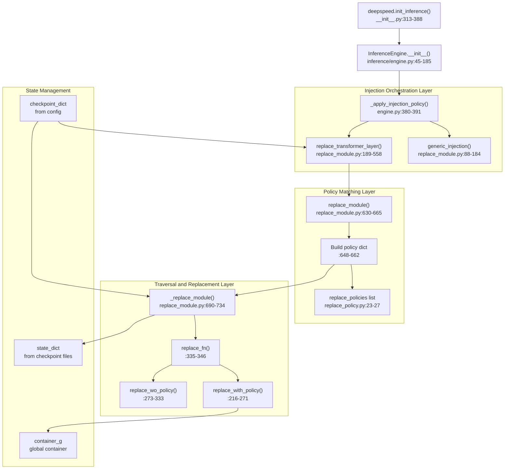

**Sources:** [deepspeed/__init__.py:313-388](), [deepspeed/inference/engine.py:45-185](), [deepspeed/inference/engine.py:380-391](), [deepspeed/module_inject/replace_module.py:88-184](), [deepspeed/module_inject/replace_module.py:189-734](), [deepspeed/module_inject/replace_policy.py:23-27]()

---

## Entry Points and Initialization

### Primary Entry Point: `init_inference`

The module injection system is invoked through `deepspeed.init_inference()`, which creates an `InferenceEngine` that automatically applies injection.

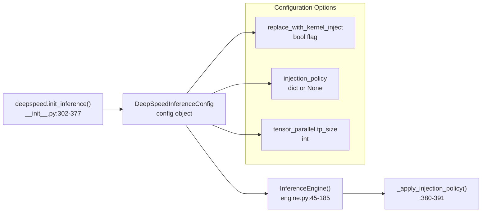

**Sources:** [deepspeed/__init__.py:302-377](), [deepspeed/inference/engine.py:45-185]()

### Configuration Flow

The system supports three initialization modes:

| Mode | Condition | Behavior |
|------|-----------|----------|
| User-Specified Policy | `injection_policy` is dict | Uses user-provided policy for specific layers [deepspeed/inference/engine.py:131-150]() |
| Kernel Injection | `replace_with_kernel_inject=True` | Replaces layers with DeepSpeed transformer implementations [deepspeed/inference/engine.py:152-154]() |
| AutoTP | `tp_size > 1` and no policy | Automatically applies tensor parallelism via `AutoTP.tp_parser` [deepspeed/inference/engine.py:155-164]() |

**Sources:** [deepspeed/inference/engine.py:131-164]()

---

## Two Modes of Operation

### Mode Selection Logic

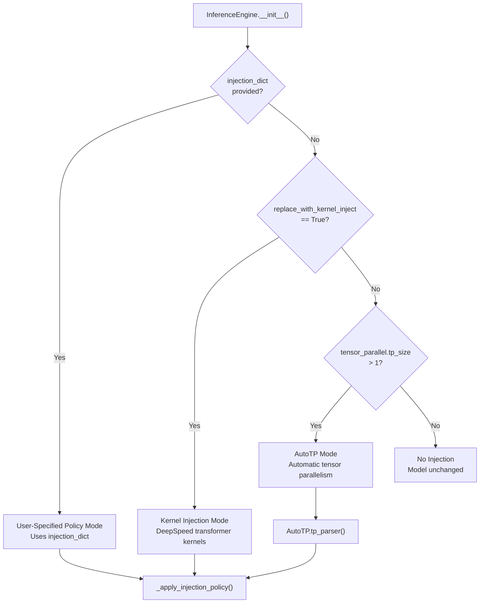

**Sources:** [deepspeed/inference/engine.py:131-164]()

---

## Policy-Based Replacement System

### Policy Architecture

The system uses policy classes to define how specific model architectures should be replaced. Each policy identifies original layer classes and specifies replacement strategies.

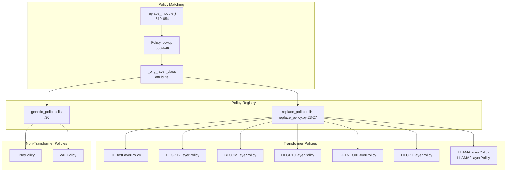

**Sources:** [deepspeed/module_inject/replace_policy.py:1-31](), [deepspeed/module_inject/replace_module.py:619-654]()

### Policy Instantiation Process

When `replace_module()` is called, it builds a policy dictionary mapping original layer classes to replacement functions:

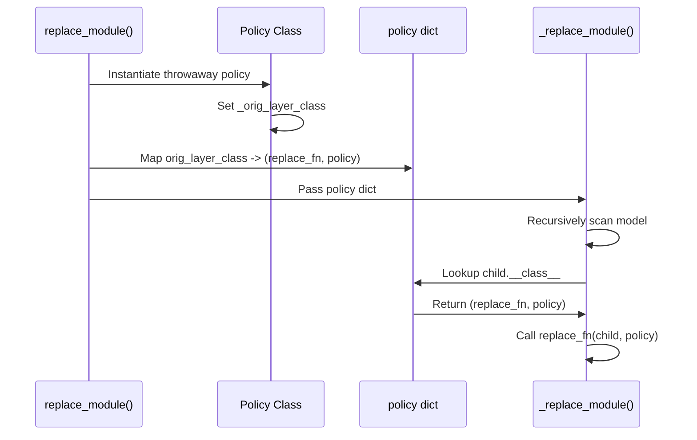

**Sources:** [deepspeed/module_inject/replace_module.py:637-654]()

---

## Kernel Injection Mode

When `replace_with_kernel_inject=True`, the system replaces layers with DeepSpeed's custom transformer implementations featuring fused CUDA kernels.

### Container-Based Replacement

The system uses a container system to wrap model-specific logic. For example, `DS_BloomContainer` [deepspeed/module_inject/containers/bloom.py:19-103]() handles the specific mapping of parameters for BLOOM models.

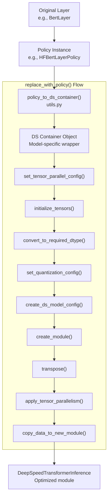

**Sources:** [deepspeed/module_inject/replace_module.py:216-271](), [deepspeed/module_inject/containers/bloom.py:19-103]()

### Container Workflow Steps

The container-based workflow performs several steps to transform an original layer into an optimized DeepSpeed module:

| Step | Method | Purpose |
|------|--------|---------|
| 1 | `policy_to_ds_container()` | Creates model-specific container instance [deepspeed/module_inject/replace_module.py:218]() |
| 2 | `set_tensor_parallel_config()` | Configures TP size and group [deepspeed/module_inject/replace_module.py:221]() |
| 3 | `initialize_tensors()` | Allocates weight/bias tensors [deepspeed/module_inject/replace_module.py:222]() |
| 4 | `convert_to_required_dtype()` | Converts to FP16/BF16/INT8 [deepspeed/module_inject/replace_module.py:223]() |
| 5 | `set_quantization_config()` | Sets up INT8 quantization if enabled [deepspeed/module_inject/replace_module.py:224]() |
| 6 | `create_ds_model_config()` | Creates DeepSpeed config object [deepspeed/module_inject/replace_module.py:225]() |
| 7 | `create_module()` | Instantiates `DeepSpeedTransformerInference` [deepspeed/module_inject/replace_module.py:226]() |
| 8 | `transpose()` | Transposes weights if needed [deepspeed/module_inject/replace_module.py:230]() |
| 9 | `apply_tensor_parallelism()` | Applies TP slicing via `ReplaceWithTensorSlicing` [deepspeed/module_inject/replace_module.py:231]() |
| 10 | `copy_data_to_new_module()` | Copies weights to new module [deepspeed/module_inject/replace_module.py:232]() |

**Sources:** [deepspeed/module_inject/replace_module.py:216-271]()

---

## AutoTP Mode

When tensor parallelism is enabled without kernel injection, the system uses AutoTP (Automatic Tensor Parallelism) to distribute layers across GPUs.

### AutoTP Replacement Flow

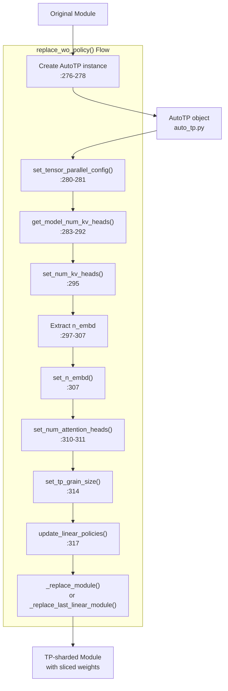

**Sources:** [deepspeed/module_inject/replace_module.py:273-322]()

### AutoTP Configuration Parameters

The AutoTP system extracts and sets several model-specific parameters to handle uneven sharding and architectural differences:

| Parameter | Function | File:Line |
|-----------|----------|-----------|
| `num_kv_heads` | `set_num_kv_heads()` | [deepspeed/module_inject/tp_shard.py:15-17]() |
| `num_attention_heads` | `set_num_attention_heads()` | [deepspeed/module_inject/tp_shard.py:20-22]() |
| `n_embd` | `set_n_embd()` | [deepspeed/module_inject/tp_shard.py:25-27]() |
| `tp_grain_size` | `set_tp_grain_size()` | [deepspeed/module_inject/tp_shard.py:30-32]() |

**Sources:** [deepspeed/module_inject/replace_module.py:283-314](), [deepspeed/module_inject/tp_shard.py:1-32]()

### Special Handling: `lm_head` Layer

The AutoTP system applies special handling to the final linear projection layer (`lm_head`) to ensure weight sharing with embeddings if necessary.

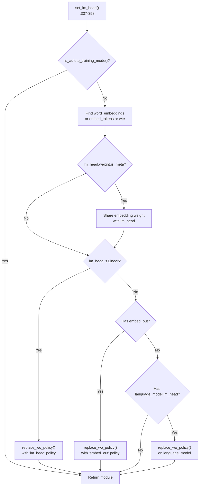

**Sources:** [deepspeed/module_inject/replace_module.py:337-358]()

---

## Recursive Module Traversal and Replacement

The `_replace_module()` function performs a depth-first traversal of the module tree, checking each child module against the policy dictionary and replacing matched modules.

### Traversal Algorithm Details

The traversal maintains state including the `prefix` string tracking the module path (e.g., `"transformer.h.0."`) and a `layer_id` counter. At each node, it checks if `child.__class__` exists in the `policies` dictionary.

**Diagram: Recursive Module Replacement Flow**

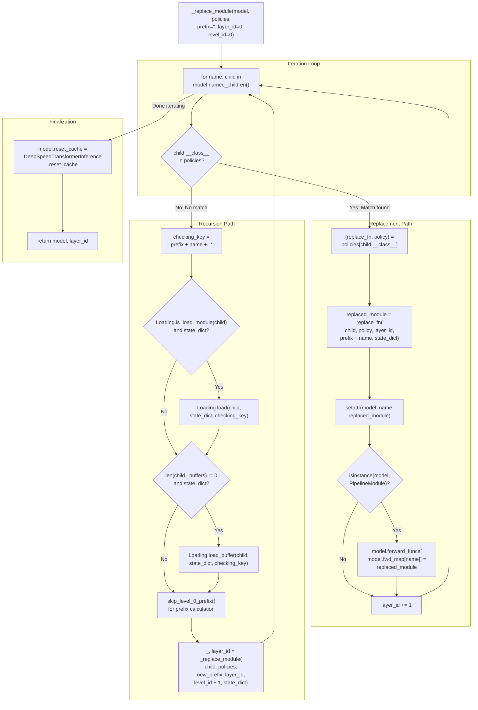

**Sources:** [deepspeed/module_inject/replace_module.py:690-734]()

### PipelineModule Integration

When the parent model is a `PipelineModule`, the replacement updates both the attribute and the `forward_funcs` list to ensure the pipeline engine uses the optimized layers.

**Sources:** [deepspeed/module_inject/replace_module.py:706-709]()

---

## Checkpoint Loading Integration

The system integrates with checkpoint loading to enable efficient model initialization from pre-trained weights, including support for INT8 sharded checkpoints [deepspeed/module_inject/load_checkpoint.py:94-102]().

### Checkpoint Loading Modes

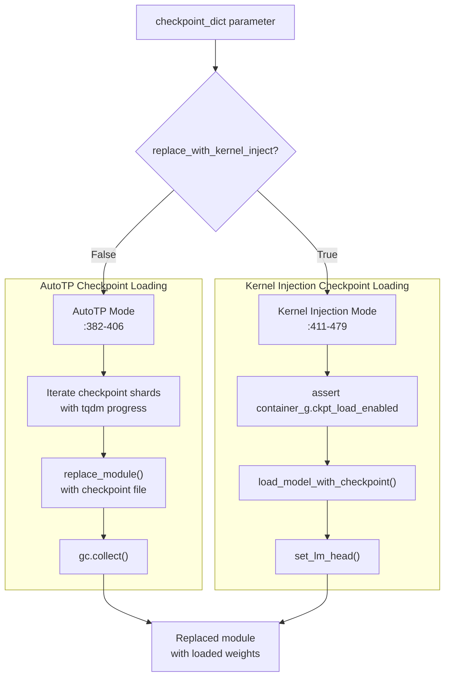

**Sources:** [deepspeed/module_inject/replace_module.py:382-479](), [deepspeed/module_inject/load_checkpoint.py:23-126]()

---

## Generic Injection for Non-Transformer Models

The system supports non-transformer models like diffusion models through `generic_injection()` [deepspeed/module_inject/replace_module.py:88-184]().

### Generic Injection Flow

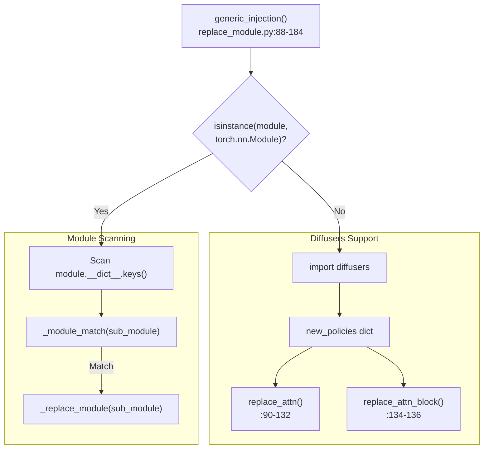

**Sources:** [deepspeed/module_inject/replace_module.py:88-184]()

---

## Quantization Support

The injection system includes support for INT8 quantization through the `GroupQuantizer` class [deepspeed/module_inject/replace_module.py:44-77]().

### Quantization Configuration

| Parameter | Role |
|-----------|------|
| `q_int8` | Boolean flag to enable INT8 quantization [deepspeed/module_inject/replace_module.py:49]() |
| `group_size` | Granularity of quantization groups [deepspeed/module_inject/replace_module.py:47]() |
| `num_bits` | Bit-width (default 8) [deepspeed/module_inject/replace_module.py:48]() |
| `num_groups` | Total number of quantization groups [deepspeed/module_inject/replace_module.py:51]() |

**Sources:** [deepspeed/module_inject/replace_module.py:44-77]()

---

## Summary Table: Injection System Components

| Component | File Path | Purpose |
|-----------|-----------|---------|
| `replace_transformer_layer()` | `replace_module.py:189-547` | Main orchestration function for layer replacement |
| `replace_module()` | `replace_module.py:630-665` | Generic module replacement with policy matching |
| `_replace_module()` | `replace_module.py:690-734` | Recursive tree traversal and replacement |
| `replace_with_policy()` | `replace_module.py:216-271` | Container-based kernel injection |
| `replace_wo_policy()` | `replace_module.py:273-333` | AutoTP-based replacement |
| `generic_injection()` | `replace_module.py:88-184` | Non-transformer model support |
| `GroupQuantizer` | `replace_module.py:44-77` | INT8 quantization support |
| `load_model_with_checkpoint()` | `load_checkpoint.py:23-126` | Logic for loading sharded/TP checkpoints |
| `replace_policies` | `replace_policy.py:23-27` | Transformer policy registry |
| `get_shard_size()` | `tp_shard.py:47-68` | Calculates shard dimensions for AutoTP |

**Sources:** [deepspeed/module_inject/replace_module.py](), [deepspeed/module_inject/load_checkpoint.py](), [deepspeed/module_inject/replace_policy.py](), [deepspeed/module_inject/tp_shard.py]()

---

