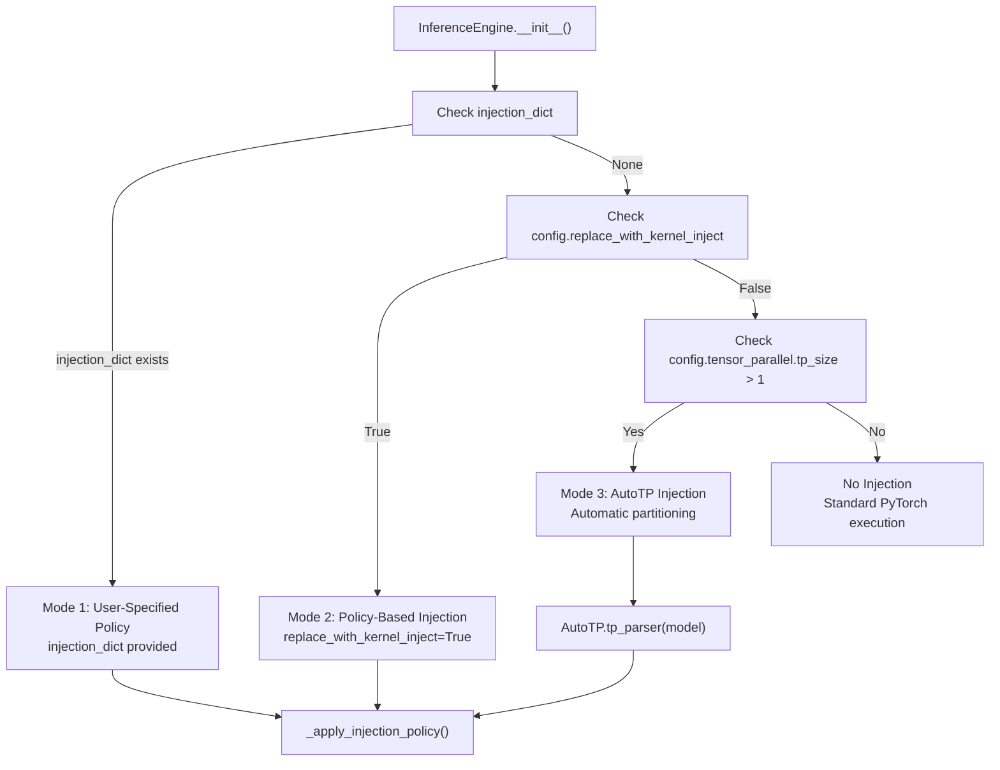
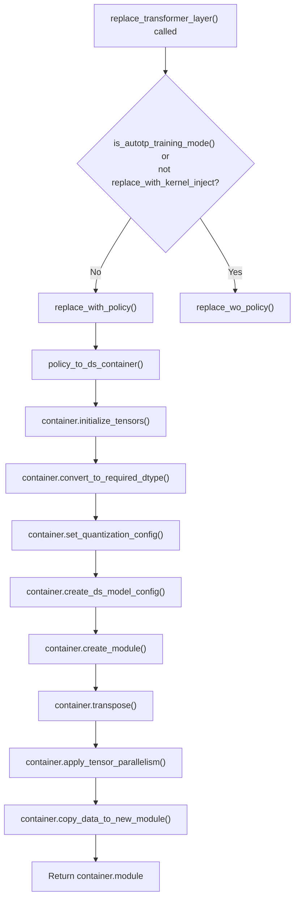
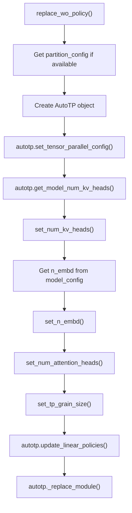
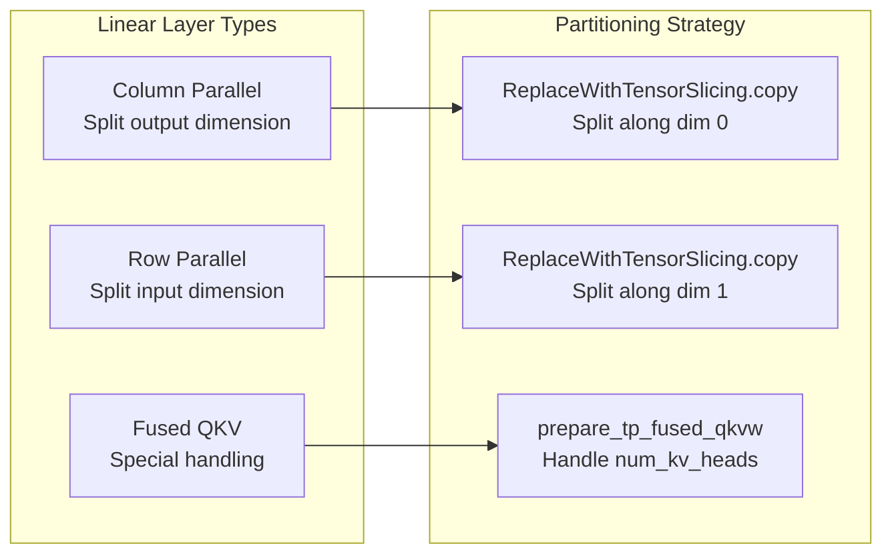
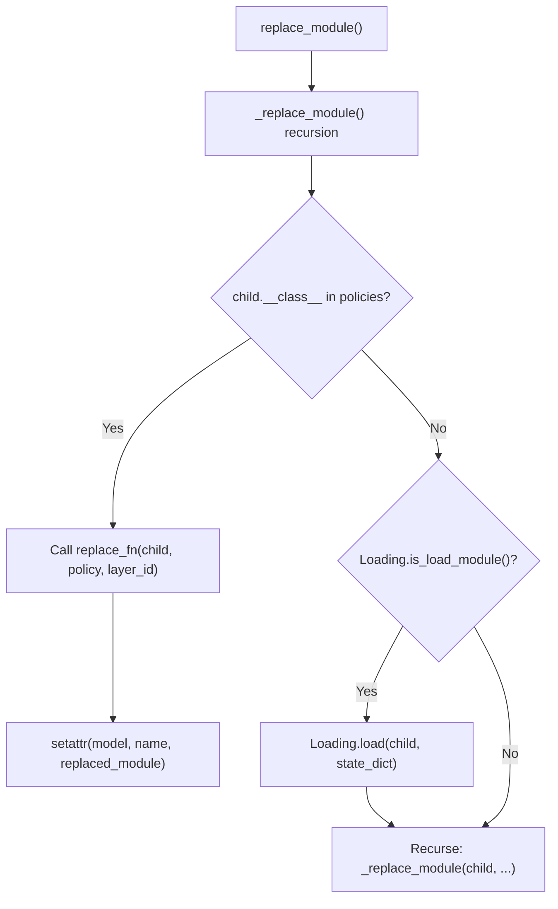

<!-- source: DeepWiki mcp.deepwiki.com · repo deepspeedai/DeepSpeed · page 5.3 Policy-Based and AutoTP Injection · fetched 2026-10-21 -->

# Policy-Based and AutoTP Injection

<details>
<summary>Relevant source files</summary>

The following files were used as context for generating this wiki page:

- [blogs/huggingface-tp/README.md](blogs/huggingface-tp/README.md)
- [deepspeed/__init__.py](deepspeed/__init__.py)
- [deepspeed/inference/engine.py](deepspeed/inference/engine.py)
- [deepspeed/module_inject/__init__.py](deepspeed/module_inject/__init__.py)
- [deepspeed/module_inject/auto_tp.py](deepspeed/module_inject/auto_tp.py)
- [deepspeed/module_inject/auto_tp_model_utils.py](deepspeed/module_inject/auto_tp_model_utils.py)
- [deepspeed/module_inject/autotp_config.py](deepspeed/module_inject/autotp_config.py)
- [deepspeed/module_inject/fusedqkv_utils.py](deepspeed/module_inject/fusedqkv_utils.py)
- [deepspeed/module_inject/layers.py](deepspeed/module_inject/layers.py)
- [deepspeed/module_inject/replace_module.py](deepspeed/module_inject/replace_module.py)
- [deepspeed/module_inject/replace_policy.py](deepspeed/module_inject/replace_policy.py)
- [deepspeed/module_inject/tp_plan_converter.py](deepspeed/module_inject/tp_plan_converter.py)
- [deepspeed/module_inject/tp_shard.py](deepspeed/module_inject/tp_shard.py)
- [deepspeed/runtime/state_dict_factory.py](deepspeed/runtime/state_dict_factory.py)
- [deepspeed/runtime/tensor_parallel/config.py](deepspeed/runtime/tensor_parallel/config.py)
- [deepspeed/runtime/tensor_parallel/init_utils.py](deepspeed/runtime/tensor_parallel/init_utils.py)
- [docs/_tutorials/automatic-tensor-parallelism.md](docs/_tutorials/automatic-tensor-parallelism.md)
- [docs/_tutorials/autotp-training.md](docs/_tutorials/autotp-training.md)
- [docs/code-docs/source/training.rst](docs/code-docs/source/training.rst)
- [tests/unit/inference/test_inference.py](tests/unit/inference/test_inference.py)
- [tests/unit/model_parallelism/test_autotp_custom_patterns.py](tests/unit/model_parallelism/test_autotp_custom_patterns.py)
- [tests/unit/model_parallelism/test_autotp_training.py](tests/unit/model_parallelism/test_autotp_training.py)
- [tests/unit/model_parallelism/test_tp_plan_e2e.py](tests/unit/model_parallelism/test_tp_plan_e2e.py)
- [tests/unit/model_parallelism/test_tp_plan_real_models.py](tests/unit/model_parallelism/test_tp_plan_real_models.py)

</details>


This document explains the two primary module injection strategies used by DeepSpeed's inference engine: **policy-based injection** for known model architectures and **AutoTP (Automatic Tensor Parallelism)** for automatic model partitioning. These strategies determine how DeepSpeed replaces standard PyTorch modules with optimized implementations.

For information about the overall module replacement system, see [Module Injection and Replacement System](#5.2). For details on the fused CUDA kernels used by replaced modules, see [Transformer Inference Kernels](#5.4).

## Injection Mode Selection

The `InferenceEngine` selects between three injection modes based on configuration parameters and user-provided policies:

Title: Inference Engine Injection Mode Selection


**Sources:** [deepspeed/inference/engine.py:131-164]()

The selection logic resides in `InferenceEngine.__init__()`:

| Mode | Trigger Condition | Purpose |
|------|------------------|---------|
| User-Specified Policy | `injection_dict` is provided | User defines custom injection policies for specific module types |
| Policy-Based Injection | `replace_with_kernel_inject=True` | Uses predefined policies for known architectures (BERT, GPT-2, BLOOM, etc.) |
| AutoTP | `replace_with_kernel_inject=False` and `tp_size > 1` | Automatically partitions linear layers for tensor parallelism |
| No Injection | None of the above | Model runs with standard PyTorch modules |

**Sources:** [deepspeed/inference/engine.py:131-164](), [deepspeed/__init__.py:80-142]()

## Policy-Based Injection

Policy-based injection uses predefined transformation rules (`Policy` classes) for known model architectures. Each policy defines how to extract weights from the original model and map them to DeepSpeed's optimized containers.

### Available Policies

The following policies are registered in the system:

```python
# From deepspeed/module_inject/replace_policy.py
replace_policies = [
    HFBertLayerPolicy, HFGPTNEOLayerPolicy, GPTNEOXLayerPolicy, HFGPTJLayerPolicy, MegatronLayerPolicy,
    HFGPT2LayerPolicy, BLOOMLayerPolicy, HFOPTLayerPolicy, HFCLIPLayerPolicy, HFDistilBertLayerPolicy,
    LLAMALayerPolicy, LLAMA2LayerPolicy, InternLMLayerPolicy
]

generic_policies = [UNetPolicy, VAEPolicy]
```

Each policy class implements methods to extract attention and MLP weights from the original architecture's layer structure.

**Sources:** [deepspeed/module_inject/replace_policy.py:23-30](), [deepspeed/module_inject/replace_module.py:81-85]()

### Policy-Based Replacement Flow

Title: Replacement Logic in replace_module.py


**Sources:** [deepspeed/module_inject/replace_module.py:216-271](), [deepspeed/module_inject/replace_module.py:442-452]()

### Container Creation Steps

The `replace_with_policy()` function performs an 11-step transformation:

1. **Create Container** - `policy_to_ds_container()` creates a model-specific container (e.g., `DeepSpeedBertContainer`, `DeepSpeedGPT2Container`) [deepspeed/module_inject/replace_module.py:221-222]()
2. **Set Tensor Parallel Config** - Configures `tp_size` and `tp_group` for distributed execution [deepspeed/module_inject/replace_module.py:223-224]()
3. **Initialize Tensors** - Allocates memory for weights in the container [deepspeed/module_inject/replace_module.py:226]()
4. **Convert Data Type** - Converts to FP16/BF16/INT8 if configured [deepspeed/module_inject/replace_module.py:227]()
5. **Set Quantization Config** - Applies INT8 quantization settings if enabled [deepspeed/module_inject/replace_module.py:228]()
6. **Create DS Model Config** - Builds `DeepSpeedInferenceConfig` for the layer [deepspeed/module_inject/replace_module.py:229-234]()
7. **Create Module** - Instantiates the optimized module (e.g., `DeepSpeedTransformerInference`) [deepspeed/module_inject/replace_module.py:235]()
8. **Transpose** - Transposes weight matrices if needed for kernel compatibility [deepspeed/module_inject/replace_module.py:236]()
9. **Apply Tensor Parallelism** - Partitions weights using `ReplaceWithTensorSlicing` [deepspeed/module_inject/replace_module.py:237]()
10. **Copy Data** - Copies transformed weights from container to the new module [deepspeed/module_inject/replace_module.py:269]()
11. **Return Module** - Returns the optimized module for installation in the model [deepspeed/module_inject/replace_module.py:271]()

**Sources:** [deepspeed/module_inject/replace_module.py:216-271]()

## AutoTP (Automatic Tensor Parallelism) Injection

When policy-based injection is disabled and `tp_size > 1`, DeepSpeed uses AutoTP to automatically partition linear layers across GPUs without requiring predefined policies.

### AutoTP Initialization Architecture

Title: AutoTP Setup and Sharding Configuration


**Sources:** [deepspeed/module_inject/replace_module.py:273-333]()

### AutoTP Linear Layer Detection

AutoTP identifies and partitions linear layers based on pattern matching. The `AutoTP` class maintains partitioning rules for different layer types, utilizing `ReplaceWithTensorSlicing` for actual sharding logic.

Title: AutoTP Partitioning Strategy


**Sources:** [deepspeed/module_inject/auto_tp.py:33-131](), [deepspeed/module_inject/fusedqkv_utils.py:29-156]()

The AutoTP system categorizes layers by analyzing model configurations:

| Layer Name Pattern | Partitioning Type | File Reference |
|-------------------|-------------------|----------------|
| `qkv_proj`, `query_key_value` | Fused Column Parallel | [deepspeed/module_inject/fusedqkv_utils.py:19]() |
| `lm_head`, `embed_out` | Column Parallel | [deepspeed/module_inject/tp_shard.py:49]() |
| `gate_proj`, `up_proj` | Column Parallel (MLP) | [deepspeed/module_inject/tp_shard.py:51]() |
| `down_proj`, `w2` | Row Parallel (MLP) | [deepspeed/module_inject/tp_shard.py:51]() |

**Sources:** [deepspeed/module_inject/fusedqkv_utils.py:18-26](), [deepspeed/module_inject/tp_shard.py:47-68]()

### Special Cases: Multi-Query Attention

AutoTP handles multi-query attention (MQA) and grouped-query attention (GQA) where the number of key-value heads differs from query heads by maintaining global state in `tp_shard.py`:

```python
# From replace_wo_policy() in replace_module.py
num_kv_heads = _autotp.get_model_num_kv_heads(model_config)
set_num_kv_heads(num_kv_heads)

n_embd = model_config.n_embd or model_config.hidden_size
set_n_embd(n_embd)

set_num_attention_heads(model_config.num_attention_heads)
set_tp_grain_size(config.tensor_parallel.tp_grain_size)
```

When `num_kv_heads` is set, `get_shard_size` calculates uneven division of attention dimensions to ensure query heads are partitioned independently from key-value heads.

**Sources:** [deepspeed/module_inject/replace_module.py:293-326](), [deepspeed/module_inject/tp_shard.py:47-68]()

## Configuration and Usage

### Policy-Based Configuration

To enable policy-based injection with optimized kernels, use the `replace_with_kernel_inject` flag in `init_inference`.

```python
import deepspeed
import torch

model = ... 
ds_engine = deepspeed.init_inference(
    model,
    mp_size=1,
    dtype=torch.half,
    replace_with_kernel_inject=True, # Enable policy-based injection
)
```

**Sources:** [deepspeed/inference/engine.py:152-154]()

### AutoTP Configuration

AutoTP is triggered when tensor parallelism is requested (`tp_size > 1`) but kernel injection is disabled.

```python
ds_engine = deepspeed.init_inference(
    model,
    mp_size=2, # AutoTP triggered for tp_size > 1
    dtype=torch.float16,
    replace_with_kernel_inject=False
)
```

**Sources:** [deepspeed/inference/engine.py:155-164]()

### User-Specified Injection Policy

For custom architectures, users provide an `injection_policy` dictionary mapping model blocks to specific layer names that require row-parallel reduction.

```python
from transformers.models.t5.modeling_t5 import T5Block

ds_engine = deepspeed.init_inference(
    model,
    mp_size=2,
    injection_policy={T5Block: ('SelfAttention.o', 'EncDecAttention.o', 'DenseReluDense.wo')}
)
```

**Sources:** [docs/_tutorials/automatic-tensor-parallelism.md:57-62]()

## Module Replacement Process

Both injection modes utilize `replace_module` to traverse the model and apply the determined transformations.

Title: Recursive Module Replacement in replace_module.py


**Sources:** [deepspeed/module_inject/replace_module.py:690-734]()

### Checkpoint Loading Integration

The replacement process integrates weight loading via the `Loading` class, which handles meta-tensor materialization and buffer copying during the traversal.

```python
# From Loading class in deepspeed/module_inject/auto_tp.py
def load(module, state_dict, prefix):
    for name, param in module.named_parameters(recurse=False):
        if param.data.is_meta:
            # Materialize meta tensor on CPU before loading
            param.data = torch.empty_like(param.data, device="cpu")
        if prefix + name in state_dict:
            param.data.copy_(state_dict[prefix + name])
```

**Sources:** [deepspeed/module_inject/auto_tp.py:133-154]()

## Comparison: Policy-Based vs AutoTP

| Aspect | Policy-Based Injection | AutoTP Injection |
|--------|----------------------|------------------|
| **Trigger** | `replace_with_kernel_inject=True` | `tp_size > 1` & `replace_with_kernel_inject=False` |
| **Optimization** | Custom Fused Kernels | Standard PyTorch + Tensor Parallelism |
| **Scope** | Predefined Architectures | Generic Model Support |
| **Weight Handling** | Container-based extraction | Direct `state_dict` loading |
| **Communication** | Optimized AllReduce | `LinearAllreduce` wrapper |

**Sources:** [deepspeed/inference/engine.py:131-164](), [deepspeed/module_inject/replace_module.py:216-333]()

---

