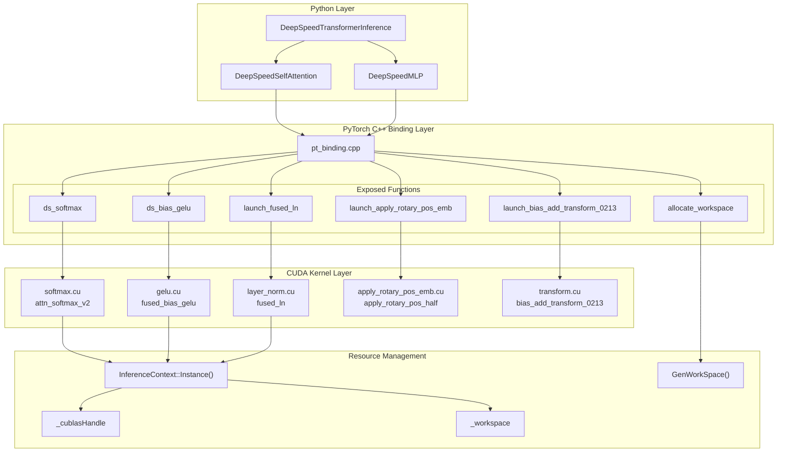
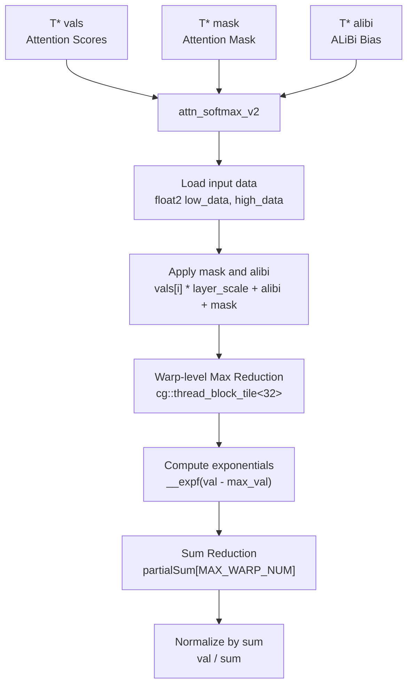

<!-- source: DeepWiki mcp.deepwiki.com · repo deepspeedai/DeepSpeed · page 5.4 Transformer Inference Kernels · fetched 2026-10-21 -->

# Transformer Inference Kernels

<details>
<summary>Relevant source files</summary>

The following files were used as context for generating this wiki page:

- [csrc/includes/cublas_wrappers.h](csrc/includes/cublas_wrappers.h)
- [csrc/includes/custom_cuda_layers.h](csrc/includes/custom_cuda_layers.h)
- [csrc/includes/feed_forward.h](csrc/includes/feed_forward.h)
- [csrc/includes/gemm_test.h](csrc/includes/gemm_test.h)
- [csrc/includes/general_kernels.h](csrc/includes/general_kernels.h)
- [csrc/includes/strided_batch_gemm.h](csrc/includes/strided_batch_gemm.h)
- [csrc/transformer/cublas_wrappers.cu](csrc/transformer/cublas_wrappers.cu)
- [csrc/transformer/general_kernels.cu](csrc/transformer/general_kernels.cu)
- [csrc/transformer/inference/csrc/apply_rotary_pos_emb.cu](csrc/transformer/inference/csrc/apply_rotary_pos_emb.cu)
- [csrc/transformer/inference/csrc/dequantize.cu](csrc/transformer/inference/csrc/dequantize.cu)
- [csrc/transformer/inference/csrc/gelu.cu](csrc/transformer/inference/csrc/gelu.cu)
- [csrc/transformer/inference/csrc/layer_norm.cu](csrc/transformer/inference/csrc/layer_norm.cu)
- [csrc/transformer/inference/csrc/pt_binding.cpp](csrc/transformer/inference/csrc/pt_binding.cpp)
- [csrc/transformer/inference/csrc/relu.cu](csrc/transformer/inference/csrc/relu.cu)
- [csrc/transformer/inference/csrc/softmax.cu](csrc/transformer/inference/csrc/softmax.cu)
- [csrc/transformer/inference/csrc/transform.cu](csrc/transformer/inference/csrc/transform.cu)
- [csrc/transformer/inference/includes/inference_context.h](csrc/transformer/inference/includes/inference_context.h)
- [csrc/transformer/inference/includes/inference_cublas_wrappers.h](csrc/transformer/inference/includes/inference_cublas_wrappers.h)
- [csrc/transformer/inference/includes/inference_cuda_layers.h](csrc/transformer/inference/includes/inference_cuda_layers.h)
- [csrc/transformer/normalize_kernels.cu](csrc/transformer/normalize_kernels.cu)
- [csrc/transformer/softmax_kernels.cu](csrc/transformer/softmax_kernels.cu)
- [deepspeed/inference/v2/kernels/core_ops/blas_kernels/blas_utils.h](deepspeed/inference/v2/kernels/core_ops/blas_kernels/blas_utils.h)
- [deepspeed/inference/v2/kernels/core_ops/gated_activations/gated_activation_kernels_cuda.cu](deepspeed/inference/v2/kernels/core_ops/gated_activations/gated_activation_kernels_cuda.cu)
- [deepspeed/inference/v2/ragged/csrc/ragged_ops.cpp](deepspeed/inference/v2/ragged/csrc/ragged_ops.cpp)
- [deepspeed/model_implementations/transformers/ds_transformer.py](deepspeed/model_implementations/transformers/ds_transformer.py)
- [deepspeed/ops/transformer/inference/config.py](deepspeed/ops/transformer/inference/config.py)
- [deepspeed/ops/transformer/inference/ds_attention.py](deepspeed/ops/transformer/inference/ds_attention.py)
- [deepspeed/ops/transformer/inference/op_binding/__init__.py](deepspeed/ops/transformer/inference/op_binding/__init__.py)
- [deepspeed/ops/transformer/inference/op_binding/base.py](deepspeed/ops/transformer/inference/op_binding/base.py)
- [deepspeed/ops/transformer/inference/op_binding/linear.py](deepspeed/ops/transformer/inference/op_binding/linear.py)
- [deepspeed/ops/transformer/inference/op_binding/qkv_gemm.py](deepspeed/ops/transformer/inference/op_binding/qkv_gemm.py)
- [deepspeed/ops/transformer/inference/op_binding/softmax.py](deepspeed/ops/transformer/inference/op_binding/softmax.py)
- [deepspeed/ops/transformer/inference/op_binding/softmax_context.py](deepspeed/ops/transformer/inference/op_binding/softmax_context.py)
- [deepspeed/ops/transformer/inference/op_binding/vector_matmul.py](deepspeed/ops/transformer/inference/op_binding/vector_matmul.py)
- [deepspeed/ops/transformer/inference/triton/attention.py](deepspeed/ops/transformer/inference/triton/attention.py)
- [deepspeed/ops/transformer/inference/triton/triton_matmul_kernel.py](deepspeed/ops/transformer/inference/triton/triton_matmul_kernel.py)
- [tests/unit/ops/transformer/inference/inference_test_utils.py](tests/unit/ops/transformer/inference/inference_test_utils.py)
- [tests/unit/ops/transformer/inference/test_attention.py](tests/unit/ops/transformer/inference/test_attention.py)
- [tests/unit/ops/transformer/inference/test_bias_add.py](tests/unit/ops/transformer/inference/test_bias_add.py)
- [tests/unit/ops/transformer/inference/test_bias_geglu.py](tests/unit/ops/transformer/inference/test_bias_geglu.py)
- [tests/unit/ops/transformer/inference/test_bias_gelu.py](tests/unit/ops/transformer/inference/test_bias_gelu.py)
- [tests/unit/ops/transformer/inference/test_bias_relu.py](tests/unit/ops/transformer/inference/test_bias_relu.py)
- [tests/unit/ops/transformer/inference/test_gelu.py](tests/unit/ops/transformer/inference/test_gelu.py)
- [tests/unit/ops/transformer/inference/test_layer_norm.py](tests/unit/ops/transformer/inference/test_layer_norm.py)
- [tests/unit/ops/transformer/inference/test_matmul.py](tests/unit/ops/transformer/inference/test_matmul.py)
- [tests/unit/ops/transformer/inference/test_moe_res_matmult.py](tests/unit/ops/transformer/inference/test_moe_res_matmult.py)
- [tests/unit/ops/transformer/inference/test_residual_add.py](tests/unit/ops/transformer/inference/test_residual_add.py)
- [tests/unit/ops/transformer/inference/test_rms_norm.py](tests/unit/ops/transformer/inference/test_rms_norm.py)
- [tests/unit/ops/transformer/inference/test_softmax.py](tests/unit/ops/transformer/inference/test_softmax.py)

</details>


This page documents the optimized CUDA kernels that power DeepSpeed's transformer inference engine. These kernels implement fused, memory-efficient operations for attention, activations, normalization, and other transformer primitives. For information about how these kernels are loaded and integrated into models, see [Module Injection and Replacement System](#5.2).

## Purpose and Scope

The transformer inference kernels provide GPU-accelerated implementations of transformer operations optimized for low-latency inference. Key characteristics include:

- **Kernel Fusion**: Multiple operations combined into single kernels to reduce memory bandwidth (e.g., `fused_bias_residual_layer_norm`).
- **Template Specialization**: Type-agnostic kernels supporting `float`, `__half`, and `__nv_bfloat16`.
- **Memory Optimization**: Aligned memory access patterns and vectorized loads/stores via `memory_access_utils.h`.
- **Workspace Management**: Efficient reuse of pre-allocated memory buffers coordinated by `InferenceContext`.

These kernels are exposed to Python through PyTorch's C++ extension interface defined in `pt_binding.cpp`.

**Sources:** [csrc/transformer/inference/csrc/pt_binding.cpp:1-14](), [csrc/transformer/inference/csrc/gelu.cu:35-59]()

## System Architecture

#### Diagram: Transformer Inference Kernel Architecture



**Sources:** [csrc/transformer/inference/csrc/pt_binding.cpp:1-100](), [deepspeed/model_implementations/transformers/ds_transformer.py:22-129](), [deepspeed/ops/transformer/inference/ds_attention.py:16-118]()

## PyTorch Binding Layer

The file `pt_binding.cpp` serves as the interface between Python and the CUDA kernels. It uses PyTorch's extension API to expose kernel functions.

### Key Enumerations

```cpp
enum class ActivationFuncType { UNKNOWN = 0, GELU = 1, ReLU = 2, GATED_GELU = 3, GATED_SILU = 4 };
enum class NormType { UNKNOWN = 0, LayerNorm = 1, GroupNorm = 2, RMSNorm = 3 };
enum class TransformerType : uint8_t { UNKNOWN = 0, GPTType = 1, BERTType = 2 };
```

These enums differentiate between model architectures and operation types. Model types are inferred based on attention mask dimensions: GPT-style models typically have 3D/4D masks, while BERT-style models use 2D masks.

**Sources:** [csrc/transformer/inference/csrc/pt_binding.cpp:16-38]()

### Workspace Allocation

The `allocate_workspace` template function reserves GPU memory for intermediate results, activation buffers, and KV caches:

```cpp
template <typename T>
void allocate_workspace(unsigned hidden_dim, unsigned num_heads, unsigned prompt_length,
                        unsigned batch_size, unsigned num_layers, unsigned mp_size = 1,
                        bool external_cache = false, unsigned rank = 0,
                        unsigned max_out_tokens = 1024, unsigned min_out_tokens = 1)
```

This function calls `InferenceContext::Instance().GenWorkSpace()` to calculate the required memory based on the `max_out_tokens` and model geometry.

**Sources:** [csrc/transformer/inference/csrc/pt_binding.cpp:107-129](), [csrc/transformer/inference/includes/inference_context.h:98-172]()

## Attention Kernels

### Softmax with Masking

The `attn_softmax_v2` kernel implements fused attention softmax.

#### Diagram: Attention Softmax Pipeline



**Key Features:**
- **Triangular masking**: For causal (GPT-style) attention.
- **Local attention**: Sliding window support with configurable `window_size`.
- **ALiBi support**: Additive position bias for attention mechanisms.
- **Warp-level reduction**: Uses `cooperative_groups` for efficient parallel max and sum operations.

The `iterations` template parameter controls loop unrolling and is selected at launch time based on the sequence length.

**Sources:** [csrc/transformer/inference/csrc/softmax.cu:34-150](), [csrc/transformer/inference/csrc/pt_binding.cpp:58-104]()

### Rotary Position Embeddings (RoPE)

The `apply_rotary_pos_half` kernel implements RoPE by rotating pairs of dimensions in the query and key tensors.

```cpp
float inv_freq = (float)((neuron_idx % half_dim) * 2) / (float)rotary_dim;
inv_freq = 1.0 / powf(rope_theta, inv_freq) * (float)seq_idx;

// Rotation logic
q[i] = conversion::to<T>(conversion::to<float>(q[i]) * cosf(inv_freq) + q_rot_temp * sinf(inv_freq));
```

The kernel uses warp shuffles (`head_group.shfl`) to exchange values between threads to perform the rotation without shared memory overhead.

**Sources:** [csrc/transformer/inference/csrc/apply_rotary_pos_emb.cu:26-88]()

## Activation and MLP Kernels

### Fused Bias-GELU

The `fused_bias_gelu` kernel combines bias addition and GELU activation in a single pass to minimize memory round-trips.

```cpp
template <typename T>
__global__ void fused_bias_gelu(T* input, const T* bias, int total_count, int intermediate_size)
{
    // ... load input and bias ...
    for (int i = 0; i < values_per_access; i++) {
        float data_f = conversion::to<float>(data[i]);
        float bias_f = conversion::to<float>(data_bias[i]);
        data[i] = conversion::to<T>(gelu(data_f + bias_f));
    }
    // ... store output ...
}
```

It utilizes vectorized memory access (`mem_access::load_global<16>`) to achieve high throughput.

**Sources:** [csrc/transformer/inference/csrc/gelu.cu:35-59]()

### Tensor Transformation (0213)

The `bias_add_transform_0213` kernel is a specialized transform used after the QKV projection. It performs:
1. Bias addition.
2. Reshaping from `[Batch, Seq, 3*Hidden]` to `[3, Batch, Head, Seq, HeadSize]`.
3. Optional Rotary Position Embedding (RoPE) integration.

This reordering is critical for the subsequent batched GEMM operations in the attention mechanism.

**Sources:** [csrc/transformer/inference/csrc/transform.cu:26-88]()

## Normalization Kernels

### Fused Residual Layer Normalization

DeepSpeed provides highly optimized LayerNorm kernels that can fuse residual addition and bias addition.

```cpp
__global__ void fused_bias_residual_layer_norm(float* vals, const float* residual, ...)
{
    // ... compute mean and variance across the row ...
    float mean = sum / row_stride;
    // ... compute variance ...
    float inv_std = rsqrtf(variance + epsilon);
    // ... normalize and apply gamma/beta ...
    vals[i] = (vals[i] - mean) * inv_std * gamma[i] + beta[i];
}
```

For FP16, the kernel avoids conversion to FP32 where possible to utilize `__half2` instructions, though it promotes to `float` for accumulation to maintain numerical stability.

**Sources:** [csrc/transformer/normalize_kernels.cu:21-120]()

## Resource Management: InferenceContext

The `InferenceContext` class is a singleton that manages global resources for inference kernels.

- **Workspace**: Manages a large pre-allocated GPU buffer used for activations and KV caches.
- **cuBLAS Handle**: Maintains a persistent `cublasHandle_t` to avoid expensive creation/destruction calls.
- **Streams and Events**: Manages CUDA streams and events (`_comp_event`, `_comm_event`) to coordinate computation and communication.

**Sources:** [csrc/transformer/inference/includes/inference_context.h:49-96]()

## Kernel Function Reference

| Kernel Name | File | Purpose |
|-------------|------|---------|
| `attn_softmax_v2` | `softmax.cu` | Fused masked softmax for attention scores. |
| `fused_bias_gelu` | `gelu.cu` | MLP activation with fused bias addition. |
| `apply_rotary_pos_half` | `apply_rotary_pos_emb.cu` | Rotary position embedding application. |
| `bias_add_transform_0213` | `transform.cu` | QKV layout transformation and RoPE fusion. |
| `fused_ln` | `layer_norm.cu` | Optimized LayerNorm with sub-block scheduling. |
| `dequantize_kernel` | `dequantize.cu` | Converts INT8 weights to floating point using group scales. |

**Sources:** [csrc/transformer/inference/includes/inference_cuda_layers.h:1-249]()

---

