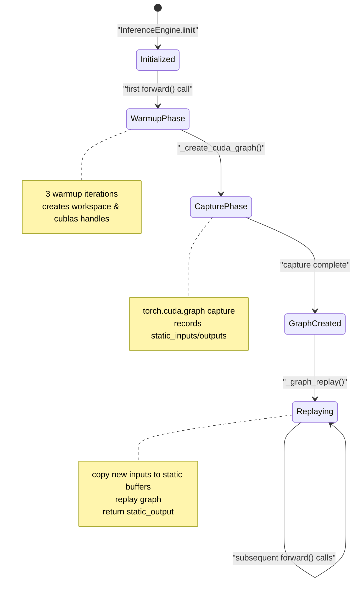
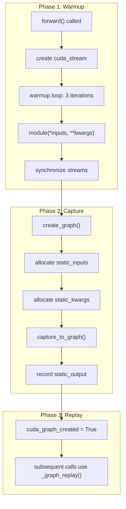
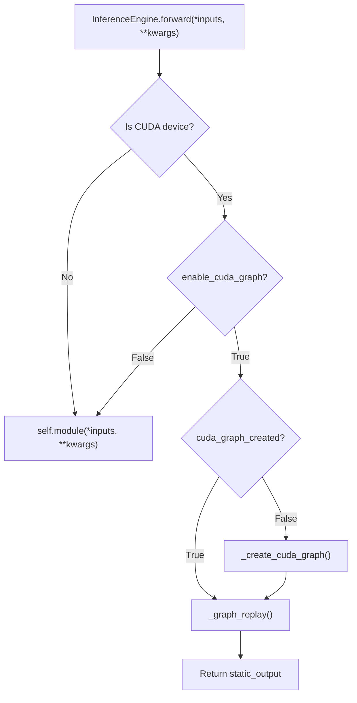
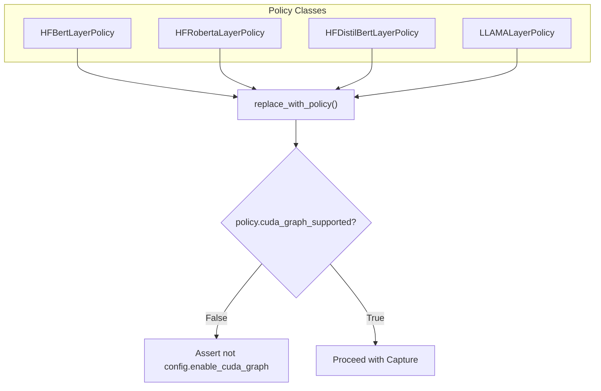

<!-- source: DeepWiki mcp.deepwiki.com · repo deepspeedai/DeepSpeed · page 5.5 CUDA Graph Optimization · fetched 2026-10-21 -->

# CUDA Graph Optimization

<details>
<summary>Relevant source files</summary>

The following files were used as context for generating this wiki page:

- [deepspeed/__init__.py](deepspeed/__init__.py)
- [deepspeed/inference/engine.py](deepspeed/inference/engine.py)
- [deepspeed/model_implementations/features/__init__.py](deepspeed/model_implementations/features/__init__.py)
- [deepspeed/model_implementations/features/cuda_graph.py](deepspeed/model_implementations/features/cuda_graph.py)
- [deepspeed/module_inject/__init__.py](deepspeed/module_inject/__init__.py)
- [deepspeed/module_inject/auto_tp.py](deepspeed/module_inject/auto_tp.py)
- [deepspeed/module_inject/auto_tp_model_utils.py](deepspeed/module_inject/auto_tp_model_utils.py)
- [deepspeed/module_inject/autotp_config.py](deepspeed/module_inject/autotp_config.py)
- [deepspeed/module_inject/containers/unet.py](deepspeed/module_inject/containers/unet.py)
- [deepspeed/module_inject/containers/vae.py](deepspeed/module_inject/containers/vae.py)
- [deepspeed/module_inject/fusedqkv_utils.py](deepspeed/module_inject/fusedqkv_utils.py)
- [deepspeed/module_inject/layers.py](deepspeed/module_inject/layers.py)
- [deepspeed/module_inject/replace_module.py](deepspeed/module_inject/replace_module.py)
- [deepspeed/module_inject/replace_policy.py](deepspeed/module_inject/replace_policy.py)
- [deepspeed/module_inject/tp_shard.py](deepspeed/module_inject/tp_shard.py)
- [deepspeed/ops/transformer/inference/diffusers_transformer_block.py](deepspeed/ops/transformer/inference/diffusers_transformer_block.py)
- [deepspeed/ops/transformer/inference/triton_ops.py](deepspeed/ops/transformer/inference/triton_ops.py)
- [deepspeed/runtime/state_dict_factory.py](deepspeed/runtime/state_dict_factory.py)
- [requirements/requirements-sd.txt](requirements/requirements-sd.txt)
- [tests/pytest.ini](tests/pytest.ini)
- [tests/unit/inference/test_inference.py](tests/unit/inference/test_inference.py)
- [tests/unit/inference/test_stable_diffusion.py](tests/unit/inference/test_stable_diffusion.py)
- [tests/unit/model_parallelism/test_autotp_training.py](tests/unit/model_parallelism/test_autotp_training.py)

</details>


## Purpose and Scope

This document describes CUDA Graph optimization in DeepSpeed inference. CUDA Graphs reduce kernel launch overhead by capturing a sequence of CUDA operations into a graph structure that can be replayed repeatedly with minimal CPU involvement. This optimization is particularly effective for models with fixed input shapes and deterministic execution paths, such as BERT and RoBERTa models during inference.

For information about general inference system architecture, see [InferenceEngine Overview](#5.1). For details on kernel-level optimizations, see [Transformer Inference Kernels](#5.4).

## Overview

CUDA Graph optimization in DeepSpeed captures the entire inference forward pass into a reusable graph structure. Once captured, the graph can be replayed on subsequent inference calls, eliminating the overhead of:

- Python-to-C++ transitions
- Individual kernel launches
- CUDA API calls for each operation

This optimization is most beneficial when:
1. The model has fixed input dimensions (batch size, sequence length).
2. The execution path is deterministic (no dynamic control flow).
3. The workload is kernel-launch-bound rather than compute-bound.

Sources: [deepspeed/inference/engine.py:496-513](), [deepspeed/inference/engine.py:89]()

## CUDA Graph Lifecycle

### States and Transitions



Sources: [deepspeed/inference/engine.py:496-524]()

### Capture Process

The CUDA graph capture follows a three-phase process:



Sources: [deepspeed/inference/engine.py:496-513]()

## Integration with InferenceEngine

### Initialization and Configuration

The `InferenceEngine` manages CUDA graph state through several key attributes and methods:

| Attribute | Type | Purpose |
|-----------|------|---------|
| `cuda_graph_created` | `bool` | Tracks whether graph has been captured [deepspeed/inference/engine.py:89]() |
| `_cuda_graphs` | CUDA Graph | Stores the captured graph structure [deepspeed/inference/engine.py:506]() |
| `static_inputs` | tuple | Fixed input tensors for graph replay [deepspeed/inference/engine.py:507]() |
| `static_kwargs` | dict | Fixed keyword arguments for graph replay [deepspeed/inference/engine.py:508]() |
| `static_output` | tensor | Output buffer for graph replay [deepspeed/inference/engine.py:511]() |

Sources: [deepspeed/inference/engine.py:89-110](), [deepspeed/inference/engine.py:506-511]()

### Forward Pass Routing

The `forward` method in `InferenceEngine` acts as the traffic controller for CUDA graph execution.



Sources: [deepspeed/inference/engine.py:556-583]()

### Code Entity Mapping: Engine Components

| Logic Name | Code Entity | File Path |
|------------|-------------|-----------|
| Capture Logic | `_create_cuda_graph` | [deepspeed/inference/engine.py:496]() |
| Replay Logic | `_graph_replay` | [deepspeed/inference/engine.py:515]() |
| Accelerator Abstraction | `get_accelerator()` | [deepspeed/inference/engine.py:25]() |
| Config Object | `DeepSpeedInferenceConfig` | [deepspeed/inference/engine.py:35]() |

Sources: [deepspeed/inference/engine.py:25-515]()

## Model and Policy Support

### Compatibility Requirements

CUDA graph support is model-architecture dependent. The injection policy determines whether a model can use CUDA graphs:



Sources: [deepspeed/module_inject/replace_module.py:216-220](), [deepspeed/module_inject/replace_policy.py:23-27]()

### Supported Model Architectures

| Model Type | CUDA Graph Support | Policy Class |
|------------|-------------------|--------------|
| BERT | ✓ Yes | `HFBertLayerPolicy` |
| RoBERTa | ✓ Yes | `HFBertLayerPolicy` (generic) |
| DistilBERT | ✓ Yes | `HFDistilBertLayerPolicy` |
| CLIP | ✓ Yes | `HFCLIPLayerPolicy` |
| Stable Diffusion | ✓ Yes | `UNetPolicy` / `VAEPolicy` |

Sources: [deepspeed/module_inject/replace_policy.py:1-31](), [deepspeed/module_inject/replace_module.py:165]()

## Graph Replay Mechanism

### Memory Management

The graph replay uses pre-allocated static buffers to avoid dynamic memory allocation during inference. This is handled in `_graph_replay`.

```python
def _graph_replay(self, *inputs, **kwargs):
    for i in range(len(inputs)):
        if torch.is_tensor(inputs[i]):
            self.static_inputs[i].copy_(inputs[i])
    for k in kwargs:
        if torch.is_tensor(kwargs[k]):
            self.static_kwargs[k].copy_(kwargs[k])
    get_accelerator().replay_graph(self._cuda_graphs)
    return self.static_output
```

Sources: [deepspeed/inference/engine.py:515-523]()

## Limitations and Constraints

### System Requirements

| Requirement | Constraint | Source |
|-------------|-----------|--------|
| PyTorch Version | ≥ 1.10 | [deepspeed/inference/engine.py:108-109]() |
| Accelerator | CUDA (NVIDIA) | [deepspeed/inference/engine.py:107]() |
| Tensor Parallelism | `tp_size == 1` for capture | [deepspeed/inference/engine.py:179]() |

### Dynamic Behavior Restrictions

CUDA graphs cannot capture:
- **Dynamic control flow**: Conditional branches based on input data.
- **Dynamic shapes**: Variable batch sizes or sequence lengths.
- **Host synchronization**: Operations requiring CPU-GPU sync.

For this reason, autoregressive models like GPT or LLaMA often disable global CUDA graphs for the generation loop, though they may use local graphs for individual components via `generic_injection` [deepspeed/module_inject/replace_module.py:88]().

## Configuration and Usage

### Configuration Options

CUDA graph optimization is enabled through the `DeepSpeedInferenceConfig`:

| Configuration Key | Type | Default |
|------------------|------|---------|
| `enable_cuda_graph` | `bool` | `False` |

**Initialization Example**:

```python
import deepspeed
engine = deepspeed.init_inference(
    model,
    config={
        "enable_cuda_graph": True,
        "replace_with_kernel_inject": True
    }
)
```

Sources: [deepspeed/inference/engine.py:45-110](), [deepspeed/__init__.py:80-142]()

### Testing Infrastructure

The test suite validates CUDA graph functionality via `enable_cuda_graph` parameterization in `tests/unit/inference/test_inference.py`.

```python
@pytest.fixture(params=[True, False], ids=["CG", "noCG"])
def enable_cuda_graph(request):
    return request.param
```

Sources: [tests/unit/inference/test_inference.py:135-137]()

---

