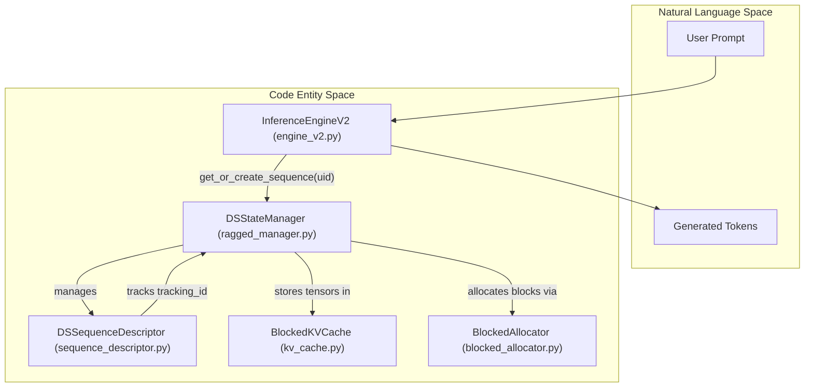
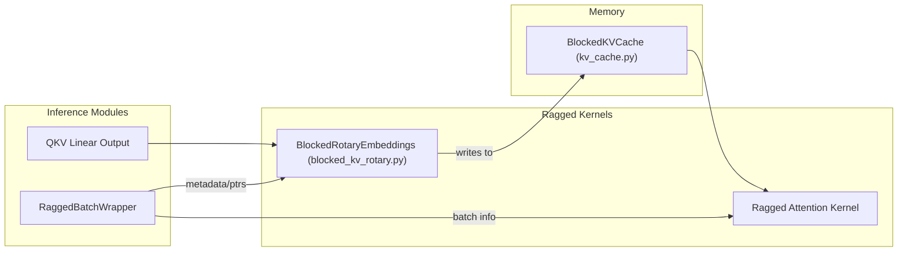

<!-- source: DeepWiki mcp.deepwiki.com · repo deepspeedai/DeepSpeed · page 5.6 Inference Engine V2 (FastGen) · fetched 2026-10-21 -->

# Inference Engine V2 (FastGen)

Relevant source files

The following files were used as context for generating this wiki page:

- [blogs/deepspeed-fastgen/README.md](blogs/deepspeed-fastgen/README.md)
- [blogs/deepspeed-fastgen/assets/images/throughput_latency_13B_no_arrow.png](blogs/deepspeed-fastgen/assets/images/throughput_latency_13B_no_arrow.png)
- [deepspeed/compat.py](deepspeed/compat.py)
- [deepspeed/inference/v2/checkpoint/huggingface_engine.py](deepspeed/inference/v2/checkpoint/huggingface_engine.py)
- [deepspeed/inference/v2/engine_factory.py](deepspeed/inference/v2/engine_factory.py)
- [deepspeed/inference/v2/engine_v2.py](deepspeed/inference/v2/engine_v2.py)
- [deepspeed/inference/v2/kernels/ragged_ops/includes/top_k_utils.h](deepspeed/inference/v2/kernels/ragged_ops/includes/top_k_utils.h)
- [deepspeed/inference/v2/kernels/ragged_ops/linear_blocked_kv_rotary/blocked_kv_rotary.py](deepspeed/inference/v2/kernels/ragged_ops/linear_blocked_kv_rotary/blocked_kv_rotary.py)
- [deepspeed/inference/v2/kernels/ragged_ops/linear_blocked_kv_rotary/blocked_kv_rotary_cuda.cu](deepspeed/inference/v2/kernels/ragged_ops/linear_blocked_kv_rotary/blocked_kv_rotary_cuda.cu)
- [deepspeed/inference/v2/model_implementations/__init__.py](deepspeed/inference/v2/model_implementations/__init__.py)
- [deepspeed/inference/v2/model_implementations/common_parameters/moe_parameters.py](deepspeed/inference/v2/model_implementations/common_parameters/moe_parameters.py)
- [deepspeed/inference/v2/model_implementations/exaone4/__init__.py](deepspeed/inference/v2/model_implementations/exaone4/__init__.py)
- [deepspeed/inference/v2/model_implementations/exaone4/container.py](deepspeed/inference/v2/model_implementations/exaone4/container.py)
- [deepspeed/inference/v2/model_implementations/exaone4/model.py](deepspeed/inference/v2/model_implementations/exaone4/model.py)
- [deepspeed/inference/v2/model_implementations/exaone4/policy.py](deepspeed/inference/v2/model_implementations/exaone4/policy.py)
- [deepspeed/inference/v2/model_implementations/inference_model_base.py](deepspeed/inference/v2/model_implementations/inference_model_base.py)
- [deepspeed/inference/v2/model_implementations/inference_policy_base.py](deepspeed/inference/v2/model_implementations/inference_policy_base.py)
- [deepspeed/inference/v2/model_implementations/inference_transformer_base.py](deepspeed/inference/v2/model_implementations/inference_transformer_base.py)
- [deepspeed/inference/v2/model_implementations/layer_container_base.py](deepspeed/inference/v2/model_implementations/layer_container_base.py)
- [deepspeed/inference/v2/model_implementations/llama_v2/__init__.py](deepspeed/inference/v2/model_implementations/llama_v2/__init__.py)
- [deepspeed/inference/v2/model_implementations/mistral/policy.py](deepspeed/inference/v2/model_implementations/mistral/policy.py)
- [deepspeed/inference/v2/model_implementations/opt/container.py](deepspeed/inference/v2/model_implementations/opt/container.py)
- [deepspeed/inference/v2/model_implementations/opt/policy.py](deepspeed/inference/v2/model_implementations/opt/policy.py)
- [deepspeed/inference/v2/model_implementations/parameter_base.py](deepspeed/inference/v2/model_implementations/parameter_base.py)
- [deepspeed/inference/v2/model_implementations/qwen_v2_moe/__init__.py](deepspeed/inference/v2/model_implementations/qwen_v2_moe/__init__.py)
- [deepspeed/inference/v2/model_implementations/qwen_v2_moe/container.py](deepspeed/inference/v2/model_implementations/qwen_v2_moe/container.py)
- [deepspeed/inference/v2/model_implementations/qwen_v2_moe/model.py](deepspeed/inference/v2/model_implementations/qwen_v2_moe/model.py)
- [deepspeed/inference/v2/model_implementations/qwen_v2_moe/policy.py](deepspeed/inference/v2/model_implementations/qwen_v2_moe/policy.py)
- [deepspeed/inference/v2/modules/implementations/moe/cutlass_multi_gemm.py](deepspeed/inference/v2/modules/implementations/moe/cutlass_multi_gemm.py)
- [deepspeed/inference/v2/ragged/kv_cache.py](deepspeed/inference/v2/ragged/kv_cache.py)
- [deepspeed/inference/v2/ragged/ragged_manager.py](deepspeed/inference/v2/ragged/ragged_manager.py)
- [deepspeed/inference/v2/ragged/sequence_descriptor.py](deepspeed/inference/v2/ragged/sequence_descriptor.py)
- [tests/unit/inference/v2/kernels/ragged_ops/ragged_testing_utils.py](tests/unit/inference/v2/kernels/ragged_ops/ragged_testing_utils.py)
- [tests/unit/inference/v2/model_implementations/parameters/test_parameter_list.py](tests/unit/inference/v2/model_implementations/parameters/test_parameter_list.py)
- [tests/unit/runtime/test_no_sync_ctxt.py](tests/unit/runtime/test_no_sync_ctxt.py)

The DeepSpeed Inference Engine V2, also known as **FastGen**, is a next-generation serving system designed for high-throughput text generation with Large Language Models (LLMs). It introduces **Dynamic SplitFuse**, a novel strategy for managing prompt processing and token generation, alongside advanced memory management techniques like ragged batching and non-contiguous KV-caches.

FastGen is optimized for models with long context windows and high concurrency requirements, providing significantly higher effective throughput compared to traditional inference engines [blogs/deepspeed-fastgen/README.md:22-28]().

## Architecture Overview

The V2 engine architecture moves away from the static batching of V1, implementing a "ragged" batching system where requests of different lengths are processed efficiently without padding [blogs/deepspeed-fastgen/README.md:63-66]().

### Key Components

| Component | Code Entity | Description |
| :--- | :--- | :--- |
| **Engine Entry** | `InferenceEngineV2` | The central orchestrator for V2 inference [deepspeed/inference/v2/engine_v2.py:12](). |
| **State Manager** | `DSStateManager` | Manages blocked KV-caches and sequence metadata [deepspeed/inference/v2/ragged/ragged_manager.py:19](). |
| **KV-Cache** | `BlockedKVCache` | Implements non-contiguous, paged memory for KV tensors [deepspeed/inference/v2/ragged/kv_cache.py:14](). |
| **Sequence Descriptor** | `DSSequenceDescriptor` | Tracks metadata (seen tokens, allocated blocks) for individual sequences [deepspeed/inference/v2/ragged/sequence_descriptor.py:59](). |
| **Policy System** | `InferenceV2Policy` | Defines how to map specific model architectures to optimized V2 kernels [deepspeed/inference/v2/model_implementations/inference_policy_base.py:29](). |

### Data Flow: From Request to Generation
The following diagram illustrates the relationship between the user-facing `InferenceEngineV2` and the internal state management entities.

**System Entity Mapping**

Sources: [deepspeed/inference/v2/engine_v2.py:12](), [deepspeed/inference/v2/ragged/ragged_manager.py:19-132](), [deepspeed/inference/v2/ragged/sequence_descriptor.py:59-102]().

## Model Implementations and Policies

FastGen uses a policy-based system to support various model architectures. Each model (e.g., LLaMA, Mistral, Qwen) has a specific implementation of `DSTransformerModelBase` and a corresponding `InferenceV2Policy` [deepspeed/inference/v2/model_implementations/inference_transformer_base.py:48](), [deepspeed/inference/v2/engine_factory.py:16-28]().

### Supported Models
The `engine_factory.py` provides helpers to build engines for:
* **LLaMA/LLaMA-2**: `Llama2Policy` [deepspeed/inference/v2/engine_factory.py:19]()
* **Mistral/Mixtral**: `MistralPolicy`, `MixtralPolicy` [deepspeed/inference/v2/engine_factory.py:20-21]()
* **Qwen/Qwen2/Qwen2MoE**: `QwenPolicy`, `Qwen2Policy`, `Qwen2MoePolicy` [deepspeed/inference/v2/engine_factory.py:25-27]()
* **Phi/Phi-3**: `PhiPolicy`, `Phi3Policy` [deepspeed/inference/v2/engine_factory.py:23-24]()
* **Falcon**: `FalconPolicy` [deepspeed/inference/v2/engine_factory.py:22]()

### Checkpoint Loading
FastGen supports loading directly from HuggingFace via `HuggingFaceCheckpointEngine`. It automatically handles:
1. **Metadata Parsing**: Fetches config via `AutoConfig` [deepspeed/inference/v2/checkpoint/huggingface_engine.py:24]().
2. **SafeTensors/Bin Support**: Prioritizes `.safetensors` over `.bin` files [deepspeed/inference/v2/checkpoint/huggingface_engine.py:59-62]().
3. **Parameter Sharding**: Parameters are yielded and transformed based on the model's tensor parallelism (TP) configuration [deepspeed/inference/v2/checkpoint/huggingface_engine.py:104-120]().

Sources: [deepspeed/inference/v2/engine_factory.py:70-141](), [deepspeed/inference/v2/checkpoint/huggingface_engine.py:16-102]().

## Ragged Batching and Memory Management

FastGen implements "Ragged Batching" to handle sequences of varying lengths without the memory waste of padding tokens.

### DSStateManager
The `DSStateManager` is responsible for the lifecycle of sequences.
* **Sequence Creation**: `_create_sequence(uid)` allocates a `tracking_slot` from a `BlockedAllocator` and initializes a `DSSequenceDescriptor` [deepspeed/inference/v2/ragged/ragged_manager.py:145-168]().
* **KV-Cache Allocation**: Uses `BlockedKVCache` to manage physical memory blocks. Memory is allocated in fixed-size pages (blocks) to eliminate fragmentation [deepspeed/inference/v2/ragged/ragged_manager.py:95-98]().
* **Resource Flushing**: `flush_sequence(uid)` frees the KV blocks and the tracking slot once a request is finished [deepspeed/inference/v2/ragged/ragged_manager.py:110-123]().

### Kernel Integration
Kernels in V2 are designed to operate on these ragged structures. For example, `BlockedRotaryEmbeddings` applies RoPE directly to queries and keys before copying them into the blocked KV-cache [deepspeed/inference/v2/kernels/ragged_ops/linear_blocked_kv_rotary/blocked_kv_rotary.py:14-18]().

**Kernel Execution Data Flow**

Sources: [deepspeed/inference/v2/kernels/ragged_ops/linear_blocked_kv_rotary/blocked_kv_rotary.py:58-73](), [deepspeed/inference/v2/ragged/kv_cache.py:14]().

## Parameter and Layer Containers

FastGen uses a sophisticated metaclass-based system to manage model parameters and layer initialization.

### LayerContainer and ParameterBase
* **LayerMetaclass**: Automatically parses type annotations in `LayerContainer` subclasses to identify `ParameterBase` objects and sets up finalization callbacks [deepspeed/inference/v2/model_implementations/layer_container_base.py:43-67]().
* **Parameter Mapping**: The `PARAM_MAPPING` dictionary in containers defines how checkpoint keys map to internal parameters [deepspeed/inference/v2/model_implementations/layer_container_base.py:20-87]().
* **Finalization**: When all dependencies (tensors/lists) for a parameter are loaded, `complete_component()` triggers `finalize()`, which performs sharding or transformations before replacing the `ParameterBase` object with a standard `torch.Tensor` [deepspeed/inference/v2/model_implementations/parameter_base.py:144-168]().

### ParametrizedList
For models with variable structures (like Mixture of Experts), `ParametrizedList` manages lists of parameters (e.g., expert weights) whose count depends on the model configuration [deepspeed/inference/v2/model_implementations/parameter_base.py:170-182]().

Sources: [deepspeed/inference/v2/model_implementations/layer_container_base.py:43-148](), [deepspeed/inference/v2/model_implementations/parameter_base.py:57-107]().

---

