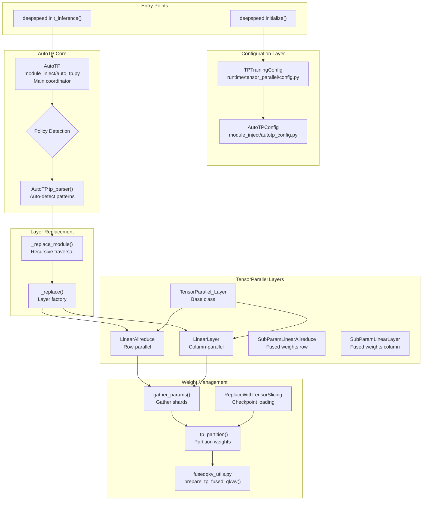
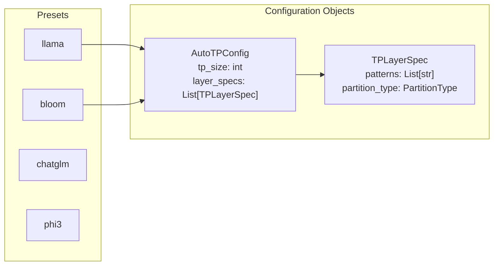
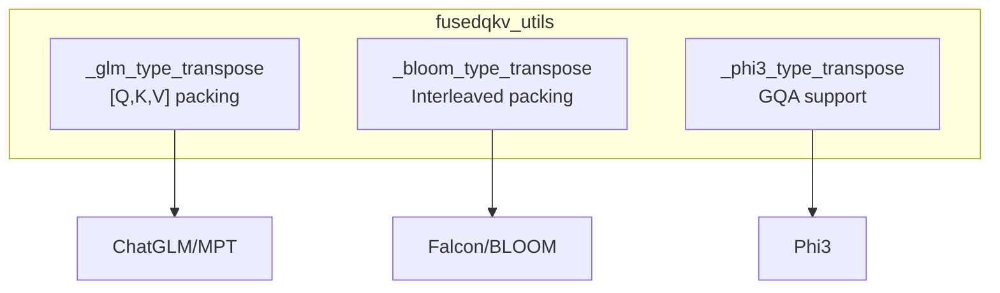

<!-- source: DeepWiki mcp.deepwiki.com · repo deepspeedai/DeepSpeed · page 6 Automatic Tensor Parallelism · fetched 2026-10-21 -->

# Automatic Tensor Parallelism

<details>
<summary>Relevant source files</summary>

The following files were used as context for generating this wiki page:

- [blogs/huggingface-tp/README.md](blogs/huggingface-tp/README.md)
- [deepspeed/__init__.py](deepspeed/__init__.py)
- [deepspeed/inference/engine.py](deepspeed/inference/engine.py)
- [deepspeed/module_inject/__init__.py](deepspeed/module_inject/__init__.py)
- [deepspeed/module_inject/auto_tp.py](deepspeed/module_inject/auto_tp.py)
- [deepspeed/module_inject/auto_tp_model_utils.py](deepspeed/module_inject/auto_tp_model_utils.py)
- [deepspeed/module_inject/autotp_config.py](deepspeed/module_inject/autotp_config.py)
- [deepspeed/module_inject/fusedqkv_utils.py](deepspeed/module_inject/fusedqkv_utils.py)
- [deepspeed/module_inject/layers.py](deepspeed/module_inject/layers.py)
- [deepspeed/module_inject/replace_module.py](deepspeed/module_inject/replace_module.py)
- [deepspeed/module_inject/replace_policy.py](deepspeed/module_inject/replace_policy.py)
- [deepspeed/module_inject/tp_plan_converter.py](deepspeed/module_inject/tp_plan_converter.py)
- [deepspeed/module_inject/tp_shard.py](deepspeed/module_inject/tp_shard.py)
- [deepspeed/runtime/state_dict_factory.py](deepspeed/runtime/state_dict_factory.py)
- [deepspeed/runtime/tensor_parallel/config.py](deepspeed/runtime/tensor_parallel/config.py)
- [deepspeed/runtime/tensor_parallel/init_utils.py](deepspeed/runtime/tensor_parallel/init_utils.py)
- [docs/_tutorials/automatic-tensor-parallelism.md](docs/_tutorials/automatic-tensor-parallelism.md)
- [docs/_tutorials/autotp-training.md](docs/_tutorials/autotp-training.md)
- [docs/code-docs/source/training.rst](docs/code-docs/source/training.rst)
- [tests/unit/inference/test_inference.py](tests/unit/inference/test_inference.py)
- [tests/unit/model_parallelism/test_autotp_custom_patterns.py](tests/unit/model_parallelism/test_autotp_custom_patterns.py)
- [tests/unit/model_parallelism/test_autotp_training.py](tests/unit/model_parallelism/test_autotp_training.py)
- [tests/unit/model_parallelism/test_tp_plan_e2e.py](tests/unit/model_parallelism/test_tp_plan_e2e.py)
- [tests/unit/model_parallelism/test_tp_plan_real_models.py](tests/unit/model_parallelism/test_tp_plan_real_models.py)

</details>


This page documents the Automatic Tensor Parallelism (AutoTP) system, which automatically partitions linear layers across GPUs for both inference and training. AutoTP analyzes model structure and applies tensor parallelism without requiring manual layer specifications.

> **Related pages:** For pipeline parallelism, see [Pipeline Parallelism](#4). For ZeRO memory optimization, see [ZeRO Memory Optimization](#3.2). For general inference optimization, see [Inference Optimization](#5).

AutoTP operates in two modes:
- **Inference mode**: Partitions models for low-latency serving (see [InferenceEngine Overview](#5.1)).
- **Training mode**: Combines tensor parallelism with ZeRO for memory-efficient training (see [DeepSpeedEngine Architecture](#3.1)).

## Core Concepts

Tensor parallelism splits weight matrices across GPUs, with each rank computing on a shard. Two partitioning strategies exist:

**Column Parallelism**: Partition output dimension, AllReduce in backward pass.
```
Weight: [out_features, in_features] → [out_features/tp_size, in_features] per rank
Forward:  Y = X @ W^T  (local compute, distributed Y)
Backward: AllReduce on ∂L/∂X
```

**Row Parallelism**: Partition input dimension, AllReduce in forward pass.
```
Weight: [out_features, in_features] → [out_features, in_features/tp_size] per rank
Forward:  AllReduce on Y
Backward: (local compute, distributed ∂L/∂W)
```

Sources: [deepspeed/module_inject/layers.py:140-169](), [deepspeed/module_inject/layers.py:172-199](), [deepspeed/module_inject/layers.py:201-220]()

## System Architecture



**AutoTP Execution Flow**

The AutoTP system operates through a multi-stage pipeline:

1. **Configuration Resolution**: `TPTrainingConfig` loads preset or custom `AutoTPConfig`.
2. **Module Traversal**: `AutoTP._replace_module()` recursively walks the model tree [deepspeed/module_inject/auto_tp.py:483-544]().
3. **Pattern Matching**: Each linear layer is matched against `TPLayerSpec` patterns [deepspeed/module_inject/autotp_config.py:310-400]().
4. **Layer Factory**: Matched layers are replaced with appropriate `TensorParallel_Layer` subclasses [deepspeed/module_inject/auto_tp.py:351-475]().
5. **Weight Partitioning**: `_tp_partition()` slices weights according to partition strategy [deepspeed/module_inject/layers.py:327-387]().

Sources: [deepspeed/module_inject/auto_tp.py:194-631](), [deepspeed/inference/engine.py:155-164](), [deepspeed/module_inject/autotp_config.py:1-570]()

## Configuration System

AutoTP can be configured via child pages for detailed setups. For details, see [AutoTP Architecture and Configuration](#6.1).

### TPLayerSpec and AutoTPConfig



**TPLayerSpec Pattern Matching**

Specs are evaluated in order; first match wins. Patterns typically target weight names like `.*\.o_proj\.weight$`.

Sources: [deepspeed/module_inject/autotp_config.py:20-308](), [deepspeed/module_inject/autotp_config.py:310-570]()

## TensorParallel Layer Types

DeepSpeed provides several specialized layers to handle distributed matrix multiplications. For details, see [TensorParallel Layer Types](#6.2).

| Layer Class | Parallelism | Key Communication |
|-------------|-------------|-------------------|
| `LinearLayer` | Column | AllReduce in Backward [deepspeed/module_inject/layers.py:201-220]() |
| `LinearAllreduce` | Row | AllReduce in Forward [deepspeed/module_inject/layers.py:389-463]() |
| `SubParamLinearLayer` | Column (Fused) | Handles sub-parameter partitioning [deepspeed/module_inject/layers.py:805-900]() |
| `LmHeadLinearAllreduce` | Row (Special) | Slices input to save memory [deepspeed/module_inject/layers.py:656-682]() |

Sources: [deepspeed/module_inject/layers.py:23-27](), [deepspeed/module_inject/layers.py:140-220]()

## Parameter Management and Checkpointing

AutoTP manages the transition between full parameters and partitioned shards. For details, see [Parameter Management and Checkpointing](#6.3).

**Gather-Partition Cycle**

The `GatherReplacedLayerParams` context manager orchestrates the gather-partition cycle for checkpointing [deepspeed/module_inject/layers.py:327-387]().

```python
with GatherReplacedLayerParams(model.parameters(), model, enabled=True):
    # Full parameters are gathered from GPUs
    torch.save(model.state_dict(), checkpoint_path)
# Parameters are re-partitioned upon exit
```

Sources: [deepspeed/module_inject/layers.py:327-387](), [deepspeed/module_inject/auto_tp.py:23-131]()

## Fused QKV and Model-Specific Handling

Handling fused weights requires architecture-specific knowledge of how Query, Key, and Value matrices are packed. For details, see [Fused QKV and Model-Specific Handling](#6.4).



Sources: [deepspeed/module_inject/fusedqkv_utils.py:29-156](), [deepspeed/module_inject/fusedqkv_utils.py:10-27]()

## Domino: Communication-Hiding TP

Domino is a specialized training engine that hides AllReduce communication behind computation. For details, see [Domino: Communication-Hiding Tensor Parallelism](#6.5).

Sources: [deepspeed/__init__.py:45]()

---

