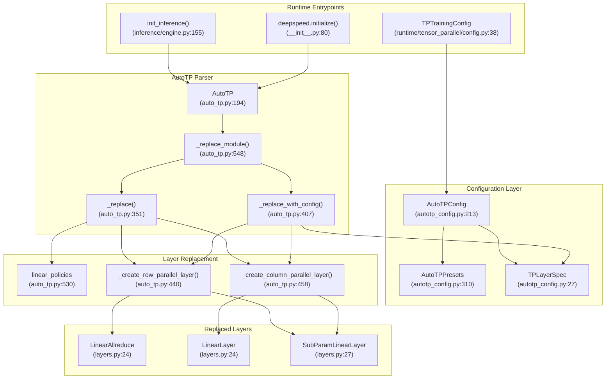
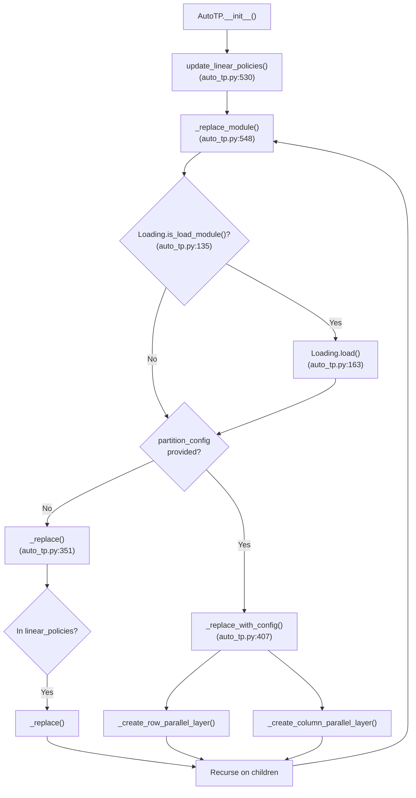

<!-- source: DeepWiki mcp.deepwiki.com · repo deepspeedai/DeepSpeed · page 6.1 AutoTP Architecture and Configuration · fetched 2026-10-21 -->

# AutoTP Architecture and Configuration

Relevant source files

The following files were used as context for generating this wiki page:

- [blogs/huggingface-tp/README.md](blogs/huggingface-tp/README.md)
- [deepspeed/__init__.py](deepspeed/__init__.py)
- [deepspeed/inference/engine.py](deepspeed/inference/engine.py)
- [deepspeed/module_inject/__init__.py](deepspeed/module_inject/__init__.py)
- [deepspeed/module_inject/auto_tp.py](deepspeed/module_inject/auto_tp.py)
- [deepspeed/module_inject/auto_tp_model_utils.py](deepspeed/module_inject/auto_tp_model_utils.py)
- [deepspeed/module_inject/autotp_config.py](deepspeed/module_inject/autotp_config.py)
- [deepspeed/module_inject/fusedqkv_utils.py](deepspeed/module_inject/fusedqkv_utils.py)
- [deepspeed/module_inject/layers.py](deepspeed/module_inject/layers.py)
- [deepspeed/module_inject/replace_module.py](deepspeed/module_inject/replace_module.py)
- [deepspeed/module_inject/replace_policy.py](deepspeed/module_inject/replace_policy.py)
- [deepspeed/module_inject/tp_plan_converter.py](deepspeed/module_inject/tp_plan_converter.py)
- [deepspeed/module_inject/tp_shard.py](deepspeed/module_inject/tp_shard.py)
- [deepspeed/runtime/state_dict_factory.py](deepspeed/runtime/state_dict_factory.py)
- [deepspeed/runtime/tensor_parallel/config.py](deepspeed/runtime/tensor_parallel/config.py)
- [deepspeed/runtime/tensor_parallel/init_utils.py](deepspeed/runtime/tensor_parallel/init_utils.py)
- [docs/_tutorials/automatic-tensor-parallelism.md](docs/_tutorials/automatic-tensor-parallelism.md)
- [docs/_tutorials/autotp-training.md](docs/_tutorials/autotp-training.md)
- [docs/code-docs/source/training.rst](docs/code-docs/source/training.rst)
- [tests/unit/inference/test_inference.py](tests/unit/inference/test_inference.py)
- [tests/unit/model_parallelism/test_autotp_custom_patterns.py](tests/unit/model_parallelism/test_autotp_custom_patterns.py)
- [tests/unit/model_parallelism/test_autotp_training.py](tests/unit/model_parallelism/test_autotp_training.py)
- [tests/unit/model_parallelism/test_tp_plan_e2e.py](tests/unit/model_parallelism/test_tp_plan_e2e.py)
- [tests/unit/model_parallelism/test_tp_plan_real_models.py](tests/unit/model_parallelism/test_tp_plan_real_models.py)

This document describes the core architecture and configuration system of Automatic Tensor Parallelism (AutoTP), which automatically partitions model layers across GPUs for both inference and training. For details on specific layer implementations, see [TensorParallel Layer Types](#6.2). For parameter lifecycle management, see [Parameter Management and Checkpointing](#6.3).

## Overview

AutoTP provides automatic tensor parallelism by analyzing model structure and applying partitioning rules to linear layers and embeddings. The system supports both **inference** mode (memory reduction with minimal code changes) and **training** mode (combined with ZeRO optimization for hybrid parallelism).

The architecture consists of three main components:

1.  **Configuration System** - Defines partitioning rules via patterns, presets, and layer specifications.
2.  **AutoTP Parser** - Traverses the model tree and applies partitioning rules.
3.  **TensorParallel Layers** - Replaced layer implementations with distributed computation.

Sources: [deepspeed/module_inject/auto_tp.py:1-631](), [deepspeed/module_inject/autotp_config.py:1-570]()

## AutoTP System Architecture

The following diagram illustrates the relationship between configuration entities and the replacement logic within the `AutoTP` class.

### Logic and Entity Flow

Sources: [deepspeed/module_inject/auto_tp.py:194-631](), [deepspeed/module_inject/autotp_config.py:27-570](), [deepspeed/runtime/tensor_parallel/config.py:38-147](), [deepspeed/inference/engine.py:155-165]()

## Configuration System

### TPLayerSpec

`TPLayerSpec` defines how a single layer (or group of layers) should be partitioned. Each spec contains regex patterns to match parameter names and a `PartitionType` (`COLUMN`, `ROW`, or `SKIP`).

Sources: [deepspeed/module_inject/autotp_config.py:27-211]()

### AutoTPConfig

`AutoTPConfig` aggregates multiple `TPLayerSpec` objects and provides layer matching logic. It includes flags for `strict_mode` (failing if no match is found) and `use_default_specs`.

Sources: [deepspeed/module_inject/autotp_config.py:213-308]()

### AutoTPPresets

DeepSpeed includes built-in presets for common architectures like `llama`, `bloom`, `mixtral`, and `phi3`. These presets pre-configure the necessary `TPLayerSpec` patterns for those models.

Sources: [deepspeed/module_inject/autotp_config.py:310-555]()

## AutoTP Class and Workflow

### Layer Replacement Flow

The `AutoTP` class orchestrates the replacement of standard PyTorch modules with Tensor Parallel variants.

Sources: [deepspeed/module_inject/auto_tp.py:351-603]()

### Pattern-Based Routing

When a `partition_config` is provided, `AutoTP` uses `_replace_with_config` to match parameter names against `TPLayerSpec` patterns. This allows for fine-grained control over which layers are partitioned and how.

Sources: [deepspeed/module_inject/auto_tp.py:407-439]()

### Fused QKV Handling

For models with fused QKV weights (e.g., BLOOM, GLM, Phi-3), AutoTP uses specialized transposition logic in `prepare_tp_fused_qkvw` to ensure heads are correctly partitioned across GPUs.

Sources: [deepspeed/module_inject/fusedqkv_utils.py:29-156]()

## Layer Creation and Implementation

AutoTP maps partitioning types to specific layer implementations:

| Partition Type | Layer Implementation | Behavior |
| :--- | :--- | :--- |
| `ROW` | `LinearAllreduce` | Partitions input dim; AllReduce in forward pass. |
| `COLUMN` | `LinearLayer` | Partitions output dim; AllReduce in backward pass. |
| Fused Shape | `SubParamLinearLayer` | Handles complex partitioning (e.g., `(3, -1)` for QKV). |

Sources: [deepspeed/module_inject/auto_tp.py:440-474](), [deepspeed/module_inject/layers.py:23-27]()

## Training vs. Inference Mode

AutoTP can be toggled between training and inference modes using `set_autotp_mode(training=True/False)`. 

*   **Inference Mode**: Uses `dist.inference_all_reduce` for performance. [deepspeed/module_inject/layers.py:159]()
*   **Training Mode**: Uses standard `dist.all_reduce` and maintains autograd compatibility (e.g., avoiding in-place bias addition). [deepspeed/module_inject/layers.py:131-137]()

Sources: [deepspeed/module_inject/layers.py:107-126](), [deepspeed/module_inject/layers.py:140-169]()

## Configuration Integration

The `TPTrainingConfig` class in `deepspeed/runtime/tensor_parallel/config.py` parses the `tensor_parallel` section of the DeepSpeed JSON configuration. It handles the merging of presets and custom `partition_config` dictionaries.

Sources: [deepspeed/runtime/tensor_parallel/config.py:38-147]()

---

