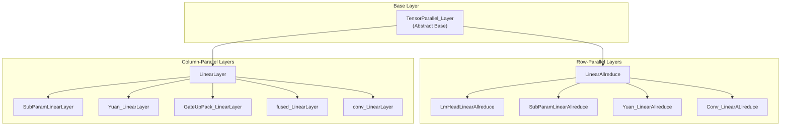
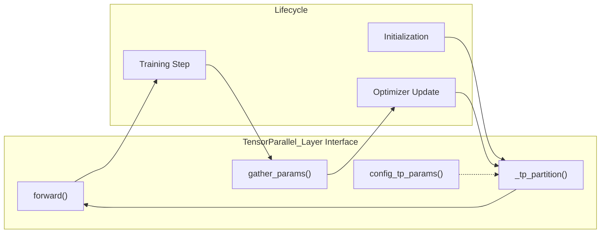
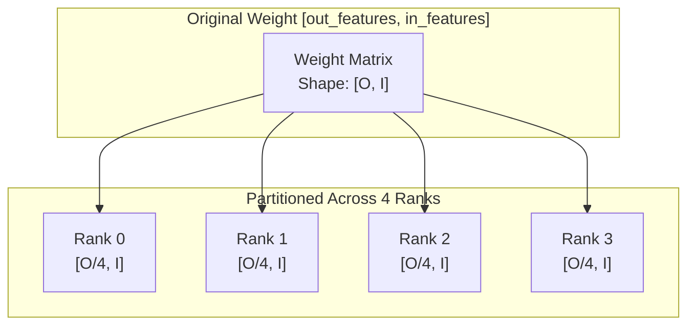
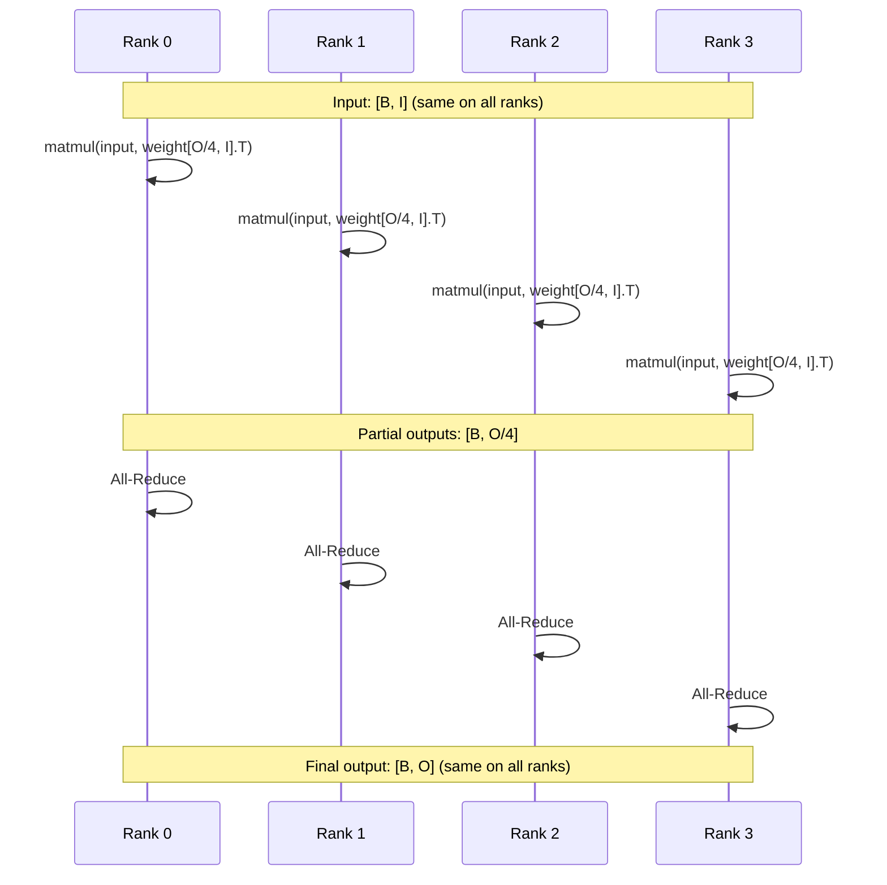
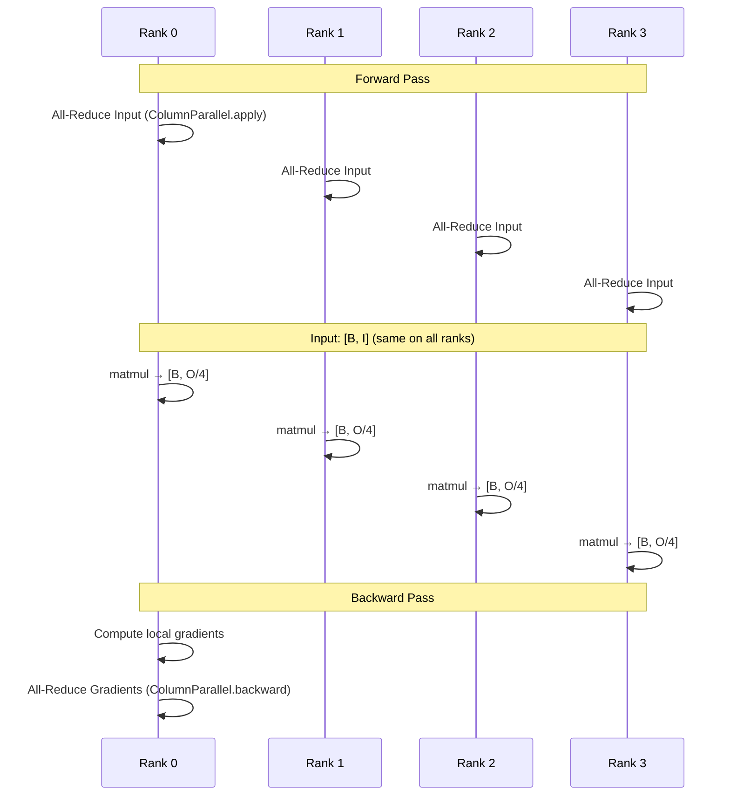
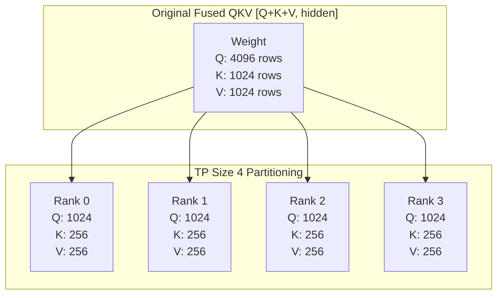

<!-- source: DeepWiki mcp.deepwiki.com · repo deepspeedai/DeepSpeed · page 6.2 TensorParallel Layer Types · fetched 2026-10-21 -->

# TensorParallel Layer Types

<details>
<summary>Relevant source files</summary>

The following files were used as context for generating this wiki page:

- [deepspeed/__init__.py](deepspeed/__init__.py)
- [deepspeed/inference/engine.py](deepspeed/inference/engine.py)
- [deepspeed/module_inject/__init__.py](deepspeed/module_inject/__init__.py)
- [deepspeed/module_inject/auto_tp.py](deepspeed/module_inject/auto_tp.py)
- [deepspeed/module_inject/auto_tp_model_utils.py](deepspeed/module_inject/auto_tp_model_utils.py)
- [deepspeed/module_inject/autotp_config.py](deepspeed/module_inject/autotp_config.py)
- [deepspeed/module_inject/fusedqkv_utils.py](deepspeed/module_inject/fusedqkv_utils.py)
- [deepspeed/module_inject/layers.py](deepspeed/module_inject/layers.py)
- [deepspeed/module_inject/replace_module.py](deepspeed/module_inject/replace_module.py)
- [deepspeed/module_inject/replace_policy.py](deepspeed/module_inject/replace_policy.py)
- [deepspeed/module_inject/tp_shard.py](deepspeed/module_inject/tp_shard.py)
- [deepspeed/runtime/state_dict_factory.py](deepspeed/runtime/state_dict_factory.py)
- [tests/unit/inference/test_inference.py](tests/unit/inference/test_inference.py)
- [tests/unit/model_parallelism/test_autotp_training.py](tests/unit/model_parallelism/test_autotp_training.py)

</details>


## Purpose and Scope

This document describes the tensor-parallel layer implementations used in DeepSpeed's Automatic Tensor Parallelism (AutoTP) system. These layers replace standard PyTorch layers (e.g., `nn.Linear`) to distribute computation across multiple GPUs using model parallelism. The layers handle weight partitioning, distributed computation, and communication operations transparently.

**Scope**: This page covers the layer type implementations in `deepspeed/module_inject/layers.py`, including their communication patterns, parameter partitioning strategies, and forward/backward pass implementations.

Sources: [deepspeed/module_inject/layers.py:1-27](), [deepspeed/module_inject/auto_tp.py:1-21]()

## Layer Type Overview

DeepSpeed AutoTP provides two primary parallelization strategies implemented through layer types:

| Layer Type | Parallelism Strategy | Weight Sharding | Communication Point | Use Case |
|------------|---------------------|-----------------|---------------------|----------|
| `LinearAllreduce` | Row-parallel | Output dimension | After forward (all-reduce) | Attention output, MLP output |
| `LinearLayer` | Column-parallel | Input dimension | In backward (all-reduce gradients) | Attention QKV, MLP input |
| `SubParamLinearAllreduce` | Row-parallel with sub-params | Output dimension with reshape | After forward (all-reduce) | Fused weights (e.g., gate_up_proj) |
| `SubParamLinearLayer` | Column-parallel with sub-params | Input dimension with reshape | In backward | Fused QKV (GQA), gate_up_proj |
| `fused_LinearLayer` | Column-parallel with fusion | Fused QKV weights | In backward | Legacy fused QKV projections |
| `LmHeadLinearAllreduce` | Row-parallel with sharded input | Output dimension | After forward | Language model head |

**Layer Type Hierarchy**



Sources: [deepspeed/module_inject/layers.py:23-27](), [deepspeed/module_inject/layers.py:155-1205]()

## Base Class: TensorParallel_Layer

The `TensorParallel_Layer` class [deepspeed/module_inject/layers.py:155-317]() provides the foundation for all tensor-parallel layers. It defines the interface for parameter partitioning, gathering, and training/inference mode handling.

### Key Attributes

```python
class TensorParallel_Layer(nn.Module, ABC):
    mp_group: Optional[dist.ProcessGroup]  # Model parallel process group
    tp_world_size: int                      # Number of tensor parallel ranks
    tp_index: int                           # Current rank in TP group
    support_training: bool                  # Whether layer supports training mode
    keep_module_on_host: bool              # Whether to keep weights on host
    tp_overlap_comm: bool                  # Whether to overlap communication
```

### Abstract Methods

All subclasses must implement:

- `forward(input)` - The forward computation
- `gather_params(params_list)` - Gather partitioned parameters across ranks
- `_tp_partition(params_list)` - Partition parameters for tensor parallelism

**Abstract Interface**



Sources: [deepspeed/module_inject/layers.py:155-292]()

## Row-Parallel Layers

Row-parallel layers shard weights along the output dimension and perform an all-reduce after the forward pass to combine partial results.

### LinearAllreduce

The `LinearAllreduce` class [deepspeed/module_inject/layers.py:388-462]() implements row-parallel linear layers where weights are partitioned along dimension 1 (output features) and results are combined via all-reduce.

**Weight Partitioning**



**Forward Pass Communication Pattern**



The `RowParallel` autograd function [deepspeed/module_inject/layers.py:140-170]() handles:
- **Forward**: All-reduce across ranks using `dist.inference_all_reduce()` or `dist.all_reduce()`.
- **Backward**: Pass gradients through unchanged (identity operation).

Sources: [deepspeed/module_inject/layers.py:388-462](), [deepspeed/module_inject/layers.py:140-170]()

### LmHeadLinearAllreduce

The `LmHeadLinearAllreduce` class [deepspeed/module_inject/layers.py:655-681]() is specialized for language model heads. It shards both weights and inputs to reduce memory usage.

The forward implementation [deepspeed/module_inject/layers.py:671-680]() slices the input:
```python
def forward(self, input):
    input_shard_size = get_shard_size(input.shape[-1], self.tp_world_size, "lm_head")
    input_shard_offset = sum(get_shard_size_list(input.shape[-1], self.tp_world_size, "lm_head")[0:self.tp_index])
    output = torch.matmul(
        input[:, :, input_shard_offset:input_shard_offset + input_shard_size],
        self.weight.transpose(-1, -2)
    )
    dist.inference_all_reduce(output, group=self.mp_group)
    # ... add bias
```

Sources: [deepspeed/module_inject/layers.py:655-681](), [deepspeed/module_inject/tp_shard.py:47-67]()

## Column-Parallel Layers

Column-parallel layers shard weights along the input dimension and perform an all-reduce in the backward pass to combine gradients.

### LinearLayer

The `LinearLayer` class [deepspeed/module_inject/layers.py:465-548]() implements column-parallel linear layers. Inputs are all-reduced before computation, and each rank computes a different portion of outputs.

**Forward and Backward Communication**



The `ColumnParallel` autograd function [deepspeed/module_inject/layers.py:201-228]() handles gradient all-reduction.

Sources: [deepspeed/module_inject/layers.py:465-548](), [deepspeed/module_inject/layers.py:201-228]()

### fused_LinearLayer

The `fused_LinearLayer` class [deepspeed/module_inject/layers.py:559-578]() handles fused QKV projections where Q, K, V weights are concatenated. It uses specialized partitioning logic from `prepare_tp_fused_qkvw()` [deepspeed/module_inject/fusedqkv_utils.py:29-155]() to correctly split the fused weight tensor based on the model type (e.g., Bloom, GLM, Phi3).

Sources: [deepspeed/module_inject/layers.py:559-578](), [deepspeed/module_inject/fusedqkv_utils.py:29-155]()

### Sub-Parameter Partitioned Layers

The `SubParamLinearLayer` and `SubParamLinearAllreduce` classes [deepspeed/module_inject/layers.py:1010-1205]() handle layers with fused parameters that have logical sub-structure (e.g., GQA with different Q/K/V sizes).

**Sub-Parameter Partitioning for GQA**



Sources: [deepspeed/module_inject/layers.py:1010-1205]()

## Communication Optimization: Overlap

When `tp_overlap_comm=True`, the `AsyncColumnParallel` function [deepspeed/module_inject/layers.py:172-199]() overlaps gradient all-reduce with weight gradient computation in the backward pass.

```python
@staticmethod
def backward(ctx: Any, grad_output: torch.Tensor):
    input, weight = ctx.saved_tensors
    grad_input = grad_output.matmul(weight)
    # Start async all-reduce
    handle = dist.all_reduce(grad_input.contiguous(), group=ctx.group, async_op=True)
    # Compute local weight gradients while communication happens
    grad_weight = grad_output.view(-1, grad_output.shape[-1]).t().matmul(input.view(-1, input.shape[-1]))
    handle.wait()
    return None, grad_input, grad_weight, grad_bias
```

Sources: [deepspeed/module_inject/layers.py:172-199]()

## Parameter Lifecycle

### Gathering for Optimizer Updates

During training, parameters must be gathered before optimizer updates. The `gather_params()` method [deepspeed/module_inject/layers.py:410-425]() uses `dist.all_gather_into_tensor()`. The `GatherReplacedLayerParams` context manager [deepspeed/module_inject/layers.py:326-386]() manages this lifecycle.

Sources: [deepspeed/module_inject/layers.py:326-386](), [deepspeed/module_inject/layers.py:410-425]()

### Mode Detection and Bias Handling

The layer behavior differs between training and inference modes [deepspeed/module_inject/layers.py:107-126](). The `add_bias()` function [deepspeed/module_inject/layers.py:128-137]() handles mode-specific behavior:

```python
def add_bias(input, bias):
    if bias is None:
        return input
    if is_autotp_training_mode():
        # Training mode - avoid inplace to ensure correct autograd
        input = input + bias
    else:
        input += bias  # Inference mode - in-place for efficiency
    return input
```

Sources: [deepspeed/module_inject/layers.py:107-137]()

---

