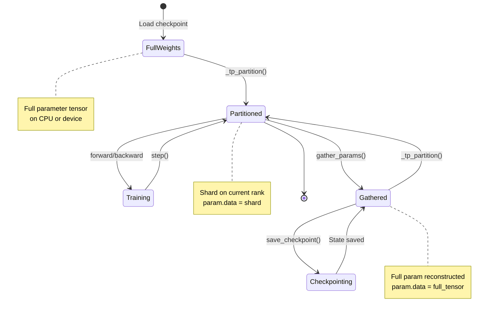
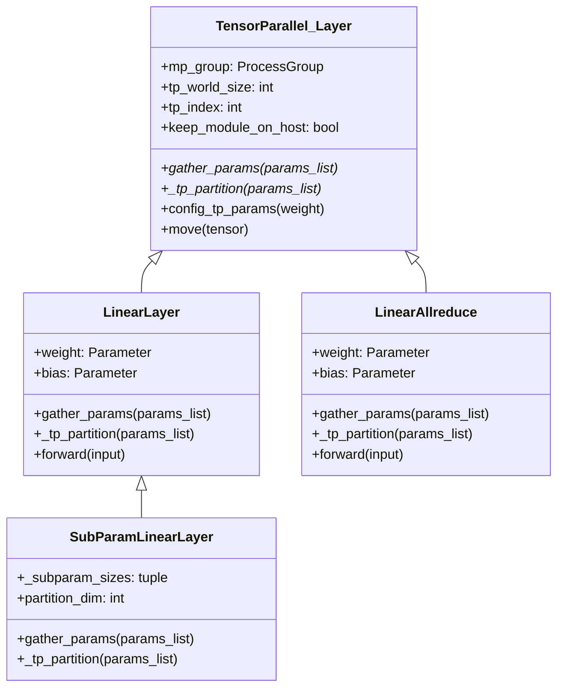
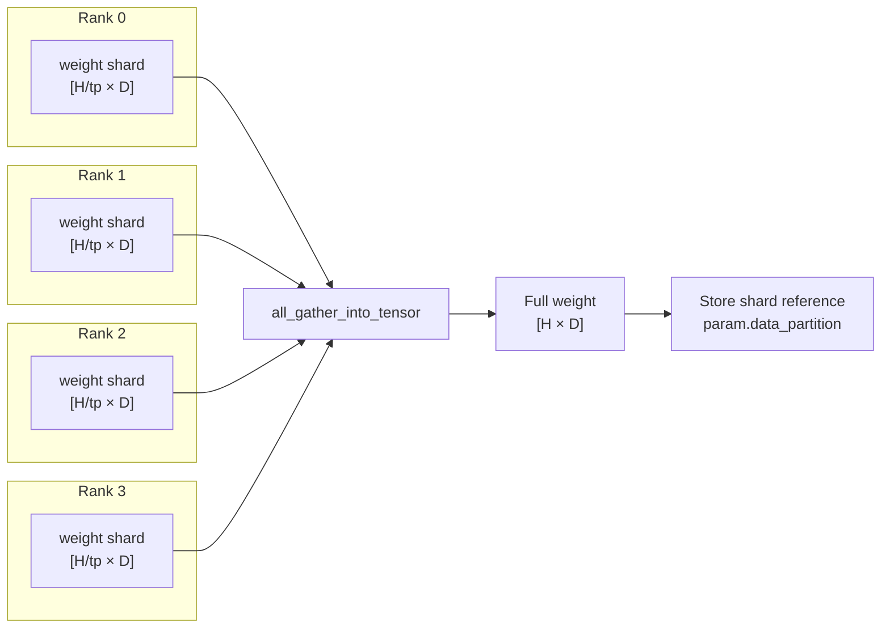
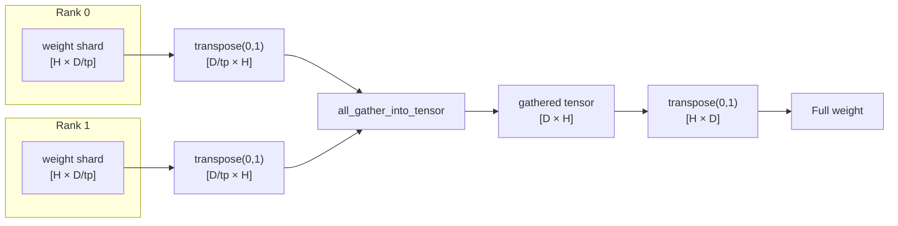
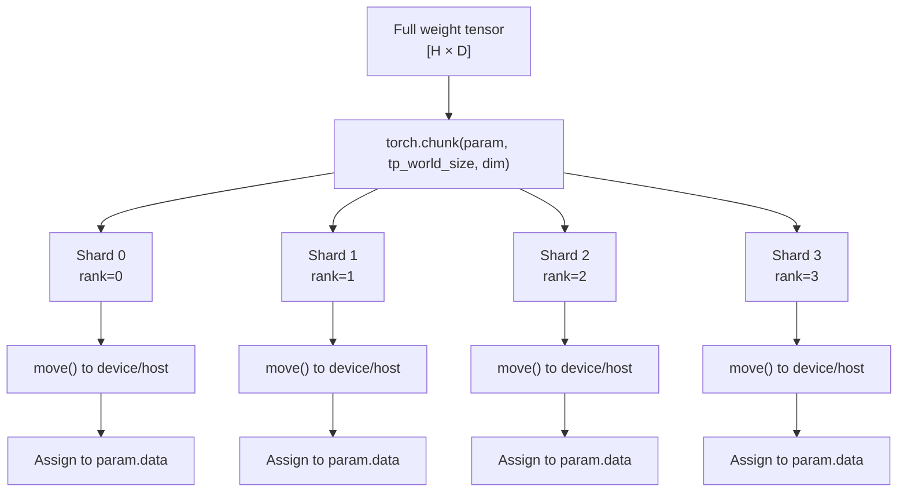
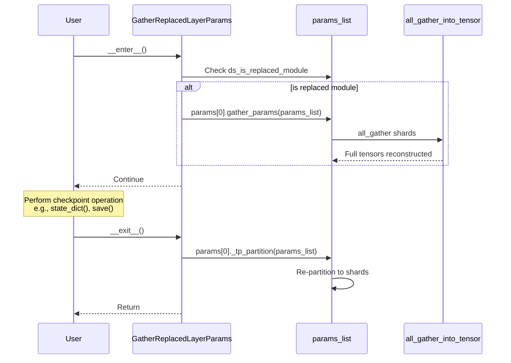
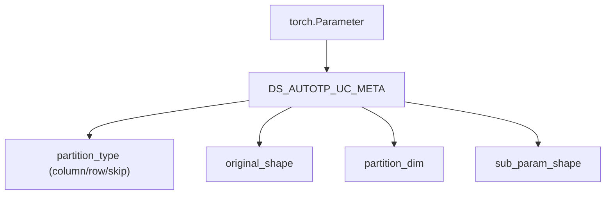
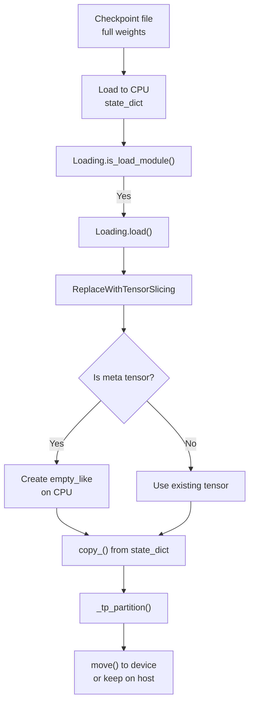

<!-- source: DeepWiki mcp.deepwiki.com · repo deepspeedai/DeepSpeed · page 6.3 Parameter Management and Checkpointing · fetched 2026-10-21 -->

# Parameter Management and Checkpointing

Relevant source files

The following files were used as context for generating this wiki page:

- [deepspeed/__init__.py](deepspeed/__init__.py)
- [deepspeed/checkpoint/__init__.py](deepspeed/checkpoint/__init__.py)
- [deepspeed/checkpoint/constants.py](deepspeed/checkpoint/constants.py)
- [deepspeed/checkpoint/deepspeed_checkpoint.py](deepspeed/checkpoint/deepspeed_checkpoint.py)
- [deepspeed/checkpoint/ds_to_universal.py](deepspeed/checkpoint/ds_to_universal.py)
- [deepspeed/checkpoint/reshape_3d_utils.py](deepspeed/checkpoint/reshape_3d_utils.py)
- [deepspeed/checkpoint/reshape_utils.py](deepspeed/checkpoint/reshape_utils.py)
- [deepspeed/checkpoint/universal_checkpoint.py](deepspeed/checkpoint/universal_checkpoint.py)
- [deepspeed/checkpoint/zero_checkpoint.py](deepspeed/checkpoint/zero_checkpoint.py)
- [deepspeed/inference/engine.py](deepspeed/inference/engine.py)
- [deepspeed/module_inject/__init__.py](deepspeed/module_inject/__init__.py)
- [deepspeed/module_inject/auto_tp.py](deepspeed/module_inject/auto_tp.py)
- [deepspeed/module_inject/auto_tp_model_utils.py](deepspeed/module_inject/auto_tp_model_utils.py)
- [deepspeed/module_inject/autotp_config.py](deepspeed/module_inject/autotp_config.py)
- [deepspeed/module_inject/fusedqkv_utils.py](deepspeed/module_inject/fusedqkv_utils.py)
- [deepspeed/module_inject/layers.py](deepspeed/module_inject/layers.py)
- [deepspeed/module_inject/replace_module.py](deepspeed/module_inject/replace_module.py)
- [deepspeed/module_inject/replace_policy.py](deepspeed/module_inject/replace_policy.py)
- [deepspeed/module_inject/tp_shard.py](deepspeed/module_inject/tp_shard.py)
- [deepspeed/runtime/state_dict_factory.py](deepspeed/runtime/state_dict_factory.py)
- [docs/_tutorials/universal-checkpointing.md](docs/_tutorials/universal-checkpointing.md)
- [tests/unit/checkpoint/test_autotp_uc_checkpoint.py](tests/unit/checkpoint/test_autotp_uc_checkpoint.py)
- [tests/unit/checkpoint/test_universal_checkpoint.py](tests/unit/checkpoint/test_universal_checkpoint.py)
- [tests/unit/inference/test_inference.py](tests/unit/inference/test_inference.py)
- [tests/unit/model_parallelism/test_autotp_training.py](tests/unit/model_parallelism/test_autotp_training.py)
- [tests/unit/runtime/tensor_parallel/test_autotp_universal_checkpoint.py](tests/unit/runtime/tensor_parallel/test_autotp_universal_checkpoint.py)

This page describes how AutoTP manages parameter lifecycle during tensor parallel training and inference, including gathering, partitioning, and checkpoint operations. For an overview of AutoTP architecture and layer types, see [AutoTP Architecture and Configuration](#6.1) and [TensorParallel Layer Types](#6.2). For handling fused QKV weights, see [Fused QKV and Model-Specific Handling](#6.4).

## Overview

In tensor parallel execution, model parameters exist in two states:

1. **Partitioned State**: Each rank holds only a shard of the full parameter (used during forward/backward).
2. **Gathered State**: The full parameter is reconstructed across all TP ranks (needed for checkpointing).

AutoTP provides mechanisms to transition between these states and manage checkpoint I/O while maintaining compatibility with standard PyTorch model saving/loading.

---

## Parameter Lifecycle States

The following diagram illustrates the transitions between parameter states during the training and checkpointing lifecycle.

Title: AutoTP Parameter Lifecycle

**Sources:** [deepspeed/module_inject/layers.py:207-318](), [deepspeed/module_inject/layers.py:404-433](), [deepspeed/module_inject/layers.py:491-517]()

During initialization, full weights are loaded and immediately partitioned [deepspeed/module_inject/replace_module.py:535-540](). During training, parameters remain in partitioned state. For checkpointing, parameters are temporarily gathered, saved, then re-partitioned [deepspeed/module_inject/layers.py:327-387]().

---

## TensorParallel_Layer Base Class

All tensor parallel layers inherit from `TensorParallel_Layer`, which defines the interface for parameter management.

Title: AutoTP Layer Hierarchy and Parameter Interface

**Sources:** [deepspeed/module_inject/layers.py:156-318](), [deepspeed/module_inject/layers.py:848-855]()

### Key Attributes and Methods

| Method/Attribute | Purpose |
|-----------------|---------|
| `gather_params(params_list)` | Reconstruct full parameter from shards using `all_gather_into_tensor` [deepspeed/module_inject/layers.py:491-501](). |
| `_tp_partition(params_list)` | Partition full parameter into shards, assign to current rank [deepspeed/module_inject/layers.py:503-517](). |
| `config_tp_params(weight)` | Attach gather/partition methods to parameter for checkpointing [deepspeed/module_inject/layers.py:247-264](). |
| `keep_module_on_host` | Keep parameters on CPU to avoid device OOM during loading [deepspeed/module_inject/layers.py:166-170](). |
| `move(tensor)` | Move tensor to device or keep on host based on configuration [deepspeed/module_inject/layers.py:236-245](). |

---

## Gather Operation

The `gather_params()` method reconstructs the full parameter from distributed shards.

### LinearLayer Gather (Column-Parallel)

For column-parallel layers, shards are concatenated along the output dimension (dim 0).

Title: Column-Parallel Parameter Gathering

**Sources:** [deepspeed/module_inject/layers.py:491-501]()

### LinearAllreduce Gather (Row-Parallel)

For row-parallel layers, weights are partitioned along the input dimension (dim 1 for 2D weights). The implementation transposes the weights before and after gathering to leverage `all_gather_into_tensor` on the contiguous dimension [deepspeed/module_inject/layers.py:410-426]().

Title: Row-Parallel Parameter Gathering

**Sources:** [deepspeed/module_inject/layers.py:410-426]()

---

## Partition Operation

The `_tp_partition()` method splits the full parameter into shards for each rank.

### Training Mode Partitioning

In training mode, even partitioning is performed using `torch.chunk` [deepspeed/module_inject/layers.py:503-517]().

Title: Training Mode Parameter Partitioning

**Sources:** [deepspeed/module_inject/layers.py:503-517]()

### Inference Mode Partitioning (Uneven)

In inference mode, uneven partitioning is supported for models with non-divisible dimensions, such as those with a specific number of KV heads [deepspeed/module_inject/tp_shard.py:47-68]().

**Sources:** [deepspeed/module_inject/layers.py:519-532](), [deepspeed/module_inject/tp_shard.py:47-79]()

---

## GatherReplacedLayerParams Context Manager

The `GatherReplacedLayerParams` context manager provides automatic gather/partition cycles for checkpoint operations [deepspeed/module_inject/layers.py:327-387]().

Title: Checkpoint Context Management

**Sources:** [deepspeed/module_inject/layers.py:327-387]()

### Identifying Replaced Modules

Parameters from replaced layers are tagged with `DS_IS_REPLACED_MODULE` and `DS_TENSOR_MODEL_PARALLEL` attributes [deepspeed/module_inject/layers.py:247-264]().

---

## Checkpoint Saving and Universal Checkpointing

During checkpoint saving, AutoTP gathers full parameters to reconstruct the model state. DeepSpeed also supports **Universal Checkpointing**, which allows saving and loading checkpoints across different parallel configurations (TP/PP/DP degrees) [deepspeed/checkpoint/ds_to_universal.py:1-47]().

Universal checkpoints store metadata on `torch.Parameter` objects to describe how they were partitioned [deepspeed/module_inject/layers.py:38-104]().

Title: Universal Checkpoint Metadata Construction

**Sources:** [deepspeed/module_inject/layers.py:38-104](), [deepspeed/checkpoint/constants.py:53-60]()

---

## Checkpoint Loading

During checkpoint loading, weights are loaded on the host, then partitioned and moved to the appropriate device.

Title: AutoTP Checkpoint Loading Flow

**Sources:** [deepspeed/module_inject/auto_tp.py:133-192](), [deepspeed/module_inject/auto_tp.py:33-130]()

---

## ReplaceWithTensorSlicing

The `ReplaceWithTensorSlicing` class performs weight slicing during checkpoint loading and initialization [deepspeed/module_inject/auto_tp.py:33-131]().

### Copy Method (Simple Slicing)

For standard linear layers, `copy()` slices along the dimension specified by `out_dim` or `in_dim` based on the rank [deepspeed/module_inject/auto_tp.py:99-130]().

### Strided Copy (Fused QKV)

For fused QKV weights, `strided_copy()` handles slicing where Q, K, and V components are interleaved or concatenated in specific patterns (e.g., `bloomtype`, `glmtype`) [deepspeed/module_inject/auto_tp.py:50-97]().

**Sources:** [deepspeed/module_inject/auto_tp.py:33-131](), [deepspeed/module_inject/fusedqkv_utils.py:18-46]()

---

## Summary Table

| Operation | Method | Purpose | Communication |
|-----------|--------|---------|---------------|
| **Partition** | `_tp_partition()` | Split full weight to shard [deepspeed/module_inject/layers.py:503-517](). | None |
| **Gather** | `gather_params()` | Reconstruct full weight [deepspeed/module_inject/layers.py:491-501](). | `all_gather_into_tensor` |
| **Save Checkpoint** | `GatherReplacedLayerParams` | Context for gathering before save [deepspeed/module_inject/layers.py:327-387](). | `all_gather_into_tensor` |
| **Load Checkpoint** | `Loading.load()` | Load full weight and slice [deepspeed/module_inject/auto_tp.py:146-192](). | None |
| **Weight Slicing** | `ReplaceWithTensorSlicing.copy()` | Perform the actual slicing of tensors [deepspeed/module_inject/auto_tp.py:99-130](). | None |

**Sources:** [deepspeed/module_inject/layers.py:156-682](), [deepspeed/module_inject/auto_tp.py:33-192]()

---

