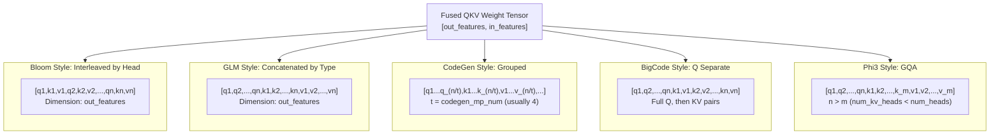
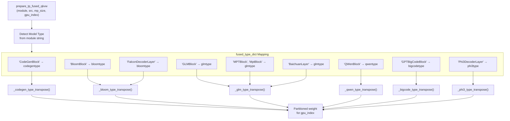
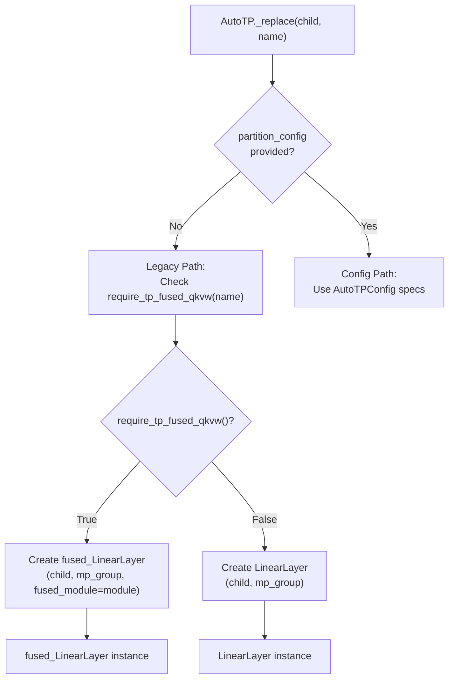

<!-- source: DeepWiki mcp.deepwiki.com · repo deepspeedai/DeepSpeed · page 6.4 Fused QKV and Model-Specific Handling · fetched 2026-10-21 -->

# Fused QKV and Model-Specific Handling

<details>
<summary>Relevant source files</summary>

The following files were used as context for generating this wiki page:

- [deepspeed/__init__.py](deepspeed/__init__.py)
- [deepspeed/inference/engine.py](deepspeed/inference/engine.py)
- [deepspeed/module_inject/__init__.py](deepspeed/module_inject/__init__.py)
- [deepspeed/module_inject/auto_tp.py](deepspeed/module_inject/auto_tp.py)
- [deepspeed/module_inject/auto_tp_model_utils.py](deepspeed/module_inject/auto_tp_model_utils.py)
- [deepspeed/module_inject/autotp_config.py](deepspeed/module_inject/autotp_config.py)
- [deepspeed/module_inject/fusedqkv_utils.py](deepspeed/module_inject/fusedqkv_utils.py)
- [deepspeed/module_inject/layers.py](deepspeed/module_inject/layers.py)
- [deepspeed/module_inject/replace_module.py](deepspeed/module_inject/replace_module.py)
- [deepspeed/module_inject/replace_policy.py](deepspeed/module_inject/replace_policy.py)
- [deepspeed/module_inject/tp_shard.py](deepspeed/module_inject/tp_shard.py)
- [deepspeed/runtime/state_dict_factory.py](deepspeed/runtime/state_dict_factory.py)
- [tests/unit/inference/test_inference.py](tests/unit/inference/test_inference.py)
- [tests/unit/model_parallelism/test_autotp_training.py](tests/unit/model_parallelism/test_autotp_training.py)

</details>


## Purpose and Scope

This page covers how DeepSpeed's Automatic Tensor Parallelism (AutoTP) system handles **fused QKV (Query-Key-Value) weights** and other model-specific weight fusion patterns. Many transformer architectures combine multiple linear projection weights into a single fused parameter for efficiency. AutoTP must correctly partition these fused weights across tensor parallel ranks while respecting the logical structure of the underlying sub-parameters.

**Related Pages:**
- For general AutoTP architecture and configuration: see [AutoTP Architecture and Configuration](6.1)
- For general tensor parallel layer types: see [TensorParallel Layer Types](6.2)
- For the new configurable partitioning API: see [Parameter Management and Checkpointing](6.3)

**Scope:**
- Legacy heuristic-based detection of fused weights by layer name.
- Model-specific fusion patterns (Bloom, GLM, CodeGen, Qwen, BigCode, Phi3, Yuan).
- Partitioning logic for different fusion styles in `fusedqkv_utils.py`.
- Integration with `fused_LinearLayer` wrapper in `layers.py`.
- How the `AutoTPConfig` API provides explicit control over fused weights via `shape` specs.

## Background: Why Fused QKV Matters for Tensor Parallelism

### Weight Fusion for Efficiency

Many transformer implementations **fuse** separate Query, Key, and Value projection weights into a single linear layer. For example, instead of three separate `Linear(hidden, hidden)` layers, they use one `Linear(hidden, 3*hidden)` layer. This provides several benefits:

1. **Reduced kernel launches**: Single matrix multiplication instead of three.
2. **Better memory locality**: Contiguous weight tensor.
3. **Framework optimizations**: Easier to apply fusion optimizations.

### Challenge for Tensor Parallelism

When partitioning fused weights across tensor parallel ranks, AutoTP must:
1. **Recognize** which layers contain fused weights (not just from shape, but from logical structure).
2. **Understand** the fusion pattern (how Q/K/V are arranged in the tensor).
3. **Partition** sub-parameters correctly so each rank gets consistent slices of Q, K, and V.
4. **Reconstruct** the correct layout when gathering parameters for checkpointing.

Different model architectures use different fusion patterns, requiring model-specific handling.

**Sources:** [deepspeed/module_inject/fusedqkv_utils.py:1-232](), [deepspeed/module_inject/layers.py:17-21]()

## Fused QKV Detection

### Name-Based Heuristic

The legacy AutoTP system uses a **name-based heuristic** to detect fused QKV layers. The function `require_tp_fused_qkvw()` checks if a layer name contains specific patterns:

| Pattern | Example | Models |
|---------|---------|--------|
| `qkv_proj` | `self_attn.qkv_proj` | Phi3, Qwen (some variants) |
| `query_key_value` | `self_attention.query_key_value` | Bloom, ChatGLM |
| `attn.Wqkv` | `attn.Wqkv` | MPT |
| `self_attn.W_pack` | `self_attn.W_pack` | Baichuan |
| `c_attn` | `transformer.h.0.attn.c_attn` | GPT-2, CodeGen |

**Detection Logic:**

The logic is defined in `fusedqkv_utils.py` [deepspeed/module_inject/fusedqkv_utils.py:18-26]():

```python
def require_tp_fused_qkvw(name, mp_size):
    fused_qkvw_name_list = ['qkv_proj', 'query_key_value', 'attn.Wqkv', 'self_attn.W_pack', 'c_attn']

    if mp_size == 1:
        return False
    for fused_name in fused_qkvw_name_list:
        if fused_name in name:
            return True
    return False
```

**When Detection Triggers:**
- Called during layer replacement in `AutoTP._replace` [deepspeed/module_inject/auto_tp.py:462-465]().
- Only when `partition_config is None` (legacy path).
- Causes replacement with `fused_LinearLayer` instead of standard `LinearLayer`.

**Sources:** [deepspeed/module_inject/fusedqkv_utils.py:18-26](), [deepspeed/module_inject/auto_tp.py:462-465]()

## Fusion Patterns Across Architectures

### Overview of Fusion Styles

Different transformer architectures organize fused QKV weights in distinct patterns. The key differences include concatenation dimensions and interleaving strategies.



**Pattern Comparison Table:**

| Model Family | Pattern Type | Q:K:V Ratio | Split Dimension | Notes |
|-------------|-------------|-------------|-----------------|-------|
| **Bloom** | Interleaved | 1:1:1 | dim 0 | `[q₁,k₁,v₁,q₂,k₂,v₂,...]` |
| **GLM/ChatGLM** | Concatenated | 1:1:1 or 1:0.25:0.25 | dim 0 | `[Q,K,V]` blocks; ChatGLM2 has special KV handling |
| **MPT/Baichuan** | Concatenated | 1:1:1 | dim 0 | Same as GLM |
| **CodeGen** | Grouped | 1:1:1 | dim 0 | Groups of `codegen_mp_num=4` |
| **Qwen** | Concatenated | 1:1:1 | dim 0 | Like GLM, requires `split_size` adjustment |
| **BigCode** | Q-separate | 1:1:1 | dim 0 | Full Q, then interleaved KV |
| **Phi3** | Concatenated | varies (GQA) | dim 0 | Unequal Q/K/V sizes for GQA |

**Sources:** [deepspeed/module_inject/fusedqkv_utils.py:34-155](), [deepspeed/module_inject/tp_shard.py:47-67]()

## Partition Logic

### Main Dispatcher: `prepare_tp_fused_qkvw`

The function `prepare_tp_fused_qkvw()` [deepspeed/module_inject/fusedqkv_utils.py:29-155]() serves as the central dispatcher that:
1. Detects the model architecture from the module string.
2. Selects the appropriate fusion pattern handler.
3. Returns the partitioned weight for the current GPU rank.



**Type Detection Logic:**

The module type is detected by matching the module's string representation against known patterns. The longest match is taken to handle overlapping names (e.g., `FalconDecoderLayer` vs `DecoderLayer`) [deepspeed/module_inject/fusedqkv_utils.py:146-152]().

**Sources:** [deepspeed/module_inject/fusedqkv_utils.py:29-155](), [deepspeed/module_inject/fusedqkv_utils.py:146-152]()

## Model-Specific Handlers

### Bloom Type: Interleaved Pattern

**Pattern:** `[q₁,k₁,v₁,q₂,k₂,v₂,...,qₙ,kₙ,vₙ]`
**Partitioning:** Splits along dimension 0 using `get_shard_size_list`.

```python
def _bloom_type_transpose(input, mp_size):
    shape = input.shape
    split_fusedqkv = input.split(get_shard_size_list(shape[0], mp_size), dim=0)
    return split_fusedqkv[gpu_index]
```
**Sources:** [deepspeed/module_inject/fusedqkv_utils.py:89-93]()

### GLM Type: Concatenated Pattern

**Pattern:** `[q₁,q₂,...,qₙ,k₁,k₂,...,kₙ,v₁,v₂,...,vₙ]`
**Partitioning:** Split each Q/K/V block separately, then concatenate via `split_by_qkvlist_and_refuse` [deepspeed/module_inject/fusedqkv_utils.py:10-15]().

**Special Case - ChatGLM2/3 with 2 KV heads:**
When `num_kv_heads == 2`, the layout is `[Q, K, V]` with different sizes [deepspeed/module_inject/fusedqkv_utils.py:71-81]():
```python
if get_num_kv_heads() == 2:
    hidden_dim = get_n_embd()
    kv_dim = (shape[0] - hidden_dim) // get_num_kv_heads()
    # ... split q, k, v separately ...
    return torch.cat((q_split[gpu_index], k_split[gpu_index], v_split[gpu_index]), dim=0)
```
**Sources:** [deepspeed/module_inject/fusedqkv_utils.py:10-15](), [deepspeed/module_inject/fusedqkv_utils.py:67-87]()

### CodeGen Type: Grouped with `codegen_mp_num`

**Pattern:** Organized in `codegen_mp_num` (typically 4) groups.
**Partitioning:** Reshapes to expose the groups, splits Q/K/V within each block, and recombines [deepspeed/module_inject/fusedqkv_utils.py:48-65]().

**Sources:** [deepspeed/module_inject/fusedqkv_utils.py:48-65]()

### BigCode Type: Full Q, then KV

**Pattern:** `[q₁,q₂,...,qₙ,k₁,v₁,k₂,v₂,...,kₙ,vₙ]`
**Partitioning:** Partition Q portion; keep entire KV portion on each rank (Multi-Query Attention) [deepspeed/module_inject/fusedqkv_utils.py:102-108]().

**Sources:** [deepspeed/module_inject/fusedqkv_utils.py:102-108]()

### Phi3 Type: GQA with Unequal Sizes

**Pattern:** `[q₁,...,qₙ,k₁,...,kₘ,v₁,...,vₘ]` where `n > m`.
**Partitioning:** Calculates boundaries based on `num_kv_heads` and `num_attention_heads`, then partitions each region [deepspeed/module_inject/fusedqkv_utils.py:110-122]().

**Sources:** [deepspeed/module_inject/fusedqkv_utils.py:110-122](), [deepspeed/module_inject/tp_shard.py:15-22]()

### Special Case: Yuan Model (Shared QK)

The Yuan model uses a unique architecture where Q and K heads are shared in a specific pattern. The handler `shard_value_with_share_qk()` [deepspeed/module_inject/fusedqkv_utils.py:158-211]() handles the complex remapping.

**Sources:** [deepspeed/module_inject/fusedqkv_utils.py:158-211](), [deepspeed/module_inject/layers.py:24-27]()

## Integration with AutoTP

### The `fused_LinearLayer` Wrapper

When AutoTP detects a fused QKV layer via the name heuristic, it wraps it with `fused_LinearLayer` instead of standard `LinearLayer` [deepspeed/module_inject/auto_tp.py:462-465]().



**`fused_LinearLayer` Implementation:**

This class overrides `_tp_partition` to use the model-specific dispatcher [deepspeed/module_inject/layers.py:560-578]():

```python
class fused_LinearLayer(LinearLayer):
    def _tp_partition(self, params_list):
        for idx, param in enumerate(params_list):
            # Use model-specific fused QKV handler
            _partition = prepare_tp_fused_qkvw(
                self.fused_module.module, 
                param, 
                self.tp_world_size, 
                self.tp_index
            )
            params_list[idx].data = _partition
```

**Sources:** [deepspeed/module_inject/auto_tp.py:462-465](), [deepspeed/module_inject/layers.py:560-578]()

### `SubParamLinearLayer` for Shape-Based Partitioning

The new `AutoTPConfig` API allows users to explicitly specify fused weight structures using the `shape` parameter in `TPLayerSpec`. This triggers the creation of a `SubParamLinearLayer` [deepspeed/module_inject/layers.py:820-976]().

**Example Config Spec:**
```python
TPLayerSpec(
    patterns=[".*\\.qkv_proj\\.weight$"],
    partition_type=PartitionType.COLUMN,
    shape=[(4096, 1024, 1024), -1], # GQA: Q, K, V sizes
    partition_dim=0
)
```

**Sources:** [deepspeed/module_inject/autotp_config.py:52-95](), [deepspeed/module_inject/layers.py:820-976]()

## Summary

**Fused QKV handling in AutoTP involves:**

1. **Detection**: Legacy name-based heuristic (`require_tp_fused_qkvw`) or explicit `TPLayerSpec` patterns.
2. **Pattern Recognition**: Identifying fusion style (Bloom, GLM, CodeGen, Qwen, BigCode, Phi3, Yuan) from module metadata.
3. **Model-Specific Partitioning**: Applying appropriate transpose functions in `fusedqkv_utils.py` to split weights correctly.
4. **Integration**: Routing through `fused_LinearLayer` (legacy) or `SubParamLinearLayer` (configurable).

**Key Files:**
- [deepspeed/module_inject/fusedqkv_utils.py:1-232]() - Model-specific handlers.
- [deepspeed/module_inject/layers.py:560-578]() - `fused_LinearLayer` wrapper.
- [deepspeed/module_inject/layers.py:820-976]() - `SubParamLinearLayer` for explicit control.
- [deepspeed/module_inject/auto_tp.py:462-465]() - Integration and routing logic.
- [deepspeed/module_inject/tp_shard.py:1-80]() - Sharding size utilities.

---

