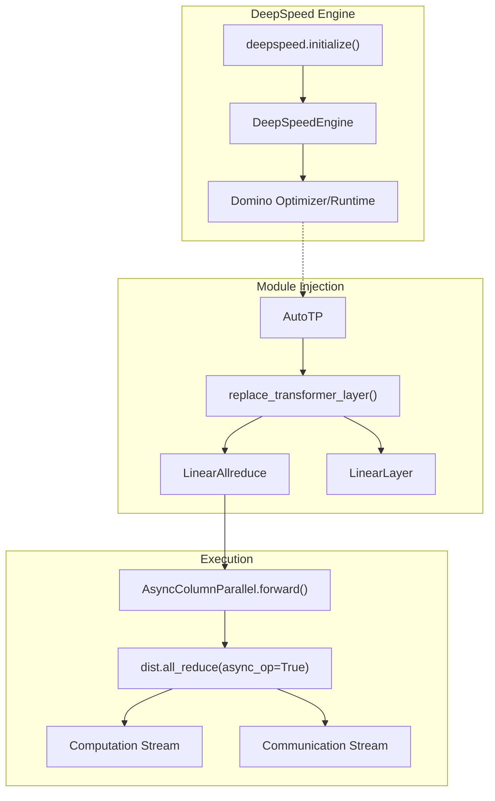
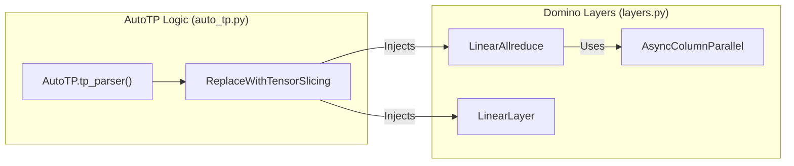

<!-- source: DeepWiki mcp.deepwiki.com · repo deepspeedai/DeepSpeed · page 6.5 Domino: Communication-Hiding Tensor Parallelism · fetched 2026-10-21 -->

# Domino: Communication-Hiding Tensor Parallelism

<details>
<summary>Relevant source files</summary>

The following files were used as context for generating this wiki page:

- [blogs/huggingface-tp/README.md](blogs/huggingface-tp/README.md)
- [deepspeed/__init__.py](deepspeed/__init__.py)
- [deepspeed/inference/engine.py](deepspeed/inference/engine.py)
- [deepspeed/module_inject/__init__.py](deepspeed/module_inject/__init__.py)
- [deepspeed/module_inject/auto_tp.py](deepspeed/module_inject/auto_tp.py)
- [deepspeed/module_inject/auto_tp_model_utils.py](deepspeed/module_inject/auto_tp_model_utils.py)
- [deepspeed/module_inject/autotp_config.py](deepspeed/module_inject/autotp_config.py)
- [deepspeed/module_inject/fusedqkv_utils.py](deepspeed/module_inject/fusedqkv_utils.py)
- [deepspeed/module_inject/layers.py](deepspeed/module_inject/layers.py)
- [deepspeed/module_inject/replace_module.py](deepspeed/module_inject/replace_module.py)
- [deepspeed/module_inject/replace_policy.py](deepspeed/module_inject/replace_policy.py)
- [deepspeed/module_inject/tp_plan_converter.py](deepspeed/module_inject/tp_plan_converter.py)
- [deepspeed/module_inject/tp_shard.py](deepspeed/module_inject/tp_shard.py)
- [deepspeed/runtime/state_dict_factory.py](deepspeed/runtime/state_dict_factory.py)
- [deepspeed/runtime/tensor_parallel/config.py](deepspeed/runtime/tensor_parallel/config.py)
- [deepspeed/runtime/tensor_parallel/init_utils.py](deepspeed/runtime/tensor_parallel/init_utils.py)
- [docs/_tutorials/automatic-tensor-parallelism.md](docs/_tutorials/automatic-tensor-parallelism.md)
- [docs/_tutorials/autotp-training.md](docs/_tutorials/autotp-training.md)
- [docs/code-docs/source/training.rst](docs/code-docs/source/training.rst)
- [tests/unit/inference/test_inference.py](tests/unit/inference/test_inference.py)
- [tests/unit/model_parallelism/test_autotp_custom_patterns.py](tests/unit/model_parallelism/test_autotp_custom_patterns.py)
- [tests/unit/model_parallelism/test_autotp_training.py](tests/unit/model_parallelism/test_autotp_training.py)
- [tests/unit/model_parallelism/test_tp_plan_e2e.py](tests/unit/model_parallelism/test_tp_plan_e2e.py)
- [tests/unit/model_parallelism/test_tp_plan_real_models.py](tests/unit/model_parallelism/test_tp_plan_real_models.py)

</details>


Domino is a high-performance tensor parallelism (TP) engine in DeepSpeed designed to minimize the performance impact of communication overhead. It achieves this by overlapping AllReduce communication with computation, a technique particularly effective for both single-node and multi-node training scenarios. Domino is integrated into the DeepSpeed runtime and works in conjunction with Automatic Tensor Parallelism (AutoTP) to provide stall-free execution for large-scale models.

## Architecture and Core Mechanism

Domino operates by transforming standard synchronous tensor parallel layers into asynchronous variants. In a typical RowParallel or ColumnParallel setup, the AllReduce operation is a blocking call that forces the GPU to wait for data from peers. Domino leverages asynchronous communication primitives to hide this latency behind subsequent layer computations.

### Data Flow and Parallelism Types

Domino supports several partitioning strategies, primarily focusing on linear layers which are the bottlenecks in Transformer architectures.

| Component | Code Entity | Description |
|-----------|-------------|-------------|
| **Column Parallel** | `ColumnParallel` | Splits weights along the output dimension. Each rank computes a partial result. |
| **Row Parallel** | `RowParallel` | Splits weights along the input dimension. Requires AllReduce to sum partial results. |
| **Async Column** | `AsyncColumnParallel` | Overlaps the gradient AllReduce in the backward pass with weight gradient computation. |
| **Sub-Parameter** | `SubParamLinearLayer` | Further partitions parameters for finer-grained parallelism and memory efficiency. |

### Component Interaction Diagram

The following diagram illustrates how the Domino runtime interacts with the DeepSpeed Engine and the communication backend.

**Domino Runtime Integration**

Sources: `deepspeed/__init__.py:80-142`(), `deepspeed/module_inject/layers.py:172-198`(), `deepspeed/module_inject/replace_module.py:20-26`()

## Implementation Details

Domino is implemented primarily through custom autograd functions and specialized layer wrappers found in the `module_inject` system.

### Asynchronous Communication Hooks

The core of Domino's communication hiding lies in `AsyncColumnParallel` and the `RowParallel` implementations. For example, in the backward pass of a column-parallel layer, the AllReduce for input gradients is launched asynchronously while the weight gradients are still being computed.

*   **Forward Pass:** Domino utilizes `dist.inference_all_reduce` for inference mode and standard `dist.all_reduce` for training [deepspeed/module_inject/layers.py:158-162]().
*   **Backward Pass:** The `AsyncColumnParallel.backward` function initiates an asynchronous AllReduce [deepspeed/module_inject/layers.py:194-194](), performs local matrix multiplication for weight gradients [deepspeed/module_inject/layers.py:195-195](), and then waits for the communication handle to complete [deepspeed/module_inject/layers.py:197-197]().

### AutoTP Integration

Domino relies on the `AutoTP` class to automatically identify and replace standard PyTorch modules with TP-aware versions.

**Code Entity Mapping: AutoTP to Domino Layers**

Sources: `deepspeed/module_inject/auto_tp.py:33-43`(), `deepspeed/module_inject/layers.py:23-27`(), `deepspeed/inference/engine.py:157-160`()

## Key Classes and Functions

### `LinearAllreduce`
A wrapper for `nn.Linear` layers that require an AllReduce after the forward pass (Row Parallelism). It ensures that partial sums from different TP ranks are aggregated correctly [deepspeed/module_inject/layers.py:24-27]().

### `AsyncColumnParallel`
A custom `torch.autograd.Function` that implements the asynchronous communication logic for Column Parallelism.
*   `forward(ctx, group, input, weight, bias)`: Computes the linear projection and saves tensors for backward [deepspeed/module_inject/layers.py:175-187]().
*   `backward(ctx, grad_output)`: The critical section where `dist.all_reduce(async_op=True)` is called to overlap communication with the `grad_weight` calculation [deepspeed/module_inject/layers.py:190-198]().

### `get_shard_size`
Calculates the appropriate dimension for slicing tensors based on the world size and specific model architecture requirements (e.g., ensuring KV heads are not split across ranks) [deepspeed/module_inject/tp_shard.py:47-67]().

## Configuration and Usage

Domino is enabled via the `tensor_parallel` section of the DeepSpeed configuration. It is often used in conjunction with `tp_model_init` to handle parameter partitioning during model initialization.

```json
{
  "tensor_parallel": {
    "tp_size": 2,
    "autotp_size": 2,
    "partition_config": "default"
  }
}
```

To initialize a model with Domino TP training support:
1.  Call `deepspeed.tp_model_init(model, tp_size=...)` [deepspeed/runtime/tensor_parallel/init_utils.py:51-52]().
2.  Pass the model to `deepspeed.initialize()` with the appropriate config [deepspeed/__init__.py:80-92]().

### Fused QKV Handling
For models like Bloom, GLM, or Phi3, Domino uses `prepare_tp_fused_qkvw` to correctly shard the concatenated Query, Key, and Value weights across TP ranks, ensuring that the internal head structure is preserved [deepspeed/module_inject/fusedqkv_utils.py:29-46]().

Sources: `deepspeed/module_inject/layers.py:1-200`(), `deepspeed/module_inject/auto_tp.py:1-130`(), `deepspeed/module_inject/tp_shard.py:47-80`(), `deepspeed/module_inject/fusedqkv_utils.py:1-155`()

---

