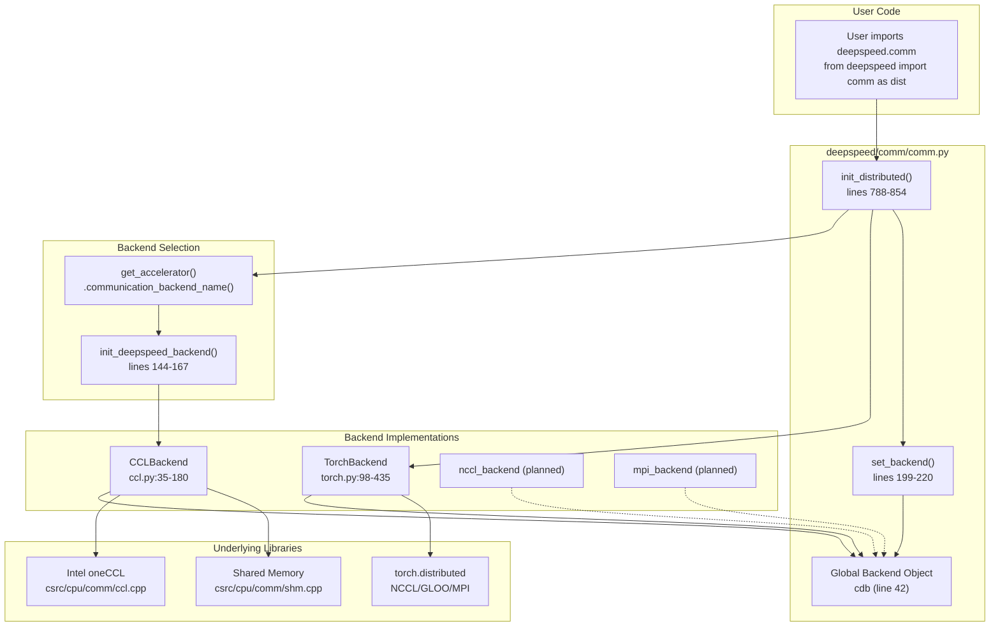
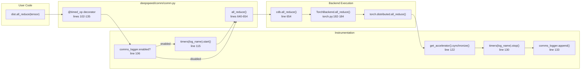
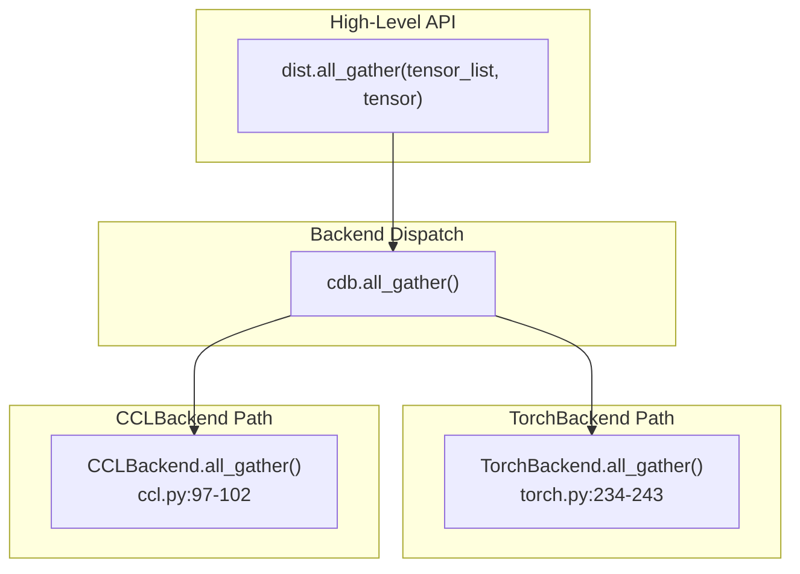

<!-- source: DeepWiki mcp.deepwiki.com · repo deepspeedai/DeepSpeed · page 7 Communication Layer · fetched 2026-10-21 -->

# Communication Layer

Relevant source files

The following files were used as context for generating this wiki page:

- [csrc/cpu/comm/arm64/shm.h](csrc/cpu/comm/arm64/shm.h)
- [csrc/cpu/comm/ccl.cpp](csrc/cpu/comm/ccl.cpp)
- [csrc/cpu/comm/riscv64/shm.h](csrc/cpu/comm/riscv64/shm.h)
- [csrc/cpu/comm/shm.cpp](csrc/cpu/comm/shm.cpp)
- [csrc/cpu/comm/shm.h](csrc/cpu/comm/shm.h)
- [csrc/cpu/comm/shm_interface.cpp](csrc/cpu/comm/shm_interface.cpp)
- [csrc/cpu/comm/x86_64/shm.h](csrc/cpu/comm/x86_64/shm.h)
- [deepspeed/comm/__init__.py](deepspeed/comm/__init__.py)
- [deepspeed/comm/ccl.py](deepspeed/comm/ccl.py)
- [deepspeed/comm/comm.py](deepspeed/comm/comm.py)
- [deepspeed/comm/torch.py](deepspeed/comm/torch.py)
- [deepspeed/comm/utils.py](deepspeed/comm/utils.py)
- [deepspeed/utils/comms_logging.py](deepspeed/utils/comms_logging.py)
- [docs/_tutorials/comms-logging.md](docs/_tutorials/comms-logging.md)
- [op_builder/cpu/__init__.py](op_builder/cpu/__init__.py)
- [op_builder/cpu/comm.py](op_builder/cpu/comm.py)
- [tests/unit/comm/test_dist.py](tests/unit/comm/test_dist.py)
- [tests/unit/ops/adam/test_adamw.py](tests/unit/ops/adam/test_adamw.py)

## Purpose and Scope

The Communication Layer provides a unified abstraction for distributed communication primitives in DeepSpeed. It wraps PyTorch's `torch.distributed` API while adding instrumentation, backend flexibility, and optimizations. This layer is used by all distributed components in DeepSpeed including ZeRO optimizer (see [ZeRO Memory Optimization](#3.2)), pipeline parallelism (see [Pipeline Parallelism](#4)), and automatic tensor parallelism (see [Automatic Tensor Parallelism](#6)).

The communication layer provides:
- **Backend abstraction**: Pluggable backends (`TorchBackend`, `CCLBackend`) with identical APIs.
- **Communication profiling**: Automatic logging of latency, bandwidth, and straggler effects.
- **Shared memory optimization**: Low-latency intra-node collectives for CPU inference.
- **API compatibility**: Drop-in replacement for `torch.distributed` with identical function signatures [deepspeed/comm/comm.py:13-22]().

This page covers the core communication infrastructure. For the distributed launcher that sets up multi-node environments, see [Distributed Training Orchestration](#8). For configuration of communication settings, see [Configuration System](#2.3).

## Architecture Overview

### Backend Abstraction and Initialization

The communication layer uses a global backend object (`cdb`) that implements all collective operations [deepspeed/comm/comm.py:42](). Backend selection occurs during initialization based on the accelerator type and available libraries.

**Architecture: Communication Backend Selection**

Sources: [deepspeed/comm/comm.py:42](), [deepspeed/comm/comm.py:144-167](), [deepspeed/comm/comm.py:199-220](), [deepspeed/comm/comm.py:788-854](), [deepspeed/comm/torch.py:98-105](), [deepspeed/comm/ccl.py:35-49]()

### API Layer with Instrumentation

All communication operations flow through a decorator-based instrumentation layer that optionally logs timing and bandwidth information via the `timed_op` decorator [deepspeed/comm/comm.py:102-135]().

**API Flow: Timed Collective Operations**

Sources: [deepspeed/comm/comm.py:102-135](), [deepspeed/comm/comm.py:640-654](), [deepspeed/comm/torch.py:182-184]()

## 7.1. Communication Backends

DeepSpeed supports multiple communication backends through a unified interface. For details, see [Communication Backends](#7.1).

### TorchBackend
`TorchBackend` is the primary backend wrapping `torch.distributed`. It manages process group initialization and provides fallbacks for various PyTorch versions [deepspeed/comm/torch.py:98-120](). It also attempts to initialize SDMA backends for AMD GPUs (mori) [deepspeed/comm/torch.py:127-139]().

### CCLBackend
`CCLBackend` provides Intel oneCCL integration for CPU-based communication [deepspeed/comm/ccl.py:35-49](). It utilizes a C++ extension to interface with `oneapi::ccl` [csrc/cpu/comm/ccl.cpp:52-84]().

## 7.2. Collective Operations

The communication layer provides wrappers for all standard collective operations (all-reduce, broadcast, all-gather, reduce-scatter) with consistent APIs. For details, see [Collective Operations](#7.2).

**Operation Routing Logic:**

Sources: [deepspeed/comm/comm.py:234-243](), [deepspeed/comm/torch.py:234-243](), [deepspeed/comm/ccl.py:97-102]()

## 7.3. Shared Memory Optimization

DeepSpeed implements low-latency intra-node communication using shared memory (SHM). This is particularly effective for CPU-based all-reduce operations during inference [csrc/cpu/comm/shm_interface.cpp:24-47](). For details, see [Shared Memory Optimization](#7.3).

**Shared Memory Architecture:**
- **Symmetric Buffers**: Used for small messages with independent reduction per rank [csrc/cpu/comm/shm.cpp:109-110]().
- **Distributed Buffers**: Used for large messages to distribute reduction work [csrc/cpu/comm/shm.cpp:111-112]().
- **SIMD Vectorization**: Reduction is optimized using AVX-512 (x86), NEON (ARM), or RVV (RISC-V) [csrc/cpu/comm/shm.cpp:154-209]().

## 7.4. Communication Logging and Profiling

The `CommsLogger` profiles communication operations, tracking latency, message sizes, and calculating algorithmic/bus bandwidth [deepspeed/utils/comms_logging.py:67-76](). For details, see [Communication Logging and Profiling](#7.4).

**Bandwidth Calculation [deepspeed/utils/comms_logging.py:34-64]():**
- **All-Reduce**: `(size * 2 / duration)`
- **All-Gather/Reduce-Scatter**: `(size * n / duration)`
- **All-to-All**: `(size / duration)`

Sources: [deepspeed/utils/comms_logging.py:34-64](), [deepspeed/utils/comms_logging.py:67-76](), [deepspeed/comm/comm.py:102-135]()

---

