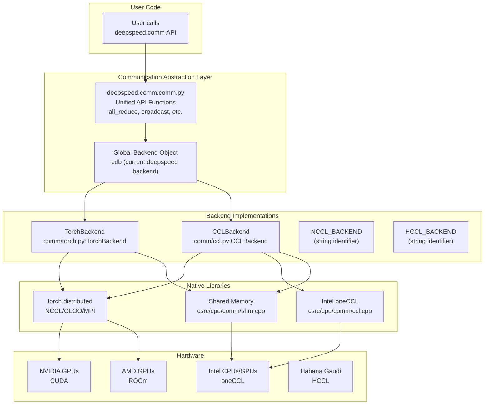
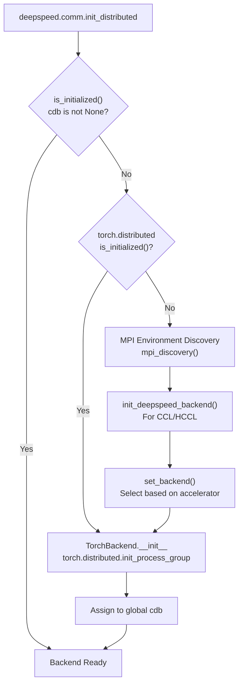
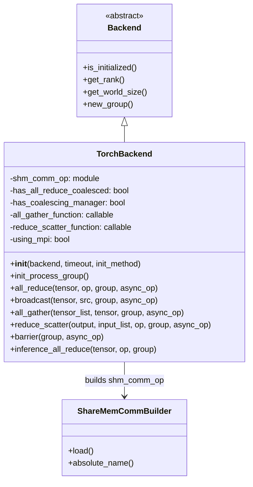
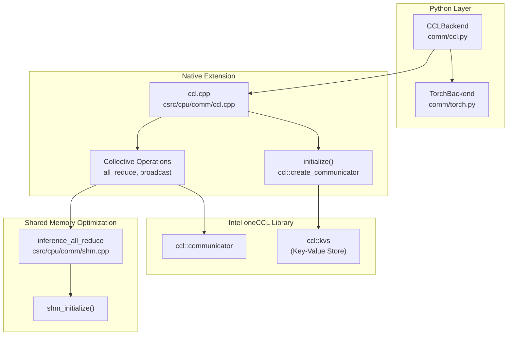

<!-- source: DeepWiki mcp.deepwiki.com · repo deepspeedai/DeepSpeed · page 7.1 Communication Backends · fetched 2026-10-21 -->

# Communication Backends

Relevant source files

The following files were used as context for generating this wiki page:

- [csrc/cpu/comm/arm64/shm.h](csrc/cpu/comm/arm64/shm.h)
- [csrc/cpu/comm/ccl.cpp](csrc/cpu/comm/ccl.cpp)
- [csrc/cpu/comm/riscv64/shm.h](csrc/cpu/comm/riscv64/shm.h)
- [csrc/cpu/comm/shm.cpp](csrc/cpu/comm/shm.cpp)
- [csrc/cpu/comm/shm.h](csrc/cpu/comm/shm.h)
- [csrc/cpu/comm/shm_interface.cpp](csrc/cpu/comm/shm_interface.cpp)
- [csrc/cpu/comm/x86_64/shm.h](csrc/cpu/comm/x86_64/shm.h)
- [deepspeed/comm/__init__.py](deepspeed/comm/__init__.py)
- [deepspeed/comm/ccl.py](deepspeed/comm/ccl.py)
- [deepspeed/comm/comm.py](deepspeed/comm/comm.py)
- [deepspeed/comm/torch.py](deepspeed/comm/torch.py)
- [deepspeed/comm/utils.py](deepspeed/comm/utils.py)
- [deepspeed/utils/comms_logging.py](deepspeed/utils/comms_logging.py)
- [docs/_tutorials/comms-logging.md](docs/_tutorials/comms-logging.md)
- [op_builder/cpu/__init__.py](op_builder/cpu/__init__.py)
- [op_builder/cpu/comm.py](op_builder/cpu/comm.py)
- [tests/unit/comm/test_dist.py](tests/unit/comm/test_dist.py)
- [tests/unit/ops/adam/test_adamw.py](tests/unit/ops/adam/test_adamw.py)

## Purpose and Scope

This page documents DeepSpeed's communication backend architecture, which provides an abstraction layer over distributed communication libraries (NCCL, GLOO, oneCCL, HCCL) through a unified API. The backend system enables DeepSpeed to support multiple hardware accelerators and optimize communication patterns across different platforms.

For information about collective operations and their usage patterns, see [Collective Operations](#7.2). For detailed communication profiling and logging, see [Communication Logging and Profiling](#7.4). For shared memory optimizations, see [Shared Memory Optimization](#7.3).

---

## Backend Architecture Overview

DeepSpeed implements a pluggable backend architecture that allows switching between different communication implementations without changing user code. The system maintains API compatibility with `torch.distributed` while adding optimizations and extensions.

Title: DeepSpeed Communication Backend Hierarchy

**Sources:** [deepspeed/comm/comm.py:41-55](), [deepspeed/comm/torch.py:98-120](), [deepspeed/comm/ccl.py:35-58]()

---

## Backend Selection and Initialization

### Backend Selection Mechanism

Backend selection occurs through the `set_backend()` function, which queries the accelerator's preferred communication backend and activates the corresponding backend object.

| Backend Name | Used By | Implementation |
|-------------|---------|----------------|
| `nccl` | NVIDIA CUDA, AMD ROCm | `TorchBackend` wrapping `torch.distributed` |
| `gloo` | CPU fallback | `TorchBackend` wrapping `torch.distributed` |
| `ccl` | Intel CPUs/XPUs | `CCLBackend` with oneCCL |
| `hccl` | Habana Gaudi | `HCCLBackend` (future placeholder) |
| `mpi` | Generic MPI | `TorchBackend` wrapping `torch.distributed` |

**Sources:** [deepspeed/comm/comm.py:199-220](), [deepspeed/comm/constants.py:11-18]()

### Initialization Flow

Title: DeepSpeed Distributed Initialization Process

The initialization process follows these steps:

1. **Check Existing Initialization**: If `cdb` is already initialized, skip initialization ([deepspeed/comm/comm.py:169-174]()).
2. **MPI Discovery**: Detect MPI environment variables if not set by launcher ([deepspeed/comm/comm.py:857-899]()).
3. **Backend-Specific Initialization**: For CCL, initialize the native library and KVS ([deepspeed/comm/comm.py:160-163]()).
4. **PyTorch Distributed Setup**: Initialize `torch.distributed.init_process_group` within `TorchBackend` ([deepspeed/comm/torch.py:165-180]()).
5. **Backend Assignment**: Set the global `cdb` object to the active backend instance ([deepspeed/comm/comm.py:199-220]()).

**Sources:** [deepspeed/comm/comm.py:144-168](), [deepspeed/comm/torch.py:107-162]()

---

## TorchBackend: Default Backend Implementation

### TorchBackend Class Structure

`TorchBackend` is the primary backend implementation that wraps PyTorch's `torch.distributed` module. It provides compatibility across different hardware accelerators through PyTorch's backend-agnostic API.

Title: TorchBackend Class and SHM Integration

**Sources:** [deepspeed/comm/torch.py:98-141](), [op_builder/cpu/comm.py:46-52]()

### PyTorch API Compatibility Handling

TorchBackend handles version-dependent API differences in PyTorch using `required_torch_version` and `inspect` checks:

| Feature | Legacy API | Modern API | Version/Check |
|-----------|-----------|------------|---------------|
| All-gather | `_all_gather_base` | `all_gather_into_tensor` | [deepspeed/comm/torch.py:143-149]() |
| Reduce-scatter | `_reduce_scatter_base` | `reduce_scatter_tensor` | [deepspeed/comm/torch.py:152-158]() |
| Device Assignment | Manual env rank | `device_id` arg | Torch >= 2.3 [deepspeed/comm/torch.py:172-177]() |
| Coalescing | `reqs` arg | `async_ops` arg | Torch >= 2.1 [deepspeed/comm/torch.py:52-53]() |

**Sources:** [deepspeed/comm/torch.py:49-56](), [deepspeed/comm/torch.py:143-158]()

### Inference Optimization Path

TorchBackend provides a specialized `inference_all_reduce` operation that can bypass standard PyTorch collectives for better performance:

1. **Custom Operator Check**: Tests for `torch.ops.deepspeed.inference_all_reduce_` ([deepspeed/comm/torch.py:187-190]()).
2. **Shared Memory Path**: Uses SHM-based reduction for single-node setups if `shm_comm_op` is loaded ([deepspeed/comm/torch.py:121-122]()).
3. **Standard Fallback**: Falls back to `torch.distributed.all_reduce` ([deepspeed/comm/torch.py:195-196]()).

**Sources:** [deepspeed/comm/torch.py:186-198](), [csrc/cpu/comm/shm_interface.cpp:53-82]()

---

## CCLBackend: Intel CPU Optimization

### CCLBackend Architecture

`CCLBackend` extends `TorchBackend` to leverage Intel's oneCCL library for optimized CPU communication. It dispatches collectives to native C++ implementations when available.

Title: CCLBackend and Native oneCCL Integration

**Sources:** [deepspeed/comm/ccl.py:35-58](), [csrc/cpu/comm/ccl.cpp:52-84]()

### Key-Value Store Initialization

CCLBackend uses a distributed key-value store (KVS) for rank coordination:

1. **Rank 0 Creates Main KVS**: Generates KVS address via `ccl::create_main_kvs()` ([csrc/cpu/comm/ccl.cpp:92-96]()).
2. **Address Broadcast**: Distributes KVS address to all ranks via `super(CCLBackend, self).broadcast` ([deepspeed/comm/ccl.py:54]()).
3. **Ranks Connect**: Non-zero ranks connect to main KVS address ([csrc/cpu/comm/ccl.cpp:71-74]()).
4. **Communicator Creation**: Each rank creates a `ccl::communicator` ([csrc/cpu/comm/ccl.cpp:76]()).

**Sources:** [deepspeed/comm/ccl.py:50-56](), [csrc/cpu/comm/ccl.cpp:52-84](), [csrc/cpu/comm/ccl.cpp:90-102]()

### Operation Dispatch Strategy

CCLBackend maintains a list of operations implemented natively in the CCL extension (`available_coll`) and dispatches accordingly via `run_collective`:

| Operation | Implementation Path |
|-----------|------------|
| `all_reduce` | `self.ccl_comm_op.all_reduce` [deepspeed/comm/ccl.py:83]() |
| `inference_all_reduce` | `self.ccl_comm_op.inference_all_reduce` [deepspeed/comm/ccl.py:90]() |
| `broadcast` | `run_collective` -> `eval("self.ccl_comm_op.broadcast")` [deepspeed/comm/ccl.py:72]() |
| `all_gather` | `run_collective` [deepspeed/comm/ccl.py:98]() |
| `barrier` | `run_collective` [deepspeed/comm/ccl.py:138]() |

**Sources:** [deepspeed/comm/ccl.py:58-77](), [csrc/cpu/comm/ccl.cpp:203-221]()

---

## Shared Memory Optimization (SHM)

The SHM backend provides low-latency all-reduce for intra-node communication on CPUs.

### Vectorized Reductions

The SHM implementation uses architecture-specific SIMD instructions for fast reduction of `BFloat16`, `Half`, and `Float` types.

- **x86_64**: Uses AVX-512/AVX2 via `x86_64/shm.h`.
- **ARM64**: Uses NEON instructions (`float32x4_t`, `vaddq_f32`) via `arm64/shm.h` ([csrc/cpu/comm/arm64/shm.h:100-106]()).
- **RISC-V**: Uses vector extensions via `riscv64/shm.h`.

### SHM Workspace Management

SHM uses a double-buffered workspace to avoid synchronization stalls between rounds:
- **`allreduce_workspace`**: Contains `coll_state` flags and data buffers ([csrc/cpu/comm/shm.cpp:95-102]()).
- **`NAIVE_ALLREDUCE_THRESHOLD`**: Messages below 1MB use a symmetric naive all-reduce ([csrc/cpu/comm/shm.cpp:93-94]()).
- **`MAX_BUF_SIZE`**: Limits the maximum size for SHM-based reduction to 32MB ([csrc/cpu/comm/shm.cpp:92]()).

**Sources:** [csrc/cpu/comm/shm.cpp:89-112](), [csrc/cpu/comm/arm64/shm.h:16-20]()

---

## Communication Logging and Profiling

DeepSpeed provides a `CommsLogger` to profile collective performance and calculate effective bandwidth.

### BW Calculation Logic

The logger calculates both algorithmic bandwidth (`algbw`) and bus bandwidth (`busbw`) based on the operation type:

| Operation Type | Bus BW Calculation |
|----------------|--------------------|
| `all_reduce` | `(size / duration) * (2 * (n - 1) / n)` [deepspeed/utils/comms_logging.py:49]() |
| `all_gather` | `(size / duration) * ((n - 1) / n)` [deepspeed/utils/comms_logging.py:46]() |
| `broadcast` | `size / duration` [deepspeed/utils/comms_logging.py:52]() |

**Sources:** [deepspeed/utils/comms_logging.py:34-64]()

### Timed Operation Wrapper

The `timed_op` decorator in `comm.py` wraps backend calls to record latency:

1. **Start Timer**: `timers(log_name).start()` ([deepspeed/comm/comm.py:115]()).
2. **Execute**: `func(*args, **kwargs)` ([deepspeed/comm/comm.py:118]()).
3. **Synchronize**: `get_accelerator().synchronize()` ([deepspeed/comm/comm.py:122]()).
4. **Record**: `comms_logger.append(raw_name, log_name, time_elapsed, msg_size)` ([deepspeed/comm/comm.py:133]()).

**Sources:** [deepspeed/comm/comm.py:102-135]()

---

## Usage and Backend Queries

DeepSpeed exposes several utility functions to check backend capabilities during runtime.

| Query Function | Purpose |
|----------------|---------|
| `is_initialized()` | Checks if `cdb` global object is set and initialized ([deepspeed/comm/comm.py:169-174]()). |
| `has_all_gather_into_tensor()` | Returns True if the backend supports direct tensor-to-tensor all-gather ([deepspeed/comm/torch.py:159-160]()). |
| `has_reduce_scatter_tensor()` | Returns True if the backend supports direct tensor-to-tensor reduce-scatter ([deepspeed/comm/torch.py:162-163]()). |
| `get_world_size()` | Returns the world size from the active `cdb` backend ([deepspeed/comm/comm.py:688-692]()). |

**Sources:** [deepspeed/comm/comm.py:169-174](), [deepspeed/comm/torch.py:159-163](), [deepspeed/comm/comm.py:688-692]()

---

