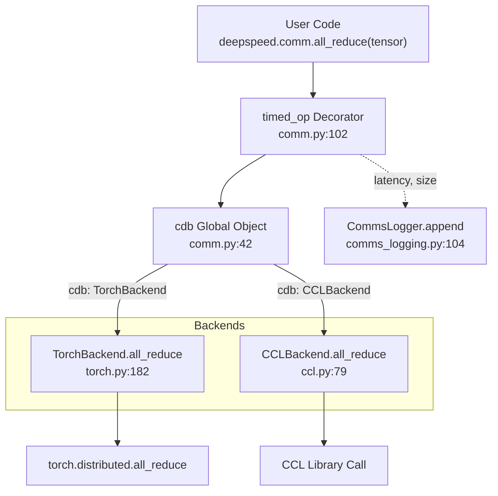
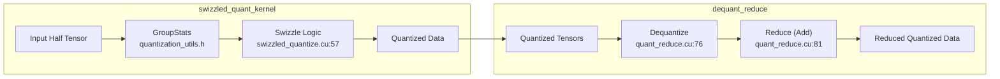

<!-- source: DeepWiki mcp.deepwiki.com · repo deepspeedai/DeepSpeed · page 7.2 Collective Operations · fetched 2026-10-21 -->

# Collective Operations

<details>
<summary>Relevant source files</summary>

The following files were used as context for generating this wiki page:

- [csrc/quantization/quant_reduce.cu](csrc/quantization/quant_reduce.cu)
- [csrc/quantization/swizzled_quantize.cu](csrc/quantization/swizzled_quantize.cu)
- [deepspeed/comm/__init__.py](deepspeed/comm/__init__.py)
- [deepspeed/comm/comm.py](deepspeed/comm/comm.py)
- [deepspeed/comm/torch.py](deepspeed/comm/torch.py)
- [deepspeed/comm/utils.py](deepspeed/comm/utils.py)
- [deepspeed/runtime/comm/coalesced_collectives.py](deepspeed/runtime/comm/coalesced_collectives.py)
- [deepspeed/utils/comms_logging.py](deepspeed/utils/comms_logging.py)
- [docs/_tutorials/comms-logging.md](docs/_tutorials/comms-logging.md)
- [tests/unit/runtime/comm/test_coalesced_collectives.py](tests/unit/runtime/comm/test_coalesced_collectives.py)

</details>


## Purpose and Scope

This document describes the collective communication operations provided by DeepSpeed's communication layer. These operations enable distributed data synchronization across multiple processes in training and inference workloads.

For information about communication backend selection and initialization, see [Communication Backends](#7.1). For details on shared memory optimization for intra-node communication, see [Shared Memory Optimization](#7.3). For communication profiling and monitoring, see [Communication Logging and Profiling](#7.4).

**Sources:** [deepspeed/comm/comm.py:1-961]()

## API Design and Compatibility

DeepSpeed's collective operations API (`deepspeed.comm`) maintains full compatibility with PyTorch's `torch.distributed` API, allowing users to replace:

```python
import torch.distributed as dist
```

with:

```python
import deepspeed.comm as dist
```

without changing any existing code. This compatibility ensures:

1. **Identical function signatures** - All collective operations match `torch.distributed` parameter names and defaults.
2. **Transparent backend delegation** - Operations are delegated to the appropriate backend (TorchBackend, CCLBackend, etc.).
3. **Automatic logging integration** - All operations can be automatically profiled through the `@timed_op` decorator.

The communication module uses a global backend object (`cdb`) that routes operations to the initialized backend implementation:

```
deepspeed.comm API → cdb (current backend) → TorchBackend/CCLBackend/etc.
```

**Sources:** [deepspeed/comm/comm.py:6-22](), [deepspeed/comm/comm.py:41-48](), [deepspeed/comm/torch.py:98-105]()

## Architecture: Collective Operations Flow

The following diagram illustrates how a user call to `deepspeed.comm` is routed through the timing logic to the underlying backend implementations.

### Communication Routing and Logging Flow


**Sources:** [deepspeed/comm/comm.py:102-135](), [deepspeed/comm/comm.py:42](), [deepspeed/comm/torch.py:182-184](), [deepspeed/utils/comms_logging.py:104-123]()

## Core Collective Operations

### All-Reduce Operations

All-reduce performs element-wise reduction across all processes and distributes the result back to all processes.

#### all_reduce

**Function Signature:**
```python
all_reduce(tensor, op=ReduceOp.SUM, group=None, async_op=False, 
           prof=False, log_name='all_reduce', debug=get_caller_func())
```

**Implementation:**
- **TorchBackend:** Delegates to `torch.distributed.all_reduce` [deepspeed/comm/torch.py:182-184]().
- **CCLBackend:** Uses Intel oneCCL library.

**Sources:** [deepspeed/comm/comm.py:640-654](), [deepspeed/comm/torch.py:182-184]()

#### all_reduce_coalesced

Performs all-reduce on multiple tensors in a single operation to reduce kernel launch overhead.

**Function Signature:**
```python
all_reduce_coalesced(tensors, op=ReduceOp.SUM, group=None, async_op=False)
```

**Requirements:**
- PyTorch >= 1.13 for `torch.distributed.all_reduce_coalesced` support [deepspeed/comm/torch.py:45-46]().
- DeepSpeed checks `has_all_reduce_coalesced` before execution [deepspeed/comm/torch.py:110]().

**Sources:** [deepspeed/comm/comm.py:669-678](), [deepspeed/comm/torch.py:45-46](), [deepspeed/comm/torch.py:110]()

#### inference_all_reduce

Specialized all-reduce optimized for inference with low-latency requirements. 

**Optimizations:**
- **Custom CUDA kernel:** Can use `torch.ops.deepspeed.inference_all_reduce_` when available [deepspeed/comm/torch.py:187-190]().
- **Shared Memory:** For intra-node communication, it can leverage `shm_comm_op` if initialized [deepspeed/comm/torch.py:109]().

**Sources:** [deepspeed/comm/comm.py:657-666](), [deepspeed/comm/torch.py:186-190](), [deepspeed/comm/torch.py:109]()

### Broadcast Operations

Broadcast distributes data from a source rank to all other ranks in the group.

#### broadcast

**Function Signature:**
```python
broadcast(tensor, src, group=None, async_op=False)
```

**Sources:** [deepspeed/comm/comm.py:222-225](), [deepspeed/comm/torch.py:213-219]()

#### broadcast_object_list

Broadcasts a list of Python objects using pickle serialization.

**Sources:** [deepspeed/comm/comm.py:228-231](), [deepspeed/comm/torch.py:222-223]()

### Gather and Scatter Operations

These operations collect or distribute data across ranks.

#### all_gather

Gathers tensors from all ranks and distributes the complete list to all ranks.

**Sources:** [deepspeed/comm/comm.py:234-243](), [deepspeed/comm/torch.py:226-232]()

#### all_gather_into_tensor

More efficient variant that gathers into a single contiguous tensor. It automatically detects the available PyTorch function (e.g., `all_gather_into_tensor` or `_all_gather_base`) [deepspeed/comm/torch.py:143-148]().

**Sources:** [deepspeed/comm/comm.py:309-318](), [deepspeed/comm/torch.py:143-148]()

#### reduce_scatter

Reduces tensors across ranks and distributes unique chunks to each rank.

**Sources:** [deepspeed/comm/comm.py:603-613](), [deepspeed/comm/torch.py:200-210]()

#### reduce_scatter_tensor

More efficient variant using a single input tensor. Like all-gather, it dynamically selects the underlying PyTorch base function [deepspeed/comm/torch.py:152-157]().

**Sources:** [deepspeed/comm/comm.py:292-306](), [deepspeed/comm/torch.py:152-157]()

### All-to-All Operations

#### all_to_all_single

Enables each rank to send unique data to every other rank using a single buffer.

**Sources:** [deepspeed/comm/comm.py:343-359](), [deepspeed/comm/torch.py:303-315]()

### Coalesced Collectives (Specialized)

DeepSpeed provides a set of "coalesced" collectives in `deepspeed.runtime.comm` that implement higher-level logic, such as quantization during communication.

#### all_to_all_quant_reduce

Performs a two-stage all-to-all reduction with quantization to save bandwidth.

1. **Intra-node:** Swizzles and quantizes the tensor, followed by a local `all_to_all_single` [deepspeed/runtime/comm/coalesced_collectives.py:57-63]().
2. **Inter-node:** Performs global reduction and a second `all_to_all_single` [deepspeed/runtime/comm/coalesced_collectives.py:64-70]().
3. **Dequantization:** Final output is dequantized and averaged [deepspeed/runtime/comm/coalesced_collectives.py:71-75]().

**Sources:** [deepspeed/runtime/comm/coalesced_collectives.py:31-76]()

#### all_to_all_loco_quant_reduce

A variant of quantized reduction that incorporates "Local-Error-Feedback" (LOCO) to maintain accuracy during aggressive quantization [deepspeed/runtime/comm/coalesced_collectives.py:81-133]().

**Sources:** [deepspeed/runtime/comm/coalesced_collectives.py:81-133]()

## Quantization Kernels for Collectives

DeepSpeed uses custom CUDA kernels to accelerate the quantization and reduction steps used in advanced collectives.

### Collective Quantization Logic


**Sources:** [csrc/quantization/swizzled_quantize.cu:22-83](), [csrc/quantization/quant_reduce.cu:21-127]()

## Communication Logging

All collectives are instrumented with the `CommsLogger`. This logger tracks:
- **Message Size:** Calculated from tensor element size and count [deepspeed/comm/utils.py:102-126]().
- **Latency:** Measured using synchronized wall clock timers [deepspeed/comm/comm.py:115-132]().
- **Bandwidth:** Calculated as Algorithm Bandwidth (`algbw`) and Bus Bandwidth (`busbw`) based on the operation type [deepspeed/utils/comms_logging.py:34-64]().

### Bandwidth Calculation Formulae

| Operation | Algorithm Bandwidth (Gbps) | Bus Bandwidth (Gbps) |
|-----------|----------------------------|----------------------|
| `all_reduce` | `(size * 2 / duration) * 8 / 1e6` | `(size / duration) * (2 * (n-1) / n) * 8 / 1e6` |
| `all_gather` | `(size * n / duration) * 8 / 1e6` | `(size * n / duration) * ((n-1) / n) * 8 / 1e6` |
| `broadcast` | `(size / duration) * 8 / 1e6` | Same as AlgBW |

**Sources:** [deepspeed/utils/comms_logging.py:34-64](), [deepspeed/comm/utils.py:102-126]()

## Synchronization and Barriers

### barrier
Standard synchronization point. In `TorchBackend`, it delegates to `torch.distributed.barrier` [deepspeed/comm/torch.py:354-357]().

### monitored_barrier
A barrier that supports timeouts and can help identify which ranks are lagging or hanging. It is particularly useful for debugging distributed training stalls [deepspeed/comm/torch.py:360-363]().

**Sources:** [deepspeed/comm/comm.py:418-432](), [deepspeed/comm/torch.py:354-363]()

## Reduction Operations (ReduceOp)

DeepSpeed supports the standard suite of reduction operations via the `ReduceOp` enum, mapped to the underlying backend's constants.

| DeepSpeed Op | Torch Mapping |
|--------------|---------------|
| `SUM` | `torch.distributed.ReduceOp.SUM` |
| `PRODUCT` | `torch.distributed.ReduceOp.PRODUCT` |
| `MIN` | `torch.distributed.ReduceOp.MIN` |
| `MAX` | `torch.distributed.ReduceOp.MAX` |
| `AVG` | `torch.distributed.ReduceOp.AVG` |

**Sources:** [deepspeed/comm/reduce_op.py:1-40](), [deepspeed/comm/torch.py:393-414]()

---

