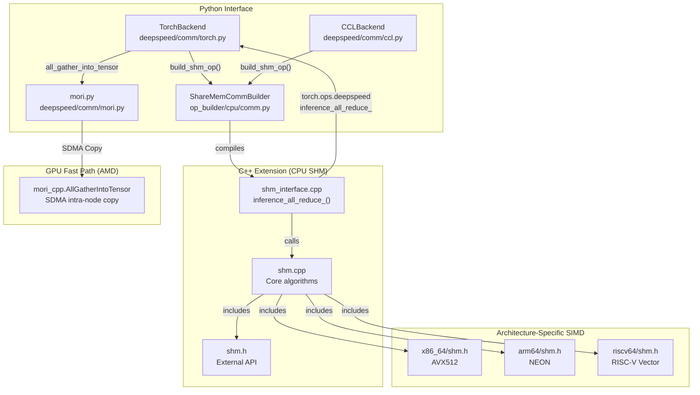
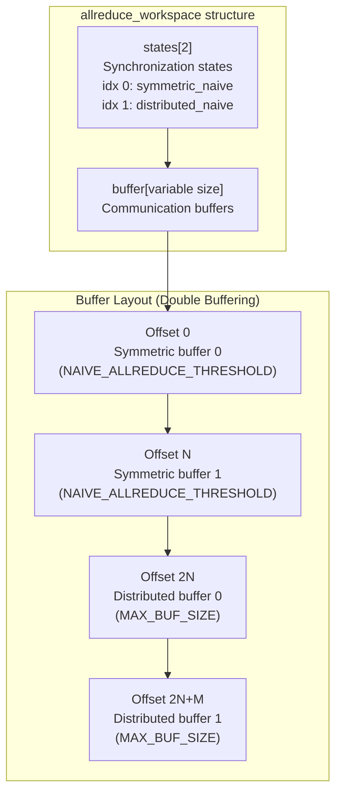

<!-- source: DeepWiki mcp.deepwiki.com · repo deepspeedai/DeepSpeed · page 7.3 Shared Memory Optimization · fetched 2026-10-21 -->

# Shared Memory Optimization

<details>
<summary>Relevant source files</summary>

The following files were used as context for generating this wiki page:

- [csrc/cpu/comm/arm64/shm.h](csrc/cpu/comm/arm64/shm.h)
- [csrc/cpu/comm/ccl.cpp](csrc/cpu/comm/ccl.cpp)
- [csrc/cpu/comm/riscv64/shm.h](csrc/cpu/comm/riscv64/shm.h)
- [csrc/cpu/comm/shm.cpp](csrc/cpu/comm/shm.cpp)
- [csrc/cpu/comm/shm.h](csrc/cpu/comm/shm.h)
- [csrc/cpu/comm/shm_interface.cpp](csrc/cpu/comm/shm_interface.cpp)
- [csrc/cpu/comm/x86_64/shm.h](csrc/cpu/comm/x86_64/shm.h)
- [deepspeed/comm/ccl.py](deepspeed/comm/ccl.py)
- [deepspeed/comm/mori.py](deepspeed/comm/mori.py)
- [examples/sdma_allgather/README.md](examples/sdma_allgather/README.md)
- [examples/sdma_allgather/ds_config_zero3.json](examples/sdma_allgather/ds_config_zero3.json)
- [examples/sdma_allgather/images/loss_gpt_2k.png](examples/sdma_allgather/images/loss_gpt_2k.png)
- [examples/sdma_allgather/images/loss_qwen3_2k.png](examples/sdma_allgather/images/loss_qwen3_2k.png)
- [examples/sdma_allgather/run_gpt_sdma_off.sh](examples/sdma_allgather/run_gpt_sdma_off.sh)
- [examples/sdma_allgather/run_gpt_sdma_on.sh](examples/sdma_allgather/run_gpt_sdma_on.sh)
- [examples/sdma_allgather/run_qwen3_sdma_off.sh](examples/sdma_allgather/run_qwen3_sdma_off.sh)
- [examples/sdma_allgather/run_qwen3_sdma_on.sh](examples/sdma_allgather/run_qwen3_sdma_on.sh)
- [op_builder/cpu/__init__.py](op_builder/cpu/__init__.py)
- [op_builder/cpu/comm.py](op_builder/cpu/comm.py)
- [tests/unit/comm/test_dist.py](tests/unit/comm/test_dist.py)
- [tests/unit/ops/adam/test_adamw.py](tests/unit/ops/adam/test_adamw.py)

</details>


This document describes DeepSpeed's shared memory (SHM) optimization system for low-latency intra-node collective communication operations. This optimization is particularly valuable for inference workloads where all participating ranks reside on the same physical machine. It also covers the **SDMA AllGather** optimization for AMD GPUs, which leverages similar low-latency intra-node principles.

**Scope**: This page focuses specifically on the shared memory implementation for CPU-based collective operations and the SDMA-based optimization for AMD MI300 GPUs. For information about communication backends and collective operations in general, see [Communication Backends](7.1) and [Collective Operations](7.2).

## Overview

The shared memory optimization provides significantly lower latency for all-reduce operations when all ranks are co-located on a single physical node. Rather than using network-based communication primitives (even for localhost communication), the system creates POSIX shared memory segments that allow ranks to directly read and write to common memory regions with minimal overhead.

**Key characteristics**:
- **Automatic activation**: Enabled when `WORLD_SIZE == LOCAL_SIZE` environment variable check passes [csrc/cpu/comm/shm_interface.cpp:31-35]().
- **Target operations**: Primarily `inference_all_reduce` for low-latency inference [csrc/cpu/comm/shm_interface.cpp:53-55]().
- **Supported data types**: BF16, FP16, FP32 [csrc/cpu/comm/shm_interface.cpp:73-76]().
- **Synchronization**: State-based synchronization using atomic memory operations [csrc/cpu/comm/shm.cpp:31-40]().
- **Vectorization**: Architecture-specific SIMD implementations (AVX512, ARM NEON, RISC-V Vector) [csrc/cpu/comm/shm.cpp:14-22]().

Sources: [csrc/cpu/comm/shm.cpp:1-86](), [csrc/cpu/comm/shm_interface.cpp:24-47]()

## Architecture Components

The shared memory system consists of several layers bridging Python and high-performance C++ implementations:



Sources: [deepspeed/comm/ccl.py:35-56](), [op_builder/cpu/comm.py:46-71](), [csrc/cpu/comm/shm_interface.cpp:1-109](), [deepspeed/comm/mori.py:5-28]()

## Workspace Structure and Memory Layout

Each rank allocates its own shared memory segment containing a workspace with buffers for communication and synchronization states. Other ranks map these segments into their address space for direct access [csrc/cpu/comm/shm.cpp:50-67]().

### Workspace Memory Layout



The workspace employs double buffering to avoid synchronization stalls between iterations [csrc/cpu/comm/shm.cpp:95-102]().

**Constants and sizing**:
- `NAIVE_ALLREDUCE_THRESHOLD`: 1,048,576 bytes (1 MB) - threshold for algorithm selection [csrc/cpu/comm/shm.cpp:93]().
- `MAX_BUF_SIZE`: 33,554,432 bytes (32 MB) - maximum buffer size for distributed algorithm [csrc/cpu/comm/shm.cpp:92]().

Sources: [csrc/cpu/comm/shm.cpp:92-112](), [csrc/cpu/comm/shm.cpp:340-394]()

## All-Reduce Algorithms

The shared memory system implements two complementary all-reduce algorithms selected based on message size [csrc/cpu/comm/shm.cpp:680-707]().

### Algorithm 1: Symmetric Naive All-Reduce
Used for messages ≤ `NAIVE_ALLREDUCE_THRESHOLD` (1 MB). Each rank performs the complete reduction independently [csrc/cpu/comm/shm.cpp:442-551]().
1. Copy input data to local shared memory buffer.
2. Publish state indicating copy complete.
3. Wait for all ranks to reach same state (spin-polling).
4. Independently reduce from all rank buffers into output.

### Algorithm 2: Distributed Naive Reduce
Used for messages > `NAIVE_ALLREDUCE_THRESHOLD`. Work is distributed across ranks using a reduce-scatter followed by all-gather pattern [csrc/cpu/comm/shm.cpp:554-678]().
1. Each rank reduces its assigned slice from all rank buffers.
2. Publish reduce-complete state and wait for all ranks.
3. Each rank copies all reduced slices to output.

Sources: [csrc/cpu/comm/shm.cpp:442-707]()

## SDMA AllGather Optimization (AMD GPUs)

For AMD GPUs (specifically MI300), DeepSpeed provides a specialized intra-node communication path via the `mori` backend. This bypasses the standard RCCL path for `all_gather_into_tensor` when all ranks are within the same node [deepspeed/comm/mori.py:5-12]().

### Implementation Details
- **Opt-in**: Users must set `DS_SDMA_ALLGATHER=1` [deepspeed/comm/mori.py:103]().
- **Mechanism**: Routes WORLD-group all-gathers through `mori_cpp.AllGatherIntoTensor`, which performs direct SDMA copies [deepspeed/comm/mori.py:156-162]().
- **Memory Management**: Allocates uncached transit buffers to facilitate high-speed SDMA transfers [deepspeed/comm/mori.py:22-23]().
- **Async Execution**: Returns a `_SdmaWork` object (duck-typed with `torch.distributed.Work`) that uses stream-level events to ensure non-blocking CPU behavior [deepspeed/comm/mori.py:45-58]().

### Constraints
SDMA is only used if:
1. The call is on the `WORLD` process group [deepspeed/comm/mori.py:186]().
2. The per-rank shard fits within the pre-allocated transit buffer (default 256 MiB) [deepspeed/comm/mori.py:138]().
3. The hardware is AMD/ROCm compatible [deepspeed/comm/mori.py:9-10]().

Sources: [deepspeed/comm/mori.py:1-200](), [examples/sdma_allgather/run_qwen3_sdma_on.sh:13-15]()

## Vectorized Reduction Operations

All reduction operations use SIMD vectorization. The system supports BF16, FP16, and FP32, often widening to FP32 for accumulation to maintain precision [csrc/cpu/comm/shm.cpp:134-146]().

### Architecture-Specific Implementations

| Architecture | Implementation File | Vectorization |
|--------------|---------------------|---------------|
| **x86_64** | `csrc/cpu/comm/x86_64/shm.h` | AVX-512 intrinsics |
| **ARM64** | `csrc/cpu/comm/arm64/shm.h` | NEON (Advanced SIMD) |
| **RISC-V** | `csrc/cpu/comm/riscv64/shm.h` | RVV (RISC-V Vector) |

**ARM NEON Example** ([csrc/cpu/comm/arm64/shm.h:22-34]()):
```cpp
static inline float32x4_t cvt_bf16_to_fp32(const uint16x4_t input) {
    uint32x4_t result_32 = vshll_n_u16(input, 16);
    return vreinterpretq_f32_u32(result_32);
}
```

Sources: [csrc/cpu/comm/arm64/shm.h:1-107](), [csrc/cpu/comm/x86_64/shm.h:1-77](), [csrc/cpu/comm/riscv64/shm.h:1-84]()

## Initialization and Fallback

### CPU SHM Initialization
The `ShareMemCommBuilder` compiles the C++ extensions [op_builder/cpu/comm.py:46-58](). During initialization, `shm_interface.cpp` checks if `LOCAL_SIZE == WORLD_SIZE` [csrc/cpu/comm/shm_interface.cpp:31-35](). If true, it calls `shm_initialize` to set up POSIX segments [csrc/cpu/comm/shm_interface.cpp:46]().

### CCL Integration
The `CCLBackend` (Intel oneCCL) checks `all_ranks_local_p` during its own initialization [csrc/cpu/comm/ccl.cpp:63](). If ranks are local, it initializes the SHM layer [csrc/cpu/comm/ccl.cpp:83]().

### Fallback Mechanism
If SHM initialization fails or a data type is unsupported, the system transparently falls back to standard backends (RCCL/NCCL/oneCCL) [deepspeed/comm/mori.py:173-174](), [csrc/cpu/comm/shm_interface.cpp:80]().

Sources: [csrc/cpu/comm/shm_interface.cpp:24-47](), [csrc/cpu/comm/ccl.cpp:52-84](), [deepspeed/comm/mori.py:168-175]()

---

