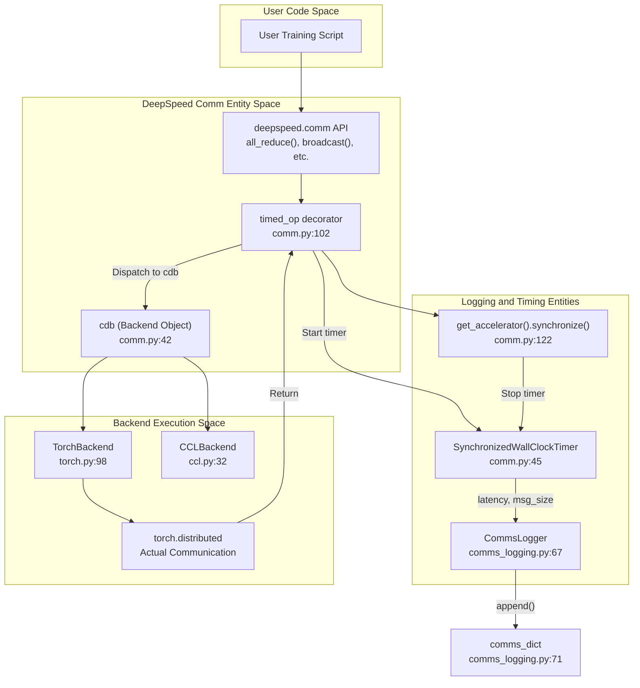
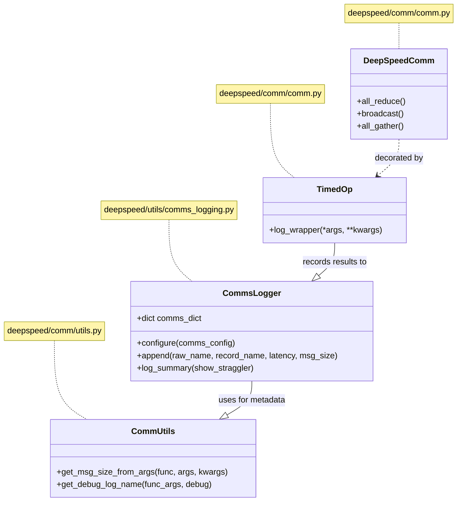

<!-- source: DeepWiki mcp.deepwiki.com · repo deepspeedai/DeepSpeed · page 7.4 Communication Logging and Profiling · fetched 2026-10-21 -->

# Communication Logging and Profiling

<details>
<summary>Relevant source files</summary>

The following files were used as context for generating this wiki page:

- [deepspeed/comm/__init__.py](deepspeed/comm/__init__.py)
- [deepspeed/comm/comm.py](deepspeed/comm/comm.py)
- [deepspeed/comm/torch.py](deepspeed/comm/torch.py)
- [deepspeed/comm/utils.py](deepspeed/comm/utils.py)
- [deepspeed/utils/comms_logging.py](deepspeed/utils/comms_logging.py)
- [docs/_tutorials/comms-logging.md](docs/_tutorials/comms-logging.md)

</details>


This document describes DeepSpeed's communication logging and profiling system, which enables tracking, measurement, and analysis of distributed communication operations. The system provides both real-time logging and summary statistics to help identify communication bottlenecks, measure bandwidth utilization, and detect stragglers in distributed training.

For information about the underlying communication backends and collective operations, see [Communication Backends](#7.1) and [Collective Operations](#7.2).

## Overview

The communication logging system consists of:
- A transparent profiling layer that wraps all communication operations via a decorator.
- A centralized logger (`CommsLogger`) that accumulates timing and bandwidth metrics.
- Configuration options to control logging granularity (all operations vs. specific operations).
- APIs to retrieve and analyze communication statistics including bandwidth and straggler detection.

All communication operations invoked through `deepspeed.comm` can be automatically logged without code modifications beyond enabling the feature in configuration [deepspeed/comm/comm.py:102-135]().

**Sources:** [deepspeed/comm/comm.py:34-135](), [deepspeed/utils/comms_logging.py:67-119]()

## System Architecture

The following diagram illustrates how the profiling layer intercepts calls from the user or internal DeepSpeed components to the communication backends.



**Figure 1:** Communication logging data flow from API layer through profiling to storage.

**Sources:** [deepspeed/comm/comm.py:42-135](), [deepspeed/utils/comms_logging.py:67-119](), [deepspeed/comm/torch.py:98-108]()

## Core Components

### CommsLogger Class
The `CommsLogger` class is the central repository for communication statistics [deepspeed/utils/comms_logging.py:67-119]().

**Key Attributes:**
| Attribute | Type | Purpose |
|-----------|------|---------|
| `comms_dict` | `dict` | Stores logged data: `{record_name: {msg_size: [count, [latencies], [algbws], [busbws]]}}` [deepspeed/utils/comms_logging.py:71]() |
| `enabled` | `bool` | Master enable flag for logging [deepspeed/utils/comms_logging.py:76]() |
| `verbose` | `bool` | If True, prints every operation immediately to rank 0 [deepspeed/utils/comms_logging.py:121-123]() |
| `debug` | `bool` | If True, appends caller function name to the log record [deepspeed/utils/comms_logging.py:73]() |
| `prof_ops` | `list` | List of specific operation names to profile [deepspeed/utils/comms_logging.py:74]() |

**Sources:** [deepspeed/utils/comms_logging.py:67-119]()

### Timed Operation Decorator
The `timed_op` decorator is the primary mechanism for capturing metrics [deepspeed/comm/comm.py:102-135]().

**Implementation Logic:**
1. **Filter:** Checks if the operation should be profiled based on `comms_logger.prof_all`, `comms_logger.prof_ops`, or a per-call `prof` flag [deepspeed/comm/comm.py:106-109]().
2. **Metadata:** Calculates message size using `get_msg_size_from_args` and determines the log name [deepspeed/comm/comm.py:113-114]().
3. **Execution:** Calls the underlying communication function [deepspeed/comm/comm.py:118]().
4. **Synchronization:** Calls `get_accelerator().synchronize()` to ensure the timer captures the full duration of the operation [deepspeed/comm/comm.py:122]().
5. **Record:** Stops the timer and calls `comms_logger.append()` with the raw name, latency, and size [deepspeed/comm/comm.py:128-133]().

**Sources:** [deepspeed/comm/comm.py:102-135](), [deepspeed/comm/utils.py:102-127]()

## Configuration

Communication logging is configured via the DeepSpeed configuration JSON or the `deepspeed.comm.configure` function [deepspeed/comm/comm.py:73-99]().

### Configuration Parameters
| Parameter | Default | Description |
|-----------|---------|-------------|
| `enabled` | `False` | Enables/disables the CommsLogger. |
| `verbose` | `False` | Prints logs for every communication call. |
| `prof_all` | `False` | Profiles all communication operations. |
| `prof_ops` | `[]` | List of operations to profile (e.g., `["all_reduce"]`). |
| `debug` | `False` | Appends caller function info to the log entry. |

**Example JSON Configuration:**
```json
"comms_logger": {
  "enabled": true,
  "verbose": false,
  "prof_all": true,
  "debug": false
}
```

**Sources:** [deepspeed/comm/comm.py:68-99](), [docs/_tutorials/comms-logging.md:29-37]()

## Metrics and Analysis

### Bandwidth Calculation
The logger calculates two types of bandwidth: Algorithmic Bandwidth (`algbw`) and Bus Bandwidth (`busbw`) [deepspeed/utils/comms_logging.py:34-64]().

| Operation Type | Formula (Simplified) |
|----------------|----------------------|
| **All-Reduce** | `tput = (size * 2 / duration)`, `busbw = tput * (n-1)/n` |
| **All-Gather** | `tput = (size * n / duration)`, `busbw = tput * (n-1)/n` |
| **P2P / Bcast**| `tput = (size / duration)`, `busbw = tput` |

**Sources:** [deepspeed/utils/comms_logging.py:34-64]()

### Straggler Detection
Straggler effect is defined as the time a rank waits for the slowest rank to start communication [docs/_tutorials/comms-logging.md:118-121]().

DeepSpeed detects stragglers by:
1. Getting the minimum collective time among all ranks via an `all_reduce(MIN)` operation.
2. Computing the difference: `straggler = local_latency - min_latency_across_ranks`.

This is triggered by calling `deepspeed.comm.log_summary(show_straggler=True)` [deepspeed/utils/comms_logging.py:327-331]().

**Sources:** [deepspeed/utils/comms_logging.py:327-376](), [docs/_tutorials/comms-logging.md:118-128]()

## Code Entity Map

The following diagram maps the logical components to their specific code entities and file locations.



**Figure 2:** Association between system names and code entities.

**Sources:** [deepspeed/comm/comm.py:102-135](), [deepspeed/comm/utils.py:102-134](), [deepspeed/utils/comms_logging.py:67-379]()

## Usage Example

To profile communication, the `deepspeed.comm` package should be used in place of `torch.distributed`.

```python
import deepspeed.comm as dist

# Initialize communication and logging
# (Configuration usually handled via DeepSpeedEngine initialization)

# Communication calls are automatically timed if enabled
dist.all_reduce(my_tensor)

# Print a summary of all communication after an epoch
dist.log_summary(show_straggler=True)
```

**Sources:** [docs/_tutorials/comms-logging.md:69-93](), [deepspeed/comm/comm.py:435-509]()

---

