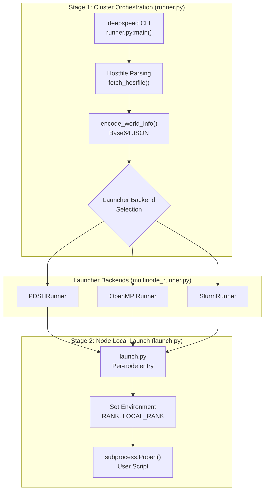
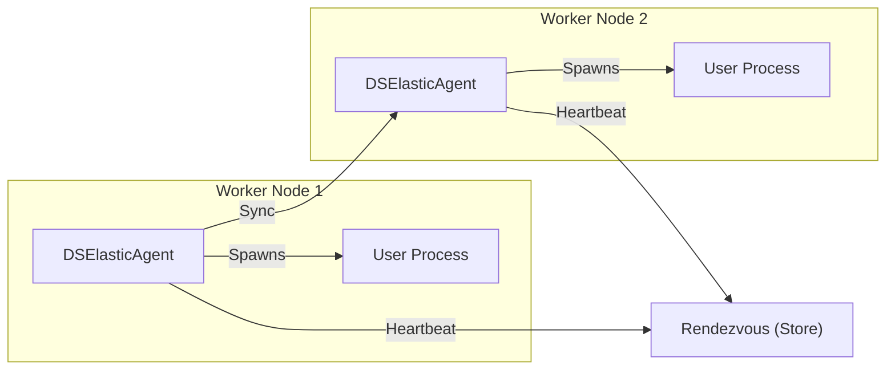

<!-- source: DeepWiki mcp.deepwiki.com · repo deepspeedai/DeepSpeed · page 8 Distributed Training Orchestration · fetched 2026-10-21 -->

# Distributed Training Orchestration

Relevant source files

The following files were used as context for generating this wiki page:

- [deepspeed/constants.py](deepspeed/constants.py)
- [deepspeed/elasticity/elastic_agent.py](deepspeed/elasticity/elastic_agent.py)
- [deepspeed/launcher/constants.py](deepspeed/launcher/constants.py)
- [deepspeed/launcher/launch.py](deepspeed/launcher/launch.py)
- [deepspeed/launcher/launcher_helper.py](deepspeed/launcher/launcher_helper.py)
- [deepspeed/launcher/multinode_runner.py](deepspeed/launcher/multinode_runner.py)
- [deepspeed/launcher/runner.py](deepspeed/launcher/runner.py)
- [deepspeed/runtime/checkpoint_engine/nebula_checkpoint_engine.py](deepspeed/runtime/checkpoint_engine/nebula_checkpoint_engine.py)
- [deepspeed/runtime/checkpoint_engine/torch_checkpoint_engine.py](deepspeed/runtime/checkpoint_engine/torch_checkpoint_engine.py)
- [deepspeed/runtime/eigenvalue.py](deepspeed/runtime/eigenvalue.py)
- [tests/unit/launcher/test_ds_arguments.py](tests/unit/launcher/test_ds_arguments.py)
- [tests/unit/launcher/test_multinode_runner.py](tests/unit/launcher/test_multinode_runner.py)
- [tests/unit/launcher/test_user_args.py](tests/unit/launcher/test_user_args.py)

DeepSpeed's distributed training orchestration system manages the launching and coordination of training processes across multiple nodes and GPUs. This infrastructure sits below the parallelism strategies, providing a uniform interface for distributed execution regardless of cluster architecture.

**Purpose**: Launch and coordinate distributed training jobs across heterogeneous cluster environments (SSH-based, MPI, Slurm, etc.)

**Key Components**:
- `runner.py`: Entry point for the `deepspeed` CLI command, handles resource discovery and launcher backend selection [deepspeed/launcher/runner.py:5-10]().
- `launch.py`: Per-node launcher that spawns worker processes with proper environment setup [deepspeed/launcher/launch.py:9-12]().
- `MultiNodeRunner` backends: Pluggable launchers for different cluster infrastructures (PDSH, OpenMPI, Slurm, etc.) [deepspeed/launcher/multinode_runner.py:19-53]().
- `DSElasticAgent`: Orchestrator for fault-tolerant and dynamic scaling [deepspeed/elasticity/elastic_agent.py:32-42]().

This page provides an overview of the orchestration system. For detailed information, see:
- [Launcher Architecture](#8.1) — `runner.py` entry point, hostfile parsing, and world info encoding.
- [Multi-Node Runners and Backends](#8.2) — PDSH, OpenMPI, Slurm, MPICH, Intel MPI backend implementations.
- [Environment Setup and Process Spawning](#8.3) — Per-node `launch.py`, environment variables, and rank assignment.
- [Elastic Training](#8.4) — `DSElasticAgent` for fault tolerance and dynamic scaling.

## System Architecture

### Two-Stage Launch Process

DeepSpeed uses a **two-stage launch architecture** to decouple cluster-wide resource management from node-local process spawning.

Title: DeepSpeed Launch Flow - From CLI to Worker Processes

Sources: [deepspeed/launcher/runner.py:436-653](), [deepspeed/launcher/launch.py:145-376]()

### Key Code Entities

Title: Orchestration Code Map

| Entity Space | Code Symbol | Role |
| :--- | :--- | :--- |
| **CLI Entry** | `deepspeed/launcher/runner.py` | Primary entry point for the `deepspeed` command [deepspeed/launcher/runner.py:436](). |
| **Resource Map** | `world_info` | A dictionary mapping hostnames to lists of accelerator IDs [deepspeed/launcher/launch.py:159-160](). |
| **Backend Base** | `MultiNodeRunner` | Abstract class for multi-node execution logic [deepspeed/launcher/multinode_runner.py:19](). |
| **Node Spawner** | `deepspeed/launcher/launch.py` | Script executed on each node to fork training processes [deepspeed/launcher/launch.py:9](). |
| **Elastic Agent** | `DSElasticAgent` | Manages dynamic rendezvous and restarts [deepspeed/elasticity/elastic_agent.py:32](). |

Sources: [deepspeed/launcher/runner.py:1-657](), [deepspeed/launcher/launch.py:1-376](), [deepspeed/launcher/multinode_runner.py:1-53]()

## Launcher Backend Types

DeepSpeed supports multiple launcher backends via the `--launcher` flag [deepspeed/launcher/runner.py:129-133]().

| Backend | Code Class | Command | Purpose |
| :--- | :--- | :--- | :--- |
| **PDSH** | `PDSHRunner` | `pdsh` | Default SSH-based parallel launcher [deepspeed/launcher/multinode_runner.py:55](). |
| **OpenMPI** | `OpenMPIRunner` | `mpirun` | Standard MPI launcher for HPC [deepspeed/launcher/multinode_runner.py:126](). |
| **Slurm** | `SlurmRunner` | `srun` | Native Slurm workload manager support [deepspeed/launcher/multinode_runner.py:387](). |
| **MPICH** | `MPICHRunner` | `mpirun` | Support for MPICH/PALS environments [deepspeed/launcher/multinode_runner.py:188](). |
| **IMPI** | `IMPIRunner` | `mpirun` | Intel MPI specific optimizations [deepspeed/launcher/multinode_runner.py:270](). |

For implementation details, see [Multi-Node Runners and Backends](#8.2).

Sources: [deepspeed/launcher/multinode_runner.py:1-478](), [deepspeed/launcher/constants.py:6-13]()

## Environment Setup and Process Spawning

The second stage of orchestration occurs within `launch.py`. This script is responsible for:
1. **World Reconstruction**: Decoding the base64 `world_info` to determine the global `WORLD_SIZE` and the node's `local_rank` mapping [deepspeed/launcher/launch.py:159-178]().
2. **Environment Injection**: Exporting standard variables like `RANK`, `LOCAL_RANK`, `MASTER_ADDR`, and `MASTER_PORT` [deepspeed/launcher/launch.py:186-218]().
3. **Subprocess Management**: Spawning user scripts using `subprocess.Popen` and managing their lifecycle [deepspeed/launcher/launch.py:355-376]().

For details on how ranks are assigned and environments are isolated, see [Environment Setup and Process Spawning](#8.3).

Sources: [deepspeed/launcher/launch.py:145-376]()

## Elastic Training

DeepSpeed integrates with Torch Elastic via the `DSElasticAgent`. This allows training jobs to survive node failures or scale dynamically as resources become available [deepspeed/elasticity/elastic_agent.py:32-42]().

Title: Elastic Training Coordination

The `DSElasticAgent` overrides `_start_workers` to inject DeepSpeed-specific environment variables while maintaining compatibility with the Torch Elastic rendezvous system [deepspeed/elasticity/elastic_agent.py:65-125]().

For details, see [Elastic Training](#8.4).

Sources: [deepspeed/elasticity/elastic_agent.py:1-191](), [deepspeed/launcher/launch.py:274-328]()

---

