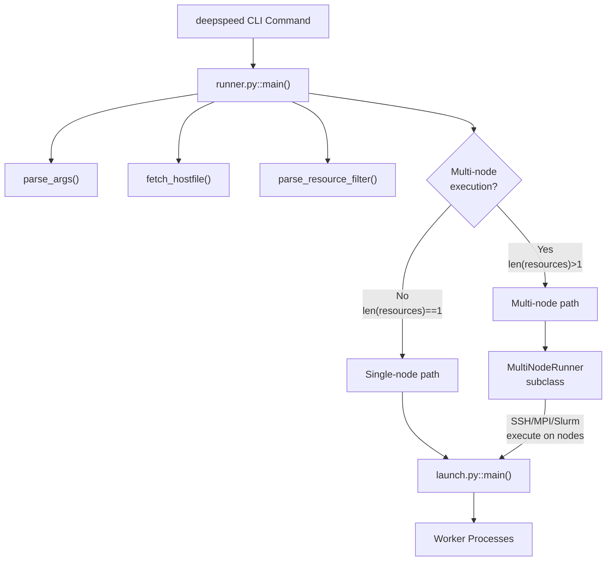
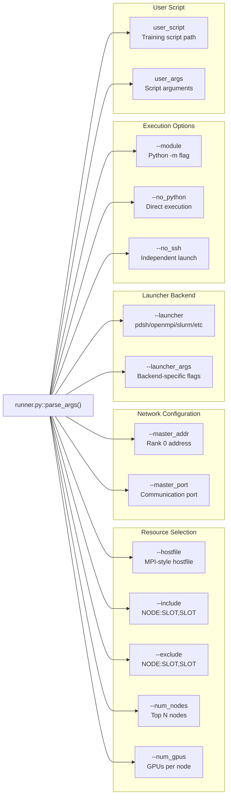
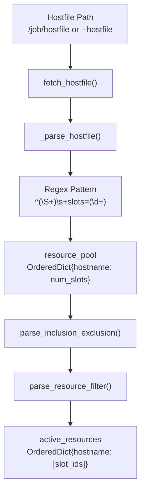
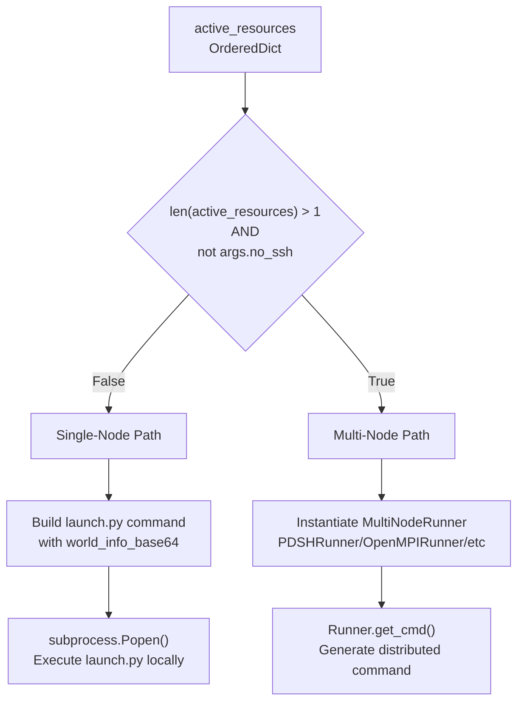
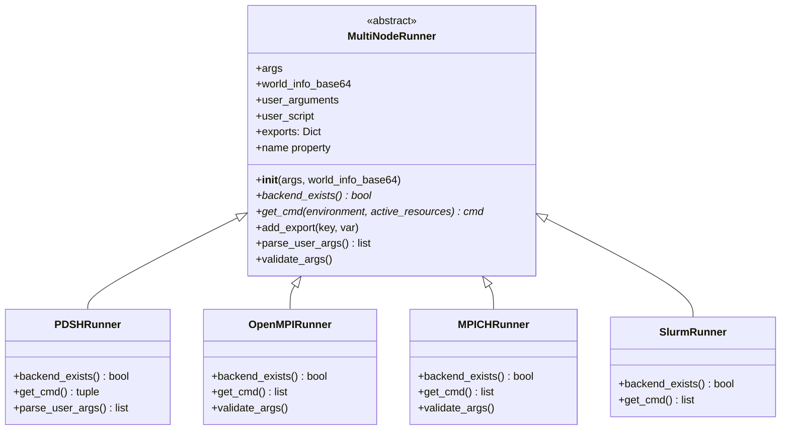
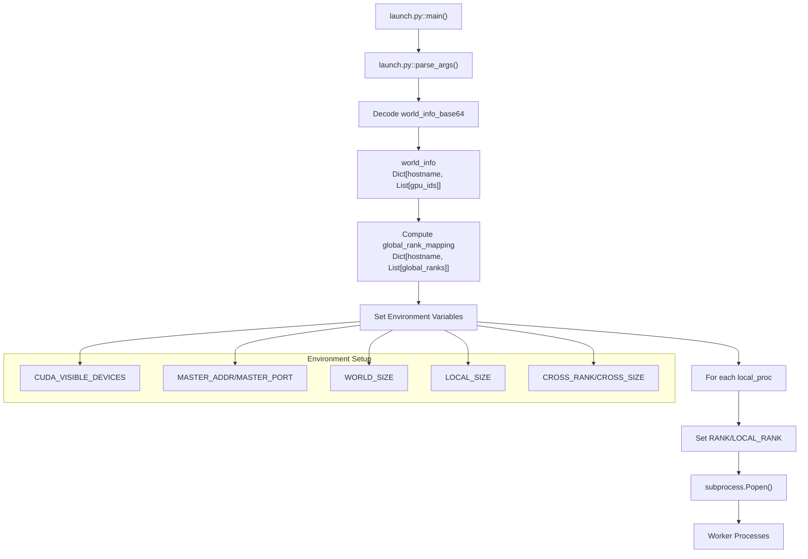
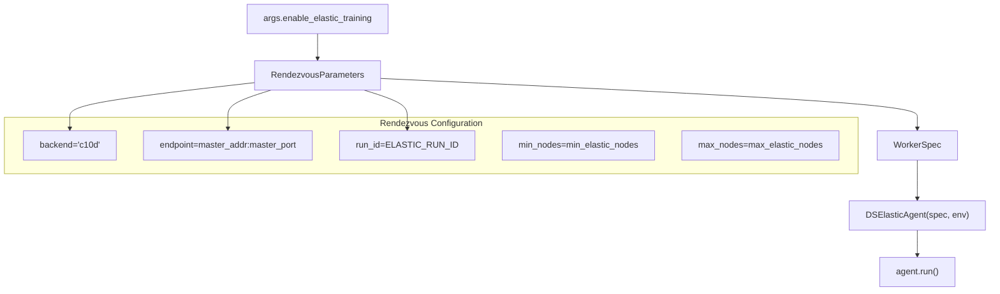

<!-- source: DeepWiki mcp.deepwiki.com · repo deepspeedai/DeepSpeed · page 8.1 Launcher Architecture · fetched 2026-10-21 -->

# Launcher Architecture

<details>
<summary>Relevant source files</summary>

The following files were used as context for generating this wiki page:

- [bin/deepspeed](bin/deepspeed)
- [bin/ds](bin/ds)
- [bin/ds_elastic](bin/ds_elastic)
- [bin/ds_report](bin/ds_report)
- [deepspeed/constants.py](deepspeed/constants.py)
- [deepspeed/elasticity/elastic_agent.py](deepspeed/elasticity/elastic_agent.py)
- [deepspeed/launcher/constants.py](deepspeed/launcher/constants.py)
- [deepspeed/launcher/launch.py](deepspeed/launcher/launch.py)
- [deepspeed/launcher/launcher_helper.py](deepspeed/launcher/launcher_helper.py)
- [deepspeed/launcher/multinode_runner.py](deepspeed/launcher/multinode_runner.py)
- [deepspeed/launcher/runner.py](deepspeed/launcher/runner.py)
- [deepspeed/runtime/checkpoint_engine/nebula_checkpoint_engine.py](deepspeed/runtime/checkpoint_engine/nebula_checkpoint_engine.py)
- [deepspeed/runtime/checkpoint_engine/torch_checkpoint_engine.py](deepspeed/runtime/checkpoint_engine/torch_checkpoint_engine.py)
- [deepspeed/runtime/eigenvalue.py](deepspeed/runtime/eigenvalue.py)
- [tests/unit/launcher/test_ds_arguments.py](tests/unit/launcher/test_ds_arguments.py)
- [tests/unit/launcher/test_multinode_runner.py](tests/unit/launcher/test_multinode_runner.py)
- [tests/unit/launcher/test_user_args.py](tests/unit/launcher/test_user_args.py)

</details>


## Purpose and Scope

This document describes the DeepSpeed launcher system, which orchestrates distributed training job execution across single or multiple nodes. The launcher handles command-line argument parsing, resource allocation from hostfiles, backend selection, and process spawning coordination. It provides a flexible interface to various cluster managers and communication backends while ensuring environment variables and topology information are correctly propagated to every training rank.

The launcher system consists of three main components:
1. **runner.py** - Main orchestration layer that parses arguments and selects execution strategy [deepspeed/launcher/runner.py:6-10]().
2. **MultiNodeRunner hierarchy** - Backend-specific implementations for PDSH, MPI, Slurm, etc [deepspeed/launcher/multinode_runner.py:19-53]().
3. **launch.py** - Single-node process spawner that creates worker processes on each node [deepspeed/launcher/launch.py:9-12]().

---

## Overall Architecture

The launcher follows a two-tier invocation model: the main `runner.py` orchestrates across nodes (tier 1), and `launch.py` spawns processes on each individual node (tier 2).



**Architecture Diagram: Two-Tier Launcher Execution Model**

Sources: [deepspeed/launcher/runner.py:436-656](), [deepspeed/launcher/launch.py:145-376]()

---

## Entry Point: runner.py::main()

The `main()` function in `runner.py` serves as the primary entry point for all distributed job launches. It performs the following sequence:

| Step | Function/Operation | Purpose |
|------|-------------------|---------|
| 1 | `parse_args()` | Parse command-line arguments including hostfile, include/exclude, launcher type [deepspeed/launcher/runner.py:48-227](). |
| 2 | `fetch_hostfile()` | Load and parse hostfile in MPI format (hostname slots=N) [deepspeed/launcher/runner.py:230-264](). |
| 3 | `parse_inclusion_exclusion()` | Filter resources based on `--include`/`--exclude` flags [deepspeed/launcher/runner.py:317-349](). |
| 4 | Determine execution mode | Single-node vs multi-node based on resource count [deepspeed/launcher/runner.py:545-578](). |
| 5 | Instantiate runner | Create appropriate `MultiNodeRunner` subclass or prepare `launch.py` command [deepspeed/launcher/runner.py:580-610](). |
| 6 | Build command | Generate execution command with environment variables [deepspeed/launcher/multinode_runner.py:34-35](). |
| 7 | `subprocess.Popen()` | Execute the command [deepspeed/launcher/runner.py:653](). |

Sources: [deepspeed/launcher/runner.py:436-656]()

---

## Command-Line Argument Parsing

The `parse_args()` function defines the launcher's CLI interface, categorizing options for resources, networking, and backends.



**Diagram: Command-Line Argument Categories**

Sources: [deepspeed/launcher/runner.py:48-227]()

---

## Hostfile Parsing and Resource Management

The launcher uses MPI-style hostfiles to define the resource pool. The `_parse_hostfile` function uses regex to extract hostnames and slot counts [deepspeed/launcher/runner.py:239-245]().



**Diagram: Hostfile Parsing Pipeline**

Hostfile format example:
```
worker-0 slots=8
worker-1 slots=8
```

The `parse_resource_filter()` function supports include/exclude syntax to sub-select GPUs [deepspeed/launcher/runner.py:351-399]():
- **Include**: `--include "worker-0@worker-1:0,2"` uses all slots on worker-0 and slots [0,2] on worker-1.
- **Exclude**: `--exclude "worker-1:0"` uses all resources except slot 0 on worker-1.

Sources: [deepspeed/launcher/runner.py:230-399]()

---

## Execution Path Decision: Single-Node vs Multi-Node

The launcher determines the execution strategy based on the active resource count and the presence of the `--no_ssh` flag [deepspeed/launcher/runner.py:545-578]().



**Diagram: Execution Strategy Selection**

The `encode_world_info()` function serializes the resource mapping as base64-encoded JSON, which is passed to `launch.py` on each node to inform it of the global topology [deepspeed/launcher/runner.py:401-404]().

Sources: [deepspeed/launcher/runner.py:401-404](), [deepspeed/launcher/runner.py:545-653]()

---

## MultiNodeRunner Class Hierarchy

The `MultiNodeRunner` abstract base class defines the interface for all backend implementations [deepspeed/launcher/multinode_runner.py:19-53]().



**Diagram: MultiNodeRunner Class Hierarchy**

Key methods:
- `backend_exists()`: Checks if the launcher backend is installed (e.g., `shutil.which('pdsh')`) [deepspeed/launcher/multinode_runner.py:60-61]().
- `get_cmd()`: Generates the backend-specific command to execute across nodes [deepspeed/launcher/multinode_runner.py:78-123]().
- `add_export()`: Adds environment variables to be exported to worker processes [deepspeed/launcher/multinode_runner.py:37-41]().

Sources: [deepspeed/launcher/multinode_runner.py:19-478]()

---

## launch.py: Single-Node Process Spawner

The `launch.py` module spawns worker processes on a single node. It computes the global rank for each local process by decoding the `world_info` [deepspeed/launcher/launch.py:157-180]().



**Diagram: launch.py Execution Flow**

Key variables set for every worker process [deepspeed/launcher/launch.py:182-225]():
- `RANK`: Global rank of the process.
- `LOCAL_RANK`: Rank of the process on the current node.
- `WORLD_SIZE`: Total number of processes in the job.
- `MASTER_ADDR`/`MASTER_PORT`: Coordination point for the distributed backend.

Sources: [deepspeed/launcher/launch.py:145-376]()

---

## Elastic Training Support

DeepSpeed integrates with PyTorch Elastic via `DSElasticAgent` [deepspeed/elasticity/elastic_agent.py:32-42](). This allows for fault-tolerant training where the world size can change dynamically.



**Diagram: Elastic Training Setup**

`DSElasticAgent` handles worker restarts and environment propagation [deepspeed/elasticity/elastic_agent.py:65-125](). It overrides `_start_workers` to ensure DeepSpeed-specific environment variables are correctly injected into the elastic worker environment [deepspeed/elasticity/elastic_agent.py:79-102]().

Sources: [deepspeed/launcher/launch.py:274-329](), [deepspeed/elasticity/elastic_agent.py:1-191]()

---

## Signal Handling and Process Cleanup

To prevent "zombie" processes or orphaned training ranks, both `runner.py` and `launch.py` implement signal handlers.

The `terminate_process_tree()` function in `launch.py` uses `psutil` to recursively find and kill all children of a given PID [deepspeed/launcher/launch.py:131-143]().

| Feature | Implementation | Purpose |
|---------|----------------|---------|
| **SIGINT/SIGTERM** | `signal.signal()` | Triggers graceful shutdown and cleanup [deepspeed/launcher/launch.py:333-335](). |
| **Process Tree** | `psutil.Process.children()` | Ensures all sub-ranks are caught [deepspeed/launcher/launch.py:132-133](). |
| **PDSH Kill** | `pkill -f` | `PDSHRunner` generates a remote kill command for multi-node cleanup [deepspeed/launcher/multinode_runner.py:122-123](). |

Sources: [deepspeed/launcher/launch.py:131-143](), [deepspeed/launcher/launch.py:333-372](), [deepspeed/launcher/multinode_runner.py:122-123]()

---

